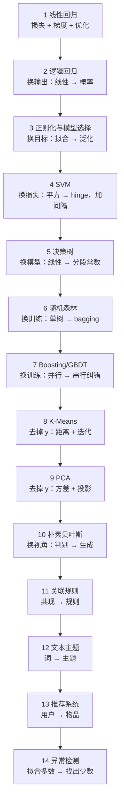

# p02-statistical-ml · 统计机器学习

> 这一族回答一个问题：**参数怎么从数据里学出来，又怎么保证学到的东西不只对这批数据有效？**
> 第一阶段（[p01-search](../p01-search/)）的规则、启发式、评估函数都是人写的；从这里开始，
> 模型从样本里拟合，泛化能力成为新的核心矛盾。
>
> 族内共 14 个实验，当前状态以 [`algorithms/README.md`](../README.md) 索引表为准。

## 1. 十四个实验一览

| # | 实验 | 章节 | 只回答一个问题 | 状态 |
|---|---|---|---|---|
| 1 | [线性回归与梯度下降](linear-regression/) | 3.2.1 | 梯度下降凭什么能收敛到最优？ | ✅ |
| 2 | [逻辑回归](logistic-regression/) | 3.2.1 | 线性输出怎么变成概率、损失为什么是交叉熵？ | ✅ |
| 3 | [正则化与模型选择](regularization/) | 3.2.1 | 为什么"训练误差最小"不等于"泛化最好"？ | ✅ |
| 4 | [SVM](svm/) | 3.2.2 | 最大间隔与核技巧解决了什么？ | ✅ |
| 5 | [决策树](decision-tree/) | 3.2.3 | 一次"划分"凭什么让不确定性下降？ | ✅ |
| 6 | [随机森林](random-forest/) | 3.3.1 | 为什么"多棵烂树"加起来会变稳？ | ✅ |
| 7 | [Boosting 与 GBDT](boosting/) | 3.3.2 | 为什么"串行纠错"能降偏差？ | ✅ |
| 8 | [K-Means](kmeans/) | 3.4.1 | 没有标签时，"好聚类"怎么定义？ | ✅ |
| 9 | [PCA](pca/) | 3.4.2 | 为什么"方差最大的方向"就是信息最多的方向？ | ✅ |
| 10 | [朴素贝叶斯](naive-bayes/) | 3.5 | "条件独立"这个强假设为什么还能用？ | ✅ |
| 11 | [关联规则 Apriori](association-rules/) | 3.6 | 买 A 的人为什么也买 B？ | ✅ |
| 12 | [文本主题模型](text-topic/) | 3.7 | 一堆文档在讲什么主题？ | ✅ |
| 13 | [推荐系统](recommender/) | 3.8 | 怎么猜用户没看过的物品？ | ✅ |
| 14 | [异常检测](anomaly-detection/) | 3.9 | 没有标签时，怎么定义"异常"？ | ✅ |

## 2. 依赖链：后面的实验在补前面的哪个零件

链上的每一跳只改一个零件：**输出、损失、模型形态、训练方式、标签、视角**。
把这五类改动看清，14 个实验就不是 14 份孤立的知识点。

## 3. 逐个说清：解决什么 + 核心量 + 边界

### 3.1 线性回归 —— 一切优化的起点

- 解决：从带噪声的样本里拟合线性关系；
- 核心量：MSE、梯度、学习率；
- 边界：只拟合线性关系、对离群点敏感、多重共线性会让系数不稳定。

### 3.2 逻辑回归 —— 从回归到分类

- 解决：输出 0/1 概率，而不是任意实数；
- 核心量：sigmoid、交叉熵、决策阈值；
- 边界：决策边界仍是线性的；类别不平衡时 accuracy 会骗人，要看 precision/recall/AUC。

### 3.3 正则化与模型选择 —— 从"拟合"到"泛化"

- 解决：模型太复杂时会记住噪声；用惩罚项与验证集把复杂度压回来；
- 核心量：L1/L2 惩罚、正则强度 λ、K 折交叉验证误差；
- 边界：λ 靠验证集选，不能看测试集；标准化会改变惩罚的几何意义。

### 3.4 SVM —— 最大间隔与核技巧

- 解决：在"能分开"的无数条线里，选一条离两类都最远的；
- 核心量：间隔、支持向量、hinge 损失、核函数；
- 边界：大规模数据训练贵；核与超参难调；对噪声与重叠类敏感（要用软间隔）。

### 3.5 决策树 —— 用"划分"代替"公式"

- 解决：非线性、特征交互、可解释规则；
- 核心量：信息增益 / 基尼指数、分裂点、树的深度；
- 边界：单树方差大、容易过拟合；对特征尺度不敏感是优点也是"看不见距离"的缺点。

### 3.6 随机森林 —— bagging 降方差

- 解决：单棵树不稳定；用 bootstrap + 特征随机训练很多棵再投票；
- 核心量：采样率、特征子集大小、OOB 误差；
- 边界：可解释性下降；对高维稀疏数据不如线性模型；不能外推。

### 3.7 Boosting / GBDT —— 串行纠错降偏差

- 解决：弱学习器逐个修正前一个的残差；
- 核心量：样本权重（AdaBoost）、残差与学习率（GBDT）、树的数量；
- 边界：串行训练难并行；对噪声与离群点敏感；学习率与树数要一起调。

### 3.8 K-Means —— 距离 + 迭代

- 解决：无标签时按"离哪个中心近"分群；
- 核心量：簇中心、inertia、k；
- 边界：假设簇是球形且大小相近；对初始化敏感（k-means++）；必须自己选 k。

### 3.9 PCA —— 方差最大的方向

- 解决：高维数据降维、去相关、可视化；
- 核心量：协方差矩阵、特征值/特征向量、解释方差比；
- 边界：只捕捉线性结构；对尺度敏感（必须先标准化）；主成分不一定可解释。

### 3.10 朴素贝叶斯 —— 强假设下的概率分类

- 解决：小样本、高维文本分类的快速基线；
- 核心量：先验、条件概率、拉普拉斯平滑；
- 边界：条件独立假设通常不成立，但分类边界有时仍然够用；概率校准差。

### 3.11 异常检测 —— 找出少数

- 解决：没有（或极少有）异常标签时，识别"不合群"的样本；
- 核心量：孤立森林的路径长度、LOF 的局部可达密度、异常分数；
- 边界：异常的定义依赖场景；阈值要按业务代价定；高维下距离类方法会失效。

## 4. 现实里谁在用

| 方向 | 典型场景 | 主要实验 |
|---|---|---|
| 金融风控 / 评分卡 | 违约概率、额度定价（可解释性要求高） | 线性/逻辑回归 + 正则化 |
| 工业预测维护 | 设备剩余寿命、故障预警（表格数据） | 随机森林、Boosting/GBDT |
| 推荐 / 广告 | 点击率预估、用户分群（特征工程 + 集成） | 逻辑回归、GBDT、K-Means |
| 图像 / 文本特征 | 传统特征 + 分类器（SVM 时代的标配） | SVM、PCA |
| 运营分析 | 用户分层、行为聚类、降维可视化 | K-Means、PCA |
| 平台稳定性 | 容量水位、异常工单、故障共现 | 异常检测、朴素贝叶斯 |

> 表格数据上，工业界最常见的组合仍是"**特征工程 + GBDT**"；深度模型在图像/文本/序列上更强，
> 但那是 p03 之后的内容。

## 5. 该读哪个

- **想理解"学习"本身**：1 → 2 → 3（损失、梯度、泛化三件套）；
- **想做表格预测**：5 → 6 → 7（树 → bagging → boosting，工业主力）；
- **想做分类边界**：2 → 4（线性 → 最大间隔/核）；
- **没有标签**：8 → 9（聚类 → 降维）；
- **想做概率、规则、主题、推荐与异常**：10 → 14。

## 6. 常见的三个误读

1. **"统计学习就是这 14 个算法"** —— 不是。这里覆盖第三章 3.2–3.9 的主线；
   3.6 关联规则、3.7 文本主题、3.8 推荐系统已补齐。
2. **"集成学习 = 随机森林"** —— 随机森林只是 bagging 一侧；Boosting（GBDT/XGBoost 系）
   在表格数据上往往更强，两者的差别是"并行降方差" vs "串行降偏差"。
3. **"无监督不需要评估"** —— 聚类要看 inertia、轮廓系数或与业务标签的 ARI；
   降维要看解释方差比与下游任务效果。没有标签不等于没有判据。

## 7. 本族的范围边界（没覆盖什么）

- 3.6/3.7/3.8 已补：关联规则、TF-IDF/NMF 主题、协同过滤/矩阵分解；
  但仍不是生产级实现（合成数据、无 FP-Growth/LDA/深度推荐）。
- **概率图模型**：只到朴素贝叶斯；HMM/CRF/高斯过程未展开（序列建模留给 p04 之后）。
- **时间序列**：ARIMA/状态空间模型不在本章；路线文档 12.2 有讨论，但没有对应实验。
- **深度学习**：属于 p03，不在这里提前讲。
- **3.3.3 Stacking / Blending**：折叠为 [Boosting 实验](boosting/README.md) §6 的延伸，不单开单元（核心是 OOF 防泄漏，一段代码可讲清）。
- **9.1 传统机器学习评估指标**：折叠为本节 + §10 的口径说明——准确率/精确率/召回率/F1、ROC-AUC/PR-AUC、MSE/MAE/R² 已在各实验的「实验结果」里用到；不单开实验，避免"指标课"脱离具体模型。

这三个折叠项与 13 个系统题的完整去向见 [路线覆盖与系统题边界](../docs/路线覆盖与系统题边界.md)。

## 8. 本族的产物约定

| 产物 | 位置 | 作用 |
|---|---|---|
| 学习文档 | `<实验>/README.md` | 基础篇 + 进阶篇两篇式 |
| 实现与对照 | `impl.py` + `framework.py` + `demo.py` | 手写 vs sklearn 同接口，双跑对账 |
| 测试 | `test_impl.py` | 梯度校验、最优性、数据契约、数值边界 |
| 素材 | `images/` + `make_teaching_assets.py` | 概念图 / 对比图 / 动画，脚本内与 impl 对账 |
| 练习 | `exercises/` | 5 题五级分级，题解分离 |
| 迁移项目 | `project/` | 非教学数据上的完整小系统 |

**状态**：14/14 完成（线性回归、逻辑回归、正则化、SVM、决策树、随机森林、Boosting/GBDT、K-Means、PCA、朴素贝叶斯、关联规则、文本主题、推荐系统、异常检测 ✅）；以 [`algorithms/README.md`](../README.md) 索引表为准。

## 9. 后续质量项（不阻塞当前 ✅）

以下问题在十四个已完成实验的评审中记录，按"收益/成本"排期，**做完再补文档与验证声明**：

| 项 | 落在哪 | 复杂度 | 计划 |
|---|---|---|---|
| 共线性 / 离群点量化 | 线性回归 | 中 | 与正则化的相关特征练习呼应 |
| SVM 测试补强（次梯度有限差分、γ 语义） | SVM | 小 | 与决策树并行 |
| 圆环素材改为训练集拟合、叠加测试点 | SVM 素材 | 小 | 下次素材轮 |
| 决策树测试补强（CCP 路径对拍、`min_samples_split` 边界） | 决策树 | 小 | 与随机森林并行 |
| 手写 CCP 路径，去掉对 sklearn alpha 序列的依赖 | 决策树 | 中 | 质量轮 |
| 主实验补「分歧 vs 深度」曲线 | 决策树素材 | 小 | 下次素材轮 |
| 随机森林测试补强（OOB 泄漏/无 OOB 树、`max_features` 边界） | 随机森林 | 小 | 与 Boosting 并行 |
| 抽取共享树模块，去掉决策树/随机森林的重复实现 | 决策树 / 随机森林 | 中 | 质量轮 |
| 项目树数网格扩到 200，演示 OOB 提前停 | 随机森林项目 | 小 | 下次素材轮 |
| AdaBoost.R2 回归（分类版已完成，R2 未做） | Boosting | 中 | 质量轮 |
| GBDT 分类（log loss + 回归树负梯度） | Boosting | 中 | ✅ 2026-10-23 |
| 补 subsample 实验与早停边界测试 | Boosting | 小 | 与 K-Means 并行 |
| 排查手写 vs sklearn 重要性量级差异 | Boosting | 小 | 下次素材轮 |
| 轮廓系数的采样/近似（大样本 O(n²)） | K-Means | 小 | 与 PCA 并行 |
| 空簇/重复中心的边界测试加强 | K-Means | 小 | 质量轮 |
| K 选择加 gap statistic / 稳定性选择 | K-Means | 中 | 质量轮 |
| `n_components` 超过 min(n,d) 时静默截断（sklearn 报错） | PCA | 小 | 质量轮 |
| PCA 补单特征/常数特征/whiten 逆变换测试 | PCA | 小 | 与朴素贝叶斯并行 |
| 核 PCA / 增量 PCA（非线性与大样本） | PCA | 中 | 质量轮 |
| 真实短信语料替换合成语料 | 朴素贝叶斯 | 中 | 质量轮 |
| 中文分词（jieba）接入词袋 | 朴素贝叶斯 | 小 | 质量轮 |
| Bernoulli / TF-IDF 进主实验（目前只在练习） | 朴素贝叶斯 | 中 | 质量轮 |
| 概率校准与过度自信的量化 | 朴素贝叶斯 | 小 | 质量轮 |
| 更难异常数据（局部/多峰），拉开 IF/LOF/KDE 差距 | 异常检测 | 中 | 质量轮 |
| LOF 训练分数与 novelty 打分口径统一 | 异常检测 | 小 | 质量轮 |
| PR-AUC / 代价曲线替代单一阈值指标 | 异常检测 | 小 | 质量轮 |
| KDE 带宽与阈值边界测试 | 异常检测 | 小 | 质量轮 |

已完成的质量修正：P3 测试缺口（`class_weight` 字典、强相关下的 Lasso KKT、CV 无泄漏断言）与耗时口径
（"仅同机对比"，不再写成普适倍数）。

**本轮质量轮已完成**：真实数据附录（线性回归 diabetes、逻辑回归 calibration 用 breast cancer）、
概率校准（Brier/ECE/Platt）、模型族同数据横向对照（§10）；多分类由决策树/随机森林/PCA 项目覆盖。

**已记录、不计划修**：RBF 的支持向量数比 sklearn 少 1（14 vs 15，SMO 与 libsvm 的数值路径不同，
只对线性核做严格一致性断言）；乳腺癌项目里核没有带来测试提升（0.9532 vs 0.9532），保留为
"核不是万能"的教学结论。

## 10. 阶段横向对照（同一份真实数据）

### 口径

- 这一节用 **sklearn 的成熟实现**做"选型级"横向比较；手写实现与框架的一致性由各实验的
  `demo.py` / `test_impl.py` 保证（误差在 1e-8 ~ 1e-3）。
- 复现：`uv run python p02-statistical-ml/stage_benchmark.py`
- 分类/回归用 5 折 CV；无监督用全量数据（K-Means/PCA）或 one-class 划分（异常检测）。
- 标准化只用于对距离/正则敏感的模型（逻辑、SVM、Ridge/Lasso）。

### 14 个实验的头条指标（各自数据，不能直接横比）

| # | 实验 | 数据 / 任务 | 头条指标 |
|---|---|---|---|
| 1 | 线性回归 | 合成 1D / 回归 | 测试 MSE 1.1818；diabetes R² 0.3929 |
| 2 | 逻辑回归 | 合成 2D / 二分类 | accuracy 0.8933、AUC 0.9618 |
| 3 | 正则化 | 合成 10 维 / 回归 | CV 选中 λ=0.0464，测试 MSE 8.6108（λ≈0 为 8.8634） |
| 4 | SVM | 同心圆 / 二分类 | RBF 测试 1.00，线性 0.67 |
| 5 | 决策树 | moons / 二分类 | 测试 0.8778；剪枝 13→9 叶、0.9333 |
| 6 | 随机森林 | moons / 二分类 | 测试 0.9444、OOB 0.9524；跨种子 σ 0.0044 |
| 7 | Boosting/GBDT | 1D 正弦 / 回归 | 测试 MSE 0.0305；早停 71 棵 0.0281 |
| 8 | K-Means | 3 团 / 聚类 | inertia 286.341、ARI 0.9703；轮廓峰值 k=3 |
| 9 | PCA | digits / 降维 | 90% 方差需 21 个主成分；重建 MSE 1.817 |
| 10 | 朴素贝叶斯 | 合成短信 / 文本二分类 | 测试 0.9889；高斯 2D 0.9333 |
| 11 | 关联规则 | 300 购物篮 / 规则 | 265 项集、534 规则；与暴力基线一致 |
| 12 | 文本主题 | 24 文档 / NMF | 重构 4.326→3.252；纯度 1.000 |
| 13 | 推荐系统 | 120 用户 / top-k | MF NDCG@10 0.252、RMSE 1.248 |
| 14 | 异常检测 | 2D 正常+异常 | AUC 1.000；精确率 IF 0.870 / LOF 0.976 |

> 这些数字来自各实验自己的数据与切分，**只能看量级/结论，不能直接排名**；
> 真正的同数据横比见下面三张表。

### 二分类：breast cancer（569×30，5 折 CV）

| 模型 | accuracy | F1 | ROC-AUC |
|---|---|---|---|
| 逻辑回归 | **0.9789** | **0.9834** | 0.9955 |
| RBF-SVM | 0.9771 | 0.9819 | **0.9957** |
| 决策树（depth=4） | 0.9262 | 0.9419 | 0.9207 |
| 随机森林（200） | 0.9667 | 0.9736 | 0.9919 |
| GBDT（100） | 0.9701 | 0.9765 | 0.9940 |
| 高斯 NB | 0.9385 | 0.9522 | 0.9885 |

### 回归：diabetes（442×10，5 折 CV）

| 模型 | RMSE | R² |
|---|---|---|
| 线性回归 | **54.527** | **0.4892** |
| RidgeCV | 54.612 | 0.4879 |
| LassoCV | 54.643 | 0.4872 |
| 随机森林（200） | 57.830 | 0.4266 |
| GBDT（100） | 57.230 | 0.4349 |

### 无监督：digits

| 任务 | 结果 |
|---|---|
| K-Means（k=10） | ARI **0.6657**，轮廓 **0.1825** |
| PCA（90% 方差） | **21** 个主成分，重建 MSE **1.817** |
| 异常检测（one-class，0 vs 其他） | IF AUC **0.9998**、LOF **1.0000**、KDE **0.9857** |

### 五条结论

1. **小样本表格数据上，线性模型仍然是强基线**：逻辑回归在二分类上 accuracy/F1 最高；
   糖尿病的线性/Ridge/Lasso 也优于 RF/GBDT。
2. **复杂模型不是自动更好**：随机森林/GBDT 在 569/442 样本上没有超过线性模型；
   它们要在更大数据、强非线性/交互上才发挥优势。
3. **树单棵最弱**：决策树 accuracy 0.926、AUC 0.921，明显低于集成；这就是随机森林/GBDT 的动机。
4. **高斯 NB 是"快而糙"的基线**：训练 0.4ms 级，accuracy 低约 0.04；文本场景另算（多项式 NB 很强）。
5. **无监督也能给出可用结果**：K-Means 在 digits 上 ARI 0.67；PCA 21 个主成分保留 90% 方差；
   one-class 异常检测 AUC 接近 1（数据可分，见异常检测的局限说明）。

> 选型不是"谁分数高选谁"：还要看样本量、线性性、可解释性、推理延迟、维护成本。

