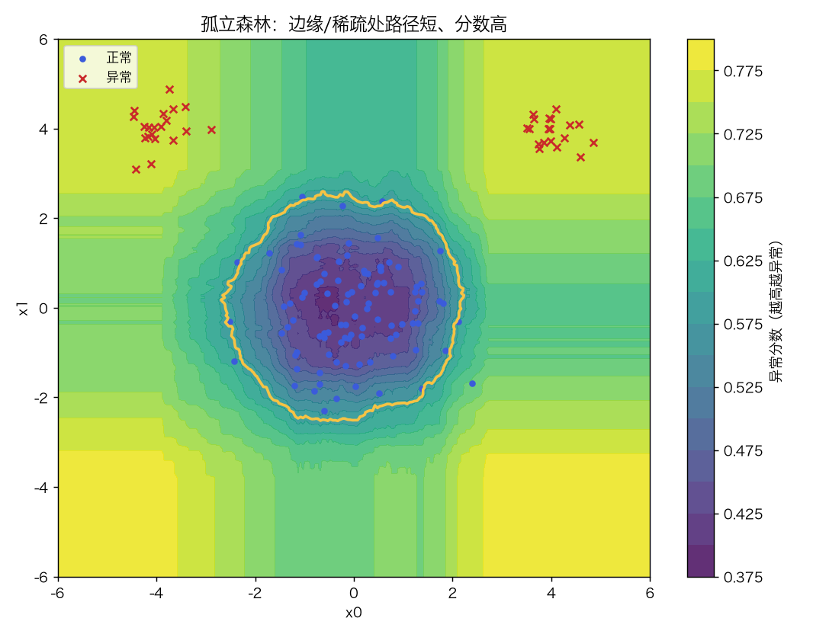
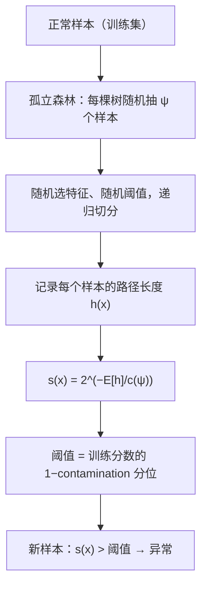
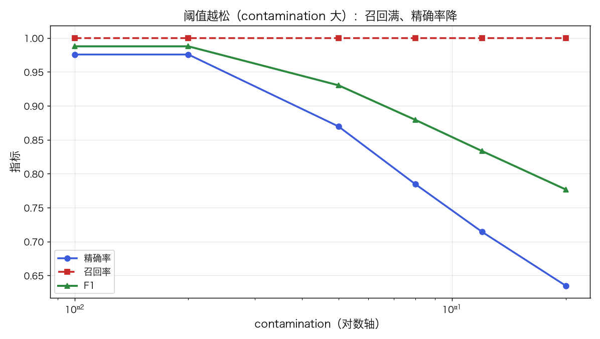
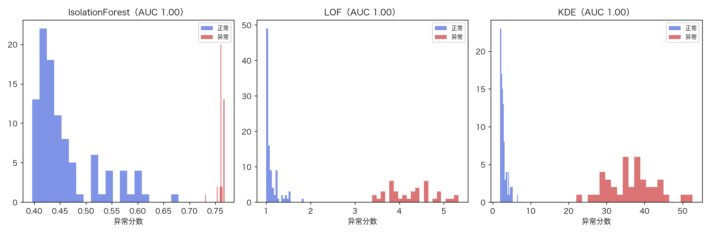
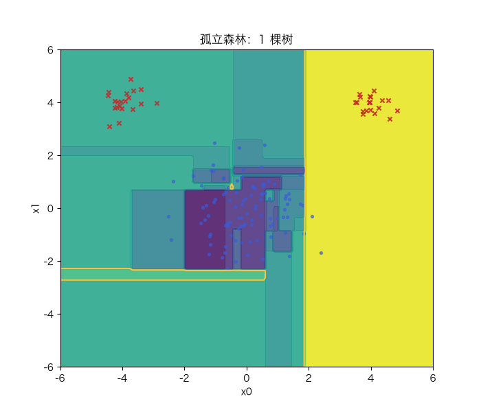

# 异常检测：孤立森林、LOF 与阈值选择

> 状态：✅ 已完成（2026-10-21）
> 对应文档章节：`../../docs/人工智能代表算法演进路线.md` 第 3.9 章
> 阅读路线：零基础读者读「基础篇」（生活类比 → 手算 → 白话 → 自测）；要看推导、实现与复现实验读「进阶篇」
> 本族共 14 个实验，学习顺序与选读建议见 [族级导读](../README.md)。

无监督估计器（统计机器学习族）：入口是 `IsolationForest / LOF / KDE` 的 `fit(X)` → `score_samples(X)`（越大越异常）→ `predict(X)`（1 异常 / −1 正常），实现在 [impl.py](impl.py)；对照是 [framework.py](framework.py) 的 sklearn 实现。**训练可以只用正常样本**。

## 读之前：一个任务，三种“打分器”

异常检测是任务；孤立森林、LOF、KDE 是三种不同的打分器：

| 方法 | 异常的定义 | 强项 |
|---|---|---|
| 孤立森林 | 随机切分下路径短 | 全局稀疏、高维较稳 |
| LOF | 局部密度比邻居低 | 局部异常 |
| KDE | 密度低（负 log 密度高） | 有明确密度模型 |

三者都输出“越大越异常”的分数，再用 `contamination` 定阈值；**不是三个不同的任务**。

# 基础篇 · 先搞懂它

## 1. 生活类比：怎么认出"不合群"的人

一群人站成几堆，有一个人孤零零站在远处——你一眼就看出他不合群。
你不需要知道"正常长什么样"，只需要判断"他有多容易被单独圈出来"。

异常检测就是干这个：**正常样本很密、异常样本很稀疏**。
孤立森林用"随机切几刀，谁先被单独切出来"衡量稀疏；LOF 用"我的邻居有多密"衡量局部稀疏；
KDE 直接估计密度。三者都不需要异常标签。

## 2. 核心量：异常分数、contamination、AUC

**异常分数** `s(x)`：越大越异常。三种定义：

- **孤立森林**：`s(x)=2^{−E[h(x)]/c(ψ)}`，`h` 是路径长度，`c(ψ)` 是修正项；
- **LOF**：`LOF(x)=mean(lrd(邻居))/lrd(x)`，局部密度比；
- **KDE**：`s(x)=−log p̂(x)`，密度越低分数越高。

**阈值**：用训练分数的 `1−contamination` 分位数。`contamination` 是"预期异常比例"，
不是真实标签比例；它直接决定精确率/召回率的取舍。

**评估**：AUC 只看排序（与阈值无关）；精确率/召回率需要阈值，也就依赖 contamination。

## 3. 主循环：随机切分 / 近邻密度

LOF 的主循环不同：算每个点到 k 个邻居的可达距离 → 局部可达密度 `lrd` → 邻居 `lrd` 均值 / 自己的 `lrd`。

## 4. 手算示例：路径越短越异常

孤立树用 `ψ=4` 个样本，修正项：

$$c(4)=2(\ln 3+\gamma)-\frac{2\cdot3}{4}\approx 1.852$$

两个样本的路径长度分别是 `h=1` 与 `h=3`：

| 样本 | h | 分数 `2^{−h/c}` |
|---|---|---|
| A | 1 | `2^{−0.540}≈0.688` |
| B | 3 | `2^{−1.620}≈0.326` |

A 的路径更短 → 更容易被孤立 → 分数更高 → 更可能是异常。
**路径长度是"切几刀才能把它单独圈出来"的度量**。

## 5. 白话版：为什么"容易被孤立"就是异常、阈值怎么定

**为什么孤立森林有效**：正常点成团，随机切很多刀才能把某个正常点单独切出来；
异常点远离人群，切一两刀就落单。树越多，路径长度越稳。

**LOF 的局部性**：如果一个点在一个稀疏区域，但它的邻居也都很稀疏，它未必异常；
LOF 比较的是"我的密度 vs 邻居的密度"，所以能发现**局部异常**（紧挨着密集簇的离群点）。

**阈值是业务选择**：contamination=1% 意味着"只报最可疑的 1%"，精确率高、召回低；
contamination=20% 则相反。没有标签时，阈值只能靠业务代价/验证集定。

**AUC=1 不代表能直接用**：排序完美，但阈值可能偏松/偏紧（项目里 KDE 就是 AUC 1.0、
精确率 0.63）。

## 6. 常见误区

- **❌ "异常检测需要异常标签"** —— 这些方法训练可以只用正常样本；标签只用于评估。
- **❌ "contamination 是真实异常比例"** —— 它是你愿意报警的比例，直接影响精确率/召回率。
- **❌ "AUC 高就够了"** —— 还要看阈值下的精确率/召回率与业务代价。
- **❌ "把异常样本混进训练集没关系"** —— 会污染"正常"的密度/切分，阈值也会漂。
- **❌ "LOF 和孤立森林总是一样"** —— LOF 看局部密度，IF 更偏全局；数据不同结论会反过来。
- **❌ "分数方向无所谓"** —— 密度/距离类方法要确认"越大越异常"，方向弄反全错。

## 7. 看图：分数与阈值

contamination 越大，召回率很快到 1，精确率下降；F1 在某个中间值最好。

三种方法的正常/异常分数分布都有重叠，但异常整体更高。

1→100 棵树：分数图从粗糙变平滑，阈值线逐渐稳定——森林平均掉了单棵树的随机性。

## 8. 掌握清单：五级能力与自测

| 级别 | 能力 | 本实验的检验方式 | 在哪做 |
|---|---|---|---|
| 1 说清 | 用自己的话讲规则 | 说出路径长度、LOF、密度分数、contamination 各是什么 | 基础篇「核心量」「白话版」 |
| 2 走通 | 纸上手算 | 给定 `ψ=4` 与两个路径长度，算 `c(4)` 与分数 | 基础篇「手算示例」节 |
| 3 判断 | 说清正确性条件 | 写出孤立森林分数、LOF 的 lrd、阈值分位；解释 AUC 与阈值指标的区别 | 进阶篇「数学推导」 |
| 4 实现 | 手写并与对照比对 | 跑通 `demo.py`，解释 AUC/精确率与 sklearn 对齐 | 进阶篇「实验结果」 |
| 5 迁移 | 用到新问题 | 在真实 one-class 数据上比较三种方法并选阈值 | [project/](project/README.md) |

**自测关卡（先预测，再跑代码验证）**：

1. `ψ` 越大，`c(ψ)` 与分数会怎么变？
2. contamination 从 1% 加到 20%，精确率/召回率各怎么变？
3. 训练集混入 5% 异常，阈值会偏松还是偏紧？
4. 为什么 KDE 的 AUC 可以是 1.0、精确率却只有 0.63？

# 进阶篇 · 实验档案

## 目录形态（本算法的"类型"）

| 文件 | 角色 | 入口 / 说明 |
|---|---|---|
| [impl.py](impl.py) | 手写实现 | `IsolationForest`、`LOF`、`KDE`，统一 `score_samples/predict` |
| [framework.py](framework.py) | 框架对照 | sklearn `IsolationForest` / `LocalOutlierFactor` / `KernelDensity` |
| [demo.py](demo.py) | 同数据双跑 | 三组实验：方法对比 / 阈值扫描 / 分数分离度 |
| [test_impl.py](test_impl.py) | 性质测试 | 分数范围、排序、阈值分位、对照、契约 |
| [make_teaching_assets.py](make_teaching_assets.py) | 素材生成 + 对账 | 分数图 / 阈值曲线 / 三方法分布 |
| [exercises/](exercises/README.md) | 练习（5 题，题解分离） | 概念、手算、诊断、实现、迁移 |
| [project/](project/README.md) | 迁移项目 | 真实手写数字 one-class：IF/LOF/KDE 对比与阈值 |

## 1. 设计原理

异常检测是"单类建模"：只学正常样本的分布/几何，把偏离得远的点标成异常。
孤立森林用**随机划分的路径长度**近似"孤立难度"；LOF 用**局部密度比**；
KDE 用**核密度**。三者对"异常"的定义不同，所以结果可能互补。

## 2. 数学推导

**孤立森林**：对 `ψ` 个样本建随机树，样本 `x` 的路径长度 `h(x)`；
平均路径 `E[h]` 越短越异常：

$$s(x)=2^{-\frac{E[h(x)]}{c(\psi)}},\qquad
c(n)=2(\ln(n-1)+\gamma)-\frac{2(n-1)}{n}$$

`c(ψ)` 把路径长度归一化到"随机 BST 的平均深度"。

**LOF**：k-距离 `kdist(x)`，可达距离

$$d_{\text{reach}}(x,z)=\max(kdist(z),d(x,z))$$

局部可达密度 `lrd(x)=1/mean(d_reach)`，LOF 为邻居 `lrd` 均值 / 自己的 `lrd`。

**KDE**：`p̂(x)=1/(n h^d) Σ_i K((x−x_i)/h)`，高斯核；分数 `−log p̂(x)`。

**阈值**：`τ=quantile({s(x_i)}, 1−contamination)`；`predict=1[s>τ]`。

**AUC**：随机取一个正常、一个异常，异常分数更高的概率；与阈值无关。

## 3. 手写实现要点

1. **孤立树随机切分**：随机选非零方差特征、在 min/max 间均匀取阈值；空孩子就停。
2. **路径长度**：叶节点返回 `depth + c(叶样本数)`，不是只返回深度。
3. **LOF 的 novelty**：训练时存 `lrd`、`kdist`；测试点用训练邻居的 `lrd`，
   不能拿测试点自己的邻居重算（那会漏掉"训练分布"）。
4. **分数方向统一**：KDE 返回 `−log density`，保证"越大越异常"。
5. **阈值只在训练分数上定**：不能看测试集；contamination 是预期报警比例。
6. **隔离森林的 ψ**：默认 256；ψ 越小树越浅、分数方差越大。

## 4. 框架对照

sklearn 的 `IsolationForest` / `LocalOutlierFactor(novelty=True)` / `KernelDensity`
与手写版在同一数据上 AUC 一致（IF 1.000 vs 1.000；LOF 1.000 vs 1.000；KDE 1.000 vs 1.000）。
差异在工程：sklearn 用 C/多线程、更成熟的子采样与 `offset_` 约定；
`LocalOutlierFactor` 默认 `novelty=False`（只能 fit_predict），要用 `novelty=True` 才能 `predict` 新样本。

## 5. 实验结果

**环境**：uv 环境（`uv sync --extra dev`），Python 3.13.15 / numpy 2.5.4 / scikit-learn 1.9.1。
**数据**：二维正常样本 `N(0,I)`（训练 300、测试 100）+ 40 个异常（`[4,4]`/`[-4,4]` 附近）。
**复现**：本目录内 `uv run python demo.py`、`uv run pytest test_impl.py -q`、
`uv run python make_teaching_assets.py`。

**实验一：三种检测器（训练只用正常样本，contamination=5%）**

| 方法 | AUC | 精确率 | 召回率 | 耗时（ms） |
|---|---|---|---|---|
| 手写 IForest | 1.000 | 0.870 | 1.000 | 95.6 |
| 手写 LOF | 1.000 | 0.976 | 1.000 | 2.3 |
| 手写 KDE | 1.000 | 0.851 | 1.000 | 0.4 |
| sklearn IForest | 1.000 | 0.870 | 1.000 | — |
| sklearn LOF | 1.000 | 0.889 | 1.000 | — |
| sklearn KDE | 1.000 | — | — | — |

**实验二：contamination 扫描（IsolationForest）**

| contamination | 精确率 | 召回率 | F1 |
|---|---|---|---|
| 0.01 | 0.976 | 1.000 | 0.988 |
| 0.02 | 0.976 | 1.000 | 0.988 |
| 0.05 | 0.870 | 1.000 | 0.930 |
| 0.08 | 0.784 | 1.000 | 0.879 |
| 0.12 | 0.714 | 1.000 | 0.833 |
| 0.20 | 0.635 | 1.000 | 0.777 |

**实验三：分数分离度**

正常平均 **0.460**，异常平均 **0.762**；分布有重叠，阈值决定取舍。

**验证声明（已验证）**：输入为上述数据与种子；2026-10-21 在 uv 环境实跑，
`uv run python demo.py` 输出上表；`uv run pytest test_impl.py -q` → **9 passed**；
`uv run python make_teaching_assets.py` 对账通过（手写 AUC 1.000 与 sklearn 一致）。

**可视化结论**：

- `images/00-孤立森林分数.png`：边缘/稀疏处分数高，阈值线之外判异常；
- `images/01-阈值扫描.png`：contamination 越大，精确率降、召回满；
- `images/02-三种方法分数.png`：三种分数的正常/异常分布；
- `images/03-森林分数生长.gif`：树数增加时孤立森林分数图的收敛。

## 6. 局限与延伸

- **contamination 是假设**：真实异常比例未知；阈值要按业务代价/验证集定。
- **高维稀疏**：距离/密度在高维退化；孤立森林相对稳，但也要特征选择。
- **局部 vs 全局**：LOF 擅长局部异常，IF 偏全局；没有一种方法全能。
- **训练集污染**：正常样本里混入异常会抬高阈值、降低召回。
- **KDE 的带宽**：`h` 太小过拟合、太大过平滑；高维还要更多样本。
- **下游**：时序异常（突变点/滑窗）、图异常、深度异常检测（自编码器/对比学习）。
- **合成数据太可分**：三方法 AUC 都是 1.0，差异主要落在阈值；需要更难的局部/多峰异常数据。
- **LOF 训练分数口径**：`score_samples(X_train)` 会把样本自己当最近邻（距离 0），与 fit 内部的 LOF 不完全一致；本实现只把它用于新样本打分。
- **阈值/PR 指标**：项目里 KDE 的 AUC=1.0 但精确率 0.63；低异常率场景应看 PR-AUC 与业务代价。
