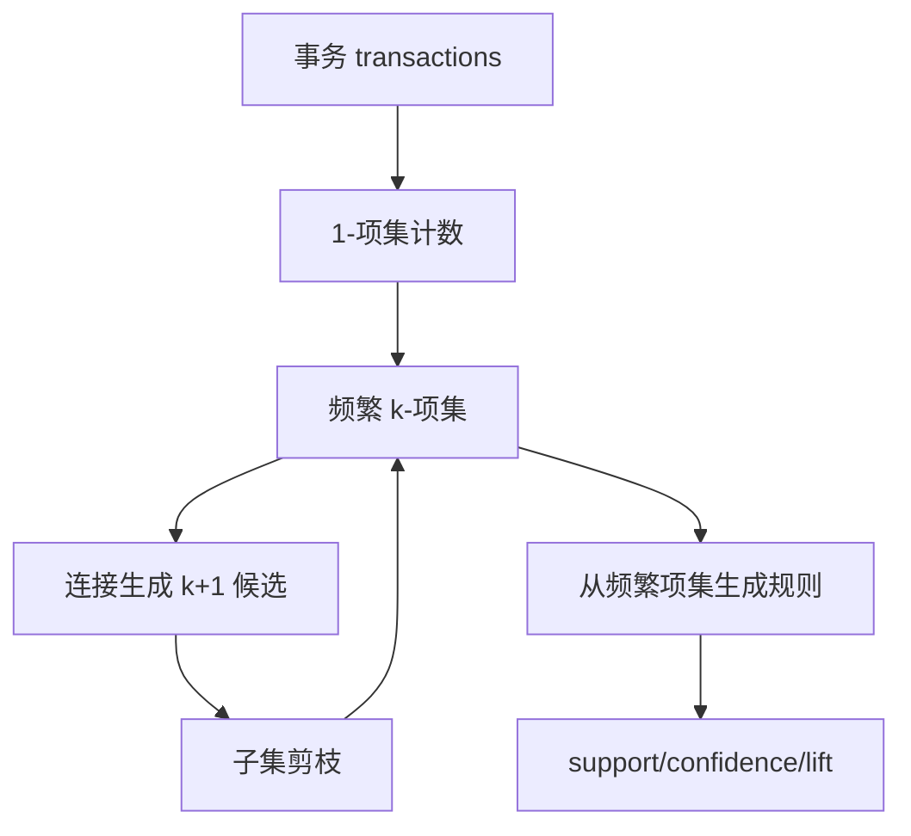
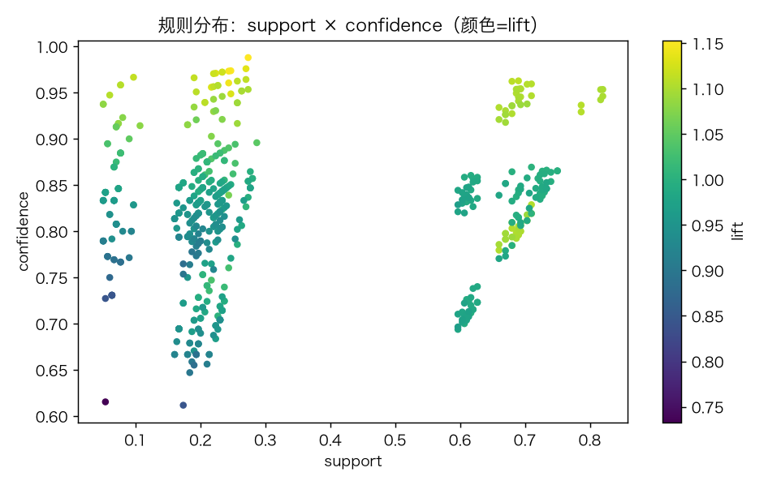
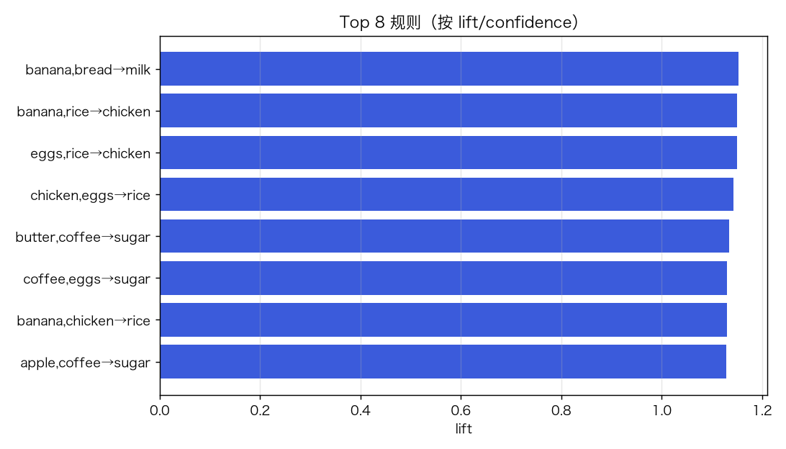
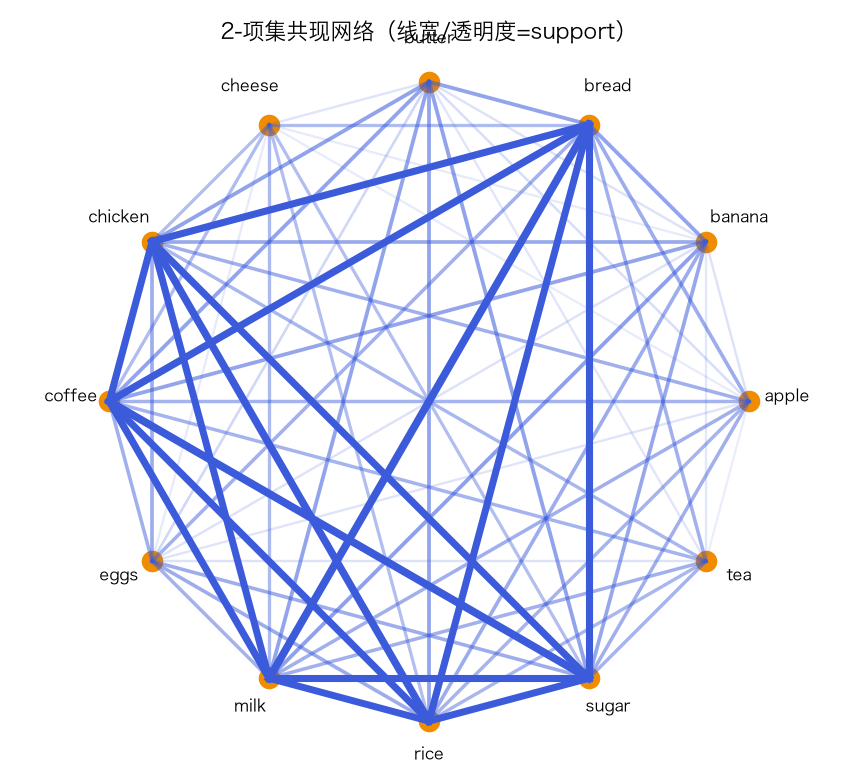
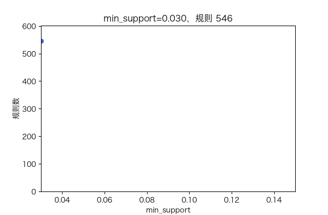

# 关联规则 Apriori：频繁项集、支持度/置信度/提升度

> 状态：✅ 已完成（2026-10-23）
> 对应文档章节：`../../docs/人工智能代表算法演进路线.md` 第 3.6 章
> 阅读路线：零基础读者读「基础篇」（生活类比 → 手算 → 白话 → 自测）；要看推导、实现与复现实验读「进阶篇」
> 本族共 14 个实验，学习顺序见 [族级导读](../README.md)。

无监督估计器（统计机器学习族）：入口是 `Apriori(min_support, max_len).fit(transactions)` / `rules(min_confidence)`，实现在 [impl.py](impl.py)；对照是 [baseline.py](baseline.py) 的暴力枚举（小数据）。

# 基础篇 · 先搞懂它

## 1. 生活类比：超市购物篮

“买面包的人经常也买牛奶。”关联规则就是从一堆购物篮里找这种搭配：

- **支持度**：同时买 A、B 的篮子占比；
- **置信度**：买了 A 的人里，也买 B 的比例；
- **提升度**：置信度 / B 本身的支持度；>1 才说明 A 真的提升了 B。

## 2. 核心量：项集、支持度、置信度、提升度

- 项集：若干商品的集合；
- `support(X)=count(X)/N`；
- `confidence(A→B)=support(A∪B)/support(A)`；
- `lift(A→B)=confidence/support(B)`。

**Apriori 性质**：频繁项集的所有子集也频繁；反之，含非频繁子集的项集一定不频繁。用它剪枝。

## 3. 主循环：候选 → 计数 → 剪枝 → 生成规则

## 4. 手算示例

5 个篮子：`{a,b},{a,b,c},{a,c},{b,c},{a,b,c,d}`。

`support({a,b})=3/5=0.6`；`support({a})=4/5=0.8`；`support({b})=4/5=0.8`。

规则 `a→b`：`confidence=0.6/0.8=0.75`；`lift=0.75/0.8=0.9375 <1`。
规则 `d→a`：`support({a,d})=1/5=0.2`，`confidence=0.2/0.2=1.0`，`lift=1/0.8=1.25`。

## 5. 白话版：为什么剪枝有效、提升度为什么重要

- **剪枝**：如果 `{A,B}` 不频繁，任何包含它的更大集合都不可能频繁；不用再数。
- **置信度会骗人**：B 本来就很常见时，A→B 的置信度自然高；lift 扣掉这个底。
- **支持度门槛**：太低会爆出大量偶然规则；太高会漏掉长尾。
- **规则不是因果**：只是共现，不能直接当“买 A 导致买 B”。

## 6. 常见误区

- **❌ "置信度高就是好规则"** —— 还要看 lift 和支持度。
- **❌ "支持度越低越好"** —— 规则数量爆炸，多数是噪声。
- **❌ "关联=因果"** —— 只是共现。
- **❌ "Apriori 能处理很大数据"** —— 候选爆炸；大数据用 FP-Growth/并行。
- **❌ "规则越多越好"** —— 要按 lift/置信度/业务过滤。
- **❌ "负相关规则也能直接提"** —— 本实现只生成正项集规则，不挖掘 negated rules。

## 7. 看图：支持度、规则与网络

support × confidence，颜色是 lift。

按 lift/confidence 排序的规则。

商品共现网络。

阈值变化时规则数量的变化。

## 8. 掌握清单：五级能力与自测

| 级别 | 能力 | 本实验的检验方式 | 在哪做 |
|---|---|---|---|
| 1 说清 | 用自己的话讲规则 | 支持度/置信度/提升度、Apriori 性质 | 基础篇「核心量」「白话版」 |
| 2 走通 | 纸上手算 | 5 个篮子的 support/conf/lift | 基础篇「手算示例」节 |
| 3 判断 | 说清正确性条件 | 剪枝、阈值、共现≠因果 | 基础篇「白话版」 |
| 4 实现 | 手写并与对照比对 | 跑通 demo，与暴力枚举一致 | 进阶篇「实验结果」 |
| 5 迁移 | 用到新问题 | 购物篮推荐/规则筛选 | [project/](project/README.md) |

**自测关卡**：

1. `{A,B}` 不频繁，`{A,B,C}` 可能频繁吗？
2. 置信度 0.8、B 支持度 0.8，lift 是多少？
3. 支持度阈值降低，规则数量会怎样？

# 进阶篇 · 实验档案

## 目录形态（本算法的"类型"）

| 文件 | 角色 | 入口 / 说明 |
|---|---|---|
| [impl.py](impl.py) | 手写实现 | `Apriori`、`Rule`、子集生成 |
| [baseline.py](baseline.py) | 暴力基线 | 枚举所有子集，小数据对账 |
| [demo.py](demo.py) | 同数据双跑 | 频繁项集 / Top 规则 / 暴力对照 |
| [test_impl.py](test_impl.py) | 性质测试 | 支持度、置信度/lift、暴力一致、契约 |
| [make_teaching_assets.py](make_teaching_assets.py) | 素材生成 + 对账 | 散点 / Top / 网络 / GIF |
| [exercises/](exercises/README.md) | 练习（5 题，题解分离） | 概念、手算、诊断、实现、迁移 |
| [project/](project/README.md) | 迁移项目 | 购物篮规则筛选 |

## 1. 设计原理

Apriori 逐层生成候选，用“子集必须频繁”剪枝；规则由频繁项集拆 antecedent/consequent 得到。
支持度控制频率，置信度控制可靠性，lift 控制“是否比基率高”。

## 2. 数学推导

`support(X)=|{t:X⊆t}|/N`；`confidence(A→B)=support(A∪B)/support(A)`；
`lift=confidence/support(B)`。

若 `support(A∪B)<min_support`，则任何超集都不频繁（反单调性）。

## 3. 手写实现要点

1. **候选连接**：只合并前 k−2 项相同的频繁项集。
2. **子集剪枝**：候选的所有 k 子集必须频繁。
3. **规则拆分**：对每个频繁项集枚举所有非空真子集。
4. **lift**：必须除以 consequent 的支持度。
5. **确定性**：项排序后生成，避免集合顺序漂移。

## 4. 框架对照

本实验的对照是**暴力枚举**（不是 sklearn）：小数据上逐项集计数，验证 Apriori 的剪枝没有漏项。
大数据可换 FP-Growth/prefixspan；本实验不实现。

## 5. 实验结果

**环境**：uv（`uv sync --extra dev`），Python 3.13.15 / numpy 2.5.4；CPU。
**数据**：12 种商品、300 个合成购物篮；植入 `bread→milk`、`coffee→sugar`、`chicken→rice`。
**复现**：本目录 `uv run python demo.py`、`uv run pytest test_impl.py -q`、`uv run python make_teaching_assets.py`。

| 指标 | 值 |
|---|---|
| 频繁项集（min_support=0.05, max_len=3） | 265 |
| 规则（min_confidence=0.5） | 534 |
| Apriori 耗时 | 4.2ms |
| 小样本 60：Apriori vs 暴力 | 271 vs 271，集合一致 |
| 暴力耗时 | 0.7ms |

**Top 规则**：`{banana,bread}→milk` sup .273 / conf .988 / lift 1.15；
`{coffee,butter}→sugar` sup .270 / conf .976 / lift 1.13。

**验证声明（已验证）**：2026-10-23 实跑；`uv run pytest test_impl.py -q` → **9 passed**；
demo 输出上表；素材对账通过（与暴力一致）。

**可视化结论**：支持度-置信度散点集中在高置信区；Top 规则 lift 仅 1.1–1.2，说明共现提升有限；网络图显示三个植入簇。

## 6. 局限与延伸

- **合成数据**：规则是植入的，指标不代表真实零售。
- **候选爆炸**：Apriori 只适合小/中数据；大数据用 FP-Growth。
- **只正项集**：不挖负相关/否定规则。
- **共现≠因果**：没有时间顺序/干预。
- **单一 min_support**：长尾规则可能被一刀切掉。
- **下游**：FP-Growth → 序列模式 → 推荐系统（p02 3.8）。

**已记录、不阻塞**：合成数据、无 FP-Growth、无负规则、无因果推断。
