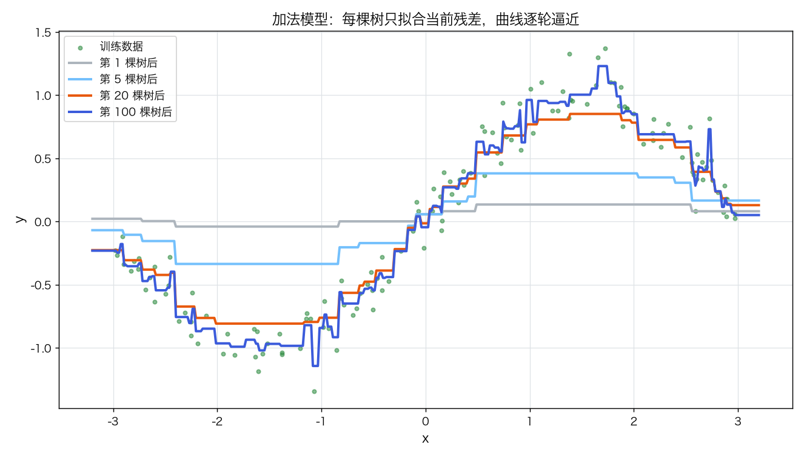
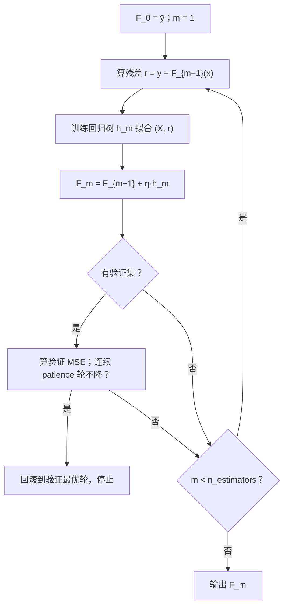
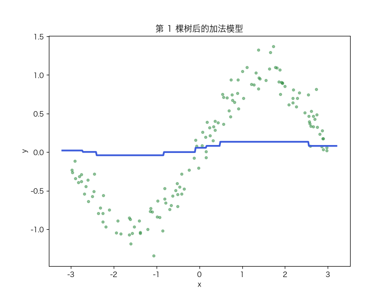

# Boosting 与 GBDT：加法模型、残差拟合、学习率与早停

> 状态：✅ 已完成（2026-10-23）
> 对应文档章节：`../../docs/人工智能代表算法演进路线.md` 第 3.3.2 章（集成学习 · Boosting 系列）
> 阅读路线：零基础读者读「基础篇」（生活类比 → 手算 → 白话 → 自测）；要看推导、实现与复现实验读「进阶篇」
> 本族共 14 个实验，学习顺序与选读建议见 [族级导读](../README.md)。

监督估计器（统计机器学习族）：入口是 `GradientBoostingRegressor(n_estimators, learning_rate, max_depth, subsample).fit(X, y, eval_set=..., early_stopping_rounds=...)`，实现在 [impl.py](impl.py)；对照是 [framework.py](framework.py) 的 sklearn `GradientBoostingRegressor`。它是 [决策树](../decision-tree/) 的**串行**集成：每棵新树只拟合当前模型的残差。

# 基础篇 · 先搞懂它

## 1. 生活类比：接力改错，而不是各自投票

随机森林是"一群专家各自做题、投票"；Boosting 是"一个学生先做，老师指出错在哪里，
下一个学生专门改这类错，再下一个改剩下的错……"——**串行**地补短板。

每棵树不需要很强（深度 3 的"弱学习器"就够），只要它总在修正前一轮的残差，
加起来就能逼近复杂曲线。这就是"三个臭皮匠"的另一种用法：不是投票，而是**接力**。

## 2. 核心量：加法模型、残差、学习率、早停

**加法模型**：

$$F_m(x)=F_{m-1}(x)+\eta\cdot h_m(x),\qquad F_0(x)=\bar y$$

**残差**（平方损失下的负梯度）：

$$r_i=y_i-F_{m-1}(x_i)$$

`h_m` 是一棵回归树，拟合 `(x_i, r_i)`；`η` 是**学习率**（shrinkage），控制每棵树走多远。

- `η` 小：每步稳、需要更多树；
- `η` 大：收敛快、容易过冲；
- **早停**：在验证集上盯住误差，连续若干轮不降就停，并回滚到验证最优的那一轮。

## 3. 主循环：串行拟合残差

## 4. 手算示例：四个点、一棵树桩

`y = [1, 2, 3, 4]`、`x = [0, 1, 2, 3]`，`η = 0.5`。

| 步骤 | 计算 | 结果 |
|---|---|---|
| 基线 | `F_0 = ȳ` | 2.5 |
| 残差 | `y − F_0` | `[−1.5, −0.5, 0.5, 1.5]` |
| 树桩切分 | `x ≤ 1.5`：左 `[−1.5,−0.5]`、右 `[0.5,1.5]` | 左均值 −1，右均值 +1 |
| 更新 | `F_1 = 2.5 + 0.5·h_1` | `[2.0, 2.0, 3.0, 3.0]` |
| MSE | 之前 `1.25`，之后 `0.5` | 降了一半多 |

第二轮的残差变成 `[−1, 0, 0, 1]`，下一棵树继续修正——每一步只走 `η` 这么远，
所以需要"多棵小树"而不是"一棵大树"。

## 5. 白话版：为什么 Boosting 降偏差、为什么学习率与早停重要

**降偏差**：随机森林平均的是"各自独立的高方差树"，降的是方差；
Boosting 每棵树都在补前一轮的**系统性误差**，降的是偏差。所以它能把训练误差压得很低，
也更容易过拟合。

**学习率是"步子大小"**：`η=1` 等于每棵树全盘接受，容易一步跨过最优；
`η=0.05` 让每棵树只贡献一点，靠"多走几步"逼近，泛化更稳。

**早停是"看验证集刹车"**：训练误差几乎总在降，验证误差会先降后升；
连续 `patience` 轮不降就停，并把模型回滚到验证最好的那一轮——这是最便宜的正则化。

**与随机森林的分工**：Bagging 并行、降方差、树可以很深；Boosting 串行、降偏差、
树要浅（通常 3–8 层）、学习率小、树多。

## 6. 常见误区

- **❌ "树越多越好"** —— 没有早停/正则化时，训练后期会过拟合；验证误差才是刹车。
- **❌ "学习率不影响结果"** —— `η` 与树数强耦合；η 小需要更多树，η 大更容易过冲。
- **❌ "早停可以用测试集"** —— 那就泄漏了；必须用训练集内部切出的验证集或 CV。
- **❌ "GBDT 能外推"** —— 预测是分段常数之和，超出训练范围不会延展趋势。
- **❌ "AdaBoost 和 GBDT 是一回事"** —— AdaBoost 用样本重加权 + 弱分类器投票；
  GBDT 用函数空间的梯度/残差。二者是 Boosting 的两条历史路线。

## 7. 动起来看：逐轮逼近

第 1、2、5、…、100 棵树：曲线从一条水平线开始，逐轮把残差"吃掉"。

## 8. 掌握清单：五级能力与自测

| 级别 | 能力 | 本实验的检验方式 | 在哪做 |
|---|---|---|---|
| 1 说清 | 用自己的话讲规则 | 说出加法模型、残差、学习率、早停各是什么；解释 Boosting 为什么降偏差 | 基础篇「核心量」「白话版」 |
| 2 走通 | 纸上手算 | 给定 4 个点与 η=0.5，算一轮树桩更新后的预测与 MSE | 基础篇「手算示例」节 |
| 3 判断 | 说清正确性条件 | 写出平方损失的负梯度、早停的 patience/回滚逻辑 | 进阶篇「数学推导」 |
| 4 实现 | 手写并与对照比对 | 跑通 `demo.py`，解释同参数下测试 MSE 为何与 sklearn 一致 | 进阶篇「实验结果」 |
| 5 迁移 | 用到新问题 | 在真实回归数据上用验证集早停，并与线性/森林对照 | [project/](project/README.md) |

**自测关卡（先预测，再跑代码验证）**：

1. 固定 100 棵树，lr 从 0.01 加到 1.0，训练/测试 MSE 各怎么变？
2. 早停通常在第几轮停下？比"跑满 300 棵"好还是差？
3. 为什么验证误差会先降后升，而训练误差一直降？
4. 把学习率减半，树数大概要怎么变？

# 进阶篇 · 实验档案

## 目录形态（本算法的"类型"）

| 文件 | 角色 | 入口 / 说明 |
|---|---|---|
| [impl.py](impl.py) | 手写实现 | `_RegTree` + `GradientBoostingRegressor` + `GradientBoostingClassifier` + `AdaBoostClassifier` |
| [framework.py](framework.py) | 框架对照 | sklearn `GradientBoostingRegressor` / `GradientBoostingClassifier` / `AdaBoostClassifier` |
| [demo.py](demo.py) | 同数据双跑 | 五组实验：回归对照 / 学习率 / 早停 / 重要性 / 分类扩展 |
| [test_impl.py](test_impl.py) | 性质测试 | 回归 + 分类：单调/早停/staged/F1 对照/契约 |
| [make_teaching_assets.py](make_teaching_assets.py) | 素材生成 + 对账 | 逐轮加法 / 学习率曲线 / 早停 / 残差动画 |
| [exercises/](exercises/README.md) | 练习（5 题，题解分离） | 概念、手算、诊断、实现、迁移 |
| [project/](project/README.md) | 迁移项目 | 真实回归（糖尿病）上的早停与模型对照 |

## 1. 设计原理

GBDT 把模型看成**函数**，在函数空间做梯度下降：每棵树拟合当前函数的负梯度，
再乘学习率加回去。平方损失下负梯度就是残差，所以实现异常简单；
换成 log loss / Huber，只需换梯度与叶子值，框架不变。

它承接决策树的"弱学习器"，与随机森林形成对照：一个并行降方差，一个串行降偏差。

## 2. 数学推导

**平方损失**：`L(y,F)=½(y−F)²`，负梯度 `−∂L/∂F = y−F = r`。

**函数空间梯度下降**：

$$F_m=F_{m-1}-\eta\cdot g_m,\qquad g_m\approx \text{拟合负梯度的回归树}$$

**叶子值**：对平方损失，叶子取残差均值即可（本实现）；对 log loss 等，
需要 Newton 步 `Σr / Σp(1−p)`。

**早停**：设验证误差 `v_m`，最优轮 `m* = argmin v_m`；
当 `m − m* ≥ patience` 时停止，并返回 `F_{m*}`。

**学习率与树数的耦合**：把 `η` 减半，通常要把树数约翻倍才能达到相近的训练误差；
但泛化最优的 `(η, m)` 要在验证集上一起选。

## 3. 手写实现要点

1. **回归树用 SSE 划分**：排序后前缀和算左右 SSE，`gain = parent_sse − left_sse − right_sse`。
2. **先算残差再建树**：树拟合的是 `y − F`，不是 `y`；忘了这一步就退化成"重复拟合同一目标"。
3. **学习率乘在树上**：`F += η * tree.predict(X)`，不是替换。
4. **早停要回滚**：记录验证最优轮，截断 `trees` 与 score 列表，`predict` 只用保留下来的树。
5. **staged_predict**：第 0 个是基线，之后逐轮 yield，方便画学习曲线。
6. **重要性在树内按 SSE 下降累加**，森林/提升取平均再归一化。

## 4. 框架对照

sklearn `GradientBoostingRegressor` 与手写版同参数（100 棵、lr=0.1、depth=3）时，
测试 MSE 都是 **0.0305**、R² 都是 **0.9448**——数值上完全对齐。

| 维度 | 手写 | sklearn |
|---|---|---|
| 树实现 | Python 逐节点排序 | C 级增量/直方图 |
| 早停 | 手写 patience + 回滚 | `n_iter_no_change` / `validation_fraction` |
| 损失 | 平方损失 | 平方、绝对、Huber、分位数 |
| 耗时 | 34.5 ms | 11.0 ms（同机同次） |

## 5. 实验结果

**环境**：uv 环境（`uv sync --extra dev`），Python 3.13.15 / numpy 2.5.4 / scikit-learn 1.9.1。
**数据**：1D `y=sin(x)+0.15·noise`（`n=200`，`seed=0`，70/30 切分）；多特征
`make_regression(n=400, p=10, n_informative=4, noise=10, shuffle=False)`。
**复现**：本目录内 `uv run python demo.py`、`uv run pytest test_impl.py -q`、
`uv run python make_teaching_assets.py`。

**实验一：手写 vs sklearn（100 棵，lr=0.1）**

| 方法 | 训练 MSE | 测试 MSE | 测试 R² | 耗时（ms） |
|---|---|---|---|---|
| 手写 GBDT | 0.0063 | 0.0305 | 0.9448 | 34.45 |
| sklearn GBR | 0.0063 | 0.0305 | 0.9448 | 10.99 |

**实验二：学习率扫描（100 棵）**

| lr | 训练 MSE | 测试 MSE |
|---|---|---|
| 0.01 | 0.0884 | 0.1084 |
| 0.05 | 0.0110 | **0.0286** |
| 0.10 | 0.0063 | 0.0305 |
| 0.30 | 0.0007 | 0.0389 |
| 1.00 | 0.0000 | 0.0433 |

lr 小拟合不足；lr 大训练误差趋 0、测试变差；本数据最优在 0.05。

**实验三：树数与早停（300 棵上限，lr=0.05）**

| 模型 | 实际树数 | 验证 MSE | 测试 MSE |
|---|---|---|---|
| 不早停 | 300 | — | 0.0345 |
| 早停 | **71** | 0.0143 | **0.0281** |

验证最优在第 71 轮；早停用 1/4 的树数拿到更好的测试结果。

**实验四：多特征重要性（前 6）**

| rank | 特征 | 手写 | sklearn |
|---|---|---|---|
| 1 | x2 | 0.2035 | 0.3461 |
| 2 | x0 | 0.1753 | 0.3090 |
| 3 | x3 | 0.1610 | 0.1855 |
| 4 | x1 | 0.1586 | 0.1489 |
| 5 | x4（噪声） | 0.0774 | 0.0013 |
| 6 | x7（噪声） | 0.0639 | 0.0021 |

前 4 正好是真特征；手写与 sklearn 的量级有差异（树的随机性/实现细节），排序一致。

**实验五：AdaBoost / GBDT 分类（breast cancer，50 轮）**

| 模型 | acc | F1 |
|---|---|---|
| AdaBoost 手写 | **0.959** | **0.967** |
| AdaBoost sklearn | 0.942 | 0.953 |
| GBDT 手写 | 0.930 | 0.944 |
| GBDT sklearn | 0.936 | 0.949 |

分类扩展保持二分类；AdaBoost 用样本重加权 + 树桩投票，GBDT 用 log loss 负梯度。

**验证声明（已验证）**：输入为上述数据与种子；2026-10-23 在 uv 环境实跑，
`uv run python demo.py` 输出上表；`uv run pytest test_impl.py -q` → **14 passed**；
`uv run python make_teaching_assets.py` 对账通过（手写 vs sklearn 测试 MSE 差 0.0000；
早停 71 轮）。耗时数字随机器浮动 `[随环境/版本变化]`。

**可视化结论**：

- `images/00-逐轮加法.png`：第 1 棵是分段常数，第 100 棵已贴合正弦；
- `images/01-学习率与树数.png`：lr 小下降慢，lr 大早期快但后期测试回升；
- `images/02-早停.png`：训练 MSE 一直降，验证 MSE 在第 71 轮见底；
- `images/03-残差拟合.gif`：逐轮"吃掉"残差的过程。

## 6. 局限与延伸

- **平方损失对离群点敏感**：一个极端点会拉偏残差；需要 Huber/分位数损失。
- **不能外推**：分段常数之和在训练范围外是平的。
- **串行训练慢**：树必须一棵棵来；现代实现用直方图/并行/近似分裂（XGBoost、LightGBM）。
- **超参强耦合**：`(learning_rate, n_estimators, max_depth, subsample)` 要一起用验证集选。
- **分类只做二分类**：log loss + 回归树拟合负梯度；多分类 softmax 未实现。
- **GBDT 分类不是 Newton 叶子值**：用回归树拟合负梯度，和 XGBoost 的叶子值不同。
- **AdaBoost 只做二分类树桩**：没有多分类 SAMME、没有 depth>1 弱学习器。
- **subsample 未展开**：参数已支持，但主实验没有专门的 subsample 曲线/测试。
- **重要性的绝对值与 sklearn 不可直接比**：排序一致，但量级有差异（如 x2 手写 0.20、
  sklearn 0.35），原因是树的实现/随机性不同；只比较排序更稳。
- **下游**：[XGBoost/LightGBM](../boosting/) 在 GBDT 上加二阶信息、正则化与工程优化；
  SHAP 等解释工具也常建立在树集成上。
