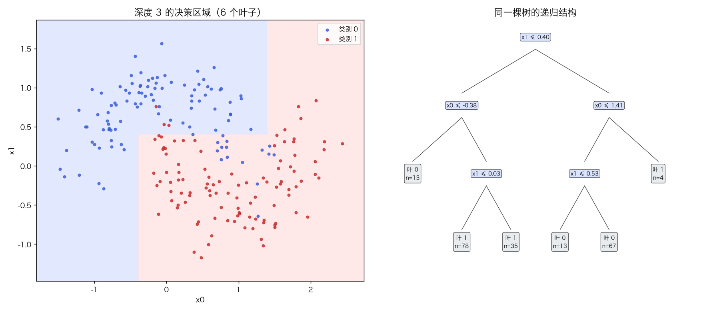
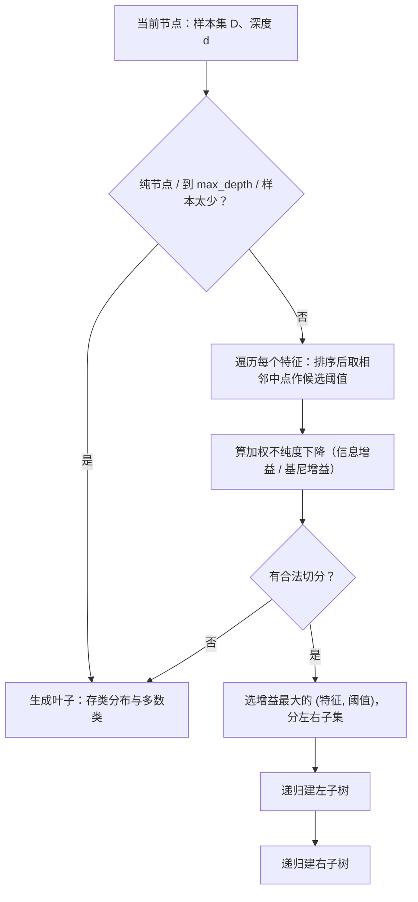
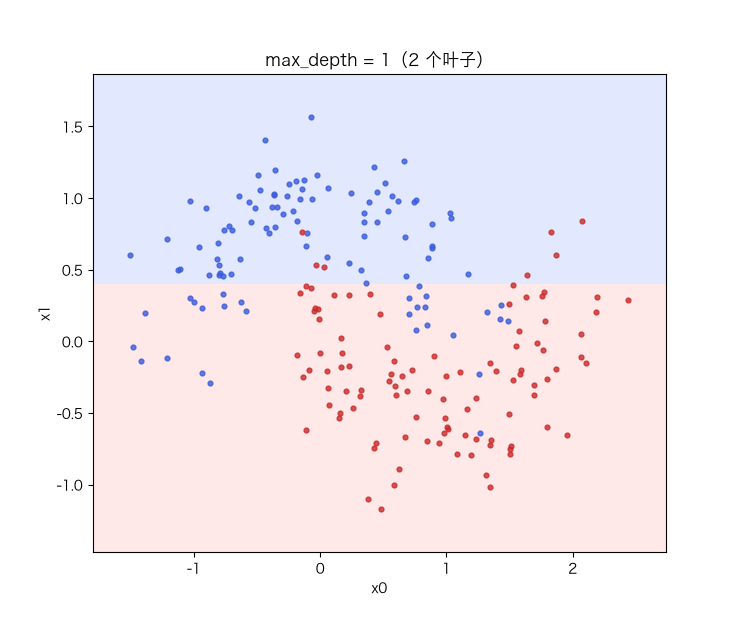

# 决策树：信息增益、基尼指数、剪枝与不稳定性

> 状态：✅ 已完成（2026-10-21）
> 对应文档章节：`../../docs/人工智能代表算法演进路线.md` 第 3.2.3 章
> 阅读路线：零基础读者读「基础篇」（生活类比 → 手算 → 白话 → 自测）；要看推导、实现与复现实验读「进阶篇」
> 本族共 14 个实验，学习顺序与选读建议见 [族级导读](../README.md)。

监督估计器（统计机器学习族）：入口是 `DecisionTree(criterion, max_depth, min_samples_leaf, ccp_alpha).fit(X, y) / predict(X)`，实现在 [impl.py](impl.py)；对照是 [framework.py](framework.py) 的 sklearn `DecisionTreeClassifier`。**没有梯度下降**：树的生长是递归划分，这是与前面四个实验最本质的区别。

# 基础篇 · 先搞懂它

## 1. 生活类比：二十问游戏

猜一个人在想什么，你只能问"是/否"问题。好问题的标准是：**问完之后，可能性减少得最多**。
"是地球人吗？"比"今天星期一吗？"有用得多——因为前者把候选集对半砍，后者几乎不改变分布。

决策树就是自动挑这种问题：每个节点选一个特征、一个阈值，把数据切成两半，
让两边的"不纯度"尽量低；切到足够纯，就停下来。

## 2. 核心量：不纯度、信息增益、剪枝

**不纯度**衡量一堆标签有多"杂"。两种常用定义：

$$H(D)=-\sum_k p_k\log_2 p_k \qquad \text{(熵，ID3)}$$

$$\text{Gini}(D)=1-\sum_k p_k^2 \qquad \text{(基尼，CART)}$$

二分类、两类各一半时：熵 = 1，基尼 = 0.5；纯节点两者都是 0。

**信息增益** = 划分前的不纯度 − 两个子节点不纯度的加权平均：

$$\text{Gain}=I(D)-\frac{n_L}{n}I(D_L)-\frac{n_R}{n}I(D_R)$$

每次选 Gain 最大的 `(特征, 阈值)`，递归下去。

**剪枝**：完全长成的树会把训练集的噪声也切出来。代价复杂度剪枝给"叶子数"标价：

$$R(T)=\sum_{\text{叶子 }t}\frac{n_t}{N}I(t),\qquad
\alpha_{\text{eff}}=\frac{R(\text{节点})-R(\text{子树})}{\text{子树叶子数}-1}$$

`α` 越大，越倾向把子树剪成一个叶子。`ccp_alpha` 就是这个阈值。

## 3. 主循环：递归划分

## 4. 手算示例：四个样本、两种切法

标签 `[0, 0, 1, 1]`（`n=4`，两类各半）。

**划分前**：熵 `H = 1`，基尼 `G = 0.5`。

**切法 A**：左边 `[0,0]`、右边 `[1,1]`（完美切分）。

| 准则 | 子节点加权不纯度 | 增益 |
|---|---|---|
| 熵 | `(2/4)·0 + (2/4)·0 = 0` | `1 − 0 = 1` |
| 基尼 | `0` | `0.5 − 0 = 0.5` |

**切法 B**：左边 `[0,0,1]`、右边 `[1]`。

| 准则 | 左子节点 | 加权 | 增益 |
|---|---|---|---|
| 熵 | `H(1/3,2/3)=0.918` | `0.75×0.918=0.689` | `1−0.689=0.311` |
| 基尼 | `1−(1/3)²−(2/3)²=0.444` | `0.75×0.444=0.333` | `0.5−0.333=0.167` |

两种准则都选 A。**熵和基尼的排序大多数时候一致**，差别只在临界情形。

## 5. 白话版：为什么树容易过拟合、为什么不稳定

**为什么容易过拟合**：树可以一直切，直到每个叶子只剩一个样本——训练误差 0，
但它记住的是"这批样本的偶然性"。深度越大，切出来的方块越碎，边界越贴噪声。

**为什么剪枝有用**：把"叶子数"写进目标，相当于问"多切一刀带来的纯度提升，
值不值得多一个叶子"。α 小 → 树大；α 大 → 树小。

**为什么不稳定**：每个节点只选"当前最优"的切分；训练集稍微变一点，
根节点的最优特征可能就换了，整棵树跟着改。实验五里，bootstrap 重采样后
两棵树的测试预测平均有 **17%** 不一致——这不是 bug，是树本身的方差。
注意"预测分歧"不随深度单调增：低噪声时深树可能更准也更稳；噪声大时深树追噪声，
不稳定性才明显（见练习 5）。

**为什么不用标准化**：树只比较"阈值两边"，特征的单调变换不改变划分，所以对量纲不敏感。

## 6. 常见误区

- **❌ "树越深越好"** —— 训练误差会降，测试误差不一定；深度是最重要的正则化旋钮。
- **❌ "熵和基尼差别很大"** —— 二者形状相似，多数数据上准确率接近；基尼少一次 log，工程更常用。
- **❌ "剪枝只是为了跑得快"** —— 剪枝是正则化，主要目的是泛化，不是速度。
- **❌ "树不需要预处理，所以随便喂"** —— 缺失值、类别编码、极端不平衡仍要处理；树只是对单调缩放不敏感。
- **❌ "两棵树结果差很多说明实现有 bug"** —— 换样本/换种子结构变化是树的固有方差。

## 7. 动起来看：树是怎么长出来的

深度从 1 加到 8：方块越切越碎，训练集被逐渐"包围"。

## 8. 掌握清单：五级能力与自测

| 级别 | 能力 | 本实验的检验方式 | 在哪做 |
|---|---|---|---|
| 1 说清 | 用自己的话讲规则 | 说出熵/基尼/信息增益/剪枝各是什么；解释树为什么不稳定 | 基础篇「核心量」「白话版」 |
| 2 走通 | 纸上手算 | 给定 4 个标签，算两种切法的熵/基尼增益 | 基础篇「手算示例」节 |
| 3 判断 | 说清正确性条件 | 写出递归终止条件、候选阈值怎么取、ccp_alpha 的公式 | 进阶篇「数学推导」 |
| 4 实现 | 手写并与对照比对 | 跑通 `demo.py`，解释同参数下叶子数/预测为何与 sklearn 一致 | 进阶篇「实验结果」 |
| 5 迁移 | 用到新问题 | 在真实三分类数据上做深度/CV/剪枝，并量化不稳定性 | [project/](project/README.md) |

**自测关卡（先预测，再跑代码验证）**：

1. 深度从 1 加到 10，训练/测试准确率、叶子数各怎么变？
2. 同一份数据，gini 与 entropy 的树会完全一样吗？
3. 为什么 `ccp_alpha` 太大时测试准确率会掉？
4. 把训练集重采样 20 次，树的测试预测平均分歧大概多少？

# 进阶篇 · 实验档案

## 目录形态（本算法的"类型"）

| 文件 | 角色 | 入口 / 说明 |
|---|---|---|
| [impl.py](impl.py) | 手写实现 | `entropy` / `gini`、递归 CART、`ccp_alpha` 剪枝、特征重要性 |
| [framework.py](framework.py) | 框架对照 | sklearn `DecisionTreeClassifier` + 剪枝路径 |
| [demo.py](demo.py) | 同数据双跑 | 五组实验：对照 / 准则 / 深度 / 剪枝 / 不稳定性 |
| [test_impl.py](test_impl.py) | 性质测试 | 不纯度、切分、深度/叶约束、剪枝、概率、契约 |
| [make_teaching_assets.py](make_teaching_assets.py) | 素材生成 + 对账 | 边界+树结构 / 深度曲线 / 剪枝曲线 / 生长动画 |
| [exercises/](exercises/README.md) | 练习（5 题，题解分离） | 概念、手算、诊断、实现、迁移 |
| [project/](project/README.md) | 迁移项目 | 真实三分类（葡萄酒）上的深度/CV/剪枝/不稳定性 |

## 1. 设计原理

前面的模型都在找一个**全局**的参数化边界（线性/核/距离）；树找的是**分段常数**边界：
每次只切一刀，切出来的每个方块给一个类。优点是自动做特征选择、能处理非线性与交互、
天然多分类；代价是高方差、边界只能是轴对齐的。

它也是集成学习的基座：随机森林 = bagging + 特征随机，GBDT = 树的加法模型。

## 2. 数学推导

**不纯度**：设节点有 `n` 个样本、第 k 类 `n_k` 个，`p_k=n_k/n`。熵、基尼如上。

**划分增益**：对候选 `(j, t)`，令 `D_L={x:x_j≤t}`、`D_R` 为补集：

$$\text{Gain}(j,t)=I(D)-\frac{|D_L|}{|D|}I(D_L)-\frac{|D_R|}{|D|}I(D_R)$$

**候选阈值**：连续特征排序后取相邻不同值的中点；`m` 个不同值有 `m−1` 个候选。
本实现每个特征排序一次 `O(n log n)`，再前缀和统计各类计数，整体 `O(d·n²)`（教学规模足够）。

**代价复杂度**：对树 `T`，`R(T)` 是叶子不纯度的样本加权和。
把节点 `t` 的子树剪成叶子，风险变化 `R(t)−R(T_t)`，叶子减少 `|T_t|−1`，
所以"每减少一个叶子的平均风险"是

$$\alpha_{\text{eff}}(t)=\frac{R(t)-R(T_t)}{|T_t|-1}$$

反复剪掉 `α_eff` 最小的节点，直到所有节点的 `α_eff > ccp_alpha`，就是 weakest-link 剪枝。

**不稳定性**：树是"贪心 + 递归"，对训练集的扰动敏感；方差可用 bootstrap 重采样后
两两预测分歧来量化。

## 3. 手写实现要点

1. **前缀和算子节点计数**：排序后对 one-hot 标签做 `cumsum`，每个切分点 O(k) 算两类计数，避免重复扫描。
2. **候选阈值取中点**：相同特征值不能切；`xs[i] == xs[i+1]` 跳过。
3. **终止条件**：纯节点、深度到顶、样本数不足、没有合法切分——四条都要有。
4. **剪枝要自底向上**：先剪子树，父节点的 `α_eff` 才是剪完后的值；`ccp_alpha` 大时可能一路剪到根。
5. **叶子存类分布**：`predict_proba` 直接返回它，`predict` 取 argmax；类别顺序由 `classes_` 固定。
6. **特征重要性**：按 `n·Δimpurity` 累加再归一化；剪枝后重新统计，才与最终树一致。

## 4. 框架对照

sklearn 的 `DecisionTreeClassifier` 与本实现同准则、同参数时，**叶子数、深度、测试预测完全一致**
（depth=4：10 叶、深度 4、预测一致率 1.0000）。差异在工程：

| 维度 | 手写 | sklearn |
|---|---|---|
| 候选切分 | 每个特征全量排序 + 中点 | 预排序/分箱、直方图近似（大样本） |
| 缺失值 | 不支持 | 支持（代理切分/缺失分支） |
| 剪枝 | `ccp_alpha` 自底向上 | 内置 `cost_complexity_pruning_path` + 并行 |
| 多输出/类别权重 | 不支持 | 支持 |

耗时：depth=4 手写约 **5.5 ms**，sklearn 约 **0.27 ms**（同机同次；框架是 C 实现）。

## 5. 实验结果

**环境**：uv 环境（`uv sync --extra dev`），Python 3.13.15 / numpy 2.5.4 / scikit-learn 1.9.1。
**数据**：`make_moons(n=300, noise=0.25, seed=0)`，70/30 分层切分。
**复现**：本目录内 `uv run python demo.py`、`uv run pytest test_impl.py -q`、
`uv run python make_teaching_assets.py`。

**实验一：手写 vs sklearn（gini，depth=4）**

| 方法 | 训练 acc | 测试 acc | 叶子 | 深度 | 耗时（ms） |
|---|---|---|---|---|---|
| 手写 | 0.9333 | 0.8778 | 10 | 4 | 5.50 |
| sklearn | 0.9333 | 0.8778 | 10 | 4 | 0.27 |

测试集预测一致率 **1.0000**。

**实验二：gini vs entropy（depth=4）**

| criterion | 训练 acc | 测试 acc | 叶子 | 根不纯度 |
|---|---|---|---|---|
| gini | 0.9333 | 0.8778 | 10 | 0.5000 |
| entropy | 0.9286 | 0.8667 | 9 | 1.0000 |

两种准则只差 1 个叶子、1 个百分点；根不纯度不同（0.5 vs 1.0）只是定义不同，不能直接比大小。

**实验三：深度扫描（gini）**

| depth | 训练 acc | 测试 acc | 叶子 |
|---|---|---|---|
| 1 | 0.8333 | 0.7556 | 2 |
| 2 | 0.9143 | 0.8333 | 4 |
| 3 | 0.9143 | 0.8333 | 6 |
| 4 | 0.9333 | 0.8778 | 10 |
| 5 | 1.0000 | 0.9222 | 13 |
| 6–10 | 1.0000 | 0.9222 | 13 |

深度 5 之后训练 100%、测试不再涨——树已经把所有训练点装进纯叶子。

**实验四：代价复杂度剪枝**

| ccp_alpha | 训练 acc | 测试 acc | 叶子 |
|---|---|---|---|
| 0.0000 | 1.0000 | 0.9222 | 13 |
| 0.0091 | 0.9857 | **0.9333** | 9 |
| 0.0339 | 0.9571 | 0.9111 | 6 |
| 0.0642 | 0.8952 | 0.8000 | 3 |
| 0.1279 | 0.8333 | 0.7556 | 2 |
| 0.2315 | 0.5000 | 0.5000 | 1 |

剪枝把 13 叶压到 9 叶，测试反而从 0.9222 升到 **0.9333**；α 再大就欠拟合。

**实验五：不稳定性（bootstrap 20 棵，depth=4）**

- 单树测试准确率：均值 **0.8239**，标准差 **0.0374**；
- 两两预测分歧：均值 **0.1705**（约 17% 的测试样本，两棵树的判断不同）。

**验证声明（已验证）**：输入为上述数据与种子；2026-10-21 在 uv 环境实跑，
`uv run python demo.py` 输出上表；`uv run pytest test_impl.py -q` → **14 passed**；
`uv run python make_teaching_assets.py` 对账通过（depth=4 叶子数与 sklearn 同、预测一致率 1.000；
alpha=0.02 时剪枝 13→7 叶）。耗时数字随机器浮动 `[随环境/版本变化]`。

**可视化结论**：

- `images/00-决策边界与树结构.png`：轴对齐的方块边界 + 同一棵树的递归结构；
- `images/01-深度与过拟合.png`：训练升、测试在 depth 4–5 见顶，叶子数持续增加；
- `images/02-剪枝曲线.png`：α 从小到大，测试先升后降；最优点在 α≈0.009；
- `images/03-树的生长.gif`：深度 1→8，方块逐步变碎。

## 6. 局限与延伸

- **轴对齐边界**：斜着的分界线要靠很多小方块逼近，效率低；旋转/核方法更合适。
- **高方差**：换一批样本结构就变（实验五），所以集成（随机森林、GBDT）是自然下一步。
- **概率不可靠**：叶子里的频率是粗糙估计，常需校准（Platt/isotonic）。
- **剪枝路径依赖框架**：demo 的候选 α 由 sklearn 的 `cost_complexity_pruning_path` 给出，
  手写树只负责按 α 剪；要完全自证，需要手写一条 CCP 路径。
- **不稳定性只测了 depth=4**：深度与稳定性的关系放在练习 5，且预测分歧不随深度单调
  （低噪声时深树可能更准也更稳）。
- **对类别编码敏感**：无序类别若编码成 0/1/2，树会误以为有序；要用 one-hot 或类别目标编码。
- **下游**：[随机森林](../random-forest/) 用 bagging 降方差；[Boosting/GBDT](../boosting/) 用加法模型降偏差。
