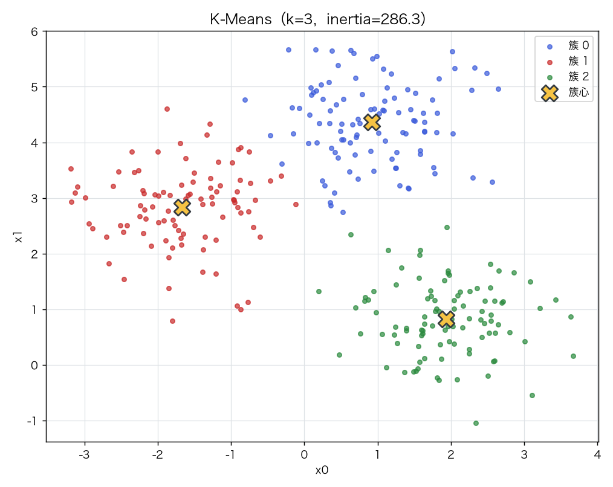
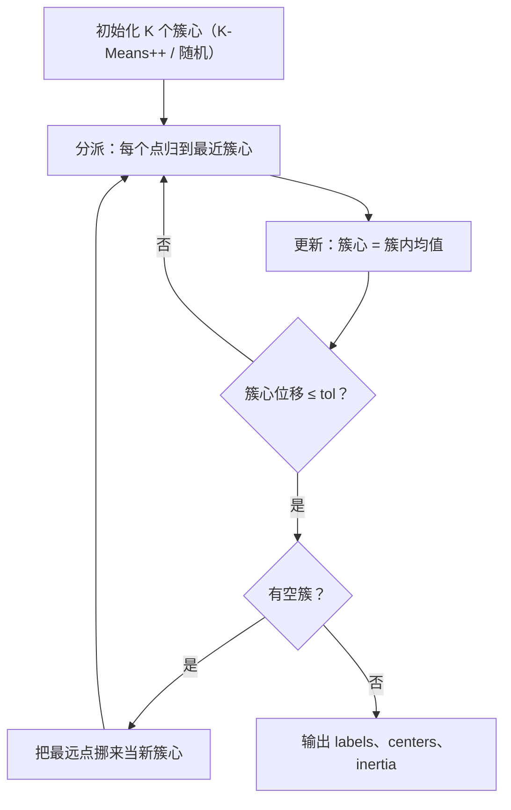
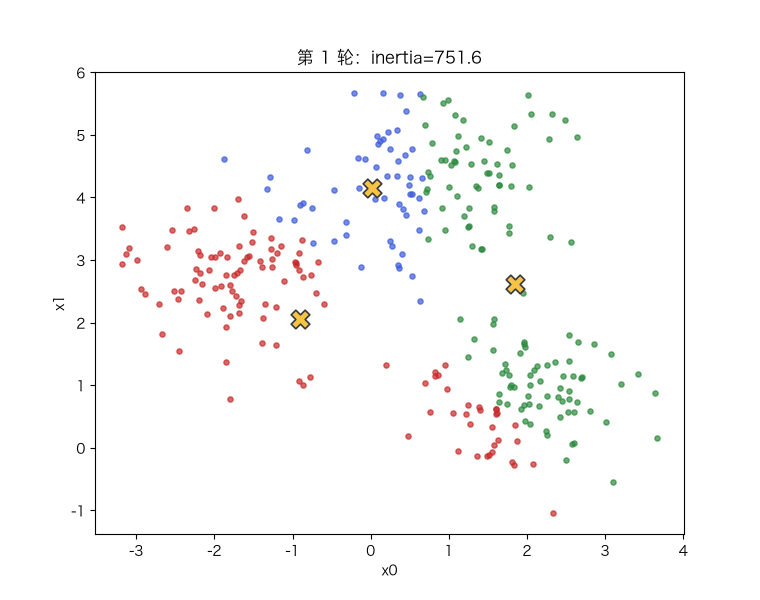

# K-Means：质心更新、K 的选择与初始化敏感性

> 状态：✅ 已完成（2026-10-21）
> 对应文档章节：`../../docs/人工智能代表算法演进路线.md` 第 3.4.1 章
> 阅读路线：零基础读者读「基础篇」（生活类比 → 手算 → 白话 → 自测）；要看推导、实现与复现实验读「进阶篇」
> 本族共 14 个实验，学习顺序与选读建议见 [族级导读](../README.md)。

无监督估计器（统计机器学习族）：入口是 `KMeans(n_clusters, n_init, init, random_state).fit(X) / predict(X)`，实现在 [impl.py](impl.py)；对照是 [framework.py](framework.py) 的 sklearn `KMeans`。**接口没有 y**：聚类没有标签可拟合，评估要靠轮廓系数/ARI 等外部指标。

# 基础篇 · 先搞懂它

## 1. 生活类比：把散落的棋子分成几堆

桌上散着一堆棋子，你要把它们分成 K 堆，要求"同一堆里的棋子尽量靠近"。

做法很自然：先随手放 K 个"堆心"，每个棋子归到最近的堆心；
然后每堆重新算中心（平均值），再重新归堆……直到堆心不再动。
这就是 K-Means——**分派与更新交替**，像两个人在原地互相迁就。

## 2. 核心量：inertia、簇心、K、轮廓系数

**目标函数**（簇内平方和，越小越紧）：

$$J=\sum_{i=1}^{n}\lVert x_i-\mu_{c(i)}\rVert^2$$

**两步交替**：

1. **分派**：固定簇心，每个点归到最近的簇心；
2. **更新**：固定分派，每个簇心取该簇样本的均值。

**K** 是簇数，必须事先给。`inertia` 随 K 单调下降（K=n 时为 0），所以不能只靠它选 K。

**轮廓系数**衡量"点离自己簇多近、离别的簇多远"：

$$s_i=\frac{b_i-a_i}{\max(a_i,b_i)},\qquad
\text{silhouette}=\frac1n\sum_i s_i$$

`a_i` 是到同簇其他点的平均距离，`b_i` 是到最近其他簇的平均距离；取值 `[-1,1]`，越大越好。

## 3. 主循环：Lloyd 迭代

## 4. 手算示例：四个点、两个簇

一维点 `[0, 1, 2, 10]`，`K=2`，初始簇心 `μ₀=0`、`μ₁=10`。

| 轮次 | 分派 | 新簇心 | inertia |
|---|---|---|---|
| 初始 | `{0,1,2}→μ₀`，`{10}→μ₁` | — | `0²+1²+2²=5` |
| 第 1 轮 | 同上 | `μ₀=1`，`μ₁=10` | `1²+0²+1²=2` |
| 第 2 轮 | 同上 | 不变 | 2（收敛） |

一轮就把簇心从 0 挪到 1，inertia 从 5 降到 2。**注意：分派一旦不变，均值也不会再变**，
所以两阶段交替一定在有限步内停（但不保证全局最优）。

## 5. 白话版：为什么依赖初始化、K 怎么选、为什么要标准化

**为什么依赖初始化**：目标函数非凸，不同的初始簇心会落进不同的局部最优。
K-Means++ 让初始簇心"彼此尽量远"：第一个随机，之后按 `D(x)²` 加权抽——
离已选簇心越远的点越可能被选中。它不是保证，但能显著减少坏结果。

**K 怎么选**：inertia 随 K 单调降，不能只看最小值。常用两招：
- **肘部**：画 inertia-K 曲线，找"再增加 K 收益骤减"的拐点；
- **轮廓系数**：直接算聚类质量，取峰值。

**为什么要标准化**：K-Means 用欧氏距离；某个特征量纲大 1000 倍，它就会主导距离，
其他特征等于不存在。做聚类前先标准化（或确认量纲可比）。

**与监督模型的区别**：没有 y，无法用"预测对不对"评估；簇编号是任意的，
所以比较两套标签要用 ARI（调整兰德指数），而不是准确率。

## 6. 常见误区

- **❌ "K-Means 一定找到全局最优"** —— 非凸，局部最优很常见；靠 `n_init` 多次重启。
- **❌ "inertia 越小说明 K 越好"** —— K=n 时 inertia=0；要配合肘部/轮廓系数。
- **❌ "K-Means 不需要标准化"** —— 距离对量纲敏感，不标准化会被大尺度特征支配。
- **❌ "簇是球形假设无所谓"** —— 双月/长条形簇会被直线切开（实验四 ARI 0.24）。
- **❌ "同一份数据每次跑标签都一样"** —— 簇编号可交换；换种子还可能换局部最优。

## 7. 动起来看：分派与簇心互相迁就

每一帧：点按当前分派着色，叉号是簇心；下一帧簇心挪到簇内均值，再重新分派。

## 8. 掌握清单：五级能力与自测

| 级别 | 能力 | 本实验的检验方式 | 在哪做 |
|---|---|---|---|
| 1 说清 | 用自己的话讲规则 | 说出 inertia、两步交替、K-Means++、轮廓系数各是什么 | 基础篇「核心量」「白话版」 |
| 2 走通 | 纸上手算 | 给定 4 个一维点与 2 个初始簇心，手算一轮分派/更新 | 基础篇「手算示例」节 |
| 3 判断 | 说清正确性条件 | 解释 Lloyd 为什么收敛、为什么只是局部最优、K-Means++ 的采样概率 | 进阶篇「数学推导」 |
| 4 实现 | 手写并与对照比对 | 跑通 `demo.py`，解释 inertia/ARI 与 sklearn 对齐 | 进阶篇「实验结果」 |
| 5 迁移 | 用到新问题 | 在真实手写数字上用轮廓系数选 K，并用 ARI 评估 | [project/](project/README.md) |

**自测关卡（先预测，再跑代码验证）**：

1. K 从 1 加到 8，inertia 会怎么变？轮廓系数呢？
2. 随机初始化跑 20 次，inertia 的分布大概多宽？K-Means++ 能改善哪一部分？
3. 把某个特征乘以 1000，聚类结果会怎样？
4. 双月数据上 K-Means 的 ARI 大概是多少？

# 进阶篇 · 实验档案

## 目录形态（本算法的"类型"）

| 文件 | 角色 | 入口 / 说明 |
|---|---|---|
| [impl.py](impl.py) | 手写实现 | `kmeans_plus_plus`、`KMeans`（Lloyd/空簇/多重启）、`silhouette_score` |
| [framework.py](framework.py) | 框架对照 | sklearn `KMeans`（Elkan/并行） |
| [demo.py](demo.py) | 同数据双跑 | 四组实验：对照 / K 选择 / 初始化 / 非球形局限 |
| [test_impl.py](test_impl.py) | 性质测试 | 初始化、inertia、单调性、轮廓、空簇、契约 |
| [make_teaching_assets.py](make_teaching_assets.py) | 素材生成 + 对账 | 聚类图 / 肘部轮廓 / 初始化分布 / Lloyd 动画 |
| [exercises/](exercises/README.md) | 练习（5 题，题解分离） | 概念、手算、诊断、实现、迁移 |
| [project/](project/README.md) | 迁移项目 | 真实手写数字：轮廓选 K、ARI、初始化稳定性 |

## 1. 设计原理

K-Means 是"用 K 个均值代表数据"的最简方法：它假设每个簇可以用一个中心概括，
并把"代表误差"写成平方和。两步交替是**坐标下降**：固定一组变量，另一组有闭式解，
所以目标单调不增、必然收敛；但目标非凸，收敛点依赖初始化。

它是无监督学习里最快的基线之一，也是向量量化、图像压缩、颜色聚类的基础。

## 2. 数学推导

**分派步**：固定 `μ`，每个 `x_i` 的最优标签是

$$c(i)=\arg\min_j \lVert x_i-\mu_j\rVert^2$$

**更新步**：固定 `c`，对 `μ_j` 求导令 0：

$$\frac{\partial J}{\partial \mu_j}=-2\sum_{i:c(i)=j}(x_i-\mu_j)=0
\;\Longrightarrow\;
\mu_j=\frac{1}{|C_j|}\sum_{i\in C_j}x_i$$

**单调收敛**：两步都不会让 `J` 增大；`J` 有下界 0；有限种分派 → 有限步收敛。
但只保证局部最优。

**K-Means++**：设 `D(x)` 为到最近已选簇心的距离，按

$$P(x)=\frac{D(x)^2}{\sum_{x'}D(x')^2}$$

采样下一个簇心；第一个均匀随机。

**轮廓系数**：`a_i` 同簇平均距离、`b_i` 最近异簇平均距离，
`s_i=(b_i−a_i)/max(a_i,b_i)`；`|C_i|=1` 时记 0。

**ARI**：调整兰德指数，把"两个标签划分的一致程度"校正到随机划分的期望为 0。

## 3. 手写实现要点

1. **距离用平方**：比较最近簇不需要开方；用 `‖x‖²+‖c‖²−2x·c` 矩阵化。
2. **空簇处理**：把"离自己簇心最远"的样本挪来当新簇心，避免空簇导致均值 NaN。
3. **n_init 多次重启**：每次不同种子，保留 inertia 最小的一组；K-Means++ 降低坏初始化概率。
4. **收敛判据**：簇心位移平方和 ≤ tol，不是 inertia 变化。
5. **标签一致性**：最终必须用最终簇心重新分派一次，否则 labels 与 centers 可能错位。
6. **history_ 记录**：每轮 centers/labels/inertia；从最优那一轮的**初始中心**重放，保留完整路径。

## 4. 框架对照

sklearn `KMeans` 默认 `init="k-means++"`、`n_init="auto"`，并用 Elkan 三角不等式/并行加速。
同数据（3 团、k=3、n_init=10）实测：

| 指标 | 手写 | sklearn |
|---|---|---|
| inertia | 286.341 | 286.341 |
| ARI vs 真标签 | 0.9703 | 0.9703 |
| 迭代 | 6 | 4 |
| 耗时（ms） | 2.6 | 4.1 |

inertia 与 ARI 完全一致；迭代数/耗时差异来自收敛判据与实现细节，在这个规模上
sklearn 的固定开销反而更明显。

## 5. 实验结果

**环境**：uv 环境（`uv sync --extra dev`），Python 3.13.15 / numpy 2.5.4 / scikit-learn 1.9.1。
**数据**：3 团（`n=300`、`cluster_std=0.7`、`seed=0`）；双月（`n=300`、`noise=0.05`）。
**复现**：本目录内 `uv run python demo.py`、`uv run pytest test_impl.py -q`、
`uv run python make_teaching_assets.py`。

**实验一：手写 vs sklearn（k=3，n_init=10）**

| 方法 | inertia | ARI | 迭代 | 耗时（ms） |
|---|---|---|---|---|
| 手写 | 286.341 | 0.9703 | 6 | 2.6 |
| sklearn | 286.341 | 0.9703 | 4 | 4.1 |

**实验二：K 的选择（k=1..8）**

| k | inertia | 轮廓系数 |
|---|---|---|
| 1 | 1601.095 | — |
| 2 | 734.037 | 0.5219 |
| 3 | 286.341 | **0.6058** |
| 4 | 244.166 | 0.4915 |
| 5 | 211.897 | 0.4421 |
| 6 | 182.965 | 0.3222 |
| 7 | 163.081 | 0.3378 |
| 8 | 138.975 | 0.3395 |

inertia 单调降、肘部在 3；轮廓系数峰值也在 k=3。

**实验三：初始化敏感性（20 个种子，n_init=1）**

| 初始化 | inertia 中位数 | 最差 | 标准差 |
|---|---|---|---|
| random | 286.4 | 697.1 | 146.6 |
| kmeans++ | 286.3 | 696.7 | **89.4** |

中位数几乎相同，但 K-Means++ 的方差明显更小。**注意**：它不保证每个种子都赢；
这组数据里两者最差都到过 ~697。

**实验四：局限——非球形簇（双月）**

K-Means（k=2）的 ARI = **0.2408**：一条直线把两个月亮切开，轮廓/簇心都救不了。

**验证声明（已验证）**：输入为上述数据与种子；2026-10-21 在 uv 环境实跑，
`uv run python demo.py` 输出上表；`uv run pytest test_impl.py -q` → **12 passed**；
`uv run python make_teaching_assets.py` 对账通过（inertia 286.341 与 sklearn 同；
双月 ARI 0.241）。耗时数字随机器浮动 `[随环境/版本变化]`。

**可视化结论**：

- `images/00-聚类与质心.png`：3 团与 3 个簇心；
- `images/01-肘部与轮廓.png`：inertia 单调降，轮廓峰值在 k=3；
- `images/02-初始化敏感性.png`：20 个种子的 inertia 分布，K-Means++ 尾部更短；
- `images/03-Lloyd迭代.gif`：分派与簇心交替收敛。

## 6. 局限与延伸

- **球形/等方差假设**：拉长、双月、密度不均的簇会失败（实验四）。
- **K 要事先给**：肘部/轮廓只是启发式；真实类别数不一定等于最优聚类数。
- **对量纲敏感**：必须标准化或确认特征可比；类别特征不能直接用欧氏距离。
- **对离群点敏感**：平方损失放大远点的影响；可用 K-Medoids/截断距离。
- **轮廓系数是 O(n²)**：要算全样本距离矩阵，大样本需要采样/近似；不要在全量百万级数据上直接算。
- **空簇处理是启发式**：把最远点挪来当新中心，极端情况下可能产生重复中心，只是避免 NaN。
- **局部最优**：n_init 只能降低概率；可用多次重启 + 共识聚类（consensus clustering）。
- **下游**：[PCA](../pca/) 常先降维再聚类；[异常检测](../anomaly-detection/) 可用"到簇心距离"；
  高斯混合模型（GMM）把硬分派换成软分派。
