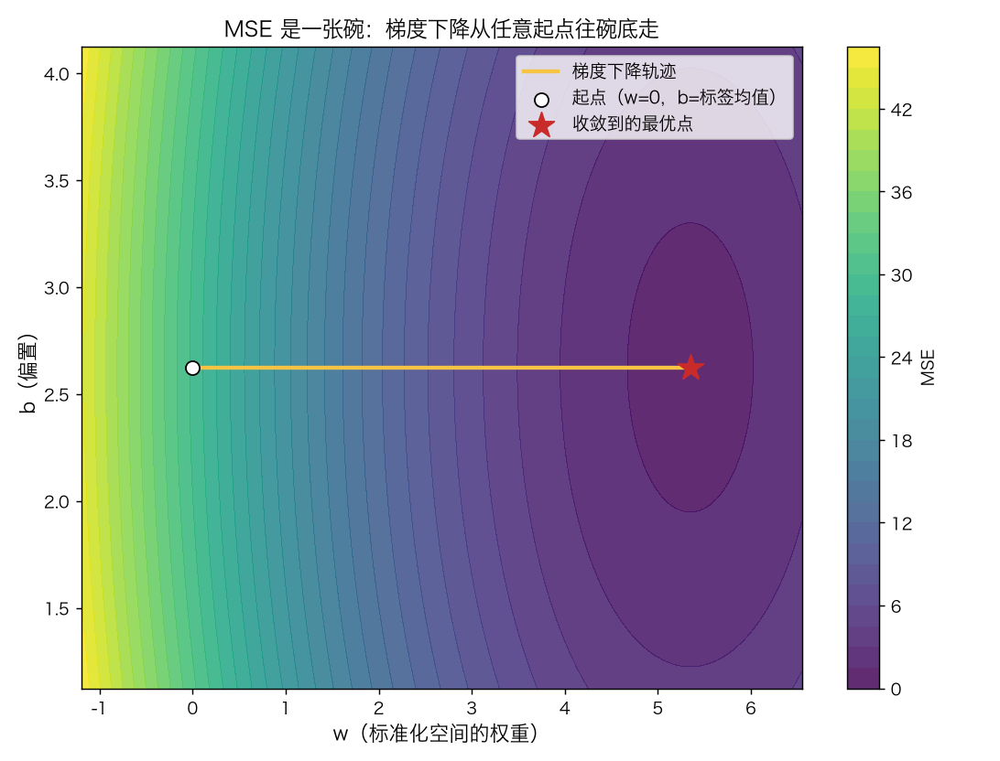
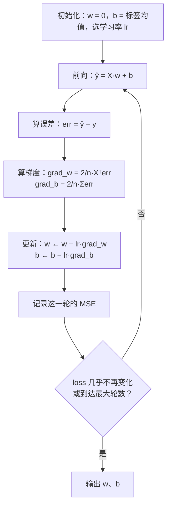
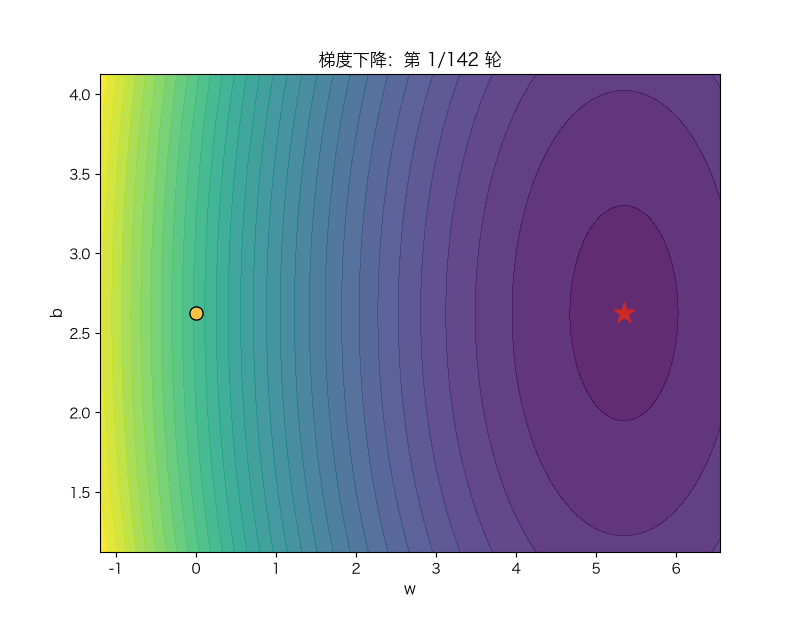

# 线性回归与梯度下降

> 状态：✅ 已完成（2026-10-21）
> 对应文档章节：`../../docs/人工智能代表算法演进路线.md` 第 3.2.1 章
> 阅读路线：零基础读者读「基础篇」（生活类比 → 手算 → 白话证明 → 自测）；要看推导、实现与复现实验读「进阶篇」
> 本族共 11 个实验，学习顺序与选读建议见 [族级导读](../README.md)。

监督估计器（统计机器学习族）：入口是 [impl.py](impl.py) 的 `Model(lr, epochs, tol).fit(X, y) → self` 与 `.predict(X) → ndarray`——吃 `(n_samples, n_features)` 的特征矩阵和 `(n_samples,)` 的标签，吐逐样本预测；对照是 [framework.py](framework.py) 的 sklearn 闭式解与 SGD。**没有 `sample`**：判别式模型只做预测，不生成数据。

## 读之前：线性回归（模型）与梯度下降（优化方法）

标题里是两个层次的东西：

| 概念 | 是什么 | 本实验 |
|---|---|---|
| **线性回归** | 模型假设：`y ≈ w·x + b` | 要学的对象 |
| **梯度下降** | 求 `w,b` 的一种迭代优化方法 | 手写训练循环 |
| **闭式解** | 另一种求法：一步解正规方程 | 对照/小数据基线 |

同一个线性回归模型，可以用闭式解、GD、SGD、Adam 等不同方法求解；**模型不等于优化器**。

# 基础篇 · 先搞懂它

## 1. 生活类比：用"每平米单价"估房价

你想给房子估价，手里有一堆成交记录：面积越大，总价越高，但不是严格成比例——同面积的房子，
楼层、装修、噪音不同，价格会上下浮动。

最朴素的办法是画一条直线：**总价 ≈ 单价 × 面积 + 基础价**。这条线不可能穿过每个点，
但可以选一条"让所有点的偏差平方和最小"的线。这就是线性回归。

它解决的麻烦是：**从一堆带噪声的例子里，估出一个能用、能解释的规律**。上一阶段（搜索）里，
规则、启发式、评估函数都是人写的；从这里开始，参数是从数据里学出来的。

## 2. 核心量：MSE、梯度、学习率

一条直线由两个量决定：

$$\hat y = w x + b$$

- `w`（权重）：每多一平米，总价涨多少；
- `b`（偏置）：面积为 0 时的"基础价"（真实业务里通常没有物理意义，但它让直线能上下平移）。

怎么判断一条线好不好？用**均方误差**（MSE）：

$$L(w,b) = \frac{1}{n}\sum_{i=1}^{n}\big(\hat y_i - y_i\big)^2
= \frac{1}{n}\sum_{i=1}^{n}\big(w x_i + b - y_i\big)^2$$

它是一个**碗形**（凸函数）：只有一个最低点。问题变成"找到碗底"。

**梯度**告诉你"往哪个方向走、坡有多陡"：

$$\frac{\partial L}{\partial w} = \frac{2}{n}\sum_i x_i(\hat y_i - y_i),\qquad
\frac{\partial L}{\partial b} = \frac{2}{n}\sum_i (\hat y_i - y_i)$$

**学习率** `lr` 决定每一步走多远：

$$w \leftarrow w - lr \cdot \frac{\partial L}{\partial w},\qquad
b \leftarrow b - lr \cdot \frac{\partial L}{\partial b}$$

图里每个点是一种 `(w, b)` 组合，颜色是它对应的 MSE；黄线是梯度下降一步步走出来的轨迹。
**"下山"就是沿着负梯度走**——梯度指向上坡，取负号才是下坡。

## 3. 主循环：前向 → 误差 → 梯度 → 更新

三个终止条件要分清：**loss 变化小于 `tol`**（收敛）、**到达 `epochs`**（预算用完）、
**数值爆掉**（学习率太大，见「常见误区」）。

## 4. 手算示例：3 个点走一步

数据：`x = [1, 2, 3]`，`y = [3, 5, 7]`（真实规律是 `y = 2x + 1`）。初始化 `w = 0`、`b = 0`，
学习率 `lr = 0.1`。

| 步骤 | 计算 | 数值 |
|---|---|---|
| 初始预测 | `ŷ = 0` | `[0, 0, 0]` |
| 初始误差 | `err = ŷ − y` | `[-3, -5, -7]` |
| 初始 MSE | `mean(err²)` | 27.6667 |
| 梯度 w | `2/3 · (1·(−3) + 2·(−5) + 3·(−7))` | −22.6667 |
| 梯度 b | `2/3 · (−3 − 5 − 7)` | −10.0000 |
| 更新 w | `0 − 0.1 × (−22.6667)` | 2.2667 |
| 更新 b | `0 − 0.1 × (−10)` | 1.0000 |
| 一步后预测 | `2.2667x + 1` | `[3.2667, 5.5333, 7.8000]` |
| 一步后 MSE | `mean(err²)` | 0.3319 |

只走一步，MSE 就从 27.6667 掉到 0.3319。**梯度的符号告诉你方向，大小告诉你坡度**；
再走几步就会停在 `w = 2`、`b = 1` 附近（这组数据无噪声，最优解就是真值）。

这组数字可以用 `demo.py` 的「手算示例」段原样复算。

## 5. 白话版：为什么沿着负梯度走就能到碗底

三个事实合起来就够了：

1. **MSE 是凸的**：它的形状像一个碗，没有局部坑，唯一的低谷就是全局最优。
2. **梯度指向"上坡最陡"的方向**：所以 `−梯度` 指向"下坡最陡"的方向。
3. **步子别迈太大**：只要学习率小于某个上限（与数据的尺度有关），每一步都会让 loss 变小；
   超过上限就会一步跨过碗底、甚至越走越远。

把这三条合起来：**只要方向对、步子稳，就一定会滑到碗底**。

**标准化为什么重要**：如果两个特征一个在 1 附近、一个在 1000 附近，碗会被拉成一条又窄又长的峡谷——
同一个学习率，在窄的方向上"太陡"（发散），在长的方向上"太缓"（走不动）。把特征缩放到同一量级，
碗就变圆，同一个学习率才能同时照顾所有方向。

## 6. 常见误区

- **❌ "训练误差越小，模型越好"** —— 训练误差可以靠把线弯得更厉害来降低，但换一批数据就崩了。
  这里只讲"拟合"，"泛化"是下一个实验（正则化与模型选择）的主题。
- **❌ "学习率随便设一个就行"** —— 太小：几千轮都到不了碗底；太大：一步冲出去，loss 变 NaN。
  它没有"通用最优值"，只能按数据尺度与损失曲率去选（进阶篇给出稳定条件）。
- **❌ "不做标准化也能收敛"** —— 能，但前提是学习率小到几乎不动。特征尺度差得越多，
  不标准化越接近"不可用"，而不是"慢一点"。
- **❌ "学到的 w 就是真实规律"** —— 学到的 `w` 是**这批样本**上的最优估计；有噪声时它会偏离真值
  （本实验的样本估计是 2.93，真实值是 3）。这不叫 bug，叫抽样误差。
- **❌ "有闭式解，所以不用学梯度下降"** —— 闭式解要求能一次分解矩阵；特征多、样本大时它的
  内存与计算代价会爆炸，而且它无法扩展到逻辑回归 / 神经网络。梯度下降是那条更通用的路。

## 7. 动起来看：轨迹一步一步滑向碗底

轨迹先沿"最陡"的方向快速下降，接近碗底时步子自动变小（梯度变小了）——这就是"越接近目标越慢"。

## 8. 掌握清单：五级能力与自测

| 级别 | 能力 | 本实验的检验方式 | 在哪做 |
|---|---|---|---|
| 1 说清 | 用自己的话讲规则 | 不看文档说出 MSE、梯度、学习率各是什么，以及为什么更新要取负号 | 基础篇「核心量」「白话版」 |
| 2 走通 | 纸上手算 | 给定 3 个点与 `lr`，独立走一步并算出新的 MSE | 基础篇「手算示例」节 |
| 3 判断 | 说清正确性条件 | 说出"MSE 凸 + 学习率小于稳定上限 ⇒ 收敛"，并解释标准化为什么能放宽这个上限 | 基础篇「白话版」、进阶篇「数学推导」 |
| 4 实现 | 手写并与对照比对 | 跑通 `demo.py`，解释 GD 与闭式解的误差、SGD 为什么略差 | 进阶篇「实验结果」 |
| 5 迁移 | 用到新问题 | 在多特征、尺度悬殊的数据上做标准化 + 特征选择，并给出可判定的验收 | [project/](project/README.md) |

**自测关卡（能预测再跑代码验证）**：

1. 把学习率从 0.05 改到 0.5，收敛会变快还是变慢？改到 1.5 呢？
2. 特征尺度差 1000 倍、不标准化时，同一个学习率会发生什么？
3. 数据无噪声时，GD 学到的 `w` 与真实值是什么关系？有噪声时呢？
4. 把 `tol` 从 `1e-10` 调到 `1e-2`，训练轮数会怎么变？模型会坏吗？

# 进阶篇 · 实验档案

## 目录形态（本算法的"类型"）

| 文件 | 角色 | 入口 / 说明 |
|---|---|---|
| [impl.py](impl.py) | 手写实现 | `Model.fit(X, y)` / `predict(X)`；`closed_form(X, y)` 作测试基准 |
| [framework.py](framework.py) | 框架对照 | `fit_linear`（sklearn 闭式解）、`fit_sgd`（sklearn SGD） |
| [demo.py](demo.py) | 同数据双跑 | 四组实验 + 手算示例打印 |
| [test_impl.py](test_impl.py) | 性质测试 | 梯度校验、最优性、数据契约、数值边界、确定性 |
| [make_teaching_assets.py](make_teaching_assets.py) | 素材生成 + 对账 | 概念图 / 学习率图 / 对照图 / 动画 |
| [exercises/](exercises/README.md) | 练习（5 题，题解分离） | 概念、手算、诊断、实现、迁移 |
| [project/](project/README.md) | 迁移项目 | 多特征房价：标准化 + 特征选择 + 正则对照 |

## 1. 设计原理

线性回归是"从数据学参数"的最简形态：**假设输出是输入的线性组合，用平方误差衡量好坏**。
在演进路线里，它取代的是"人写评分规则"（专家系统里的加权打分）；它自己会被
逻辑回归（分类）、正则化（泛化）、树模型（非线性）逐步扩展，但**损失 + 梯度 + 优化**
这套骨架一直沿用到神经网络。

它值得作为第一个统计学习实验，因为三件事都能在这里看清：**模型（一条线）、损失（MSE）、
优化（梯度下降）**。后面的算法几乎都是在这三者上换零件。

## 2. 数学推导

**模型与损失**（矩阵写法，`X ∈ R^{n×d}`，`y ∈ R^n`）：

$$\hat y = Xw + b\mathbf 1,\qquad
L(w,b) = \frac{1}{n}\lVert Xw + b\mathbf 1 - y\rVert_2^2$$

**梯度**：对 `w` 用矩阵求导，对 `b` 用标量求导：

$$\nabla_w L = \frac{2}{n}X^\top(Xw + b\mathbf 1 - y),\qquad
\frac{\partial L}{\partial b} = \frac{2}{n}\mathbf 1^\top(Xw + b\mathbf 1 - y)$$

`impl.py` 里的 `_gradients` 就是这两行；`err = ŷ − y` 对应代码里的 `err`。

**闭式解**：令梯度为 0，把截距并入特征（给 `X` 补一列 1，记作 `A`），得正规方程

$$A^\top A\,\theta = A^\top y \;\Longrightarrow\; \theta = (A^\top A)^{-1}A^\top y$$

直接用逆矩阵数值不稳定，所以 `impl.closed_form` 用 `np.linalg.lstsq`（SVD 路线）解它。
注意：**闭式解只用于对照与测试，`Model.fit` 不调用它**——否则就绕过了本实验要理解的梯度下降。

**为什么收敛**：把 `b` 并入参数后，`L` 的 Hessian 是

$$H = \frac{2}{n}A^\top A \succeq 0$$

半正定 ⇒ `L` 是凸函数，唯一的低谷就是全局最优。对二次函数，梯度下降的误差满足

$$\lVert \theta_{k+1} - \theta^\* \rVert \le \rho\,\lVert \theta_k - \theta^\* \rVert,\qquad
\rho = \max\big(|1 - lr\cdot\lambda_{\min}|,\ |1 - lr\cdot\lambda_{\max}|\big)$$

其中 `λ` 是 `H` 的特征值。要 `ρ < 1`，需要

$$0 < lr < \frac{2}{\lambda_{\max}}$$

这就是"步子别迈太大"的精确版本。**标准化**把 `A` 的各列缩放到同一量级，
`λ_max/λ_min`（条件数）随之变小，`2/λ_max` 变大——同一个学习率就更安全、收敛更快。
本实验的「实验三」就是把这条推导跑成数字。

## 3. 手写实现要点

1. **向量化**：`err = X @ w + b - y`，梯度 `X.T @ err`。用循环写也能对，但慢一个数量级，
   后面"耗时对照"就失去意义。
2. **标准化 + 反变换**：`fit` 内部记录 `mu/sigma`，在标准化空间下降；`predict` 用同一组参数变换。
   `raw_coef = w/sigma`、`raw_intercept = b − mu·(w/sigma)` 才能与闭式解/框架系数直接比较。
3. **初始化 `b = ȳ`**：从标签均值起步，比 `b = 0` 少走很多冤枉路（尤其标签整体偏移时）。
4. **收敛判据用 loss 变化，不用参数变化**：参数在不同尺度下变化幅度不可比；loss 是无量纲的。
   `tol` 太小会白跑轮数，太大会停在半路——本实验用 `1e-12` 是为了让结论"精确到可与闭式解对照"。
5. **常数特征要防除零**：`sigma = 0` 时直接除会得到 inf；实现里把这类列当作不缩放，交给 `b` 吸收。
6. **溢出要能看见**：学习率过大时 `err ** 2` 会溢出成 inf/NaN。不要静默吞掉——本实验在
   `demo.py` 里显式标记"发散/震荡"，让读者看到边界。

## 4. 框架对照

**sklearn 闭式解 `LinearRegression`**：走 SVD/`lstsq` 路线解正规方程，默认带截距、不做正则化。
它在本实验里与手写闭式解**逐位相同**（同一份数据、同一条数学路线），说明手写版的矩阵运算没有写错。

**sklearn `SGDRegressor`**：名字里的 SGD 是"随机梯度下降"——每次只用一个样本估计梯度。
框架在背后多做了几件事：打乱样本顺序、支持 L2/L1 正则、可选早停、学习率调度。
本实验把它设成与手写版同口径（`alpha=0`、`early_stopping=False`、常数学习率），
它仍然**略差于闭式解**：随机梯度的噪声 + 常数学习率不衰减，最后会在最优点附近抖动。
这不是框架"错"，而是**SGD 的代价**：换来的是每步只看一个样本、能处理超大数据的扩展性。

> **注意：sklearn 没有"批量梯度下降"估计器。** `SGDRegressor` 走的是**随机**梯度路线，
> 所以「实验一」四行**不是同一个算法的四个实现**：手写 GD（批量）、手写闭式解、
> sklearn 闭式解是同一目标函数的两类解法，`SGDRegressor` 是另一种优化路线。
> 直接把 SGD 与批量 GD 比"谁更准"没有意义——要同口径比，得把批大小、学习率调度、
> 早停都对齐（本实验只对齐了正则化与早停）。

**差异归因**（数字见「实验结果」）：

| 差异 | 来源 |
|---|---|
| 测试 MSE：SGD 比闭式解高约 1.3% | 随机梯度噪声 + 学习率未衰减，最后在最优附近抖动 |
| 系数：SGD 的 `w` 偏高约 1.4% | 同上；且 `alpha=0` 时它没有正则化帮助稳定 |
| 耗时：sklearn 闭式解比手写闭式解慢一个量级 | sklearn 走通用估计器路径（校验、复制、封装），手写版只做一次 `lstsq` |

## 5. 实验结果

**环境**：uv 环境（`uv sync --extra dev`），Python 3.13.15 / numpy 2.5.4 / scikit-learn 1.9.1。
**数据**：`y = 3x + 2 + N(0, 1)`，`n = 200`，`seed = 0`；70/30 切分，切分随机种子 0。
**复现**：本目录内 `uv run python demo.py`（四组实验 + 手算示例）、
`uv run pytest test_impl.py -q`、`uv run python make_teaching_assets.py`。

**实验一：同一份数据上的四条路线**

| 方法 | 训练 MSE | 测试 MSE | 测试 R² | w | b | 迭代轮数 |
|---|---|---|---|---|---|---|
| 手写 GD（lr=0.05, tol=1e-12） | 0.9867 | 1.1818 | 0.9626 | 2.9340 | 1.9619 | 142 |
| 闭式解（手写） | 0.9867 | 1.1818 | 0.9626 | 2.9340 | 1.9619 | — |
| sklearn `LinearRegression` | 0.9867 | 1.1818 | 0.9626 | 2.9340 | 1.9619 | — |
| sklearn `SGDRegressor` | 1.0014 | 1.1972 | 0.9621 | 2.9773 | 2.0455 | 3000 epoch |

三条路线（手写 GD / 手写闭式解 / sklearn 闭式解）在测试集上逐位相同；SGD 略差，原因见「框架对照」。
**注意这四行不是四个同算法实现**：sklearn 没有批量 GD 估计器，`SGDRegressor` 是随机梯度路线
（见「框架对照」的说明）。
注意 `w = 2.9340` 而不是真实值 3：**这是样本估计，不是 bug**——噪声让这批数据的最优直线偏离了真实规律。

**实验二：学习率扫描（标准化后的 1 维数据，最多 5000 轮）**

| lr | 最终训练 MSE | 轮数 | 状态 |
|---|---|---|---|
| 0.001 | 1.0421 | 5000 | 未完全收敛（还在慢慢走） |
| 0.01 | 1.0421 | 689 | 收敛 |
| 0.05 | 1.0421 | 142 | 收敛 |
| 0.1 | 1.0421 | 70 | 收敛 |
| 0.5 | 1.0421 | 3 | 收敛（1 维二次函数恰好在一步附近到达） |
| 1.0 | 29.6442 | 2 | 发散/震荡（越过稳定边界） |
| 1.5 | NaN | 5000 | 发散（溢出） |

`lr = 0.5` 只用 3 轮就到位，是因为 1 维标准化数据的 Hessian 约为 2，`2/λ_max ≈ 1`，
0.5 已接近"一步到碗底"；`lr = 1.0` 正好落在边界上，开始来回震荡；1.5 直接溢出。
**"最优学习率"依赖曲率，不是常数**。

**实验三：特征尺度差 1000 倍（lr = 0.01，最多 2000 轮）**

| 方案 | 最终训练 MSE | 轮数 | 说明 |
|---|---|---|---|
| 先标准化 | 0.2480 | 713 | 正常收敛（0.248 是噪声地板） |
| 不标准化 | NaN | 2000 | 发散：大尺度特征把步长放大到失控 |

同一个学习率，只差"有没有标准化"，结果从"正常收敛"变成"溢出"。

**实验四：耗时对照（9 次中位数；毫秒级数字随环境波动 `[随环境/版本变化]`，仅同机对比）**

| 方法 | 测试 MSE | 中位耗时（ms） |
|---|---|---|
| 手写 GD（142 轮） | 1.1818 | 0.8–0.9 |
| 手写闭式解 | 1.1818 | 0.01 |
| sklearn 闭式解 | 1.1818 | 0.15 |

同精度下，本机同次测量里闭式解约快 70×（≈0.01 ms vs ≈0.8 ms）——这是**同机同次**的比例，换机器会变；GD 的代价是上百轮矩阵乘法。**但这不代表 GD 没用**：
闭式解要求能装下并分解 `AᵀA`（特征维度是瓶颈），而 GD 只需要能算梯度——逻辑回归、
神经网络都只能走后者。

**验证声明（已验证）**：输入为上述合成数据与种子；2026-10-21 在 uv 环境实跑，
`uv run python demo.py` 输出上表数字；`uv run pytest test_impl.py -q` → **11 passed**；
`uv run python make_teaching_assets.py` 对账通过（手算一步 MSE 27.6667 → 0.3319、
GD 与闭式解 MSE 一致、lr=1.5 发散），素材输出到 `images/`。

**可视化结论**：

- `images/00-损失地形与下降路径.png`：MSE 的等高线是同心椭圆（碗），GD 轨迹从
  `(0, ȳ)` 出发沿最陡方向落到碗底；
- `images/01-学习率与收敛.png`：小学习率的曲线在右侧缓慢下滑，大学习率在左侧直接冲出图外；
- `images/02-手写vs框架.png`：三条拟合线几乎重合，SGD 的线略微偏上——与表中系数差一致；
- `images/03-梯度下降动画.gif`：接近碗底时步子变小，对应梯度模长下降。

## 附录：真实数据（diabetes）

教学实验用合成数据；这里在 sklearn 自带的 `diabetes`（442×10，真实回归）上复核一次：

| 方法 | 测试 RMSE | 测试 R² |
|---|---|---|
| 闭式解 | 55.652 | 0.3929 |
| 手写 GD | 55.652 | 0.3929 |
| sklearn | 55.652 | 0.3929 |

三种解逐位一致；系数绝对值前 5 是 `s5(+721.9)、bmi(+579.5)、s1(−504.6)、bp(+272.5)、s2(+241.6)`。
R²≈0.39 说明线性模型只能解释约四成方差——真实数据的非线性/交互要靠树或核方法。

复现：`cd algorithms/p02-statistical-ml/linear-regression && uv run python real_data.py`

## 6. 局限与延伸

- **只拟合线性关系**：`y` 与特征不是线性关系时，再多的数据也救不回来。出路是特征扩展（多项式）
  或换非线性模型——见 [决策树](../decision-tree/)。
- **对离群点敏感**：平方损失会把大误差放大，一个极端点就能拉偏整条线。换成 MAE/Huber 损失可缓解，
  代价是失去闭式解。
- **多重共线性**：特征之间高度相关时，`XᵀX` 接近奇异，系数会变得很大且不稳定；
  这正是 [正则化与模型选择](../regularization/) 要解决的问题。
- **只做点预测，不表达不确定性**：想知道"这个预测有多可信"，需要贝叶斯线性回归或
  bootstrap 区间——本阶段先不展开。
- **下游**：分类场景把线性输出接一个 sigmoid，就是 [逻辑回归](../logistic-regression/)；
  想在小样本、高维上控制过拟合，接 [正则化](../regularization/)；想看非线性划分，接
  [决策树](../decision-tree/)。
