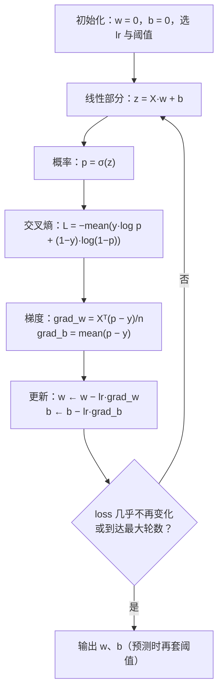
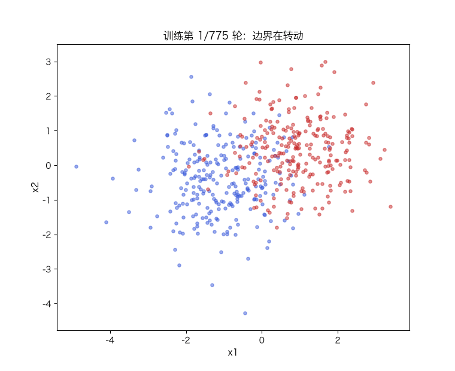

# 逻辑回归

> 状态：✅ 已完成（2026-10-21）
> 对应文档章节：`../../docs/人工智能代表算法演进路线.md` 第 3.2.1 章
> 阅读路线：零基础读者读「基础篇」（生活类比 → 手算 → 白话证明 → 自测）；要看推导、实现与复现实验读「进阶篇」
> 本族共 11 个实验，学习顺序与选读建议见 [族级导读](../README.md)。

监督估计器（统计机器学习族）：入口是 [impl.py](impl.py) 的 `Model(lr, epochs, threshold).fit(X, y) → self`、
`.predict_proba(X) → ndarray`（概率）与 `.predict(X) → 0/1`（按阈值）；对照是 [framework.py](framework.py)
的 sklearn `LogisticRegression`。**没有 `sample`**：判别式模型只给概率，不生成样本。

# 基础篇 · 先搞懂它

## 1. 生活类比：不是"像不像"，而是"有多大概率"

线性回归输出的是任意实数，可很多问题要的是**是/否**：这封邮件是不是垃圾、这个客户会不会转化、
这笔交易是不是欺诈。

最直接的想法是"输出大于 0 就判 1"，但这样有两个毛病：输出没有上界，也没法解释成概率；
而且"离分界线远近"和"有多确定"对不上。

逻辑回归做了一件事：**先把线性输出压进 (0, 1)，再把它当概率**。压的工具是 sigmoid：

$$\sigma(z) = \frac{1}{1 + e^{-z}}$$

它把任意实数单调地压到 (0,1)：`z=0` 时是 0.5，`z` 越大越接近 1，越小越接近 0。

## 2. 核心量：logit、交叉熵、阈值

模型：

$$z = Xw + b,\qquad p = \sigma(z) = \frac{1}{1+e^{-z}}$$

`z` 叫 **logit**（对数几率）：`z = log(p/(1-p))`。所以逻辑回归其实是"**对几率做线性回归**"。

损失用**交叉熵**（二元）：

$$L = -\frac{1}{n}\sum_{i=1}^{n}\Big[y_i\log p_i + (1-y_i)\log(1-p_i)\Big]$$

它的梯度干净得出奇（推导见进阶篇）：

$$\frac{\partial L}{\partial w} = \frac{1}{n}X^\top(p - y),\qquad
\frac{\partial L}{\partial b} = \frac{1}{n}\sum_i (p_i - y_i)$$

**注意**：形式与线性回归的梯度一模一样，但这里的 `p` 是 sigmoid 之后的概率，不是线性输出。

**阈值** `threshold` 不属于模型：模型只给概率，`predict` 才用阈值把它变成 0/1。
默认 0.5 只是习惯，不是定理——类别不平衡或代价不对称时，阈值要单独选。

## 3. 主循环：前向 → 概率 → 交叉熵 → 梯度 → 更新

## 4. 手算示例：2 个点走一步

数据：`x = [1, 2]`，`y = [0, 1]`（第一个点判 0，第二个点判 1）。初始化 `w = 0`、`b = 0`，
学习率 `lr = 0.5`。

| 步骤 | 计算 | 数值 |
|---|---|---|
| 初始 z | `0·x + 0` | `[0, 0]` |
| 初始 p | `σ(0)` | `[0.5, 0.5]` |
| 初始 BCE | `−(log 0.5 + log 0.5)/2` | 0.6931 |
| 梯度 w | `mean((p−y)·x)` = `[(0.5−0)·1 + (0.5−1)·2]/2` | −0.2500 |
| 梯度 b | `mean(p−y)` = `[(0.5−0) + (0.5−1)]/2` | 0.0000 |
| 更新 w | `0 − 0.5×(−0.25)` | 0.1250 |
| 更新 b | `0 − 0.5×0` | 0.0000 |
| 一步后 p | `σ([0.125, 0.25])` | `[0.5312, 0.5622]` |
| 一步后 BCE | 代入 | **0.6668** |

一步之后，两个点的概率都朝各自标签的方向挪了一点，BCE 从 0.6931 降到 0.6668。
这组数字可以用 `demo.py` 的「手算示例」段原样复算。

## 5. 白话版：为什么交叉熵配 sigmoid 这么"顺"

三个事实：

1. **sigmoid 把实数变成概率**：`p` 可以解释为"判 1 的概率"。
2. **交叉熵衡量"用 p 去描述真实标签 y 的代价"**：`y=1` 时 p 越接近 1 代价越小；
   `y=0` 时 p 越接近 0 代价越小；预测反了代价会暴涨。
3. **两者的导数恰好抵消**：sigmoid 的导数 `σ' = σ(1−σ)` 与交叉熵里的分母相遇，
   化简后梯度只剩 `p − y`。这不是巧合，是"用最大似然配自然参数"的结果（进阶篇推导）。

**为什么不用 MSE**：MSE 配 sigmoid 会让损失变成非凸的，梯度还会多一个 `σ'` 因子——
当预测错得很离谱时，`σ'` 接近 0，梯度也接近 0，学得极慢（梯度消失的雏形）。

**阈值为什么能单独调**：模型给的是排序（概率），阈值决定"把线画在哪"。
同一个模型，阈值 0.5 和 0.2 是两种业务策略，不是两个模型。

## 6. 常见误区

- **❌ "准确率高就是好模型"** —— 类别 8% 时，全判 0 也有 92% 准确率。
  要看少数类的召回、精确率、F1 或 AUC（本实验用一张表把陷阱摆出来）。
- **❌ "阈值 0.5 是标准答案"** —— 0.5 只对应"两类代价相同且先验各半"。
  漏判代价高时要把阈值调低，误判代价高时调高。
- **❌ "输出的概率就是置信度"** —— 未校准的逻辑回归概率可能整体偏高/偏低；
  想要可信概率，需要校准（Platt/Isotonic）或换生成式模型。
- **❌ "逻辑回归只能画直线"** —— 决策边界对 `x` 是线性的，但先做特征扩展（多项式、交互项）
  就能画曲线，代价是更容易过拟合。
- **❌ "特征不用标准化"** —— 梯度下降对尺度敏感；不标准化时同一个学习率可能发散或几乎不动。

## 7. 动起来看：边界如何一步步转到位

蓝/红点是两类样本，线是 `p = 0.5` 的决策边界；训练过程中它从初始位置逐步转到两类之间。

## 8. 掌握清单：五级能力与自测

| 级别 | 能力 | 本实验的检验方式 | 在哪做 |
|---|---|---|---|
| 1 说清 | 用自己的话讲规则 | 说出 logit、sigmoid、交叉熵、阈值各是什么；解释阈值为什么不属于模型 | 基础篇「核心量」「白话版」 |
| 2 走通 | 纸上手算 | 给定 2 个点与 `lr`，走一步并算出新的 BCE | 基础篇「手算示例」节 |
| 3 判断 | 说清正确性条件 | 解释"为什么交叉熵的梯度是 p−y"与"为什么 accuracy 在不平衡时会骗人" | 基础篇「白话版」、进阶篇「数学推导」 |
| 4 实现 | 手写并与对照比对 | 跑通 `demo.py`，解释手写 GD 与 lbfgs 的指标/耗时差异 | 进阶篇「实验结果」 |
| 5 迁移 | 用到新问题 | 在不平衡数据上做重加权 + 代价敏感的阈值选择 | [project/](project/README.md) |

**自测关卡（先预测，再跑代码验证）**：

1. 把阈值从 0.5 调到 0.2，召回和精确率各会怎么变？
2. 少数类占 8% 时，accuracy = 0.93 说明模型好吗？还该看什么？
3. 交叉熵配 sigmoid 的梯度里为什么没有 `σ'(z)`？换成 MSE 会怎样？
4. 学习率从 0.5 加到 30，训练会更快还是震荡？

# 进阶篇 · 实验档案

## 目录形态（本算法的"类型"）

| 文件 | 角色 | 入口 / 说明 |
|---|---|---|
| [impl.py](impl.py) | 手写实现 | `Model.fit` / `predict_proba` / `predict`；`sigmoid`、指标工具 |
| [framework.py](framework.py) | 框架对照 | `fit_logreg`（sklearn `LogisticRegression`，lbfgs + 弱正则） |
| [demo.py](demo.py) | 同数据双跑 | 手算 + 四组实验（主对照/学习率/不平衡/耗时） |
| [test_impl.py](test_impl.py) | 性质测试 | sigmoid 稳定性、梯度差分、指标、阈值、权重、数据契约 |
| [make_teaching_assets.py](make_teaching_assets.py) | 素材生成 + 对账 | 决策边界 / 学习率 / 不平衡阈值 / 训练动画 |
| [exercises/](exercises/README.md) | 练习（5 题，题解分离） | 概念、手算、诊断、实现、迁移 |
| [project/](project/README.md) | 迁移项目 | 转化预测：不平衡 + 代价敏感阈值 |

## 1. 设计原理

线性回归解决"输出多少"，逻辑回归解决"属于哪一类"。它把线性输出通过 sigmoid 变成概率，
再用**最大似然**（等价于最小化交叉熵）训练。在演进路线里，它承接线性回归的"损失 + 梯度"，
把**输出层**换掉；后面的 SVM 会换掉**损失**，决策树会换掉**模型形态**。

它仍是工业界最重要的基线之一：可解释（系数 = log-odds 的线性贡献）、训练快、
输出概率、容易加正则与重加权。

## 2. 数学推导

**从几率到 logit**：设 `p = P(y=1|x)`，几率 `p/(1-p)` 的取值范围是 (0, ∞)，
取对数后是全体实数。令

$$\log\frac{p}{1-p} = Xw + b \;\Longrightarrow\; p = \sigma(Xw+b)$$

**最大似然**：样本独立，似然 `L(w,b) = ∏ p_i^{y_i}(1-p_i)^{1-y_i}`，负对数似然：

$$-\log L = -\sum_i\big[y_i\log p_i + (1-y_i)\log(1-p_i)\big]$$

除以 `n` 就是交叉熵。

**梯度推导**（关键一步）：记 `z = Xw+b`、`p = σ(z)`，有 `σ'(z) = σ(z)(1-σ(z))`。

$$\frac{\partial}{\partial z}\big[-y\log p - (1-y)\log(1-p)\big]
= -\frac{y}{p}\sigma'(z) + \frac{1-y}{1-p}\sigma'(z)
= \sigma(z) - y$$

代回链式法则：

$$\nabla_w L = \frac{1}{n}X^\top(p-y),\qquad \frac{\partial L}{\partial b} = \frac{1}{n}\sum(p_i-y_i)$$

**凸性**：Hessian 为 `H = (1/n)Xᵀ S X`，`S = diag(p_i(1-p_i)) ⪰ 0`，所以 `H ⪰ 0`——
损失是凸的，梯度下降不会卡在局部最优（但没有闭式解，只能迭代）。

**决策边界**：`p = 0.5 ⇔ z = 0 ⇔ Xw + b = 0`，对 `x` 是线性的。
阈值改成 `t` 时边界变成 `Xw + b = log(t/(1-t))`——**边界平移，模型不变**。

## 3. 手写实现要点

1. **数值稳定 sigmoid**：`z` 很负时 `exp(-z)` 会溢出；按正负分支分别算（实现里用 `pos` 掩码）。
2. **损失用 logaddexp**：`logaddexp(0, z) − y·z` 等价于交叉熵，但不会出现 `log(0)`；
   指标函数 `binary_cross_entropy` 对概率做 `eps` 截断。
3. **梯度用矩阵形式**：`grad_w = X.T @ (sw * (p − y)) / n`，`sw` 是类别权重。
4. **标准化**：与线性回归同理；逻辑回归的曲率还依赖 `p(1-p)`，尺度差会让收敛更不稳。
5. **class_weight**：`balanced` 按类频率反比加权，等价于把少数类的每个样本复制多份。
6. **阈值只影响 `predict`**：`predict_proba` 不读阈值，保证"概率"与"策略"分离。

## 4. 框架对照

**sklearn `LogisticRegression`** 默认带 **L2 正则**（`C=1.0`），求解器是 lbfgs（拟牛顿，用二阶信息）。
本实验把 `C` 设为 `1e6` 近似"无正则"，并传入标准化后的数据，才与手写版同口径。

结果（数字见「实验结果」）：**指标与系数逐位一致**——说明手写实现没有写错。
差异只在耗时：手写 GD 用 723 轮矩阵乘法，lbfgs 每步更贵，但本数据 **11 次迭代**就收敛，
所以本机同次测量下 sklearn 约快 14×（≈0.8 ms vs ≈11.5 ms，仅同机对比、随环境变化）。**这不是"框架更好"，而是"二阶方法在中小规模上更省步数"**；
数据大到装不下 Hessian 时，一阶方法（SGD/Adam）才是唯一选择。

另外两点框架行为值得知道：

- `class_weight="balanced"` 在 sklearn 里是**样本重加权**，与手写版同一语义；
- `predict_proba` 输出的是"未校准概率"，sklearn 不会替你做校准。

## 5. 实验结果

**环境**：uv 环境（`uv sync --extra dev`），Python 3.13.15 / numpy 2.5.4 / scikit-learn 1.9.1。
**数据**：二维两个有重叠的高斯团（`n=500`，`seed=0`，70/30 分层切分）；
不平衡实验为 3000 个样本、少数类 8%（`seed=2`）。
**复现**：本目录内 `uv run python demo.py`、`uv run pytest test_impl.py -q`、
`uv run python make_teaching_assets.py`。

**实验一：手写 GD vs sklearn（二维重叠数据）**

| 方法 | accuracy | precision | recall | F1 | AUC | 轮数 |
|---|---|---|---|---|---|---|
| 手写 GD（lr=0.5） | 0.8933 | 0.8831 | 0.9067 | 0.8947 | 0.9618 | 723 |
| sklearn lbfgs | 0.8933 | 0.8831 | 0.9067 | 0.8947 | 0.9618 | 11（lbfgs 迭代） |

系数：手写 `w=[2.0624, 0.7977]`、`b=0.1493`；sklearn 完全相同。

**实验二：学习率扫描（最多 8000 轮）**

| lr | 最终 BCE | 轮数 | 状态 |
|---|---|---|---|
| 0.001 | 0.3583 | 8000 | 未完全收敛 |
| 0.01 | 0.2997 | 8000 | 未完全收敛 |
| 0.1 | 0.2994 | 3577 | 收敛 |
| 0.5 | 0.2994 | 775 | 收敛 |
| 1.0 | 0.2994 | 399 | 收敛 |
| 2.0 | 0.2994 | 204 | 收敛 |
| 5.0 | 0.2994 | 81 | 收敛 |
| 30.0 | 0.4202 | 8000 | 发散/震荡 |

逻辑回归的稳定区间比线性回归宽（损失曲率被 `p(1-p)` 压小），但 `lr=30` 仍会震荡。

**实验三：类别不平衡（训练集少数类 8%）**

| 方案 | accuracy | precision | recall | F1 |
|---|---|---|---|---|
| 默认（阈值 0.5） | **0.9300** | 0.6154 | 0.3333 | 0.4324 |
| `class_weight=balanced` | 0.8456 | 0.3282 | **0.8889** | 0.4794 |

阈值扫描（默认模型）：

| threshold | precision | recall | F1 | 预测为正的比例 |
|---|---|---|---|---|
| 0.1 | 0.3684 | 0.8750 | 0.5185 | 19.00% |
| 0.2 | 0.4609 | 0.7361 | 0.5668 | 12.78% |
| 0.3 | 0.5500 | 0.6111 | **0.5789** | 8.89% |
| 0.4 | 0.6071 | 0.4722 | 0.5312 | 6.22% |
| 0.5 | 0.6154 | 0.3333 | 0.4324 | 4.33% |
| 0.7 | 0.8182 | 0.2500 | 0.3830 | 2.44% |

**accuracy 最高的是默认阈值，但它的少数类召回只有 0.33**——这就是"准确率陷阱"。
重加权或调低阈值都能把召回拉上来，代价是精确率下降。

**实验四：耗时（7 次中位数；毫秒级数字随环境波动 `[随环境/版本变化]`，仅同机对比）**

| 方法 | accuracy | 中位耗时（ms） |
|---|---|---|
| 手写 GD（723 轮） | 0.8933 | ≈11.5（11–12） |
| sklearn lbfgs | 0.8933 | ≈0.8 |

**验证声明（已验证）**：输入为上述合成数据与种子；2026-10-21 在 uv 环境实跑，
`uv run python demo.py` 输出上表；`uv run pytest test_impl.py -q` → **16 passed**；
`uv run python make_teaching_assets.py` 对账通过。耗时数字随机器浮动。

**可视化结论**：

- `images/00-决策边界.png`：两类点有重叠，边界穿过重叠区；手写与 sklearn 的线重合；
- `images/01-损失与学习率.png`：小学习率的曲线缓慢下降，大学习率在底部震荡；
- `images/02-不平衡与阈值.png`：阈值升高时精确率上升、召回下降——曲线交叉点就是"业务选择点"；
- `images/03-决策边界动画.gif`：边界从初始位置逐步转到两类之间。

## 6. 局限与延伸

- **边界是线性的**：非线性可分数据要靠特征扩展或换模型——见 [决策树](../decision-tree/)、[SVM](../svm/)。
- **概率未必校准**：逻辑回归的 likelihood 训练不保证概率可靠；风控/医疗要额外做校准。
- **完全可分时权重会发散**：损失可以无限逼近 0，`‖w‖` 一直涨；需要正则化——
  见 [正则化与模型选择](../regularization/)。
- **不平衡需要显式处理**：重加权、阈值选择、重采样，见 [project/](project/README.md)。
- **多分类**：二分类的 softmax 推广（multinomial）不在本实验；p03 的神经网络会以它为基础。
