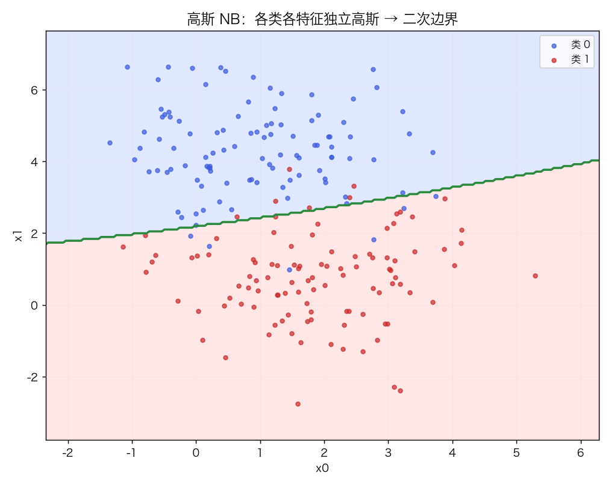
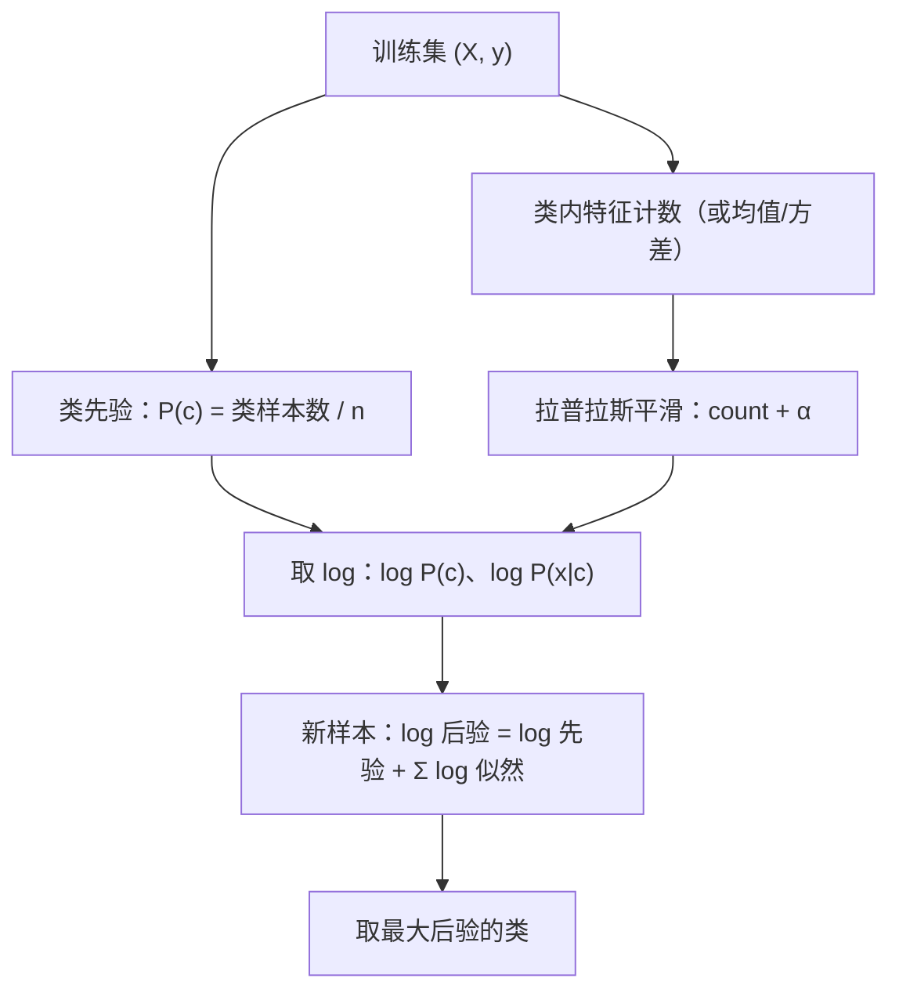
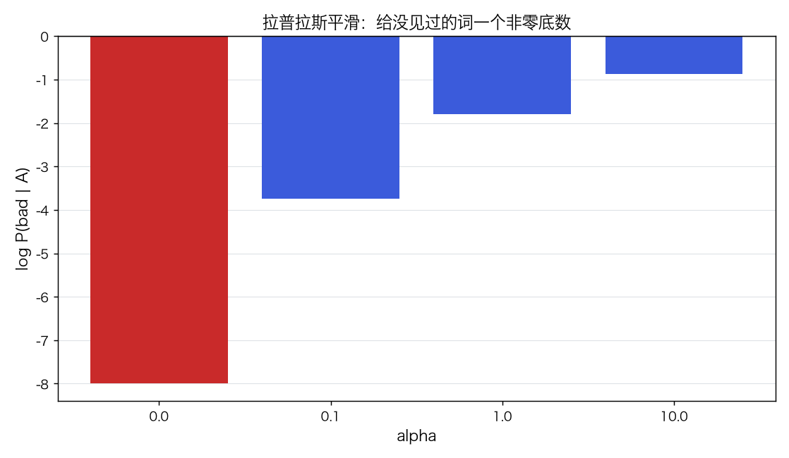
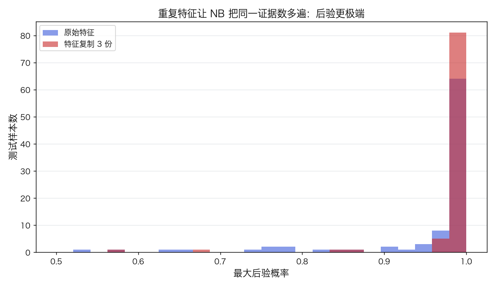

# 朴素贝叶斯：条件独立、先验/似然与拉普拉斯平滑

> 状态：✅ 已完成（2026-10-21）
> 对应文档章节：`../../docs/人工智能代表算法演进路线.md` 第 3.5 章
> 阅读路线：零基础读者读「基础篇」（生活类比 → 手算 → 白话 → 自测）；要看推导、实现与复现实验读「进阶篇」
> 本族共 11 个实验，学习顺序与选读建议见 [族级导读](../README.md)。

监督估计器（统计机器学习族）：入口是 `MultinomialNB(alpha).fit(X, y)`（文本/计数）与 `GaussianNB().fit(X, y)`（连续），实现在 [impl.py](impl.py)；对照是 [framework.py](framework.py) 的 sklearn `MultinomialNB` / `GaussianNB`。**没有训练循环**：fit 只是数频次/估均值方差。

# 基础篇 · 先搞懂它

## 1. 生活类比：看到"免费"就猜垃圾短信

你收到一条短信，里面有"免费""中奖""点击"——你几乎立刻判断它是垃圾短信。
你并没有真的算概率，但大脑在做类似的事：**这些词在垃圾短信里出现的概率，远高于正常短信**。

朴素贝叶斯把这件事写成公式：先看两类短信各占多少（先验），
再看每个词在两类里出现的频率（似然），乘起来比一比（后验）。"朴素"在于它假设：
**在给定类别后，每个词出现与否彼此独立**——这个假设通常不成立，但用起来意外地好。

## 2. 核心量：先验、似然、后验、平滑

**贝叶斯公式**：

$$P(c\mid x)=\frac{P(c)\,P(x\mid c)}{P(x)}$$

**条件独立假设**把 `P(x|c)` 拆成每个特征的乘积：

$$P(x\mid c)=\prod_{j=1}^{d}P(x_j\mid c)$$

**多项式 NB（文本）**：把文档看成词袋，`P(w|c)` 用类内词频估计：

$$\hat P(w\mid c)=\frac{\text{count}(w,c)+\alpha}{\sum_{w'}\text{count}(w',c)+\alpha V}$$

`α` 是**拉普拉斯平滑**：给每个词加一个底数，避免"某类没见过的词"把概率打成 0。
`V` 是词表大小。

**高斯 NB（连续）**：每个类、每个特征假设正态分布，估计均值与方差：

$$P(x_j\mid c)=\mathcal N(x_j;\mu_{jc},\sigma^2_{jc})$$

**对数域**：连乘容易下溢，实际都算 `log P(c) + Σ log P(x_j|c)`，再用 logsumexp 归一化。

## 3. 主循环：数频次 → 算对数概率 → 加法判决

## 4. 手算示例：两个词、两类短信

训练集（词表 `{good, bad}`）：

- A 类（正常）：`["good good", "good"]` → `count(good)=3, count(bad)=0`
- B 类（垃圾）：`["bad bad", "bad"]` → `count(good)=0, count(bad)=3`
- 先验各 0.5；`α=1`、`V=2`。

平滑后的条件概率：

| | good | bad |
|---|---|---|
| A | `(3+1)/(3+2)=0.8` | `(0+1)/(3+2)=0.2` |
| B | `(0+1)/(3+2)=0.2` | `(3+1)/(3+2)=0.8` |

新短信只有 `good`：

- `P(A|good) ∝ 0.5×0.8 = 0.4`
- `P(B|good) ∝ 0.5×0.2 = 0.1`
- 归一化后 `P(A|good)=0.8`。

**若不平滑**（`α=0`）：`P(good|B)=0`，B 的后验直接变 0——一个没见过的词就能"一票否决"。

## 5. 白话版：为什么"假设错了"还能用、平滑在做什么

**为什么独立假设错了还管用**：分类只关心"哪个类的分更高"，不要求概率校准。
即使 `P(x|c)` 估得不准，只要**类之间的相对排序**对，argmax 就正确。
但概率值会过度自信——把相关特征当独立证据数多遍（实验四：平均最大后验 0.954→0.987）。

**平滑在做什么**：给每个特征加 `α` 个"虚拟样本"。`α=1` 是标准拉普拉斯；
`α<1` 平滑弱、`α` 大更平滑。它保证没有零概率，也让罕见词不至于主导。

**文本为什么用词袋**：忽略词序，只看词频；简单、快、可解释（每个词有 log 概率），
但丢掉"不""没有"这类否定与语序信息。

## 6. 常见误区

- **❌ "NB 假设特征真的独立"** —— 是"给定类别后条件独立"的建模假设，不是事实。
- **❌ "NB 的概率很准"** —— 相关特征会让后验过度自信；要校准用 Platt/isotonic。
- **❌ "不需要平滑"** —— 未见词会让整类后验为 0；`α=0` 只适合调试。
- **❌ "文本分类需要词序模型"** —— 词袋 + NB 是强基线；词序/上下文用 CNN/Transformer。
- **❌ "先验不重要"** —— 类别极不平衡时，先验会显著改变决策；可用 `class_prior` 调整。
- **❌ "高斯 NB 只能用于正态数据"** —— 它是"每类每特征高斯"的假设，偏态/多峰时会吃亏。

## 7. 看图：平滑与过度自信

`α=0` 时 `log P(bad|A)=−∞`；只要给一点平滑，就变成有限值。

把特征复制 3 份，NB 把同一份证据数了三遍，最大后验从 0.954 抬到 0.987。

## 8. 掌握清单：五级能力与自测

| 级别 | 能力 | 本实验的检验方式 | 在哪做 |
|---|---|---|---|
| 1 说清 | 用自己的话讲规则 | 说出先验/似然/后验、条件独立、平滑各是什么 | 基础篇「核心量」「白话版」 |
| 2 走通 | 纸上手算 | 给定 5 条短信与词表，算平滑后的条件概率与后验 | 基础篇「手算示例」节 |
| 3 判断 | 说清正确性条件 | 写出多项式/高斯似然、对数域、为什么需要平滑 | 进阶篇「数学推导」 |
| 4 实现 | 手写并与对照比对 | 跑通 `demo.py`，解释概率与 sklearn 对齐 | 进阶篇「实验结果」 |
| 5 迁移 | 用到新问题 | 在文本语料上做词袋 + NB，选 alpha 并解释错误 | [project/](project/README.md) |

**自测关卡（先预测，再跑代码验证）**：

1. `α=0` 时，测试短信出现"某类没见过的词"，后验会怎样？
2. 把特征复制一份，NB 的概率会变大还是变小？准确率呢？
3. 文本分类的 alpha 从 0.01 加到 50，测试准确率会怎么变？
4. 为什么 NB 的概率常常"太自信"？

# 进阶篇 · 实验档案

## 目录形态（本算法的"类型"）

| 文件 | 角色 | 入口 / 说明 |
|---|---|---|
| [impl.py](impl.py) | 手写实现 | `CountVectorizer`、`MultinomialNB`、`GaussianNB`、logsumexp |
| [framework.py](framework.py) | 框架对照 | sklearn `MultinomialNB` / `GaussianNB` |
| [demo.py](demo.py) | 同数据双跑 | 四组实验：高斯 / 文本 / 平滑 / 独立被违反 |
| [test_impl.py](test_impl.py) | 性质测试 | 词袋、先验、平滑、概率、对照、契约 |
| [make_teaching_assets.py](make_teaching_assets.py) | 素材生成 + 对账 | 高斯边界 / alpha 曲线 / 平滑 / 过度自信 |
| [exercises/](exercises/README.md) | 练习（5 题，题解分离） | 概念、手算、诊断、实现、迁移 |
| [project/](project/README.md) | 迁移项目 | 文本垃圾短信分类：词袋 + NB、alpha 选择 |

## 1. 设计原理

NB 用"条件独立"把高维联合概率拆成一维乘积，参数量从指数级降到 `O(类数×特征数)`；
一次计数就完成训练。它假设很强，但在文本/高维稀疏数据上是极强基线，
也是理解生成式模型（HMM、LDA）的入口。

## 2. 数学推导

**后验**：

$$P(c\mid x)=\frac{P(c)\prod_j P(x_j\mid c)}{\sum_{c'}P(c')\prod_j P(x_j\mid c')}$$

**对数后验**（避免下溢）：

$$\log P(c\mid x)=\log P(c)+\sum_j\log P(x_j\mid c)-\log\sum_{c'}\exp(\cdots)$$

**多项式似然**：把文档 `x` 看成词频向量 `(n_1,…,n_V)`：

$$P(x\mid c)\propto\prod_{w}P(w\mid c)^{n_w}$$

**平滑**：`P(w|c)=(count(w,c)+α)/(Σ count+αV)`；`α=1` 即加一平滑。

**高斯似然**：

$$\log P(x\mid c)=-\frac12\sum_j\left[\log(2\pi\sigma_{jc}^2)+\frac{(x_j-\mu_{jc})^2}{\sigma_{jc}^2}\right]+\log P(c)$$

**独立假设的代价**：若两个特征完全相关，NB 会把同一个似然乘两次，
后验方差被低估（过度自信），但 argmax 未必错。

## 3. 手写实现要点

1. **先验用文档数**：`P(c)=类文档数/n`，不是"类总词数/n"（后者会偏向长文档）。
2. **对数域 + logsumexp**：先减最大值再 `log(sum(exp))`，避免溢出。
3. **平滑分母**：`Σ_w count(w,c) + αV`；`V` 是词表大小，不是文档长度。
4. **高斯方差下限**：`var + var_smoothing*max(var)`，避免除零。
5. **词袋**：`\w+` 切词、小写化；未知词忽略；`min_df` 过滤低频词。
6. **先验/似然分开存**：方便解释"哪个词把后验拉向哪边"。

## 4. 框架对照

sklearn 的 `MultinomialNB`/`GaussianNB` 与手写版同参数下概率一致（高斯测试准确率、
平均最大后验都相同；文本 alpha=1 测试准确率都是 0.9889）。差异在工程：

| 维度 | 手写 | sklearn |
|---|---|---|
| 输入 | 稠密 numpy | 稀疏矩阵、`partial_fit` 在线学习 |
| 平滑 | 手写加 α | 同样的加 α，另有 `fit_prior`/`class_prior` |
| 数值 | 手写 logsumexp | 更细的 log 概率与下溢处理 |
| 变体 | 多项式/高斯 | 伯努利、Categorical、Complement 等 |

## 5. 实验结果

**环境**：uv 环境（`uv sync --extra dev`），Python 3.13.15 / numpy 2.5.4 / scikit-learn 1.9.1。
**数据**：二维 blobs（`n=300`、`std=1.2`、`seed=0`）；合成的垃圾/正常短信语料
（每类 150 条、30 词词表、15% 噪声词）。
**复现**：本目录内 `uv run python demo.py`、`uv run pytest test_impl.py -q`、
`uv run python make_teaching_assets.py`。

**实验一：高斯 NB（二维 blobs）**

| 方法 | 训练 acc | 测试 acc | 平均最大后验 | 耗时（ms） |
|---|---|---|---|---|
| 手写 | 0.9429 | 0.9333 | 0.9537 | 0.041 |
| sklearn | 0.9429 | 0.9333 | 0.9537 | 0.295 |

**实验二：文本分类（词袋 + 多项式 NB）**

词表 30 个词；训练 210 / 测试 90。

| alpha | 训练 acc | 测试 acc |
|---|---|---|
| 0.01 | 1.0000 | 0.9889 |
| 0.10 | 1.0000 | 0.9889 |
| 1.00 | 1.0000 | 0.9889 |
| 10.00 | 0.9952 | 0.9889 |

alpha=1 时手写与 sklearn 测试准确率都是 **0.9889**。

**实验三：拉普拉斯平滑**

| alpha | log P(bad\|A) | log P(bad\|B) |
|---|---|---|
| 0.0 | **−∞** | 0.0000 |
| 1.0 | −1.7918 | −0.2231 |

**实验四：条件独立被违反（特征复制 3 份）**

平均最大后验：原始 **0.9537** → 复制后 **0.9869**；准确率不变（仍 0.9333）。

**验证声明（已验证）**：输入为上述数据与种子；2026-10-21 在 uv 环境实跑，
`uv run python demo.py` 输出上表；`uv run pytest test_impl.py -q` → **11 passed**；
`uv run python make_teaching_assets.py` 对账通过（高斯 NB 与 sklearn 同；
文本测试 0.989）。

**可视化结论**：

- `images/00-高斯NB边界.png`：二次决策边界；
- `images/01-文本与alpha.png`：alpha 从 0.001 到 50 的准确率曲线；
- `images/02-平滑与零概率.png`：α=0 的 −∞ 与平滑后的有限值；
- `images/03-过度自信.png`：重复特征前后最大后验的分布。

## 6. 局限与延伸

- **条件独立假设**：相关特征导致过度自信；概率要校准。
- **词袋丢语序**：否定、反讽、长距离依赖处理不了；用 CNN/Transformer。
- **高斯假设**：偏态/多峰/离散特征不合适；文本用多项式/伯努利。
- **零概率**：必须平滑；`α` 是超参，要在验证集上选。
- **类别不平衡**：先验会主导；可调 `class_prior` 或重采样。
- **下游**：文本分类的强基线；生成式模型（HMM/LDA）与贝叶斯网络的思想源头。
- **语料是合成的**：短信语料由模板/词表生成（30 词、50% 噪声），不是真实短信库；
  验收阈值（0.92）按这份语料设定，不代表真实场景。
- **中文分词未处理**：`CountVectorizer` 用 `\w+`，中文会按字切；真实中文文本需要 jieba 等分词。
- **Bernoulli/TF-IDF 只在练习**：主实现只有 Multinomial/Gaussian；Bernoulli 在练习 4，TF-IDF 未实现。
- **alpha=0 只是教学演示**：实际应使用 α>0；当测试样本含"两类都没见过"的词时，
  本实现回退为均匀后验，避免 nan（`predict` 仍按 argmax 给出一个类）。
