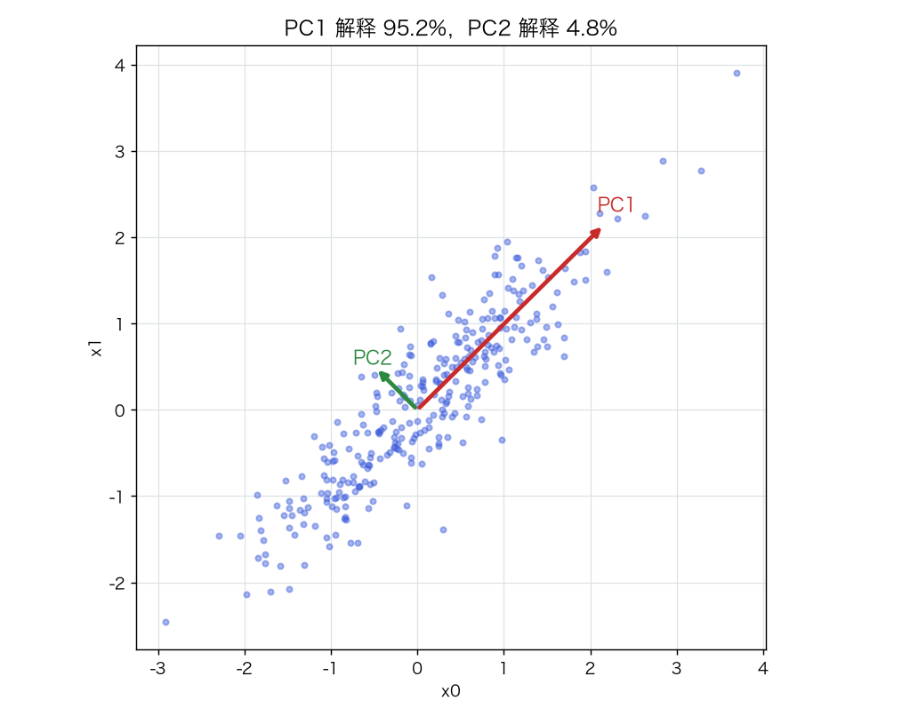
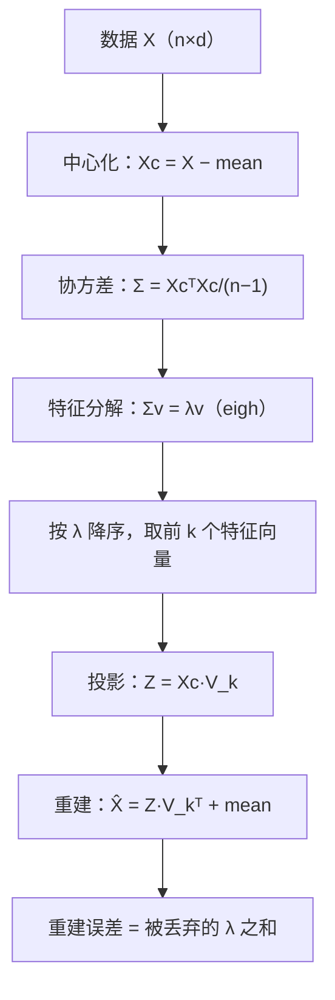
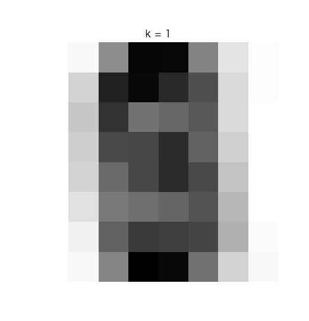

# PCA 主成分分析：方差最大化、特征分解与重建误差

> 状态：✅ 已完成（2026-10-21）
> 对应文档章节：`../../docs/人工智能代表算法演进路线.md` 第 3.4.2 章
> 阅读路线：零基础读者读「基础篇」（生活类比 → 手算 → 白话 → 自测）；要看推导、实现与复现实验读「进阶篇」
> 本族共 11 个实验，学习顺序与选读建议见 [族级导读](../README.md)。

无监督估计器（统计机器学习族）：入口是 `PCA(n_components, standardize, whiten).fit(X) / transform(X) / inverse_transform(Z)`，实现在 [impl.py](impl.py)；对照是 [framework.py](framework.py) 的 sklearn `PCA`。**没有 y**，也不做分派：它做的是**坐标变换**。

# 基础篇 · 先搞懂它

## 1. 生活类比：给高维数据拍一张"最有信息量的照片"

一摞三维物体要拍成二维照片。从正面拍，可能只看到一条线；从侧面拍，能看到轮廓。
PCA 做的就是**自动找"最能看清差异"的拍摄角度**：把数据投影到方差最大的方向上。

方差大 = 数据在这个方向上铺得开 = 信息多。PCA 依次找"互相垂直、方差最大"的方向，
前几个方向就概括了数据的大部分变化。

## 2. 核心量：主成分、方差占比、重建误差

**主成分**是协方差矩阵的特征向量 `v_j`，对应特征值 `λ_j` 是数据在该方向的方差。

**方差占比**：

$$\text{ratio}_j=\frac{\lambda_j}{\sum_i\lambda_i}$$

前 k 个主成分的累计占比，就是"保留了多少信息"。

**投影与重建**：

$$Z=X_c V_k,\qquad \hat X=Z V_k^\top+\bar x$$

`X_c` 是中心化后的数据；丢掉的后几个方向造成的误差，正好等于被丢掉的特征值之和。

## 3. 主循环：中心化 → 协方差 → 特征分解 → 投影

## 4. 手算示例：二维、相关系数 0.9

协方差矩阵：

$$\Sigma=\begin{bmatrix}1&0.9\\0.9&1\end{bmatrix}$$

特征值 `λ₁=1.9`、`λ₂=0.1`；特征向量 `v₁=(1,1)/√2`、`v₂=(−1,1)/√2`。

- 第一主成分方向：`(0.707, 0.707)`；
- 方差占比：`1.9/2=0.95`、`0.1/2=0.05`；
- 只保留 PC1：丢掉 5% 的方差，重建 MSE 约 `0.05×总方差/2`（逐元素平均）。

把点投影到 `v₁` 上，相当于"沿 45° 看这团数据"——这就是方差最大的角度。

## 5. 白话版：为什么中心化、为什么是特征向量、k 怎么选

**为什么中心化**：PCA 关心"围绕均值的波动"。不中心化，协方差算成了二阶矩，
第一主成分会指向均值方向（"数据整体离原点多远"），而不是数据内部的差异。

**为什么是特征向量**：要在 `‖v‖=1` 下最大化投影方差 `vᵀΣv`。
拉格朗日乘子给出 `Σv=λv`——最优方向就是特征向量，最大方差就是最大特征值。

**k 怎么选**：
- 累计方差占比（90%/95%）；
- 碎石图的肘部；
- **重建误差**：看降维再重建后损失多少；
- 下游任务：分类/聚类的效果（不能只看方差）。

**标准化**：PCA 对量纲敏感。若特征单位不同，先标准化（等价于对相关矩阵做 PCA）；
但这会改变"主成分"的含义，不一定总是更好。

## 6. 常见误区

- **❌ "PCA 需要标签"** —— 无监督，只看 X 的方差结构。
- **❌ "主成分是原始特征里挑几个"** —— 是原始特征的**线性组合**，通常每个都带一点。
- **❌ "方差占比高就一定对下游任务好"** —— 方差大不等于判别性强；分类任务要看标签。
- **❌ "必须标准化"** —— 量纲不同才需要；像素这类同量纲数据不一定要标准化。
- **❌ "主成分彼此独立"** —— 只是**不相关**（协方差为 0），不意味着独立。
- **❌ "k=n 时重建误差不为 0"** —— 保留全部主成分可以无损重建（数值误差除外）。

## 7. 动起来看：主成分越多，重建越清楚

同一个数字，k 从 1 加到 64：前几个主成分给出轮廓，后面的补细节。

## 8. 掌握清单：五级能力与自测

| 级别 | 能力 | 本实验的检验方式 | 在哪做 |
|---|---|---|---|
| 1 说清 | 用自己的话讲规则 | 说出主成分、方差占比、重建误差、中心化的作用 | 基础篇「核心量」「白话版」 |
| 2 走通 | 纸上手算 | 对 `[[1,0.9],[0.9,1]]` 求特征值/特征向量与方差占比 | 基础篇「手算示例」节 |
| 3 判断 | 说清正确性条件 | 写出方差最大化的拉格朗日推导；解释标准化改变了什么 | 进阶篇「数学推导」 |
| 4 实现 | 手写并与对照比对 | 跑通 `demo.py`，解释方差占比/重建误差与 sklearn 对齐 | 进阶篇「实验结果」 |
| 5 迁移 | 用到新问题 | 在真实数据上选 k，比较原始 vs PCA 的下游效果 | [project/](project/README.md) |

**自测关卡（先预测，再跑代码验证）**：

1. 二维相关数据只保留 PC1，重建 MSE 大概多少？
2. digits 保留 90% 方差需要几个主成分？95% 呢？
3. 把某个特征放大 10 倍，第一主成分会怎么变？标准化后呢？
4. 为什么 k=n 时重建误差是 0？

# 进阶篇 · 实验档案

## 目录形态（本算法的"类型"）

| 文件 | 角色 | 入口 / 说明 |
|---|---|---|
| [impl.py](impl.py) | 手写实现 | 中心化/标准化、协方差特征分解、投影/重建、whiten |
| [framework.py](framework.py) | 框架对照 | sklearn `PCA`（SVD） |
| [demo.py](demo.py) | 同数据双跑 | 三组实验：2D 方向 / digits 方差与重建 / 标准化 |
| [test_impl.py](test_impl.py) | 性质测试 | 正交、排序、占比、重建、whiten、契约 |
| [make_teaching_assets.py](make_teaching_assets.py) | 素材生成 + 对账 | 主成分方向 / 碎石图 / 重建对比 / 重建动画 |
| [exercises/](exercises/README.md) | 练习（5 题，题解分离） | 概念、手算、诊断、实现、迁移 |
| [project/](project/README.md) | 迁移项目 | 真实手写数字：PCA + kNN、选 k、重建误差 |

## 1. 设计原理

PCA 找"数据变化最大的正交方向"，用少数方向概括大部分方差。
它是**线性、无监督、全局**的降维：没有标签、没有分派，只有一次坐标旋转。

在演进路线里，它承接 K-Means 的"无监督"、开启降维主线；
下游包括分类/聚类前的降维、可视化、去噪、特征压缩。

## 2. 数学推导

**目标**：在 `‖v‖=1` 下最大化投影方差：

$$\max_v v^\top\Sigma v\quad\text{s.t.}\quad v^\top v=1$$

拉格朗日函数 `L=vᵀΣv−λ(vᵀv−1)`，对 v 求导：

$$2\Sigma v-2\lambda v=0\;\Longrightarrow\;\Sigma v=\lambda v$$

所以最优方向是特征向量，最大方差是最大特征值；后续主成分在与前面正交的约束下同理。

**重建误差**：保留前 k 个主成分，丢弃的方差是 `Σ_{j>k}λ_j`；逐元素 MSE 还要除以特征数 d。

**SVD 等价**：对中心化矩阵 `Xc` 做 SVD `Xc=U S Vᵀ`，则 `V` 的列就是主成分，
`λ_j=S_j²/(n−1)`。sklearn 默认走 SVD，数值上更稳（不必显式算协方差）。

**复杂度**：协方差 `O(nd²)` + 特征分解 `O(d³)`；SVD 对 `n≫d` 更稳。

## 3. 手写实现要点

1. **必须中心化**：`Xc = X − mean`；否则第一主成分指向均值。
2. **用 `eigh`**：协方差是对称矩阵，`eigh` 比 `eig` 稳，返回升序，要反转。
3. **符号约定**：特征向量符号可任意；本实现让"绝对值最大分量为正"，保证可复现。
4. **截断**：`n_components` 支持整数、浮点方差占比、None。
5. **重建**：`Z @ components_ + mean`；标准化时还要乘回 `scale_`。
6. **whiten**：投影后除以 `sqrt(λ)`，让各维方差为 1（注意 ddof 差异）。

## 4. 框架对照

sklearn `PCA` 用 **SVD**，手写用**协方差特征分解**；两者数学等价。
2D 相关数据上：PC1/PC2 方向、方差占比（0.9515/0.0485）完全一致；
digits 上 90% 方差需要的主成分数也一致。

| 维度 | 手写 | sklearn |
|---|---|---|
| 分解 | 协方差 + `eigh` | 中心化矩阵 SVD |
| 数值稳定性 | 显式协方差，`n≫d` 时较慢 | SVD 更稳、可截断 |
| 符号 | 自定义约定 | `svd_flip` |
| 额外能力 | 无 | 增量 PCA、随机化 SVD、核 PCA |

## 5. 实验结果

**环境**：uv 环境（`uv sync --extra dev`），Python 3.13.15 / numpy 2.5.4 / scikit-learn 1.9.1。
**数据**：二维相关高斯（`n=300`、`ρ=0.9`、`seed=0`）；digits（1797×64）。
**复现**：本目录内 `uv run python demo.py`、`uv run pytest test_impl.py -q`、
`uv run python make_teaching_assets.py`。

**实验一：二维相关数据**

| 量 | 手写 | sklearn |
|---|---|---|
| PC1 | (0.7098, 0.7044) | (0.7098, 0.7044) |
| 方差占比 | 0.9515 / 0.0485 | 0.9515 / 0.0485 |
| k=1 重建 MSE | 0.0487 | — |
| k=2 重建 MSE | ≈7e−33 | — |

**实验二：digits 的方差与重建**

前 2 个主成分解释 28.5%；**90% 需 21 个**、**95% 需 29 个**（共 64）。
全量拟合耗时：手写 **≈0.5 ms**、sklearn **≈0.4 ms**（同机同次，3 次中位数，随机器浮动）。

| k | 累计方差 | 重建 MSE |
|---|---|---|
| 1 | 0.1489 | 15.9777 |
| 2 | 0.2851 | 13.4210 |
| 5 | 0.5450 | 8.5424 |
| 10 | 0.7382 | 4.9143 |
| 20 | 0.8943 | 1.9843 |
| 30 | 0.9591 | 0.7681 |
| 50 | 0.9995 | 0.0085 |
| 64 | 1.0000 | 0.0000 |

**实验三：标准化改变"主成分"**

| 版本 | PC1 载荷 | 占比 |
|---|---|---|
| 原始（协方差） | (0.9949, 0.1007) | 0.998 |
| 标准化（相关矩阵） | (0.7071, 0.7071) | 0.948 |

原始 PCA 的 PC1 几乎只由大尺度特征 x0 决定；标准化后变成两者的均衡组合。

**验证声明（已验证）**：输入为上述数据与种子；2026-10-21 在 uv 环境实跑，
`uv run python demo.py` 输出上表；`uv run pytest test_impl.py -q` → **10 passed**；
`uv run python make_teaching_assets.py` 对账通过（2D 方差占比与 sklearn 一致；
digits 90% 方差需 21 个主成分）。

**可视化结论**：

- `images/00-主成分方向.png`：PC1 沿 45°，箭头长度对应方差；
- `images/01-方差解释.png`：碎石图 + 累计占比，标出 90%/95%；
- `images/02-重建对比.png`：k=1/5/20/50 的重建；
- `images/03-重建动画.gif`：k 从 1 到 64，数字逐渐清晰。

## 6. 局限与延伸

- **线性**：只能找线性子空间；流形数据用 t-SNE/UMAP/自编码器。
- **方差 ≠ 判别**：方差大的方向不一定是分类有用的方向（LDA 是有监督的对照）。
- **对量纲敏感**：不标准化时大尺度特征主导；标准化又改变含义，要按任务选。
- **离群点敏感**：方差被极端点放大；可用稳健 PCA。
- **主成分不独立**：只是不相关；需要独立成分用 ICA。
- **下游**：PCA 白化 + kNN/分类、核 PCA、增量 PCA、随机化 SVD；[K-Means](../kmeans/) 前常先降维。
- **边界行为**：`n_components` 超过 `min(n,d)` 时本实现静默截断，sklearn 会报错；
  单特征/常数特征/whiten 逆变换没有专门测试。
