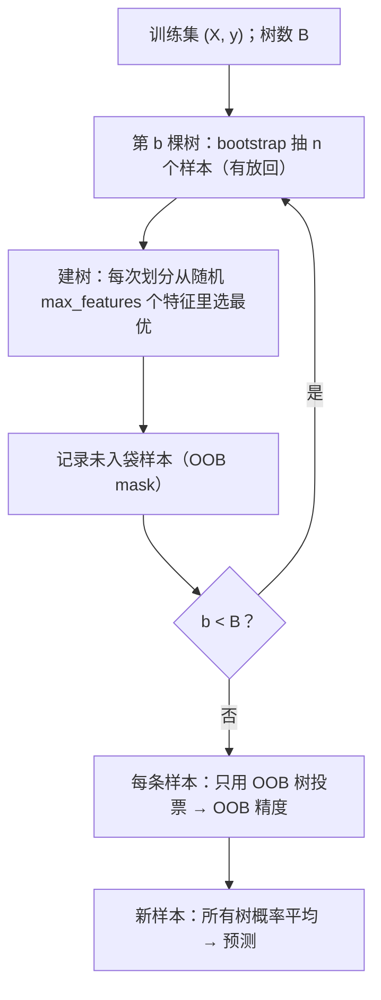
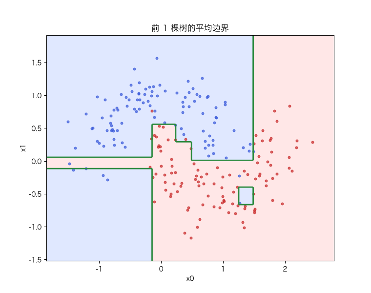

# 随机森林：Bagging、特征随机、OOB 与变量重要性

> 状态：✅ 已完成（2026-10-21）
> 对应文档章节：`../../docs/人工智能代表算法演进路线.md` 第 3.3.1 章（集成学习 · Bagging 系列）
> 阅读路线：零基础读者读「基础篇」（生活类比 → 手算 → 白话 → 自测）；要看推导、实现与复现实验读「进阶篇」
> 本族共 11 个实验，学习顺序与选读建议见 [族级导读](../README.md)。

监督估计器（统计机器学习族）：入口是 `RandomForest(n_trees, max_features, max_depth, random_state).fit(X, y) / predict(X) / predict_proba(X)`，实现在 [impl.py](impl.py)；对照是 [framework.py](framework.py) 的 sklearn `RandomForestClassifier`。它是 [决策树](../decision-tree/) 的 bagging 集成：**不新学划分准则，而是用随机性把很多棵树"平均"稳**。

# 基础篇 · 先搞懂它

## 1. 生活类比：一群普通专家投票

一棵决策树像一个聪明但情绪化的专家：换一批数据，它的判断就变。怎么办？

找 100 个这样的专家，每人只看**随机抽到的一部分数据**、每次决策只看**随机几个特征**，
最后投票。单个专家可能离谱，但"多数人的意见"通常更稳——这就是 bagging 的直觉。

随机森林比普通 bagging 多走一步：**每次划分只允许看随机特征子集**，
让专家们不要都盯着同一个最强特征，从而进一步降低"大家一起错"的概率。

## 2. 核心量：bootstrap、特征随机、OOB、重要性

**Bootstrap（自助采样）**：从 `n` 个训练样本中有放回地抽 `n` 个，训练一棵树。
每个样本一次都没被抽中的概率是

$$\left(1-\frac1n\right)^n \approx e^{-1}\approx 0.368$$

这约 36.8% 的样本就是这棵树的**袋外（OOB）样本**。

**特征随机**：每次划分不是从全部 `p` 个特征里选，而是从随机抽的 `max_features` 个里选
（分类默认 `sqrt(p)`）。这让树之间"相关性"下降。

**OOB 误差**：对每个样本，只用"没见过它"的树投票，得到一条预测；
所有样本的 OOB 预测准确率就是 OOB 精度——**不用额外验证集**就能估泛化。

**变量重要性**：一棵树里，特征 `j` 的重要性 = 它带来的不纯度下降按样本数加权求和；
森林对所有树取平均再归一化。它衡量"这个特征帮了多少忙"，**不是因果效应**。

## 3. 主循环：训练与 OOB

## 4. 手算示例：5 个样本的 bootstrap 与 OOB

`n=5`，某棵树的 bootstrap 下标是 `[0, 0, 2, 3, 3]`（有放回，所以 0 和 3 重复）。

- 入袋样本：`{0, 2, 3}`；
- **OOB 样本**：`{1, 4}`——这棵树完全没见过它们。

假设三棵树对样本 1 的预测是 `[0, 1, 1]`，真实标签是 `1`：

- 概率平均：`(0 + 1 + 1)/3 = 0.667` → 预测 `1`，OOB 判对；
- 若真实标签是 `0`，则判错。

把每个样本的 OOB 判断汇总，就是 OOB 精度。**注意：只有"该样本在 OOB 里"的树才参与投票。**

## 5. 白话版：为什么平均能降方差、为什么还要特征随机

**平均降方差**：若 `B` 棵树的方差都是 `σ²`、两两相关系数是 `ρ`，平均后的方差是

$$\text{Var}=\rho\sigma^2+\frac{1-\rho}{B}\sigma^2$$

树越多，第二项越小；但只要 `ρ>0`，第一项就下不去。所以**光增加树数不够，还要降 ρ**。

**特征随机就是降 ρ**：如果每棵树都先看同一个最强特征，它们会高度相似（ρ 大）；
每次划分强制换特征子集，树与树之间的差异变大，平均才更有效。

**OOB 为什么免费**：bagging 天然给每个样本留了约 36.8% 的"没见过它的树"，
拿这些树投票就是一次交叉验证。它比训练误差可靠，但仍是**样本内**估计，
数据有泄漏时也会乐观。

**重要性为什么不能当因果**：它只说明"这个特征在划分中被用得多、降不纯度多"；
相关特征会互相分走重要性，高基数特征也可能被高估。

## 6. 常见误区

- **❌ "树越多越容易过拟合"** —— 树多主要降方差，测试误差通常先降后平；不会因为 B 大而必过拟合。
- **❌ "OOB 一定等于测试精度"** —— OOB 是样本内估计；分布漂移/泄漏时会偏乐观。
- **❌ "特征重要性高 = 因果"** —— 只是模型内的贡献，相关特征会分摊重要性。
- **❌ "随机森林需要标准化"** —— 树只看阈值，单调缩放不影响划分。
- **❌ "max_features 越大越好"** —— 太大 → 树相似、ρ 高；太小 → 单树太弱。默认 `sqrt` 是折中。

## 7. 动起来看：投票如何把边界磨平

前 1、2、5、…、100 棵树的平均边界：单树有锯齿，树多了以后边界被"投票"磨平。

## 8. 掌握清单：五级能力与自测

| 级别 | 能力 | 本实验的检验方式 | 在哪做 |
|---|---|---|---|
| 1 说清 | 用自己的话讲规则 | 说出 bootstrap、max_features、OOB、重要性各是什么；解释 `ρ` 为什么关键 | 基础篇「核心量」「白话版」 |
| 2 走通 | 纸上手算 | 给定 bootstrap 下标，写出 OOB 集合；给三棵树投票算 OOB 判断 | 基础篇「手算示例」节 |
| 3 判断 | 说清正确性条件 | 写出方差分解公式；解释 OOB 的前提与重要性的偏差 | 进阶篇「数学推导」 |
| 4 实现 | 手写并与对照比对 | 跑通 `demo.py`，解释 OOB 与测试的关系、重要性排序 | 进阶篇「实验结果」 |
| 5 迁移 | 用到新问题 | 在真实多分类数据上用 OOB 选树数，并解释重要性 | [project/](project/README.md) |

**自测关卡（先预测，再跑代码验证）**：

1. 树数从 1 加到 200，测试准确率和 OOB 各怎么变？
2. `max_features=1` 与 `None` 相比，哪个更稳？为什么？
3. 为什么 OOB 精度通常略高于测试精度？
4. 两个高度相关的特征，重要性会怎么分？

# 进阶篇 · 实验档案

## 目录形态（本算法的"类型"）

| 文件 | 角色 | 入口 / 说明 |
|---|---|---|
| [impl.py](impl.py) | 手写实现 | `_Tree`（特征随机 CART）+ `RandomForest`（bootstrap、OOB、重要性） |
| [framework.py](framework.py) | 框架对照 | sklearn `RandomForestClassifier`（OOB、`n_jobs`） |
| [demo.py](demo.py) | 同数据双跑 | 五组实验：单树/森林 / 树数 / max_features / 重要性 / 稳定性 |
| [test_impl.py](test_impl.py) | 性质测试 | OOB 比例、max_features、集成增益、OOB 一致性、重要性、契约 |
| [make_teaching_assets.py](make_teaching_assets.py) | 素材生成 + 对账 | 边界对比 / 树数曲线 / 重要性 / 投票动画 |
| [exercises/](exercises/README.md) | 练习（5 题，题解分离） | 概念、手算、诊断、实现、迁移 |
| [project/](project/README.md) | 迁移项目 | 真实 10 分类（手写数字）上的 OOB 选树数与重要性 |

## 1. 设计原理

单棵树是**低偏差、高方差**：训练集稍变，结构就变。Bagging 用"bootstrap + 平均"
把方差压下去；随机森林再加"每次划分只看特征子集"，降低树间相关性 `ρ`，
让平均更有效。它不改变单棵树的表达能力，改变的是**集成后的方差**。

在演进路线里，它承接决策树的"不稳定性"，也是 Boosting 的对照面：
Bagging 并行降方差，Boosting 串行降偏差。

## 2. 数学推导

**bootstrap 的 OOB 比例**：单次抽样不命中某样本的概率 `1-1/n`，`n` 次独立：

$$P(\text{未入袋})=\left(1-\frac1n\right)^n\to e^{-1}\approx 0.368$$

**平均的方差**：设 `B` 棵树同方差 `σ²`、两两相关 `ρ`：

$$\text{Var}\left(\frac1B\sum_b T_b\right)
=\rho\sigma^2+\frac{1-\rho}{B}\sigma^2$$

**OOB 估计**：对样本 `i`，令 `S_i={b: i∉bootstrap_b}`，

$$\hat y_i^{\text{OOB}}=\arg\max_k \frac{1}{|S_i|}\sum_{b\in S_i} p_{b,k}(x_i),
\qquad \text{OOB}=\frac1n\sum_i \mathbb 1[\hat y_i^{\text{OOB}}=y_i]$$

**重要性**（mean decrease impurity）：

$$\text{Imp}(j)=\frac1B\sum_b\sum_{t\in T_b:\ \text{split on }j}
\frac{n_t}{n}\Big(I(t)-\frac{n_L}{n_t}I(L)-\frac{n_R}{n_t}I(R)\Big)$$

再对所有特征归一化。它对高基数/连续特征有偏差，必要时用置换重要性。

## 3. 手写实现要点

1. **每棵树独立 bootstrap**：`rng.integers(0, n, n)`，同时记录 `in_bag` 掩码 → OOB mask。
2. **特征随机发生在每次划分**，不是每棵树：`rng.choice(p, m, replace=False)` 后只在子集里找最优。
3. **OOB 只让"没见过该样本"的树投票**：按 mask 累加概率，最后除以计数；无 OOB 树的样本记 NaN。
4. **概率平均而非硬投票**：`predict_proba` 平均后 argmax，和 sklearn 口径一致。
5. **随机源统一**：bootstrap 与特征抽样共用一个 `Generator`，同 seed 完全可复现。
6. **重要性在树内按样本数加权**，森林取平均再归一化；不要对每棵树先归一化再平均（会扭曲权重）。

## 4. 框架对照

sklearn `RandomForestClassifier` 与手写版同口径（bootstrap + `sqrt(p)` + 概率平均）。
实测（moons，100 棵）：

| 指标 | 手写森林 | sklearn 森林 |
|---|---|---|
| 测试准确率 | 0.9444 | 0.9333 |
| OOB 精度 | 0.9524 | 0.9524 |
| 耗时（ms） | 256.0 | 43.8 |

差异在工程：sklearn 用 C 实现、多核并行、预排序/分箱与更成熟的随机数管理；
数学目标一致。OOB 相同说明"未入袋投票"的口径对上了。

## 5. 实验结果

**环境**：uv 环境（`uv sync --extra dev`），Python 3.13.15 / numpy 2.5.4 / scikit-learn 1.9.1。
**数据**：moons（`n=300`，`noise=0.25`，`seed=0`，70/30 分层切分）；高维合成数据
（`n=400`、`p=12`、4 个真特征、`flip_y=0.05`、`shuffle=False`）。
**复现**：本目录内 `uv run python demo.py`、`uv run pytest test_impl.py -q`、
`uv run python make_teaching_assets.py`。

**实验一：单棵树 vs 森林（moons，100 棵）**

| 方法 | 训练 acc | 测试 acc | OOB | 耗时（ms） |
|---|---|---|---|---|
| 手写 单树（n_trees=1） | 0.9762 | 0.9111 | 0.9296 | — |
| 手写 森林（100 棵） | 1.0000 | **0.9444** | 0.9524 | 256.0 |
| sklearn 森林（100 棵） | 1.0000 | 0.9333 | 0.9524 | 43.8 |

**实验二：树数扫描**

| n_trees | 训练 acc | 测试 acc | OOB |
|---|---|---|---|
| 1 | 0.9714 | 0.8667 | 0.9155 |
| 5 | 0.9952 | 0.9000 | 0.8770 |
| 10 | 1.0000 | 0.9111 | 0.9091 |
| 25 | 1.0000 | 0.9444 | 0.9429 |
| 50 | 1.0000 | 0.9444 | 0.9476 |
| 100 | 1.0000 | 0.9444 | 0.9524 |
| 200 | 1.0000 | 0.9333 | 0.9524 |

树数增加后 OOB 从 0.9155 升到 0.9524，50–100 棵后基本饱和。

**实验三：max_features 扫描（p=12）**

| max_features | 测试 acc | OOB |
|---|---|---|
| 1 | 0.6750 | 0.7607 |
| sqrt（3） | 0.7667 | 0.7964 |
| log2（3） | 0.7667 | 0.7964 |
| 6 | **0.8083** | 0.8357 |
| None（12） | 0.7833 | 0.8214 |

每次只看 1 个特征太弱；给到 3–6 个后明显改善。`sqrt` 是常用默认，不是最优保证。

**实验四：特征重要性（前 6）**

| rank | 特征 | 手写 | sklearn |
|---|---|---|---|
| 1 | x3 | 0.1527 | 0.1471 |
| 2 | x1 | 0.1439 | 0.1488 |
| 3 | x2 | 0.1320 | 0.1322 |
| 4 | x0 | 0.1211 | 0.1224 |
| 5 | x5（噪声） | 0.0855 | 0.0819 |
| 6 | x11（噪声） | 0.0574 | 0.0664 |

重要性前 4 正好是真特征 x0–x3；手写与 sklearn 的排序与量级一致。

**实验五：稳定性（10 个随机种子）**

| 模型 | 测试 acc 均值 | 标准差 |
|---|---|---|
| 单树 | 0.9022 | 0.0441 |
| 森林（100 棵） | **0.9422** | **0.0044** |

均值更高、波动小一个数量级——bagging 降方差的最直接证据。

**验证声明（已验证）**：输入为上述数据与种子；2026-10-21 在 uv 环境实跑，
`uv run python demo.py` 输出上表；`uv run pytest test_impl.py -q` → **11 passed**；
`uv run python make_teaching_assets.py` 对账通过（单树 OOB 0.930 → 森林 0.952、
重要性前 4 为真特征、森林测试 0.944）。耗时数字随机器浮动 `[随环境/版本变化]`。

**可视化结论**：

- `images/00-单树与森林边界.png`：单树锯齿边界 vs 森林平滑边界；
- `images/01-树数与OOB.png`：OOB 随树数上升并饱和，与测试同量级；
- `images/02-特征重要性.png`：真特征高、噪声低，手写与 sklearn 并排；
- `images/03-森林投票.gif`：逐棵加树，边界被投票磨平。

## 6. 局限与延伸

- **重要性有偏差**：高基数/连续特征容易被高估；相关特征会互相分摊。需要时用**置换重要性**。
- **OOB 不是万能验证**：它估计的是"训练分布内"的泛化；分布漂移、时间序列、分组数据要用独立验证。
- **不 extrapolate**：树/森林的预测是训练集标签的加权平均，超出特征范围不会外推。
- **内存与速度**：B 棵深树占内存；大样本用直方图/近似分裂（LightGBM 等）。
- **校准**：森林概率偏向中间值，需要时做 Platt/isotonic 校准。
- **自包含树带来重复**：`_Tree` 与 [决策树](../decision-tree/) 的 `DecisionTree` 是两套划分逻辑，
  改一处要同步两处；后续可抽成共享模块。
- **OOB 选树数会停在网格上界**：项目只扫到 100 棵，OOB 仍在缓慢上升，选中的 100 是边界；
  要真正演示"提前停"，需要把网格扩到 200+。
- **`oob_score(X, y)` 只校验长度**：不校验 X 是否就是训练集；传错同长度数据会得到无意义数字。
- **下游**：[Boosting/GBDT](../boosting/) 用串行残差拟合降偏差，与 bagging 形成对照；
  变量重要性/置换重要性的思想延伸到所有集成模型。
