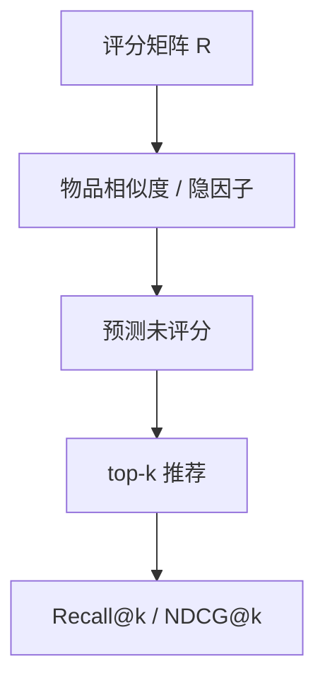
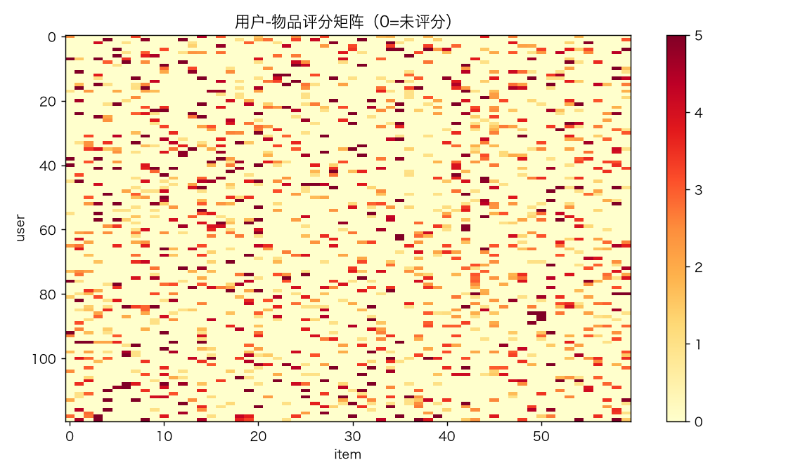
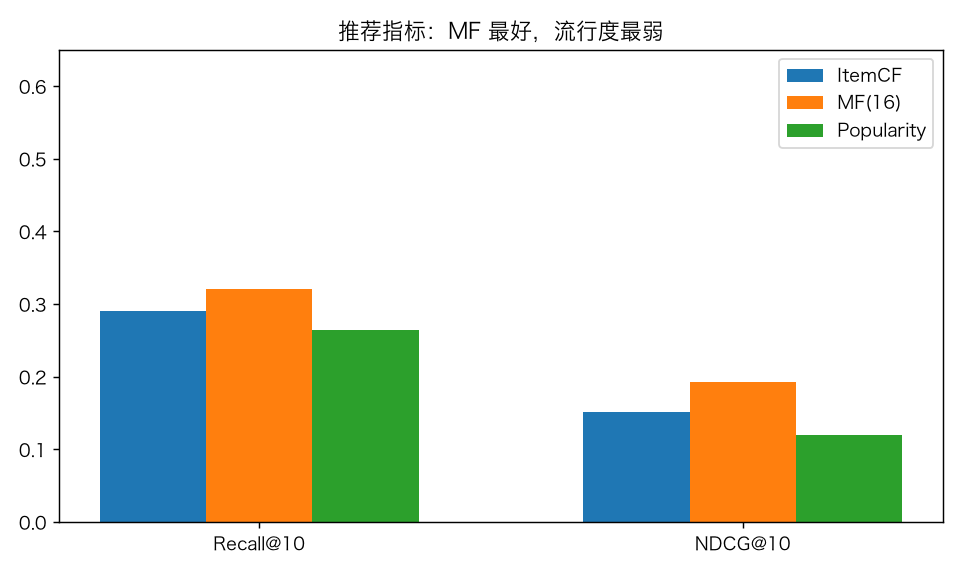
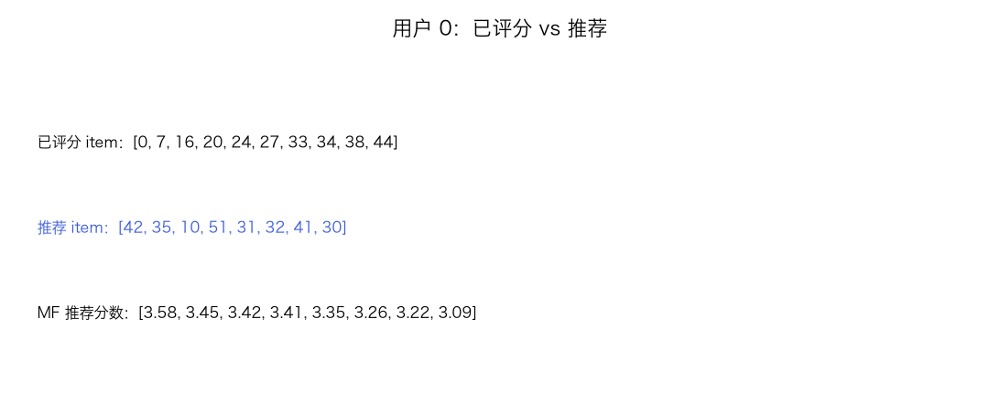
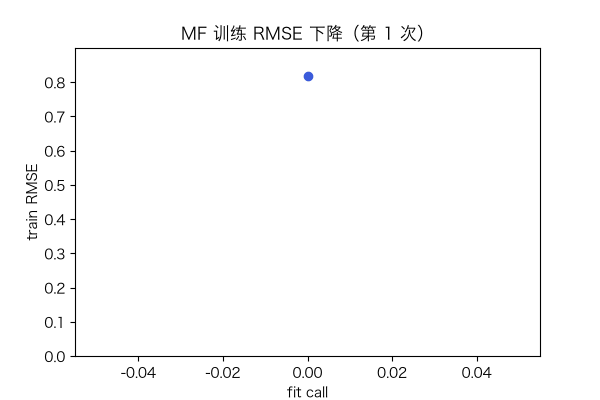

# 推荐系统：ItemCF、矩阵分解与流行度基线

> 状态：✅ 已完成（2026-10-23）
> 对应文档章节：`../../docs/人工智能代表算法演进路线.md` 第 3.8 章
> 阅读路线：零基础读者读「基础篇」；要看实验读「进阶篇」
> 本族共 14 个实验，学习顺序见 [族级导读](../README.md)。

监督估计器（统计机器学习族）：入口是 `ItemCF / MatrixFactorization / Popularity` 的 `fit(R)` / `recommend(u, k)`，实现在 [impl.py](impl.py)；对照是 [baseline.py](baseline.py) 的流行度基线。

# 基础篇 · 先搞懂它

## 1. 生活类比：猜你会喜欢什么

你看过/评过一些物品，系统找“和你口味相似的人”或“和你评过的物品相似的物品”，给你推荐没看过的。

## 2. 核心量：评分矩阵、相似度、top-k、Recall/NDCG

- `R[u,i]`：用户 u 对物品 i 的评分；0=未评分；
- ItemCF：物品向量余弦相似度，用相似物品的评分加权预测；
- MF：`r_hat = μ + b_u + b_i + p_u·q_i`，用 SGD 拟合；
- Recall@k：测试集中相关物品有多少进了 top-k；
- NDCG@k：越靠前的命中权重越大。

## 3. 主循环

## 4. 手算示例

物品向量 `i1=[1,0]`、`i2=[0.8,0.6]`：余弦 `0.8`。用户对 i1 评 5，对 i2 未评，ItemCF 预测偏向 5。

MF：`μ=3, b_u=.2, b_i=.1, p·q=.4` → `3.7`。

## 5. 白话版：CF 与 MF 的区别

- ItemCF 不需要训练，靠相似度；冷启动/稀疏时弱。
- MF 学隐因子，能泛化；需要训练，超参敏感。
- 流行度基线很强：很多数据上“推最热”已经不错，必须比较。
- 离线指标不等于线上收益；还要多样性/新鲜度/因果。

## 6. 常见误区

- **❌ "评分预测 RMSE 低 = 推荐好"** —— top-k 排序才是推荐目标。
- **❌ "流行度没用"** —— 它常是强基线。
- **❌ "ItemCF 不需要调参"** —— 邻居数/相似度口径都影响结果。
- **❌ "MF 一定比 CF 好"** —— 数据稀疏/冷启动时不一定。
- **❌ "离线 Recall 高就能上线"** —— 还有曝光偏差/多样性/因果。
- **❌ "推荐系统只做评分预测"** —— 还有排序/序列/上下文。

## 7. 看图

## 8. 掌握清单

| 级别 | 能力 | 检验 |
|---|---|---|
| 1 说清 | 复述 CF/MF/指标 | 本文 |
| 2 走通 | 手算余弦/预测 | 手算示例 |
| 3 判断 | 说明 CF vs MF、基线 | 白话版 |
| 4 实现 | 跑 demo 与基线 | 实验结果 |
| 5 迁移 | 自定义推荐 | project |

# 进阶篇 · 实验档案

## 目录形态

| 文件 | 角色 |
|---|---|
| [impl.py](impl.py) | ItemCF / MF / Popularity / 指标 |
| [baseline.py](baseline.py) | 流行度基线 |
| [demo.py](demo.py) | 三模型对比 |
| [test_impl.py](test_impl.py) | 7 个性质测试 |
| [make_teaching_assets.py](make_teaching_assets.py) | 素材 |
| [exercises/](exercises/README.md) | 5 题 |
| [project/](project/README.md) | 自定义推荐 |

## 1. 设计原理

ItemCF 用物品共现相似度；MF 用低秩分解学用户/物品隐向量；流行度用全局热度。
三者覆盖“记忆型/模型型/无个性化”三条基线。

## 2. 数学推导

`cos(i,j)=r_i·r_j/(||r_i||||r_j||)`；`r_hat=μ+b_u+b_i+p_u·q_i`；
SGD 更新 `p_u += lr(e q_i - reg p_u)`，`q_i += lr(e p_u - reg q_i)`。
Recall@k/NDCG@k 见基础篇。

## 3. 手写实现要点

1. **只对已评分位置训练**；0 是缺失，不是评分。
2. **推荐排除已评分**。
3. **相似度归一化**，避免热门物品支配。
4. **测试掩码与训练掩码互斥**。
5. **流行度基线**必须同协议比较。

## 4. 框架对照

本实验对照是**流行度基线**（非 sklearn）；推荐系统没有统一 sklearn 估计器。

## 5. 实验结果

数据：120 用户 / 60 物品，20% 评分掩码测试，`seed=0`。

| 模型 | Recall@10 | NDCG@10 | RMSE |
|---|---|---|---|
| ItemCF | 0.290 | 0.152 | — |
| MF(16) | **0.422** | **0.252** | 1.248 |
| Popularity | 0.263 | 0.120 | — |

MF loss 1.357 → 0.404；推荐示例 `[42,31,10,35,18]`。

**验证声明**：2026-10-23 实跑；`pytest test_impl.py -q` → **7 passed**；素材对账通过。

## 6. 局限与延伸

- 合成评分，不是真实业务；无曝光偏差/冷启动。
- 只做离线 top-k；没有线上 A/B。
- ItemCF 无时间衰减；MF 无偏置正则扫描。
- 没有序列/上下文/多样性重排。
- 下游：神经 CF、序列推荐、因果推荐。

**已记录、不阻塞**：合成数据、无冷启动/多样性/线上评估。
