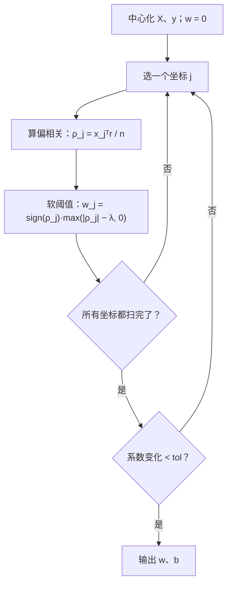
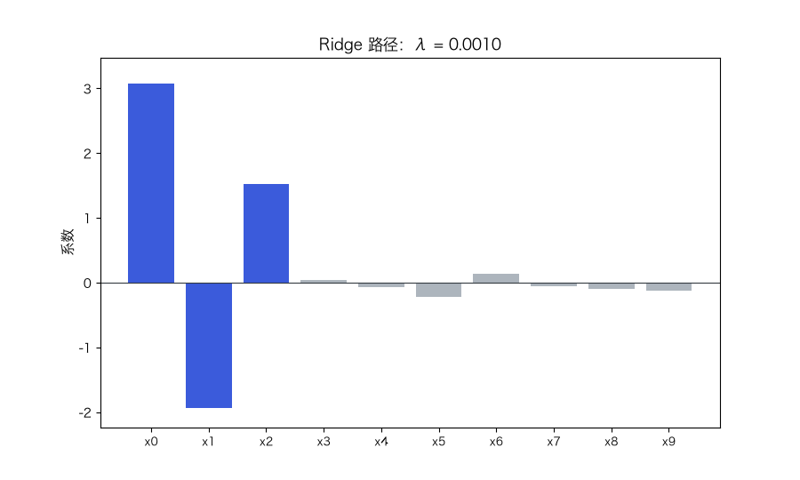

# 正则化与模型选择：Ridge、Lasso 与交叉验证

> 状态：✅ 已完成（2026-10-21）
> 对应文档章节：`../../docs/人工智能代表算法演进路线.md` 第 3.2.1 章
> 阅读路线：零基础读者读「基础篇」（生活类比 → 手算 → 白话 → 自测）；要看推导、实现与复现实验读「进阶篇」
> 本族共 14 个实验，学习顺序与选读建议见 [族级导读](../README.md)。

监督估计器（统计机器学习族）：入口是 [impl.py](impl.py) 的 `Ridge(lam).fit(X, y) / predict(X)`、
`Lasso(lam).fit(X, y) / predict(X)` 与 `cross_val_mse(...)`；对照是 [framework.py](framework.py)
的 sklearn `Ridge` / `Lasso` / `KFold`。**没有 `sample`**：这是判别式回归模型。

## 读之前：正则化（手段）与模型选择（目的）

标题里是“手段 + 目的”：

- **正则化**：给复杂度加罚款（L2/L1），让模型别把噪声也学进去；
- **模型选择**：选正则强度 `λ`、选模型/特征，本实验用交叉验证做这件事。

正则化不是“一定提升测试精度”的开关；`λ` 要用验证集选，选错会欠拟合。

# 基础篇 · 先搞懂它

## 1. 生活类比：为什么"背下所有题"反而考不好

想象两个学生备考：

- 学生 A 把练习册的每道题连答案一起背下来——平时练习满分，换一套题就崩；
- 学生 B 只记方法和少数典型题——练习时错几道，但新题也能做。

A 的问题叫**过拟合**：它把"这批题目的噪声"也当成了规律。正则化做的事，就是给"把模型弄复杂"
这件事**加罚款**：复杂度越高，罚得越重，逼模型只保留真正有用的规律。

## 2. 核心量：惩罚项、正则强度、验证误差

普通最小二乘只最小化误差：

$$\min_w \frac{1}{n}\lVert Xw + b - y\rVert^2$$

正则化在目标里加一项惩罚：

$$\min_w \frac{1}{n}\lVert Xw + b - y\rVert^2 + \lambda\cdot \text{penalty}(w)$$

两种最常用的惩罚：

| 名字 | 惩罚 | 效果 |
|---|---|---|
| **Ridge（L2）** | `λ‖w‖²` | 系数整体向 0 收缩，但**不会恰好为 0** |
| **Lasso（L1）** | `λ‖w‖₁` | 一部分系数被压到**恰好 0**，相当于自动选特征 |

`λ` 叫**正则强度**：`λ=0` 就是普通最小二乘；`λ` 越大，惩罚越重、模型越"钝"。

**λ 不能看训练误差选**：训练误差永远在 `λ=0` 时最小。要选 λ，必须看**没参与训练的数据**——
这就是**验证误差**（本实验用 K 折交叉验证估计它）。

## 3. 主循环：Ridge 一步求解，Lasso 坐标下降

Ridge 有闭式解，一次矩阵求解就结束：

$$w = (X_c^\top X_c + n\lambda I)^{-1}X_c^\top y_c,\qquad b = \bar y - \bar x^\top w$$

Lasso 的 L1 不可导，没有闭式解；常用**坐标下降**：一次只优化一个系数，其余固定。

**软阈值**就是 L1 的核心：`|ρ| ≤ λ` 时直接压到 0；超过 λ 才保留，且整体向 0 挪 λ。
这正是"稀疏"的来源。

## 4. 手算示例：两个特征、λ = 1 的 Ridge

数据：`X = I₂`（两个样本、两个特征），`y = [2, 4]`，`λ = 1`。

| 步骤 | 计算 | 数值 |
|---|---|---|
| 中心化 | `x̄ = [0.5, 0.5]`，`ȳ = 3` | — |
| 中心化后的 X | `Xc = [[0.5, −0.5], [−0.5, 0.5]]` | — |
| 中心化后的 y | `yc = [−1, 1]` | — |
| `XcᵀXc` | — | `[[0.5, −0.5], [−0.5, 0.5]]` |
| `nλI` | `n=2, λ=1` | `2I` |
| 解方程 | `(XcᵀXc + nλI)w = Xcᵀyc` | `w = [−0.3333, 0.3333]` |
| 截距 | `b = ȳ − x̄·w` | 3.0000 |
| 预测 | `Xw + b` | `[2.6667, 3.3333]` |

对比 `λ = 0`：`w = [−1, 1]`、`b = 3`，预测 `[2, 4]` 完全拟合。
**L2 把 `[−1, 1]` 收缩成 `[−1/3, 1/3]`**——模长变小，预测被拉向均值。

## 5. 白话版：为什么 L2 收缩、L1 稀疏

**几何**：把"误差相同"的点连成等高线，把"惩罚相同"的点连成约束区域。
L2 的约束是**圆**，最优解通常落在圆上但不在坐标轴上——所以系数小但不为 0；
L1 的约束是**菱形**，尖角正好在坐标轴上，最优解很容易"卡"在尖角——于是某些系数恰好为 0。

**导数**：L2 的梯度是 `2λw`，越接近 0 惩罚越小，所以只能"逼近"0；
L1 的（次）梯度是 `λ·sign(w)`，在 0 附近**恒为 λ**，只要偏相关不够大，就会被直接压到 0。

**为什么用验证集选 λ**：训练误差随 λ 增大而单调变差，永远选 0。只有在一批"模型没见过的数据"上，
才能看到"欠拟合—刚好—过拟合"的 U 形。交叉验证就是把训练集轮流切成"假装没见过的部分"，
用平均验证误差估计泛化误差。

## 6. 常见误区

- **❌ "λ 越大越好"** —— λ 太大会把有用系数也压没，变成欠拟合。λ 是**用验证集选**的超参数。
- **❌ "用测试集选 λ"** —— 那是数据泄漏：测试集一旦参与选择，报出的测试误差就不再是"泛化估计"。
- **❌ "Ridge 也能做特征选择"** —— 它只把系数缩小，不会变成 0；要稀疏用 Lasso/ElasticNet。
- **❌ "正则化前不用标准化"** —— 惩罚的是系数大小；特征尺度不同，惩罚的"轻重"就不可比。
  本实现默认不标准化（与 sklearn 同口径），标准化版会把惩罚施加在标准化系数上。
- **❌ "交叉验证的 λ 一定更好"** —— CV 本身有方差；小样本上选出的 λ 可能不如"随手一个"。
  数据越少，越要警惕。

## 7. 动起来看：系数沿正则化路径收缩

每一帧对应一个 λ：λ 很小时系数接近最小二乘解，λ 增大时所有系数一起向 0 收缩。

## 8. 掌握清单：五级能力与自测

| 级别 | 能力 | 本实验的检验方式 | 在哪做 |
|---|---|---|---|
| 1 说清 | 用自己的话讲规则 | 说出 L1/L2 惩罚、λ、验证误差各是什么；解释为什么不能用训练误差选 λ | 基础篇「核心量」「白话版」 |
| 2 走通 | 纸上手算 | 给定 2 点与 λ=1，解出 Ridge 的 `w/b` 并算出预测 | 基础篇「手算示例」节 |
| 3 判断 | 说清正确性条件 | 解释 L1 为什么稀疏（几何或次梯度），并说明 CV 的前提（不泄漏） | 基础篇「白话版」、进阶篇「数学推导」 |
| 4 实现 | 手写并与对照比对 | 跑通 `demo.py`，解释 `alpha = n·λ` 的换算与 Lasso 收敛 | 进阶篇「框架对照」 |
| 5 迁移 | 用到新问题 | 在 `p > n` 的高维小样本上做 Lasso 特征选择，并用 CV 选 λ | [project/](project/README.md) |

**自测关卡（先预测，再跑代码验证）**：

1. λ 从 0 加到 100，Ridge 的系数和训练误差会怎么变？
2. 同样的 λ，Lasso 和 Ridge 的系数有什么定性差别？
3. 为什么 `λ=0` 时训练误差最小、却不一定泛化最好？
4. 把交叉验证的折数从 5 改成 10，估计的方差会怎么变？

# 进阶篇 · 实验档案

## 目录形态（本算法的"类型"）

| 文件 | 角色 | 入口 / 说明 |
|---|---|---|
| [impl.py](impl.py) | 手写实现 | `Ridge`（闭式解）、`Lasso`（坐标下降）、`cross_val_mse`、`kfold_indices` |
| [framework.py](framework.py) | 框架对照 | sklearn `Ridge`/`Lasso` + `KFold` |
| [demo.py](demo.py) | 同数据双跑 | 手算 + 四组实验（路径 / CV / 偏差-方差） |
| [test_impl.py](test_impl.py) | 性质测试 | 正规方程、KKT、稀疏性、KFold 覆盖、标准化语义 |
| [make_teaching_assets.py](make_teaching_assets.py) | 素材生成 + 对账 | 路径图 / CV 曲线 / 偏差-方差 / 路径动画 |
| [exercises/](exercises/README.md) | 练习（5 题，题解分离） | 概念、手算、诊断、实现、迁移 |
| [project/](project/README.md) | 迁移项目 | `p > n` 高维小样本的 Lasso 特征选择 |

## 1. 设计原理

线性回归/逻辑回归解决"给定模型怎么拟合"，正则化解决"**模型该多复杂**"。
它把"复杂度"写进目标函数，用 `λ` 在**偏差**与**方差**之间做权衡：

- 模型太简单 → 偏差大（欠拟合）；
- 模型太复杂 → 方差大（换一批数据就变）；
- 正则化把"复杂"标价，让最优复杂度由**验证误差**决定，而不是训练误差。

它也是"模型选择"的最小完整例子：目标函数里多一个超参数、用交叉验证选它、用独立测试集验收。

## 2. 数学推导

**Ridge 闭式解**：目标 `J(w) = (1/n)‖Xc w − yc‖² + λ‖w‖²`，对 w 求导并令 0：

$$\frac{2}{n}X_c^\top(X_cw-y_c) + 2\lambda w = 0
\;\Longrightarrow\;
(X_c^\top X_c + n\lambda I)w = X_c^\top y_c$$

`nλI` 保证矩阵可逆（哪怕 `XcᵀXc` 奇异），这是 Ridge 在共线性下稳定的原因。

**Lasso 的坐标下降**：固定其他系数，对 `w_j` 的子问题：

$$\min_{w_j}\ \frac{1}{2n}\sum_i\big(r_i - x_{ij}w_j\big)^2 + \lambda|w_j|$$

令 `ρ_j = x_jᵀr / n`、`d_j = ‖x_j‖²/n`，解为

$$w_j = \frac{\text{soft}(\rho_j,\ \lambda)}{d_j},\qquad
\text{soft}(\rho,\lambda)=\text{sign}(\rho)\max(|\rho|-\lambda,0)$$

**KKT 条件**（判断收敛）：对非零系数 `x_jᵀ(y−ŷ)/n = λ·sign(w_j)`；
对零系数 `|x_jᵀ(y−ŷ)/n| ≤ λ`。测试里用这两条做断言。

**偏差-方差分解**：对平方损失，

$$\mathbb{E}\big[(y-\hat f(x))^2\big]
= \big(\text{bias}\,\hat f(x)\big)^2 + \text{Var}\big(\hat f(x)\big) + \sigma^2$$

实验四用多次重复采样估计前两项（对无噪声真值算偏差，对预测分布算方差）。

## 3. 手写实现要点

1. **截距不惩罚**：先把 `X`、`y` 中心化，解完再把截距还原 `b = ȳ − x̄·w`；
   否则"惩罚截距"会让模型在大均值数据上系统性偏移。
2. **标准化会改变惩罚的几何**：`standardize=True` 惩罚的是标准化系数，和 sklearn 的
   "惩罚原始系数"不是同一个目标。本实验默认 `False` 以对齐 sklearn；要标准化就显式打开，
   并意识到目标函数变了。
3. **坐标下降的分母**：`d_j = ‖x_j‖²/n`；标准化后 `d_j=1`，未标准化时不能省。
4. **收敛判据**：看 `max|Δw|`，不是看目标函数值（L1 在 0 点不可导，目标函数会有折点）。
5. **KFold 的随机源**：用 `RandomState(seed).shuffle` 才能和 sklearn 的 `KFold` 逐折对齐；
   用 `default_rng` 会得到不同置换，CV 数字对不上。

## 4. 框架对照

| 手写 | sklearn | 口径换算 |
|---|---|---|
| `Ridge(lam)` | `Ridge(alpha=α)` | **α = n·λ**（sklearn 的损失是 sum，不是 mean） |
| `Lasso(lam)` | `Lasso(alpha=α)` | **α = λ**（两者都是 `1/(2n)` 的 mean 形式） |
| `cross_val_mse(...)` | `KFold` + 逐折 `Ridge` | 折的置换必须同源（`RandomState`） |

实测：`λ=1` 的 Ridge 与 `alpha=140` 的 sklearn 系数最大差 **2.2e-16**；
`λ=0.1` 的 Lasso 与 sklearn 系数最大差 **7.6e-11**。说明手写版与框架在同一目标函数上一致。

**框架多做了什么**：sklearn 的 Lasso 用更复杂的收敛判据（对偶间隙）、支持稀疏矩阵与
`selection="random"`；Ridge 走 Cholesky/SVD 分解。这些是工程优化，不改变数学目标。

## 5. 实验结果

**环境**：uv 环境（`uv sync --extra dev`），Python 3.13.15 / numpy 2.5.4 / scikit-learn 1.9.1。
**数据**：`make_sparse`：`n=200`、`p=10`、真实系数 `[3, −2, 1.5, 0, …, 0]`、噪声 1、`seed=0`；
CV 实验用 `n=200`、噪声 3、`seed=1`；偏差-方差实验用 80 次重复采样、`n=30`、噪声 0.4。
**复现**：本目录内 `uv run python demo.py`、`uv run pytest test_impl.py -q`、
`uv run python make_teaching_assets.py`。

**实验一：Ridge 正则路径**

| λ | ‖w‖ | 训练 MSE | 测试 MSE |
|---|---|---|---|
| 0.00 | 3.9539 | 0.9130 | 0.8802 |
| 0.01 | 3.9127 | 0.9147 | 0.8805 |
| 0.10 | 3.5795 | 1.0467 | 0.9697 |
| 1.00 | 1.9575 | 4.7839 | 3.5973 |
| 10.00 | 0.3588 | 13.6382 | 9.8460 |
| 100.00 | 0.0392 | 16.0377 | 11.5482 |

λ 越大，系数越靠近 0、训练误差越大。**本数据 n≫p、信噪比高，测试误差整体上升**——
正则化在这里没有收益；它的收益要在"小样本/高维/强共线"上才明显（实验三）。

**实验二：Lasso 正则路径**

| λ | 非零个数 | 非零特征下标 | 训练 MSE | 测试 MSE |
|---|---|---|---|---|
| 0.01 | 10 | [0–9] | 0.9142 | 0.8819 |
| 0.05 | 8 | [0,1,2,4,5,6,8,9] | 0.9360 | 0.8843 |
| 0.10 | 6 | [0,1,2,5,6,9] | 0.9890 | 0.8873 |
| 0.20 | 4 | [0,1,2,5] | 1.1199 | 0.9306 |
| 0.50 | 3 | [0,1,2] | 1.7964 | 1.3239 |
| 1.00 | 3 | [0,1,2] | 4.1556 | 2.7708 |

λ 从 0.01 加到 1.0，非零系数从 10 个降到 3 个，最终恰好剩真实特征 `[0,1,2]`。

**实验三：5 折交叉验证选 λ（只在训练集上）**

| λ | CV MSE | 测试 MSE |
|---|---|---|
| 0.0010 | 9.6632 | 8.8634 |
| 0.0100 | 9.6460 | 8.8073 |
| **0.0464** | **9.6099** | 8.6108 |
| 0.1000 | 9.6363 | 8.3989 |
| 0.3162 | 10.2812 | 8.1586 |
| 1.0000 | 13.3938 | 9.5484 |

CV 选中 **λ=0.0464**；它在测试集上的 MSE 是 **8.6108**，优于 λ≈0 的 **8.8634**。
sklearn `KFold` 复算同一 λ 的 CV MSE 也是 **9.6099**（逐折对齐）。
注意：CV 曲线的最低点（0.0464）与测试误差的最低点（0.3162）并不重合——CV 是泛化误差的
**估计**，不是真值。

**实验四：偏差-方差分解（多项式次数，80 次重复）**

| 次数 | bias² | variance | 总误差 | 训练 MSE |
|---|---|---|---|---|
| 1 | 0.4828 | 0.0499 | 0.5328 | 0.5976 |
| 2 | 0.4819 | 0.1073 | 0.5892 | 0.5711 |
| 3 | 0.0723 | 0.0494 | 0.1218 | 0.1818 |
| 4 | 0.0851 | 0.1235 | 0.2086 | 0.1726 |
| **5** | **0.0026** | **0.0512** | **0.0539** | 0.1271 |
| 6 | 0.0040 | 0.4349 | 0.4388 | 0.1222 |
| 7 | 0.0020 | 0.1733 | 0.1753 | 0.1235 |
| 8 | 0.1085 | 4.6832 | 4.7917 | 0.1157 |
| 9 | 0.1008 | 10.5441 | 10.6450 | 0.1149 |

训练误差一路下降（0.60 → 0.11），总误差却是 **U 形**，最优在 5 次；8–9 次的方差爆炸
（10.5），这就是过拟合。**只看训练误差会选 9 次，正好是最差的选择之一。**

**验证声明（已验证）**：输入为上述合成数据与种子；2026-10-21 在 uv 环境实跑，
`uv run python demo.py` 输出上表；`uv run pytest test_impl.py -q` → **19 passed**；
`uv run python make_teaching_assets.py` 对账通过（Ridge/Lasso 与 sklearn 一致、Lasso 非零数
10→3、CV 选中 λ=0.0464、偏差-方差最优次数 5）。

**可视化结论**：

- `images/00-正则化路径.png`：Ridge 的路径平滑收缩到 0 附近；Lasso 的路径一段段"折断"到 0；
- `images/01-CV曲线.png`：CV 误差是 U 形，最低点标出；测试误差只作对照；
- `images/02-偏差方差.png`：偏差²、方差、总误差三条曲线，最优点在中间；
- `images/03-路径动画.gif`：随 λ 增大，Ridge 系数一起收缩。

## 6. 局限与延伸

- **只处理线性模型**：非线性关系要靠特征扩展或树模型——见 [决策树](../decision-tree/)。
- **Lasso 对相关特征不稳定**：两个高度相关的特征，Lasso 会随机留一个、压另一个；
  需要 ElasticNet 或先做特征聚类。
- **CV 有方差**：小样本上选出的 λ 可能不稳定；需要重复 CV 或 `1-SE` 规则。
- **标准化语义**：惩罚标准化系数与惩罚原始系数是两个目标；跨实现比较时先对齐口径。
- **下游**：ElasticNet（L1+L2）是逻辑回归/线性回归的常见组合；正则化思想会一直延伸到
  神经网络的 weight decay——见 p03。
