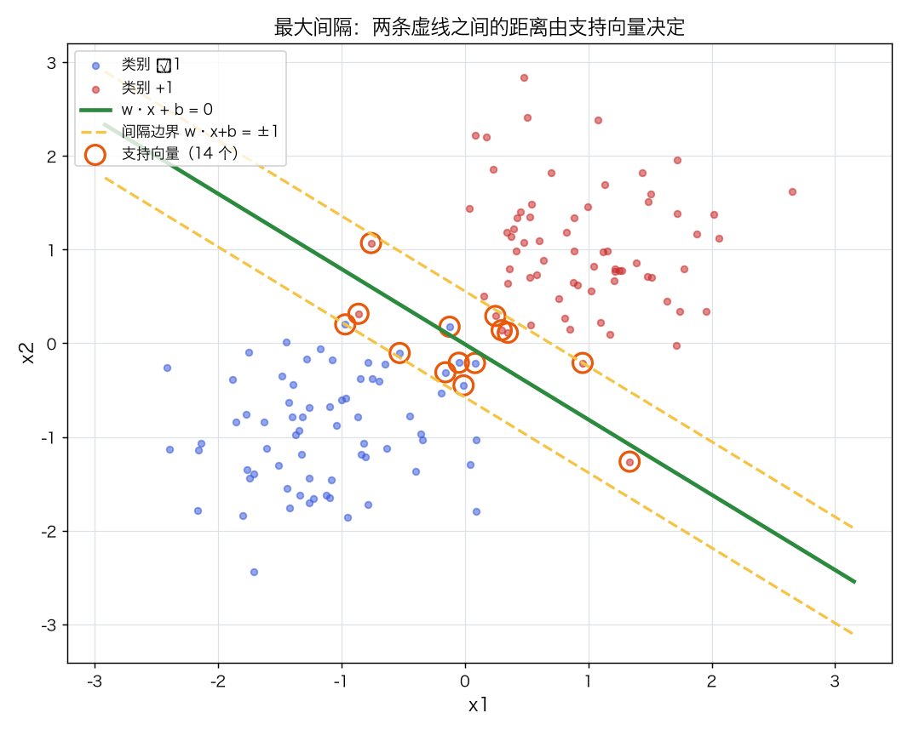
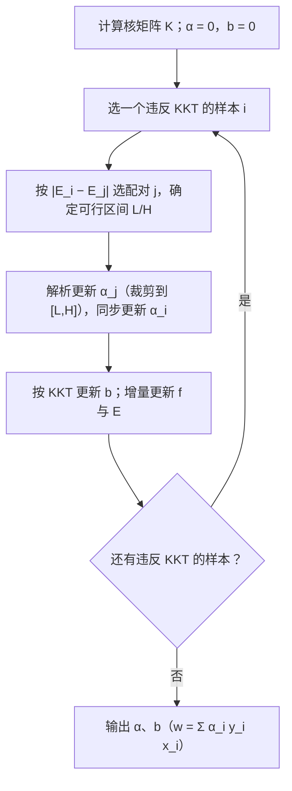
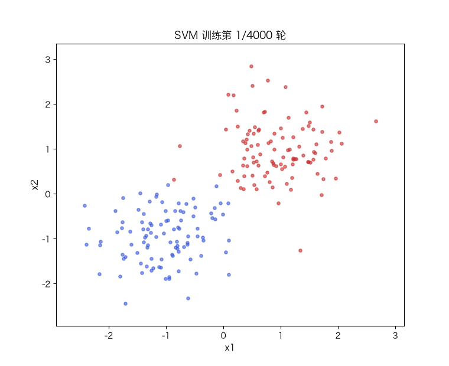

# 支持向量机 SVM：最大间隔、hinge 损失与核技巧

> 状态：✅ 已完成（2026-10-21）
> 对应文档章节：`../../docs/人工智能代表算法演进路线.md` 第 3.2.2 章
> 阅读路线：零基础读者读「基础篇」（生活类比 → 手算 → 白话 → 自测）；要看推导、实现与复现实验读「进阶篇」
> 本族共 14 个实验，学习顺序与选读建议见 [族级导读](../README.md)。

监督估计器（统计机器学习族）：入口是 [impl.py](impl.py) 的 `LinearSVM(C).fit(X, y) / predict(X)`（原始问题）
与 `KernelSVM(C, kernel).fit(X, y) / decision_function / predict`（对偶 + SMO）；对照是 [framework.py](framework.py)
的 sklearn `SVC` / `LinearSVC`。**没有 `sample`**：判别式模型。

# 基础篇 · 先搞懂它

## 1. 生活类比：在两条街之间修一条最宽的路

两类点像两条街上的房子，你要在中间修一条路把两边分开。能分开的路线有无数条，怎么选？

SVM 的答案是：**选那条"离两边房子都尽量远"的路**。路越宽，新房子（新样本）越不容易压线。
这条路的中线就是分类边界，路的宽度就是**间隔**；紧贴路边的那几栋房子，就是**支持向量**。

## 2. 核心量：间隔、hinge 损失、C

**分类边界**是超平面 `w·x + b = 0`。点到它的**函数间隔**是 `y·(w·x+b)`，
除以 `‖w‖` 得到**几何间隔**：

$$\text{margin} = \frac{2}{\lVert w\rVert}$$

最大化间隔等价于最小化 `½‖w‖²`。

**hinge 损失**衡量"违反间隔"的代价：

$$\ell(s, y) = \max\big(0,\ 1 - y\cdot s\big),\qquad s = w\cdot x + b$$

- `y·s ≥ 1`：在间隔外、分对了 → 损失 0；
- `0 < y·s < 1`：分对了但太靠近边界 → 线性惩罚；
- `y·s < 0`：分错了 → 损失大于 1。

完整目标（**sum 口径**，C 是每个样本违反间隔的罚金）：

$$\min_{w,b}\ \frac12\lVert w\rVert^2 + C\sum_i \max\big(0, 1 - y_i(w\cdot x_i+b)\big)$$

- `C` 小：更看重"路宽"，允许一些点压线（软间隔、更稳）；
- `C` 大：更看重"分对训练集"，路会变窄（容易过拟合）。

图里两条虚线是 `w·x+b = ±1`，它们的间距就是间隔；被圈出的点满足 `α>0`，只有它们决定边界。

## 3. 主循环：原始问题用次梯度，对偶问题用 SMO

**原始问题**（线性核）直接对 hinge 做次梯度下降：只有 `y·s < 1` 的样本贡献梯度，
`w` 同时受正则项 `w` 的拉回。

**对偶问题**（核技巧的来源）用 SMO（成对坐标上升）：

## 4. 手算示例：三个点、一条竖线

取 `w = (1, 0)`、`b = 0`，所以边界是 `x₁ = 0`，几何间隔 `2/‖w‖ = 2`。

| 样本 | x | y | score `w·x+b` | `y·score` | hinge |
|---|---|---|---|---|---|
| A | (2, 0) | +1 | 2 | 2 | 0（在间隔外） |
| B | (0.5, 0) | +1 | 0.5 | 0.5 | 0.5（压线） |
| C | (−1, 0) | +1 | −1 | −1 | 2（分错） |

目标值（`C = 1`）：`½‖w‖² + C·(0 + 0.5 + 2) = 0.5 + 2.5 = 3.0`。

A 的损失是 0，**它不会影响解**；B、C 才是"支持向量"。这就是 SVM 稀疏性的来源：
边界只由少数几个点决定。

## 5. 白话版：为什么对偶、为什么核、为什么稀疏

**为什么对偶**：原始问题要求 `w` 是特征的线性组合。把约束用拉格朗日乘子写进目标，
对 `w` 求导得 `w = Σ α_i y_i x_i`——**w 只由支持向量（α>0）决定**。代回去得到只含 `α` 的问题。

**为什么核**：对偶里 `x_i` 只以**内积** `x_i·x_j` 出现。把内积换成核函数 `K(x_i,x_j)`，
就等价于把特征映射到高维 `φ(x)` 再做内积，但**不需要真的算出 φ(x)**。RBF 核
`K(x,z)=exp(−γ‖x−z‖²)` 对应无穷维特征空间——线性核切不开的同心圆，它一刀就能分开。

**为什么稀疏**：KKT 条件说，只有"正好压在间隔上或违反间隔"的样本 `α>0`；
间隔外的点 `α=0`，对 `w` 没有贡献。所以增删一个远离边界的点，解不变。

**C 的两端**：`C→0` 时正则项压倒一切，`w→0`（全判一类）；`C→∞` 时退化为硬间隔，
对噪声敏感。中间才是"宽路 + 允许少量压线"。

## 6. 常见误区

- **❌ "SVM 只能处理线性问题"** —— 线性核只是其中一种；RBF/多项式核能画曲线边界。
- **❌ "C 越大越好"** —— C 大 = 更贴训练集、间隔更窄，噪声点上容易过拟合。
- **❌ "所有训练点都是支持向量"** —— 只有 `α>0` 的少数点；本实验的线性例子只有 14/140。
- **❌ "核越复杂越好"** —— RBF 的 `γ` 太大时每个点都成了孤岛（过拟合），太小则退化成线性。
- **❌ "标准化不影响 SVM"** —— 标准化会改变 `‖w‖` 的几何，从而改变正则化的含义；
  与 sklearn 对比时要么两边都标准化，要么都不标准化（本实验对比时统一不标准化）。

## 7. 动起来看：边界如何转到位

原始问题的次梯度下降：边界从初始位置逐步转到"两边都尽量远"的位置。

## 8. 掌握清单：五级能力与自测

| 级别 | 能力 | 本实验的检验方式 | 在哪做 |
|---|---|---|---|
| 1 说清 | 用自己的话讲规则 | 说出间隔、hinge、C、支持向量各是什么；解释为什么间隔外的点不影响解 | 基础篇「核心量」「白话版」 |
| 2 走通 | 纸上手算 | 给定 `w,b` 与 3 个点，算出 score、margin、hinge 与目标值 | 基础篇「手算示例」节 |
| 3 判断 | 说清正确性条件 | 写出 KKT 三种情形，并解释 C、γ 各自控制什么 | 进阶篇「数学推导」 |
| 4 实现 | 手写并与对照比对 | 跑通 `demo.py`，解释原始/对偶/框架的间隔与 SV 数为何一致 | 进阶篇「实验结果」 |
| 5 迁移 | 用到新问题 | 在真实数据上做 RBF 的 C/γ 交叉验证与线性/核对照 | [project/](project/README.md) |

**自测关卡（先预测，再跑代码验证）**：

1. C 从 0.1 加到 100，间隔和支持向量数会怎么变？
2. 在同心圆上，线性核和 RBF 核的准确率大概差多少？
3. 为什么 `α=0` 的样本删掉不影响解？KKT 的哪一条说明了这点？
4. RBF 的 γ 调得非常大，决策边界会变成什么样？

# 进阶篇 · 实验档案

## 目录形态（本算法的"类型"）

| 文件 | 角色 | 入口 / 说明 |
|---|---|---|
| [impl.py](impl.py) | 手写实现 | `LinearSVM`（原始 + 次梯度）、`KernelSVM`（对偶 + SMO） |
| [framework.py](framework.py) | 框架对照 | sklearn `SVC` / `LinearSVC`（同 sum 口径，C 直接对应） |
| [demo.py](demo.py) | 同数据双跑 | 三方对照 / C 扫描 / 核技巧 / hinge vs logistic |
| [test_impl.py](test_impl.py) | 性质测试 | hinge、C 的几何、原始 vs 对偶、KKT、核矩阵、契约 |
| [make_teaching_assets.py](make_teaching_assets.py) | 素材生成 + 对账 | 间隔图 / C 曲线 / 核技巧 / 训练动画 |
| [exercises/](exercises/README.md) | 练习（5 题，题解分离） | 概念、手算、诊断、实现、迁移 |
| [project/](project/README.md) | 迁移项目 | 真实数据（乳腺癌）上的 C/γ 交叉验证与线性/核对照 |

## 1. 设计原理

逻辑回归最大化似然，边界由**所有点**共同决定；SVM 只关心"边界附近的那几个点"，
目标是**最大化间隔**。这个差别带来三个后果：解稀疏、可以用核、对噪声点更敏感（C 来调）。

在演进路线里，它把逻辑回归的**交叉熵损失**换成 hinge，把"概率输出"换成"间隔"；
核技巧则是"用线性方法做非线性"的通用套路（核 PCA、核 K-Means 都是同一思想）。

## 2. 数学推导

**原始问题**（软间隔）：

$$\min_{w,b,\xi}\ \frac12\lVert w\rVert^2 + C\sum_i \xi_i
\quad\text{s.t.}\quad y_i(w\cdot x_i+b)\ge 1-\xi_i,\ \xi_i\ge 0$$

**拉格朗日**：乘子 `α_i ≥ 0`（间隔约束）、`μ_i ≥ 0`（ξ 非负）：

$$\mathcal L = \frac12\lVert w\rVert^2 + C\sum_i\xi_i
-\sum_i\alpha_i\big[y_i(w\cdot x_i+b)-1+\xi_i\big]-\sum_i\mu_i\xi_i$$

对 `w, b, ξ` 求偏导并令 0：

$$w=\sum_i\alpha_i y_i x_i,\qquad \sum_i\alpha_i y_i=0,\qquad \alpha_i+\mu_i=C$$

代回得到**对偶问题**：

$$\max_{\alpha}\ \sum_i\alpha_i-\frac12\sum_{i,j}\alpha_i\alpha_j y_i y_j\,K(x_i,x_j)
\quad\text{s.t.}\quad 0\le\alpha_i\le C,\ \sum_i\alpha_i y_i=0$$

**KKT 条件**（判断收敛/解释稀疏）：

| α 的位置 | 含义 | 条件 |
|---|---|---|
| `α_i = 0` | 间隔外、分对 | `y_i f(x_i) ≥ 1` |
| `0 < α_i < C` | 正好在间隔上（自由 SV） | `y_i f(x_i) = 1` |
| `α_i = C` | 间隔内或分错（有界 SV） | `y_i f(x_i) ≤ 1` |

**核技巧**：把 `K(x_i,x_j)=φ(x_i)·φ(x_j)` 代入对偶，所有计算只需要核矩阵，
不需要显式构造 `φ`。RBF 核 `exp(−γ‖x−z‖²)` 对应无穷维特征空间。

**SMO**：固定其余 `α`，一次只优化一对 `(α_i, α_j)`（保持 `Σαy=0`）。
`α_j` 有解析解，裁剪到可行区间 `[L,H]`；`b` 由自由 SV 的 KKT 条件更新。

## 3. 手写实现要点

1. **原始问题的次梯度**：只有 `margin < 1` 的样本进梯度；`w` 的梯度含正则项 `w` 本身。
2. **SMO 的配对与边界**：`y_i≠y_j` 与 `y_i=y_j` 的 `L/H` 公式不同；`η=K_ii+K_jj−2K_ij ≤ 0` 时跳过。
3. **增量维护 `f`**：每次更新后 `f += Δα_i y_i K[:,i] + Δα_j y_j K[:,j] + Δb`，
   避免每步重算 `O(n²)`。
4. **配对要跳过被边界卡住的 j**：否则会出现"有违反却无法更新"的假收敛（本实现踩过）。
5. **口径一致**：目标用 `C·Σhinge`（sum），对偶上界就是 `C`；若改成 mean，上界要变成 `C/n`。
6. **标准化会改变正则化几何**：与 sklearn 对比时要统一（本实验统一不标准化）。

## 4. 框架对照

sklearn `SVC` 与 `LinearSVC` 都最小化 `½‖w‖² + CΣhinge`（sum 口径），所以 `C` 直接对应。
实测（不标准化、同一份数据）：

| 指标 | 手写 SMO | sklearn SVC(linear) |
|---|---|---|
| 测试准确率 | 1.0000 | 1.0000 |
| 几何间隔 | 0.884 | 0.884 |
| 支持向量数 | 14 | 14 |

**差异只在耗时**：手写 SMO 约 3.6 ms，sklearn 约 0.24 ms；原始问题的次梯度 GD 要 185 ms。
框架快在 C 实现 + 更成熟的启发式（收缩、缓存），不是数学上更优。

## 5. 实验结果

**环境**：uv 环境（`uv sync --extra dev`），Python 3.13.15 / numpy 2.5.4 / scikit-learn 1.9.1。
**数据**：两个高斯团（`n=200`，`sep=1.0`，`seed=0`，70/30 分层切分）；同心圆（`n=300`，
内外半径 0.5/1.5，噪声 0.05，`seed=1`，同样 70/30 分层切分）。
**复现**：本目录内 `uv run python demo.py`、`uv run pytest test_impl.py -q`、
`uv run python make_teaching_assets.py`。

**实验一：线性可分数据上的三方对照**

| 方法 | 训练 acc | 测试 acc | 间隔 | SV | 耗时（ms） |
|---|---|---|---|---|---|
| 手写 LinearSVM（GD） | 0.9786 | 1.0000 | 0.883 | — | 184.5 |
| 手写 KernelSVM（SMO） | 0.9786 | 1.0000 | 0.884 | 14 | 3.6 |
| sklearn SVC(linear) | 0.9786 | 1.0000 | 0.884 | 14 | 0.24 |
| sklearn LinearSVC | 0.9786 | 1.0000 | 0.884 | — | — |

**实验二：C 扫描（线性核，SMO）**

| C | 训练 acc | 测试 acc | 间隔 | SV | 迭代 |
|---|---|---|---|---|---|
| 0.1 | 0.9929 | 1.0000 | 1.673 | 28 | 5 |
| 1.0 | 0.9786 | 1.0000 | 0.884 | 14 | 5 |
| 10.0 | 0.9786 | 1.0000 | 0.639 | 8 | 19 |
| 100.0 | 0.9857 | 1.0000 | 0.490 | 7 | 74 |

C 越大，间隔越窄、支持向量越少（从 28 降到 7），训练集拟合更紧。

**实验三：核技巧（同心圆，C=10）**

| 核 | 训练 acc | 测试 acc | SV |
|---|---|---|---|
| 线性 | 0.6476 | 0.6667 | 206 |
| RBF（手写） | 1.0000 | 1.0000 | 14 |
| RBF（sklearn） | 1.0000 | 1.0000 | 15 |

线性核只能切一条直线（测试 0.67）；RBF 用 14 个支持向量把圆环分开（测试 1.00）。

**实验四：hinge vs logistic（y=+1）**

| score | hinge | logistic |
|---|---|---|
| −2.0 | 3.0000 | 2.1269 |
| −1.0 | 2.0000 | 1.3133 |
| 0.0 | 1.0000 | 0.6931 |
| 1.0 | 0.0000 | 0.3133 |
| 2.0 | 0.0000 | 0.1269 |
| 3.0 | 0.0000 | 0.0486 |

`|score| ≥ 1` 后 hinge 恰好为 0；logistic 永远不为 0——这是"稀疏 vs 平滑"的损失函数根源。

**验证声明（已验证）**：输入为上述合成数据与种子；2026-10-21 在 uv 环境实跑，
`uv run python demo.py` 输出上表；`uv run pytest test_impl.py -q` → **11 passed**；
`uv run python make_teaching_assets.py` 对账通过（间隔与 sklearn 同、SV=14、RBF 同心圆 1.00）。
耗时数字随机器浮动 `[随环境/版本变化]`。

**可视化结论**：

- `images/00-最大间隔与支持向量.png`：边界与两条间隔线，支持向量被圈出；
- `images/01-C与间隔.png`：C 增大 → 间隔变窄、SV 变少；
- `images/02-核技巧.png`：线性核的直线 vs RBF 的圆环决策区域；
- `images/03-决策边界动画.gif`：原始问题训练时边界逐步转正。

## 6. 局限与延伸

- **核矩阵是 O(n²) 内存**：n 上万时 RBF 核直接爆内存，要用近似核/Nyström 或线性模型。
- **多分类要拆**：SVM 原生二分类；多分类用 one-vs-rest / one-vs-one（sklearn 内部这么做）。
- **不直接给概率**：`decision_function` 是间隔，不是概率；要概率得做 Platt 校准。
- **γ 与 C 都敏感**：RBF 的两个超参数必须用交叉验证选，见 [project/](project/README.md)。
- **支持向量数有 1 个的差异**：RBF 手写 14 / sklearn 15（SMO 与 libsvm 的数值路径与容差不同）；
  只对线性核做严格一致性断言。
- **圆环素材是全量拟合的示意**：`images/02-核技巧.png` 用全部数据画决策区域；
  定量结论以 `demo.py` 的 70/30 切分为准。
- **下游**：核技巧可推广到 [PCA](../pca/)（核 PCA）与聚类；最大间隔思想在正则化框架里
  与 [逻辑回归](../logistic-regression/) 形成"hinge vs 交叉熵"的对照。
