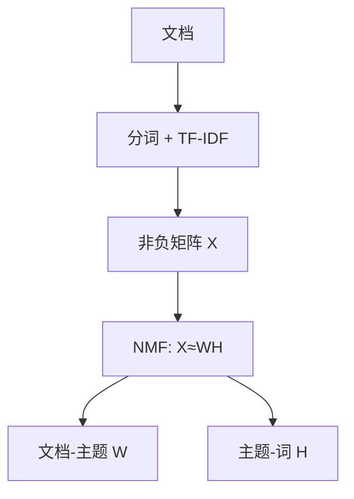
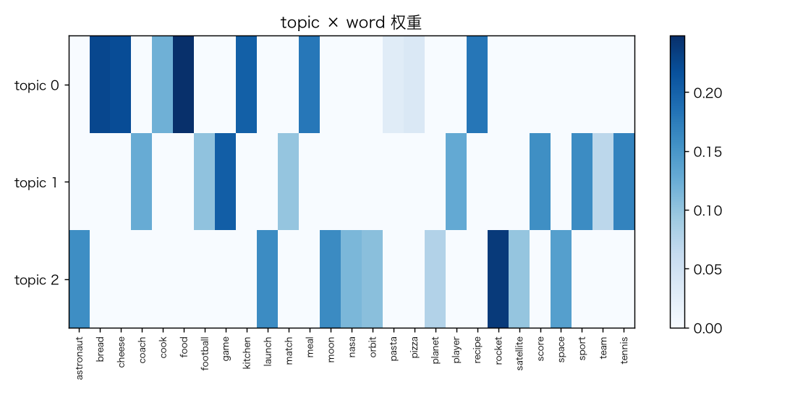
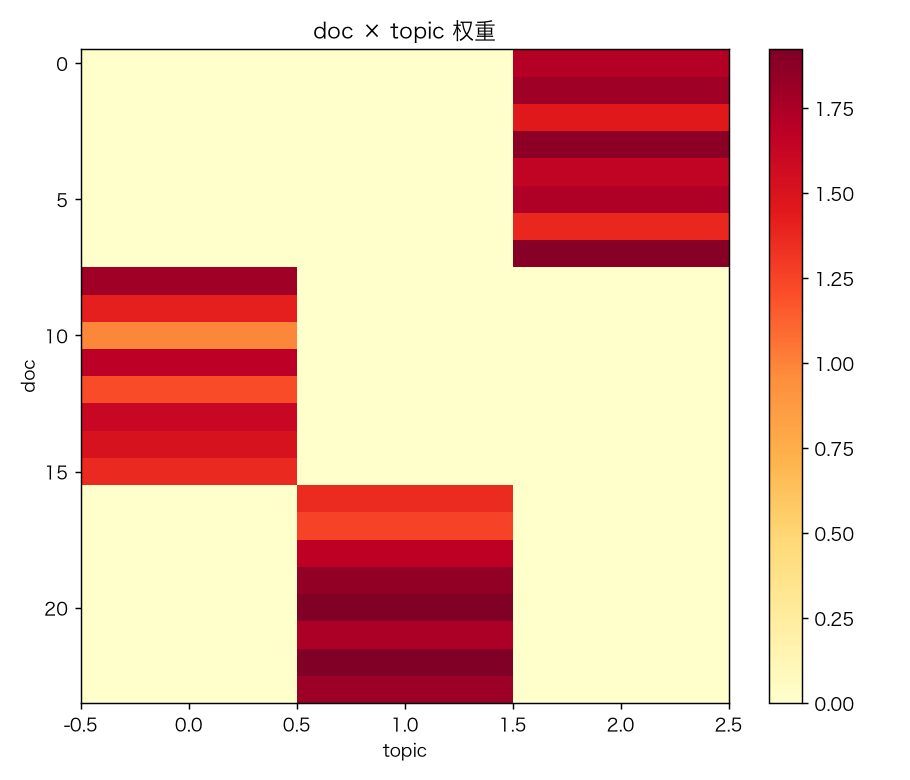
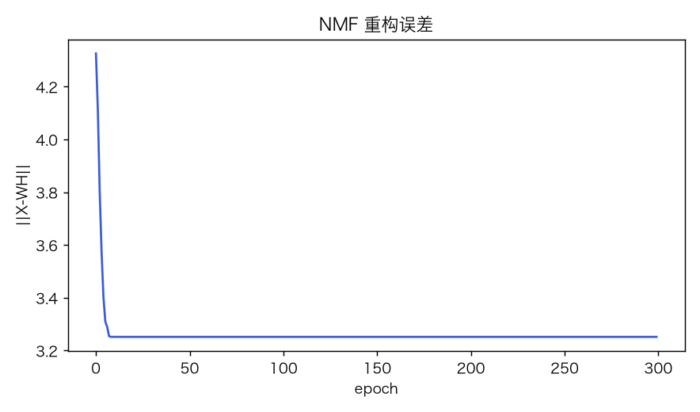
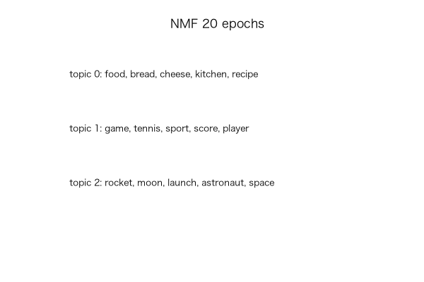

# 文本主题模型：TF-IDF + NMF

> 状态：✅ 已完成（2026-10-23）
> 对应文档章节：`../../docs/人工智能代表算法演进路线.md` 第 3.7 章
> 阅读路线：基础篇 → 进阶篇
> 本族共 14 个实验，见 [族级导读](../README.md)。

无监督估计器（统计机器学习族）：入口是 `Tfidf().fit(docs)` / `NMF(n_topics).fit(X)` / `top_words`，实现在 [impl.py](impl.py)；对照是 [framework.py](framework.py) 的 sklearn NMF。

# 基础篇

## 1. 生活类比：一篇文章在讲什么

给每篇文章打几个“主题标签”（太空/食物/体育）。不用人工词典，让词共现自己聚类。

## 2. 核心量：TF-IDF、主题-词矩阵、文档-主题矩阵

- TF-IDF：词频 × 逆文档频率；
- NMF：`X ≈ W H`，`W`=文档×主题，`H`=主题×词，所有元素非负；
- 主题词：`H` 每行权重最大的词；
- 文档主题：`W` 每行权重。

## 3. 主循环

## 4. 手算示例

`X=[[1,1],[1,0]]`，2 主题；NMF 会得到一组非负 `W,H`，重构误差 `||X-WH||`。
本实验用乘性更新：`H *= WᵀX/(WᵀWH)`，`W *= XHᵀ/(WHHᵀ)`。

## 5. 白话版：NMF 与 LDA 的区别

- NMF 是矩阵分解，优化重构误差；不建模概率；
- LDA 是生成模型，主题分布 + 词分布；
- NMF 更快更简单，主题词可解释；不提供概率语义。
- 主题数 k 要选；k 太大主题碎片化。

## 6. 常见误区

- **❌ "主题模型能自动命名主题"** —— 只给词表，名字要人起。
- **❌ "k 越大越好"** —— 过拟合/碎片化。
- **❌ "NMF=LDA"** —— 目标函数/语义不同。
- **❌ "TF-IDF 后一定是概率"** —— 不是。
- **❌ "主题=情感/立场"** —— 只是词共现。
- **❌ "小语料也能稳定"** —— 本实验只有 24 篇合成文档。

## 7. 看图

## 8. 掌握清单

| 级别 | 能力 | 检验 |
|---|---|---|
| 1 说清 | 复述 TF-IDF/NMF | 本文 |
| 2 走通 | 手算重构 | 手算示例 |
| 3 判断 | NMF vs LDA、k 选择 | 白话版 |
| 4 实现 | 跑 demo | 实验结果 |
| 5 迁移 | 文档打标 | project |

# 进阶篇

## 目录形态

| 文件 | 角色 |
|---|---|
| [impl.py](impl.py) | TF-IDF + NMF |
| [framework.py](framework.py) | sklearn NMF 对照 |
| [demo.py](demo.py) | 主题发现 + 纯度 |
| [test_impl.py](test_impl.py) | 8 个测试 |
| [make_teaching_assets.py](make_teaching_assets.py) | 素材 |
| [exercises/](exercises/README.md) | 5 题 |
| [project/](project/README.md) | 文档打标 |

## 1. 设计原理

TF-IDF 把文档变非负稀疏矩阵；NMF 用低秩非负分解得到“主题=词的组合”。

## 2. 数学推导

`X≈WH`，最小化 `||X-WH||²`；乘性更新保持非负。TF-IDF：
`tf·(log((N+1)/(df+1))+1)`。

## 3. 手写实现要点

1. 分词/停用词；
2. L2 归一化；
3. 乘性更新 + eps；
4. 固定 H 投影新文档；
5. 主题词只做解释，不做因果。

## 4. 框架对照

sklearn `NMF` 同 `n_components=3`，比较主题词与重构误差。

## 5. 实验结果

24 篇合成文档 / 27 词 / 3 主题：

| 指标 | 值 |
|---|---|
| 重构误差 | 4.326 → **3.252** |
| 主题纯度 | **1.000** |
| 主题词 | space/rocket；food/pizza；sport/tennis |
| sklearn NMF 重构误差 | 3.252（与手写一致） |

**验证**：2026-10-23 实跑；`pytest test_impl.py -q` → **9 passed**；素材对账通过。

## 6. 局限与延伸

- 24 篇合成文档，不是真实语料；
- NMF 非概率，无 LDA 的生成语义；
- 主题数手工指定；
- 无词形还原/中文分词；
- 下游：LDA/BERTopic/神经主题模型。

**已记录、不阻塞**：合成语料、无 LDA、无中文分词、k 未自动选择。
