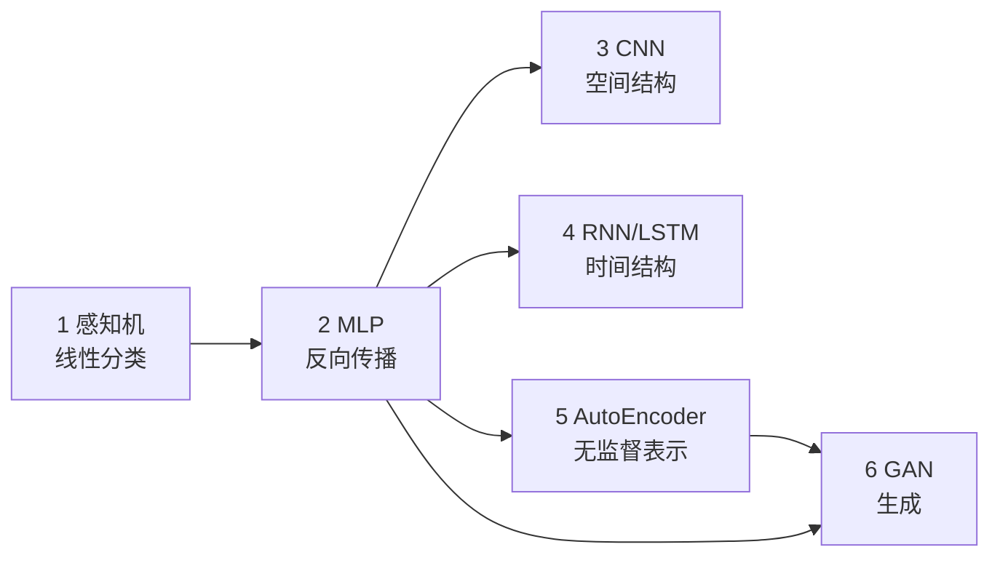

# p03-deep-learning · 深度学习族

> 状态：**0/6 完成（全部为骨架）**
> 对应路线：`../docs/人工智能代表算法演进路线.md` 第四章（4.2–4.6）
> 族内顺序：感知机 → MLP/反向传播 → CNN → RNN/LSTM → AutoEncoder → GAN
> 本族 6 个实验，占全仓库 29 个实验中的 6 个；逐实验入口见 [`algorithms/README.md`](../README.md)。

## 1. 这个族在讲什么

传统机器学习靠人工特征；深度学习让**表示**本身被学习。这个族从最小的线性分类器出发，
依次补上三块能力：

1. **可学习的非线性**：多层感知机 + 反向传播（一切深度模型的底座）；
2. **结构先验**：卷积利用空间局部性，循环利用时间共享；
3. **无监督/生成**：自编码器学压缩表示，GAN 学从噪声生成数据。

它不是"把 sklearn 换成 PyTorch"，而是**手写前向/反向**，把自动微分替你做的事拆开看。

## 2. 六个实验一览

| # | 实验 | 章节 | 默认数据 | 核心 | 本次补强 | 状态 |
|---|---|---|---|---|---|---|
| 1 | [感知机](perceptron/) | 4.2 | 合成二维 | 在线错误驱动更新、收敛定理 | 线性可分/不可分对照 | ⬜ |
| 2 | [MLP 与手写反向传播](mlp-backprop/) | 4.2 | digits / 小表格 | 链式法则、softmax/CE | **优化器、初始化、正则、LR schedule、batch size** | ⬜ |
| 3 | [LeNet](cnn-lenet/) | 4.3.1 | digits 8×8 | im2col、池化路由 | **BatchNorm、残差（可选 1×1/深度可分离）** | ⬜ |
| 4 | [RNN 与 LSTM](rnn-lstm/) | 4.4 | 合成序列 | BPTT、门控 | **梯度裁剪、长序列对照、梯度范数-T 曲线** | ⬜ |
| 5 | [AutoEncoder](autoencoder/) | 4.5 | digits 8×8 | 重构、瓶颈表示 | **与 PCA 的二维对照（可选 denoising）** | ⬜ |
| 6 | [GAN](gan/) | 4.6 | 2D 高斯 + digits | 交替对抗、非饱和损失 | **模式崩塌/多样性评估** | ⬜ |

## 3. 依赖链



- **2（MLP）是全族地基**：3/4/5/6 的反向传播都是同一套链式法则；
- 3 与 4 可以并行/选读；
- 5 → 6 是"表示 → 生成"的自然延伸。

## 4. 逐个说清

**1 感知机**：最小的"错分就改"学习器。重点不是准确率，而是**收敛定理只在
线性可分时成立**——demo 要故意跑一组不可分数据，看 epoch 间误差来回摆。

**2 MLP**：手写每一层的前向缓存与反向梯度；softmax + 交叉熵；数值稳定。
补强部分不是"再堆一层"，而是**现代训练的四件事**：优化器（SGD/Momentum/Adam）、
初始化（零/随机/He/Xavier）、正则（weight decay/dropout/early stopping）、
学习率 schedule 与 batch size 的交互。

**3 CNN**：LeNet 讲清卷积=局部连接+权重共享、im2col 的空间换时间、池化的 argmax 反传。
补强：**BatchNorm**（为什么能稳定/加速）与**残差连接**（为什么能训深）。

**4 RNN/LSTM**：BPTT 沿时间累加梯度；朴素 RNN 的梯度消失/爆炸；LSTM 的门控与细胞状态。
补强：**合成序列任务**（复制/反转/长序列）、**梯度裁剪**、RNN vs LSTM 的长序列对照，
并把"梯度范数随 T 的变化"画成曲线，让梯度消失可见。

**5 AutoEncoder**：无 y，目标是重构自己；瓶颈层是表示。补强：digits 上 2D latent
可视化，与 [PCA](../p02-statistical-ml/pca/) 的线性子空间对比；可选 **denoising AE**
（加噪→重建），说明表示是否真的抓到了结构。

**6 GAN**：两个网络交替、梯度方向相反；原始 min-max 的饱和问题。
补强：**非饱和损失**、**模式崩塌**与**生成多样性**的量化，断言只做"训练不崩"而不是"生成好看"。

## 5. 现实里谁在用

- **感知机**：现代很少单独用；它是"线性分类 + 错误驱动"的最小原型，理解 SVM/逻辑回归的起点。
- **MLP**：表格/推荐系统的 embedding + 小 MLP 头；也是 CNN/RNN/Transformer 的通用组件。
- **CNN**：图像分类、检测、分割、医学影像、端侧视觉；本族只做 LeNet 级原理。
- **RNN/LSTM**：传感器/时序/语音/流式场景；长序列建模现在多由 Transformer 接管，但门控思想仍在。
- **AutoEncoder**：降维、去噪、异常检测、预训练表示；与 [PCA](../p02-statistical-ml/pca/) 是"线性/非线性压缩"的对照。
- **GAN**：图像生成、超分、数据增强、风格迁移；训练稳定性与评价是主要工程难点。

## 6. 该读哪个（按目的）

| 你的目的 | 优先读 | 说明 |
|---|---|---|
| 想真正理解反向传播 | 2 MLP | 全族地基；必须手推一遍 |
| 做图像/视觉 | 2 → 3 CNN | LeNet 后再看 ResNet/检测分割（范围外） |
| 做序列/时序 | 2 → 4 RNN/LSTM | 再看 p04 的注意力/Transformer |
| 做压缩/异常检测 | 2 → 5 AE | 与 PCA、异常检测对照 |
| 做生成 | 2 → 6 GAN | 再延伸到 p05 的 VAE/Diffusion |
| 只做表格预测 | 2 MLP | 但先和 p02 的树集成比一比，小样本未必划算 |

- **主线（必读）**：1 → 2 → 3 → 4；
- **表示/生成（选读）**：2 → 5 → 6；
- 如果只做一遍：**2 的 MLP 必须自己推一遍反向传播**，其余实验都是它的复用；
- 每篇都先读「基础篇」再跑 demo，最后做练习/项目。

## 7. 常见的三个误读

1. **"深度学习 = 调 PyTorch"** —— 本族的手写纪律要求自己写前向/反向；
   框架只用于对照，否则学不到原理。
2. **"层数越多越好"** —— 深了会梯度消失/退化；ResNet 的残差、BN、初始化都是为了让深网络可训练。
3. **"GAN 生成好看 = 模型好"** —— GAN 没有似然，模式崩塌时也能生成少数逼真样本；
   评价要看多样性/覆盖，不能只看几张图。

## 8. 与 p02 / p04 的衔接

- **p02 → p03**：p02 是人工特征 + 浅层模型；p03 把"特征"也交给模型学。
  同一份小表格数据上，线性/树集成仍可能赢（见 p02 §10），不要默认深度模型更强。
- **p03 → p04**：RNN 的"沿时间传梯度"在 Transformer 里换成"注意力 + 残差"；
  p04 的 attention 会复用本族的反向传播与训练技巧。
- **p03 → p05**：AutoEncoder 是 VAE 的前身；GAN 与 Diffusion 是两条生成路线。

## 9. 本族的约定（P0）

### 环境

```bash
cd algorithms
uv sync --extra deep-learning     # 安装 torch（CPU 即可）
uv run python p03-deep-learning/perceptron/demo.py
```

- 手写实现优先用 **numpy**；`torch` 只用于 `framework.py` 对照；
- 不要求 GPU；CPU 上每个 demo 控制在 **2–3 分钟**；
- **不依赖 torchvision**：默认数据走 sklearn / numpy，离线可跑；MNIST 只作为可选扩展。

### 数据（离线优先）

| 实验 | 默认数据 | 说明 |
|---|---|---|
| 感知机 | 合成二维（`make_blobs` / 手写点） | 可分/不可分两组 |
| MLP | sklearn `digits`（8×8）或小表格 | 多分类 + 小样本 |
| CNN | sklearn `digits` reshape 成 `(N,1,8,8)` | 不下载 MNIST；可 pad 到 12×12 |
| RNN | 合成序列（复制/反转/长短序列） | 不依赖语料下载 |
| AutoEncoder | `digits` 8×8 | 与 PCA 同数据对照 |
| GAN | 2D 高斯 + `digits` 子集 | 小网络、短训练 |

可选扩展（不计入默认验收）：torchvision MNIST、真实文本语料。

### 运行时与确定性

- 训练集默认 **≤ 3000 样本**；CNN/GAN 只跑 **1–3 epoch**（原理验证，不刷 SOTA）；
- 所有实验固定 `random_state` / torch seed；
- 断言只做**形状、有限值、梯度检查、收敛趋势**，不对生成质量做硬断言。

### 框架对照

- 对照对象是 **PyTorch**（`torch.nn` + 现成优化器），不是 sklearn；
- 同一数据、同一随机种子、同一初始化策略下比较 loss/指标；
- 对不齐时在 README 里解释（初始化、优化器默认值、数值精度），不要强行调参对齐。

### 交付标准（每个实验）

- README：基础篇 8 节 + 进阶篇六段 + 五级清单；
- 测试：梯度检查/形状/确定性/边界，至少 8 个；
- 素材：3 张 PNG + 1 个 GIF（训练曲线、特征图/生成样本、动画）；
- 练习 5 题（题解分离）+ 1 个迁移项目；
- 验证声明：环境、数据、种子、命令、结果四要素。

## 10. 本次补强：5 个主项 + 4 个小项（P0–P2）

| 优先级 | 补强 | 落在哪 | 状态 |
|---|---|---|---|
| P0 | 族级导读 + 环境/数据/运行时约定 | 本文件 | ✅ 已补 |
| P0 | 训练技巧：优化器/初始化/正则 | MLP 的"实验四" | 已写入计划与骨架 |
| P1 | CNN：BatchNorm + 残差 | LeNet 的"实验五" | 已写入计划与骨架 |
| P1 | GAN：非饱和损失 + 模式崩塌/多样性 | GAN 的"实验四/五" | 已写入计划与骨架 |
| P2 | RNN：合成序列 + 梯度裁剪 + 长序列对照 | RNN 的"实验三/四" | 已写入计划与骨架 |

**4 个低成本小项**（折进上面实验，不新增目录）：

| 小项 | 落在哪 | 目的 |
|---|---|---|
| 学习率 schedule + batch size | MLP | 从"能训练"到"训练得稳" |
| 1×1 卷积 / 深度可分离卷积（可选） | LeNet | 参数效率，不碰检测/分割 |
| 梯度范数随 T 的曲线 | RNN | 把"梯度消失"变成可观测量 |
| denoising AE（可选） | AutoEncoder | 检验表示是否抓到结构 |

> 这些是**范围补强**，不新增第 7 个实验目录；仍保持 6 个实验、29 个总盘。

## 11. 不在本族范围

- **4.3.2–4.3.4**：轻量 CNN、目标检测、图像分割——工程分支，不塞进原理族；
- **4.7 图神经网络 GNN**、**4.8 深度强化学习**：单独的能力层，后续按需开族；
- **Transformer/注意力**：属于 [p04-transformer](../p04-transformer/)，本族不重复。

## 12. 状态与后续

- 当前 **0/6**；按 1 → 2 → 3 → 4 → 5 → 6 推进；
- 每个实验完成后同步：本表状态、[`algorithms/README.md`](../README.md) 索引、根 README 计数；
- 遗留项统一记在本文件"补强"表和 `.dsh/memory/`，不散落在各实验。
