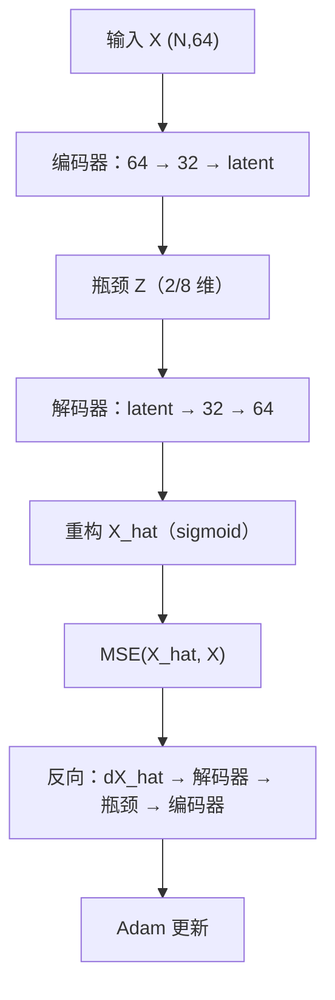
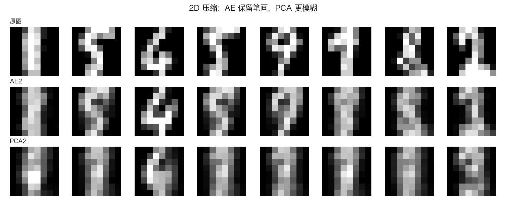
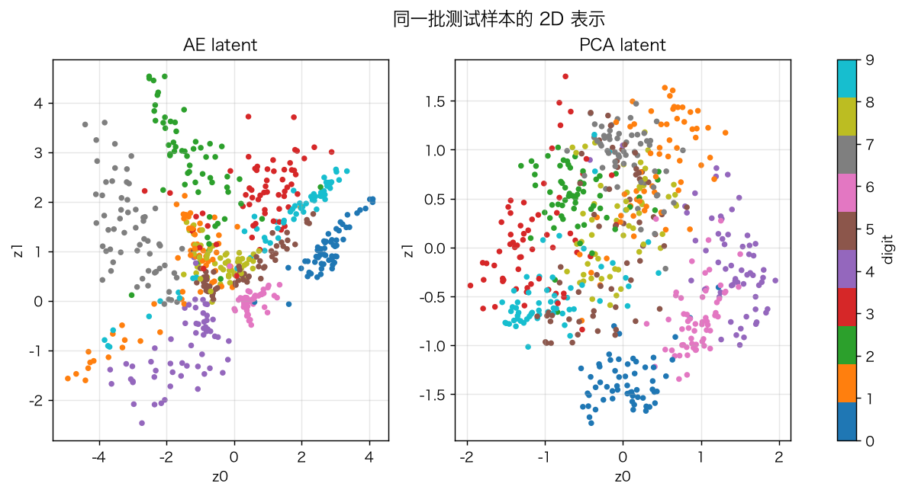
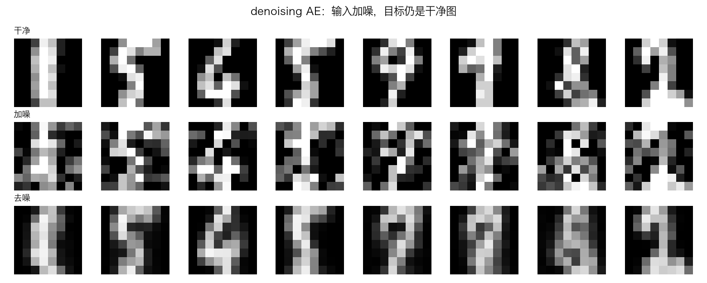
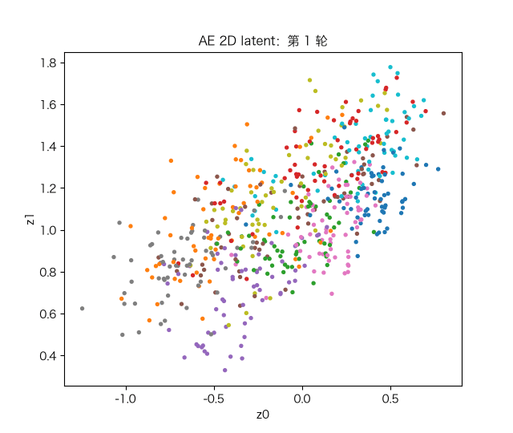

# 自编码器 AutoEncoder：压缩、2D latent 与去噪

> 状态：✅ 已完成（2026-10-22）
> 对应文档章节：`../../docs/人工智能代表算法演进路线.md` 第 4.5 章
> 阅读路线：零基础读者读「基础篇」（生活类比 → 手算 → 白话 → 自测）；要看推导、实现与复现实验读「进阶篇」
> 本族共 6 个实验，学习顺序与补强计划见 [族级导读](../README.md)。

深度模型（无监督）：入口 `AutoEncoder(latent_dim, denoising).fit(X)` / `encode(X)` / `decode(Z)` / `reconstruct(X)`；实现在 [impl.py](impl.py)，对照是 [framework.py](framework.py) 的 PyTorch 对称 MLP。

## 读之前：AE、PCA 与“表示学习”

- **AutoEncoder**：用“编码器 → 瓶颈 → 解码器”学一个压缩表示，目标**重构输入自己**；
- **PCA**：线性、无监督的降维；**线性 AE + MSE 的最优解会落在 PCA 子空间**；
- **非线性 AE**：能学弯曲的流形，重构误差通常低于同维 PCA，但表示不再有“方差最大”的解释。

| 概念 | 是什么 | 本实验 |
|---|---|---|
| AE | 编码-解码的重构网络 | 手写 + torch |
| latent | 瓶颈层的 2/8/… 维表示 | `encode(X)` |
| denoising AE | 输入加噪、目标干净图 | `denoising>0` |
| PCA | 线性降维基线 | sklearn 对照 |

# 基础篇 · 先搞懂它

## 1. 生活类比：把 64 个像素压成 2 个数，再画回去

你要把一张 8×8 的数字图片存成“2 个数”。存之前先想：这 2 个数要保留什么，
才能让解压后的图还认得出是哪个数字？

AutoEncoder 就是这样一对函数：

- **编码器** `f(x)`：64 维 → 2 维（瓶颈）；
- **解码器** `g(z)`：2 维 → 64 维；
- 训练目标：`g(f(x)) ≈ x`，让“压缩再解压”尽量还原。

没有标签，**x 自己就是标签**。瓶颈迫使网络丢掉细节、保留最能重建的结构。

## 2. 核心量：编码器、瓶颈、解码器、重构误差

**编码器**：`z = f(x)`，`z` 的维度就是 `latent_dim`。
**解码器**：`x_hat = g(z)`。
**损失**：`MSE = mean((x_hat − x)²)`。

**denoising AE**：输入 `x + noise`，目标仍是干净的 `x`；逼网络学“去噪”而不是“抄输入”。

**与 PCA 的关系**：若 `f,g` 都是线性的、损失是 MSE，最优的 2D 子空间就是 PCA 的前两个主成分；
非线性激活让 AE 能学弯曲的 2D 流形。

## 3. 主循环：编码 → 解码 → 重构误差 → 反向

## 4. 手算示例：线性 AE 为什么等于 PCA

一维输入 `x`，一维瓶颈，线性编码 `z=wx`、线性解码 `x_hat=wz=w²x`。

重构误差 `(w²x−x)² = x²(w²−1)²`；最小在 `w²=1`，即 `w=±1`，重构无损。

二维输入、一维瓶颈时，线性 AE 只能把所有点投影到一条过原点的直线上；
MSE 最优的那条线，正是**第一主成分**。所以“线性 AE ≈ PCA”，
非线性 AE 则能把直线弯成曲线，去贴合流形。

## 5. 白话版：瓶颈为什么能学特征、AE 和 PCA 差在哪

**瓶颈是“信息闸门”**：64→2 只能过 2 个数，网络必须挑“最值得保留”的方向。
如果数据在一个弯曲的低维流形上，直线（PCA）不够，非线性 AE 可以把它“摊平”。

**AE 的表示不一定适合分类**：它只保证“能重建”，不保证“能区分”；
本实验的项目会看到：8 维 AE 特征做分类（0.923）优于 8 维 PCA（0.894），但仍不如原始 64 维（0.970）。

**denoising 是“加噪正则”**：逼网络从损坏的输入恢复结构，学到的表示更鲁棒；
代价是干净图上的重构会略差。

## 6. 常见误区

- **❌ "AE 的 latent 一定比 PCA 好"** —— 低维通常更好；维度接近原始时 PCA 可能反超（本实验 32 维：PCA 0.0026 < AE 0.0068）。
- **❌ "重构误差低 = 表示适合分类"** —— 重构和判别是两件事；要看下游任务。
- **❌ "AE 需要标签"** —— 无监督，目标就是输入自己。
- **❌ "denoising AE 在干净图上一定更好"** —— 它牺牲一点干净重构换鲁棒性（0.0149→0.0184）。
- **❌ "瓶颈越小越好"** —— 太小欠拟合、太大失去压缩意义；本实验 2D 重构明显差于 8D。
- **❌ "AE 只能做降维"** —— 还能去噪、异常检测、预训练、生成（VAE/GAN 的前身）。

## 7. 看图：重构、latent、去噪与训练过程

2D 压缩：AE 保留笔画轮廓，PCA 更模糊；测试 MSE 0.0381 vs 0.0526。

同一批测试样本：AE 的 2D 空间把不同数字分得更开；PCA 更混叠。

denoising AE：输入加噪，输出仍接近干净图；加噪测试 MSE 0.0552（干净训练是 0.1015）。

训练中 2D latent 从混在一起逐渐按数字分开。

## 8. 掌握清单：五级能力与自测

| 级别 | 能力 | 本实验的检验方式 | 在哪做 |
|---|---|---|---|
| 1 说清 | 用自己的话讲规则 | 说出编码/解码/瓶颈/重构损失/denoising | 基础篇「核心量」「白话版」 |
| 2 走通 | 纸上手算 | 线性 AE 的 `w²=1` 与 PCA 等价 | 基础篇「手算示例」节 |
| 3 判断 | 说清正确性条件 | 解释 AE vs PCA、重构 ≠ 判别、denoising 代价 | 基础篇「白话版」+ 实验二/三 |
| 4 实现 | 手写并与对照比对 | 跑通 `demo.py`，重构 MSE 与 torch 对齐 | 进阶篇「实验结果」 |
| 5 迁移 | 用到新问题 | 8 维 latent + 逻辑回归分类 | [project/](project/README.md) |

**自测关卡（先预测，再跑代码验证）**：

1. 线性 AE + MSE 的 2D 子空间和 PCA 前两维是什么关系？
2. latent 从 2 加到 32，重构 MSE 会降吗？会降到 0 吗？
3. denoising AE 在干净图上的 MSE 会变好还是变差？
4. 重构 MSE 更低的表示，分类一定更准吗？

# 进阶篇 · 实验档案

## 目录形态（本算法的"类型"）

| 文件 | 角色 | 入口 / 说明 |
|---|---|---|
| [impl.py](impl.py) | 手写实现 | `AutoEncoder`：encode/decode/reconstruct、MSE、denoising、Adam |
| [framework.py](framework.py) | PyTorch 对照 | `TorchAE`（对称 MLP） |
| [demo.py](demo.py) | 同数据双跑 | 2D / latent 扫描 / denoising / torch |
| [test_impl.py](test_impl.py) | 性质测试 | 梯度检查、AE vs PCA、去噪、形状、torch、契约 |
| [make_teaching_assets.py](make_teaching_assets.py) | 素材生成 + 对账 | 重构 / latent / 去噪 / latent GIF |
| [exercises/](exercises/README.md) | 练习（5 题，题解分离） | 概念、手算、诊断、实现、迁移 |
| [project/](project/README.md) | 迁移项目 | AE 8 维特征 + 逻辑回归分类 |

## 1. 设计原理

AE 用“瓶颈”强制压缩：编码器把输入映射到低维 `z`，解码器从 `z` 重建。
训练只最小化重构误差，不需要标签。瓶颈维度决定“保留多少信息”；
denoising 通过损坏输入学习更鲁棒的结构。它是 VAE/GAN/自监督预训练的前身。

## 2. 数学推导

**损失**：

$$L=\frac{1}{ND}\sum_{n,d}(\hat x_{n,d}-x_{n,d})^2$$

**输出层梯度**：`dL/dx_hat = 2(x_hat−x)/(ND)`；再乘 sigmoid 导数。

**线性 AE = PCA**：若编码/解码都是线性、无偏置，`x_hat = W_d W_e x`；
最优的 `W_d W_e` 是到前 `k` 个主成分子空间的投影（Eckart–Young）。

**denoising**：`x_in = x + ε`，`ε~N(0,σ²)`；目标仍是 `x`，等价于学习一个去噪映射。

## 3. 手写实现要点

1. **损失归一化**：MSE 对 `N×D` 个元素求平均，反传要除以 `N×D`（不是 batch size）。
2. **输出层 sigmoid**：像素在 `[0,1]`；用 sigmoid 保证重构有界。
3. **瓶颈不加激活**：latent 保持线性输出，便于 2D 可视化。
4. **denoising 只加在输入**：目标始终是干净 `X`。
5. **Adam 状态**：每个参数独立 `m/v`；`t` 每 batch 加一次。
6. **`param_history`**：动画/训练过程可视化要用。

## 4. 框架对照

torch 的对称 MLP 与手写版同结构、同数据：

| latent | 手写 MSE | torch MSE |
|---|---|---|
| 2 | 0.0381 | 0.0372 |
| 8 | 0.0149 | 0.0151 |

差异来自初始化/优化器/浮点精度；量级一致。
torch 20 行就能搭好，手写版要自己写 4 层反向与 MSE 归一化——这是本实验的对照价值。

## 5. 实验结果

**环境**：uv（`uv sync --extra deep-learning --extra dev`），Python 3.13.15 /
numpy 2.5.4 / scikit-learn 1.9.1 / torch 2.14.1；CPU。
**数据**：sklearn `digits`，像素 /16，拉平 64 维；训练 1200 / 测试 597。
**复现**：本目录内 `uv run python demo.py`、`uv run pytest test_impl.py -q`、
`uv run python make_teaching_assets.py`。

**实验一：2D 压缩（测试 MSE）**

| 方法 | MSE | 耗时（s） |
|---|---|---|
| 手写 AE | 0.0381 | ≈0.36 |
| torch AE | 0.0372 | ≈1.0 |
| PCA | 0.0526 | 0.00 |

**实验二：latent 维度扫描（测试 MSE）**

| latent | AE | PCA |
|---|---|---|
| 2 | 0.0381 | 0.0526 |
| 4 | 0.0244 | 0.0381 |
| 8 | 0.0149 | 0.0245 |
| 16 | 0.0087 | 0.0115 |
| 32 | 0.0068 | **0.0026** |

**实验三：denoising（latent=8）**

| 训练 | 干净 MSE | 加噪 MSE |
|---|---|---|
| 干净训练 | **0.0149** | 0.1015 |
| 加噪训练 | 0.0184 | **0.0552** |

**实验四：手写 vs torch（latent=8）**

手写 0.0149；torch 0.0151。

**验证声明（已验证）**：输入为上述数据与种子；2026-10-22 在 uv 环境实跑，
`uv run python demo.py` 输出上表；`uv run pytest test_impl.py -q` → **7 passed**；
`uv run python make_teaching_assets.py` 对账通过（AE 2D < PCA 2D）。

**可视化结论**：

- `images/00-重构对比.png`：AE 保留笔画，PCA 更模糊；
- `images/01-2D隐空间.png`：AE 的 2D 空间按数字分得更开；
- `images/02-去噪.png`：加噪输入 → 接近干净图；
- `images/03-隐空间生长.gif`：训练中 latent 逐渐按类别分开。

## 6. 局限与延伸

- **重构 ≠ 判别**：8 维 AE 分类 0.923，仍低于原始 64 维 0.970。
- **32 维时 PCA 反超**：PCA 0.0026 < AE 0.0068；AE 的瓶颈/训练预算有限。
- **无生成能力**：AE 不能采样新图；生成要看 VAE/GAN（p05）。
- **latent 无概率解释**：VAE 才给先验/后验；AE 的 `z` 只是压缩码。
- **小数据/小图**：8×8 digits 只有 1797 张；更大图像要 CNN-AE。
- **下游**：VAE（概率生成）→ GAN（对抗生成）→ 自监督预训练。

**已记录、不阻塞**：

- **denoising 只做高斯噪声**：mask noise、椒盐噪声、遮挡等更接近真实损坏的形态未覆盖。
- **固定 100 轮、无验证集/早停**：32 维时 AE 反而输给 PCA（0.0068 vs 0.0026），
  有“欠训练/瓶颈宽度”的因素，但没有做训练预算扫描。
- **`encode`/`decode`/`reconstruct` 没有形状/NaN 校验**：输入维度或类型不对时抛 numpy 错误；
  `TorchAE` 的输入校验更少。
- **下游只做线性探针**：项目用逻辑回归评估 latent，没有 fine-tune 编码器，也没有 kNN/SVM 对照。
- **无卷积 AE**：8×8 拉平输入，空间结构没利用；更大图像要 CNN-AE/VAE。
