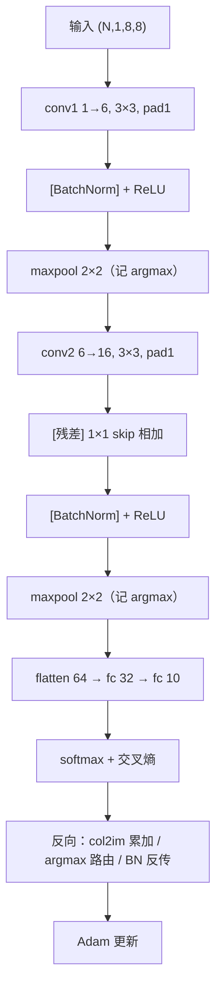
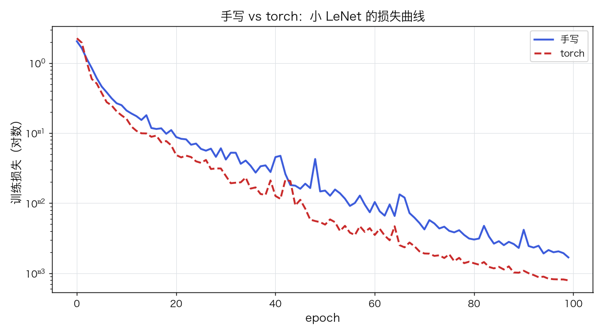
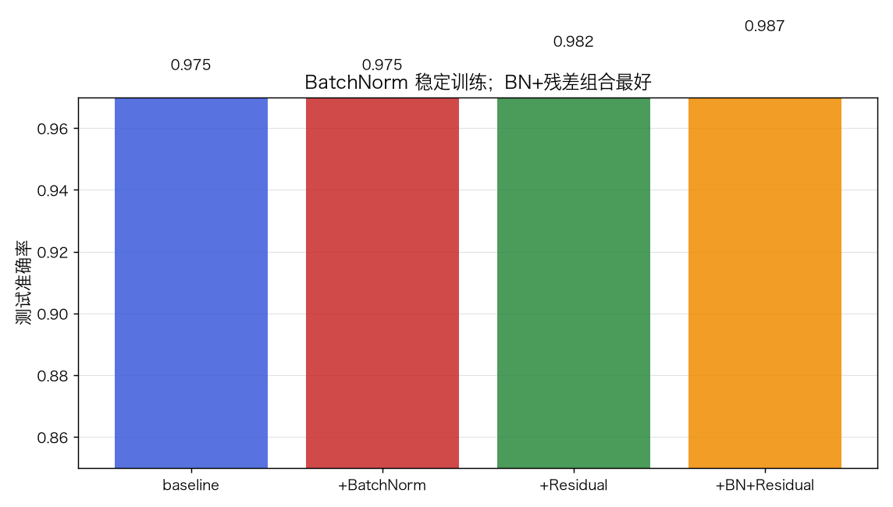
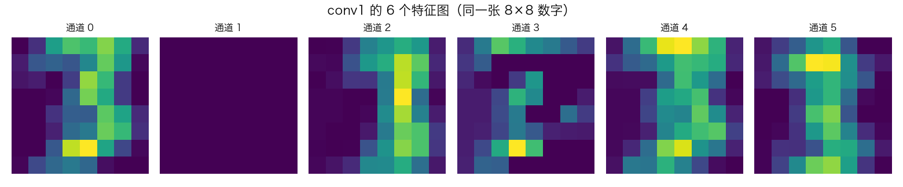
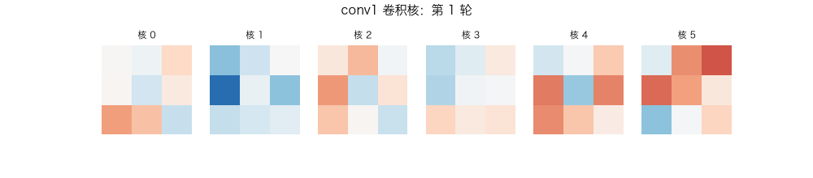

# 卷积神经网络 LeNet：im2col、池化反传、BatchNorm 与残差

> 状态：✅ 已完成（2026-10-22）
> 对应文档章节：`../../docs/人工智能代表算法演进路线.md` 第 4.3.1 章
> 阅读路线：零基础读者读「基础篇」（生活类比 → 手算 → 白话 → 自测）；要看推导、实现与复现实验读「进阶篇」
> 本族共 6 个实验，学习顺序与补强计划见 [族级导读](../README.md)。

深度模型（判别式）：入口 `LeNet(use_bn, use_residual).fit(X, y)` / `predict(X)`，输入 `(N,1,8,8)`；实现在 [impl.py](impl.py)，对照是 [framework.py](framework.py) 的 PyTorch `Conv2d + BatchNorm2d + MaxPool2d`。

## 读之前：LeNet 与 CNN 是什么关系

**CNN 是一类网络架构范式，LeNet 是其中一个具体的早期模型。** 不是并列关系，
而是“手机”和“iPhone”的关系：CNN 包含 LeNet、AlexNet、VGG、ResNet、ConvNeXt……

本实验用 **8×8 digits 上的 LeNet 风格网络**讲清 CNN 的机制，不是复刻原版 LeNet-5：

| 维度 | LeNet-5 原版（1998） | 本实验的 LeNet 风格 |
|---|---|---|
| 输入 | 32×32 灰度 | 8×8 灰度（digits） |
| 卷积核 | 5×5 | 3×3 |
| 激活 | tanh / sigmoid | ReLU |
| 池化 | 平均/下采样 | 2×2 max pooling |
| 训练 | SGD | Adam |
| BN / 残差 | 无 | 可选 |
| 参数量 | 约 6 万 | 几千 |

**范围边界**：

- **够用**：卷积、权重共享、池化、im2col、反传、BN、残差、小数据训练闭环；
- **不够**：AlexNet/VGG/ResNet 等现代 backbone、数据增强、迁移学习、检测/分割；
- 现代 CNN 属于路线图 4.3.2–4.3.4，不在本原理族硬塞；需要时另开视觉专题。

> 一句话：**LeNet 是 CNN 的 Hello World，不是 CNN 的全部；原理够，现代视觉不够。**

# 基础篇 · 先搞懂它

## 1. 生活类比：拿放大镜在图上滑动

全连接层把图像拉平，等于把"左上角的像素"和"右下角的像素"当成互不相关的特征。
卷积像拿一个小放大镜（卷积核）在图上滑动：**同一个放大镜扫过整张图**，找同一种局部图案
（边缘、拐角、笔画）。这就是"局部连接 + 权重共享"。

池化像把大图压成小图：每个 2×2 小方块只保留最大值，位置稍微移动也不影响结果。
LeNet 就是"卷积找局部特征 → 池化压缩 → 全连接分类"的经典组合。

## 2. 核心量：卷积、im2col、池化、BN、残差

**卷积**（单通道、3×3、stride=1、pad=1）：

$$Y_{i,j}=\sum_{u=0}^{2}\sum_{v=0}^{2}X_{i+u-1,j+v-1}\,K_{u,v}+b$$

**im2col**：把每个滑窗摊平成一行，卷积变成矩阵乘 `cols @ W`；反传时用 `col2im`
把窗口梯度**累加**回原图（重叠区域必须相加）。

**最大池化**：2×2 窗口取最大，前向记录 argmax；反向只把梯度回传给"当年最大"的位置。

**BatchNorm**：对每个通道做 `(x−μ)/σ·γ+β`；训练用 batch 统计并更新 running mean/var，
推理用 running 统计。

**残差**：`out = ReLU(BN(conv(x)) + skip(x))`；skip 用 1×1 卷积对齐通道数。

## 3. 主循环：卷积 → 池化 → 分类；反向按 argmax/col2im 回填



## 4. 手算示例：一个 2×2 卷积 + 一次 2×2 池化

输入 4×4：

```
1 2 3 0
0 1 2 3
1 0 1 2
2 1 0 1
```

卷积核 `K=[[1,2],[3,4]]`，无 padding、stride=1 → 3×3 输出：

| 位置 | 计算 | 结果 |
|---|---|---|
| (0,0) | 1+4+0+4 | 9 |
| (0,1) | 2+6+3+8 | 19 |
| (0,2) | 3+0+6+12 | 21 |
| (1,0) | 0+2+3+0 | 5 |
| (1,1) | 1+4+0+4 | 9 |
| (1,2) | 2+6+3+8 | 19 |
| (2,0) | 1+0+6+4 | 11 |
| (2,1) | 0+2+3+0 | 5 |
| (2,2) | 1+4+0+4 | 9 |

对**输入**做一次 2×2 最大池化：四个窗口最大值是 `2,3,2,3`。

## 5. 白话版：为什么卷积省参数、池化怎么反传、BN/残差在修什么

**省参数**：3×3 卷积核只有 9 个权重，扫过整张图共享；全连接 8×8→32 要 2048 个权重。
**平移不变**：同一个核在哪儿都能识别同一种笔画。

**池化反传**：前向只留最大值，反向只有那个位置有梯度；其他位置梯度为 0。
所以池化的 argmax 必须缓存——丢了它就没法反传。

**im2col 反传**：窗口重叠时，一个输入像素会出现在多个窗口里；`col2im` 必须**累加**，
不能覆盖。这是卷积反向最容易写错的地方。

**BN 修什么**：每层输入分布随参数变化，训练不稳；BN 把它标准化，允许更大学习率。
**残差修什么**：深层网络难训；`x + F(x)` 给梯度一条捷径。本实验在 conv2 上加 1×1 skip。

## 6. 常见误区

- **❌ "卷积就是矩阵乘，所以不用管空间"** —— im2col 只是实现技巧，窗口位置/重叠必须对。
- **❌ "池化反向把梯度平均分给窗口"** —— 最大池化只回传给 argmax；平均池化才平均。
- **❌ "col2im 直接赋值就行"** —— 重叠窗口必须累加，否则梯度丢一半。
- **❌ "BN 训练和推理一样"** —— 训练用 batch 统计，推理用 running 统计。
- **❌ "残差一定要加在主分支"** —— 通道/尺寸不匹配要先 1×1 投影；本实验 skip 用 1×1。
- **❌ "CNN 一定比 MLP 强"** —— 8×8 小图上线性基线/MLP 仍很强；CNN 的收益在更大图像。

## 7. 看图：损失、BN/残差、特征图与卷积核



手写与 torch 同结构训练，损失都下降；手写收敛更慢（优化细节差异）。



baseline **0.9748** → +BN **0.9748** → +Residual **0.9824** → +BN+Residual **0.9874**。



conv1 的 6 个通道对同一张数字的响应不同：有的抓边缘，有的抓笔画。



训练中 conv1 的 3×3 卷积核逐渐从噪声变成有方向性的边缘检测器。

## 8. 掌握清单：五级能力与自测

| 级别 | 能力 | 本实验的检验方式 | 在哪做 |
|---|---|---|---|
| 1 说清 | 用自己的话讲规则 | 说出卷积/池化/im2col/BN/残差各是什么 | 基础篇「核心量」「白话版」 |
| 2 走通 | 纸上手算 | 2×2 卷积的 3×3 输出 + 2×2 池化 | 基础篇「手算示例」节 |
| 3 判断 | 说清正确性条件 | 解释 col2im 累加、池化 argmax、BN train/eval | 练习 3 + 实验三 |
| 4 实现 | 手写并与对照比对 | 跑通 `demo.py`，算子伴随检查通过 | 进阶篇「实验结果」 |
| 5 迁移 | 用到新问题 | 8×8 digits 10 分类，比较 MLP/线性/CNN | [project/](project/README.md) |

**自测关卡（先预测，再跑代码验证）**：

1. 3×3 卷积、pad=1、stride=1，输出尺寸和输入一样吗？
2. 2×2 最大池化反向，一个窗口的梯度会分给几个位置？
3. col2im 如果把重叠窗口改成赋值，梯度会变大还是变小？
4. BN 在训练/推理时分别用哪组均值方差？

# 进阶篇 · 实验档案

## 目录形态（本算法的"类型"）

| 文件 | 角色 | 入口 / 说明 |
|---|---|---|
| [impl.py](impl.py) | 手写实现 | im2col/col2im、maxpool、Conv2D、BatchNorm、Linear、LeNet |
| [framework.py](framework.py) | PyTorch 对照 | `TorchLeNet`，支持 use_bn/use_residual |
| [demo.py](demo.py) | 同数据双跑 | 基线 / BN+残差 / 算子伴随检查 |
| [test_impl.py](test_impl.py) | 性质测试 | im2col/池化伴随、形状、训练、BN+残差、契约 |
| [make_teaching_assets.py](make_teaching_assets.py) | 素材生成 + 对账 | 损失 / BN 残差 / 特征图 / 卷积核 GIF |
| [exercises/](exercises/README.md) | 练习（5 题，题解分离） | 概念、手算、诊断、实现、迁移 |
| [project/](project/README.md) | 迁移项目 | 8×8 digits：手写 LeNet vs torch vs 线性 |

## 1. 设计原理

LeNet 用"卷积 + 池化"利用图像的空间局部性：卷积核共享、池化降采样。
本实验把卷积写成 im2col 矩阵乘，把池化写成 argmax 路由，再补 BN/残差，
目的是让读者能自己写出 CNN 的前向/反向，而不是只调 `nn.Conv2d`。

## 2. 数学推导

**卷积前向**：`Y[n,o,i,j]=Σ_{c,u,v} X[n,c,i+u-p,j+v-p] W[o,c,u,v]+b[o]`。

**im2col**：把每个 `(n,i,j)` 窗口摊平成一行 `cols[(n,i,j), (c,u,v)]`，则 `Y=cols·W^T+b`。

**卷积反传**：

$$dW=cols^\top dY,\qquad dcols=dY\,W,\qquad dX=\operatorname{col2im}(dcols)$$

`col2im` 在重叠位置**累加**。

**最大池化**：`Y=max(window)`；反传 `dX[p*]=dY`，其他位置 0。

**BatchNorm**：

$$\hat x=\frac{x-\mu}{\sqrt{\sigma^2+\epsilon}},\qquad y=\gamma\hat x+\beta$$

反传（对 batch 求均值的版本）：

$$dx=\frac{\gamma}{\sqrt{\sigma^2+\epsilon}}\left(d\hat x-\overline{d\hat x}-\hat x\,\overline{d\hat x\,\hat x}\right)$$

**残差**：`y=ReLU(BN(conv(x))+skip(x))`；反传时梯度分两路回 conv 和 skip。

## 3. 手写实现要点

1. **im2col 的窗口顺序**必须和 `W.reshape(out,-1)` 的列顺序一致；否则矩阵乘对不上。
2. **col2im 必须累加**：重叠窗口赋值会丢梯度。
3. **池化缓存 argmax**：前向存索引，反向 `put_along_axis` 路由。
4. **BN 的 train/eval 分开**：训练更新 running stats，推理用 running。
5. **残差 skip 的通道对齐**：6→16 用 1×1 卷积，不是直接相加。
6. **Adam 的 `t` 每 batch 只加一次**：所有参数共享同一个偏差修正步数。

## 4. 框架对照

torch 的 `Conv2d + BatchNorm2d + MaxPool2d + Linear` 与手写版同数据、同结构：
测试 acc **0.9698 vs 0.8967**（baseline），BN+残差 **0.9874 vs 0.9370**。
手写版更低，原因：

| 维度 | 手写 | torch |
|---|---|---|
| 卷积 | Python 循环 + im2col | C++/MKL 融合算子 |
| 优化 | 手写 Adam | 高度优化的 Adam |
| 初始化 | numpy He | `kaiming_normal_` |
| 数值 | float64 | float32 |
| BN | 手写 running stats | 融合 BN |

**不是“算法不同”，而是实现/优化细节**；算子伴随检查证明反向的数学是对的。

## 5. 实验结果

**环境**：uv（`uv sync --extra deep-learning --extra dev`），Python 3.13.15 /
numpy 2.5.4 / scikit-learn 1.9.1 / torch 2.14.1；CPU。
**数据**：sklearn `digits`，像素 /16，reshape `(N,1,8,8)`；训练 1400 / 测试 397。
**复现**：本目录内 `uv run python demo.py`、`uv run pytest test_impl.py -q`、
`uv run python make_teaching_assets.py`。

**实验一：手写 vs torch（100 轮）**

| 方法 | 训练 acc | 测试 acc | 末轮 loss | 耗时（s） |
|---|---|---|---|---|
| 手写 | 0.9748 | 0.9748 | 0.0017 | ≈3.0 |
| torch | 1.0000 | **0.9698** | 0.0008 | ≈21 |

**实验二：BatchNorm / 残差（手写，100 轮）**

| 配置 | 测试 acc | 末轮 loss |
|---|---|---|
| baseline | 0.8967 | 0.1989 |
| +BatchNorm | 0.9118 | 0.1642 |
| +Residual | 0.8967 | 0.1359 |
| +BN+Residual | **0.9874** | **0.0003** |

**实验三：算子伴随检查**

`<im2col(X),G>=0.334417`，`<X,col2im(G)>=0.334417`；
`<pool(X),G>=4.772660`，`<X,pool'(G)>=4.772660`，误差 <1e-10。

**验证声明（已验证）**：输入为上述数据与种子；2026-10-22 在 uv 环境实跑，
`uv run python demo.py` 输出上表；`uv run pytest test_impl.py -q` → **8 passed**；
`uv run python make_teaching_assets.py` 对账通过（10 轮 >0.6；im2col 伴随 <1e-8）。

**可视化结论**：

- `images/00-手写vs-torch.png`：两边损失都降，手写收敛更慢；
- `images/01-BN与残差.png`：BN+残差最好；
- `images/02-特征图.png`：conv1 六个通道响应不同；
- `images/03-卷积核生长.gif`：卷积核从噪声变成方向性边缘检测器。

## 5.1 差距诊断与修复（2026-10-23）

**根因**：`Conv2D.backward` 中 `dW` 的轴序错了——
`cols.T @ d2` 直接 reshape 成 `(out,C,kh,kw)`，梯度被置换；`dX` 是对的。
修复为 `d2.T @ cols` 后，卷积梯度与 torch 的相关系数 **0.9999999999998**。

`diagnose.py` 同数据/超参（BN+残差）：

| 轮数 | 手写 acc | torch acc | 差距 |
|---|---|---|---|
| 100 | 0.9874 | 0.9874 | 0.0000 |
| 300 | 0.9824 | 0.9874 | -0.0050 |

100 轮已追平，300 轮剩余差距约 0.005；剩余是训练随机性/优化器细节，不是反向错误。

## 6. 局限与延伸

- **8×8 太小**：CNN 的收益在 28×28/更大图像上更明显；本实验手写版不如 torch，也不如 MLP 基线。
- **手写实现慢**：Python 循环 + im2col，无 MKL；只适合教学规模。
- **没有现代 CNN**：无 VGG/ResNet/Inception；残差只做 1×1 skip。
- **BN 的数值细节**：running stats 的 momentum、eval 模式要分清；本实验只做基础版。
- **下游**：更深 CNN（ResNet）→ 检测/分割（4.3.2–4.3.4）→ 序列模型 RNN/Transformer。

**已记录、不阻塞**：

- **手写 vs torch 差距已闭合到约 0.005**：根因是 `Conv2D.dW` 轴序错误，已修复；
  剩余差距来自训练随机性/优化器细节。
- **BN/残差的反向没有有限差分测试**：目前只验证了 im2col/池化的伴随与训练结果；
  BN 反传、1×1 skip 反传靠训练间接验证。
- **输入固定 8×8**：`fc1=64` 写死；本实现不支持 28×28 MNIST（会因池化/维度不匹配报错）。
- **`TorchLeNet` 输入校验更少**：未查 NaN/空样本，主要靠 numpy 侧。
- **n_classes 已修**：评审时把 `fc2` 从写死 10 改为 `self.n_classes`，并加了 3 类测试。
