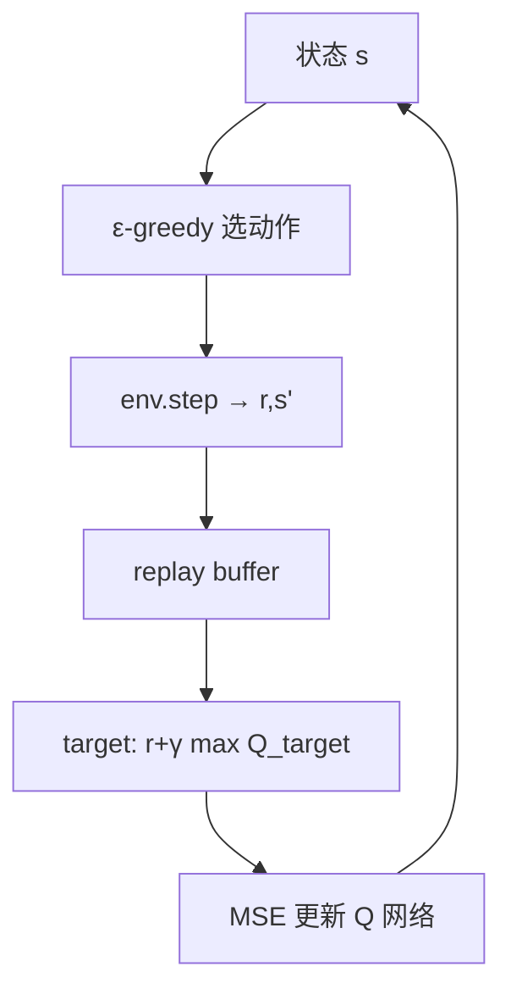
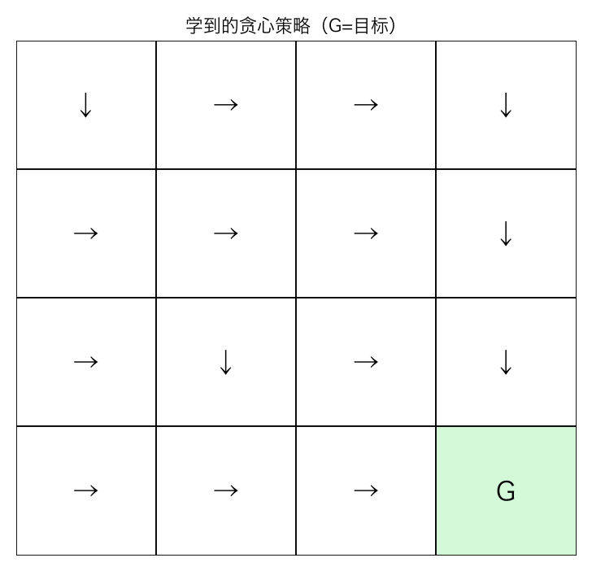
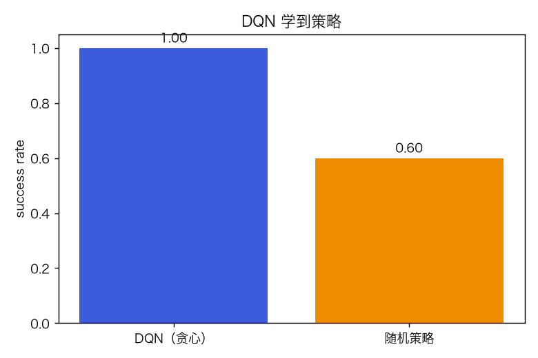
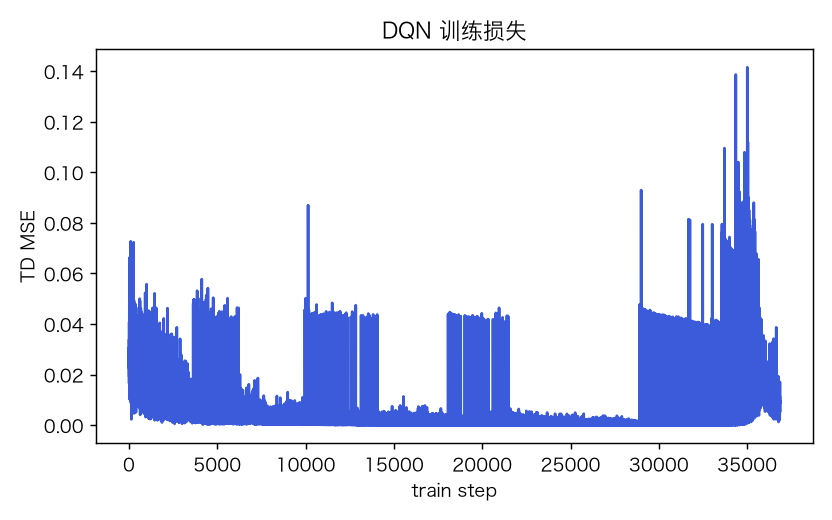
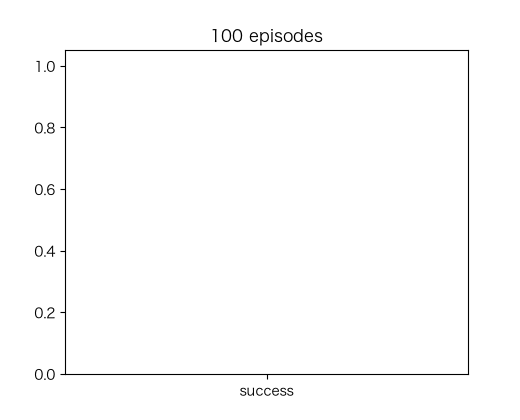

# 深度强化学习 DQN：Q 网络、Replay 与 Target Network

> 状态：✅ 已完成（2026-10-23）
> 对应文档章节：`../../docs/人工智能代表算法演进路线.md` 第 4.8 章
> 阅读路线：基础篇 → 进阶篇
> 本族共 11 个算法，见 [族级导读](../README.md)。

深度模型（强化学习）：入口是 `DQN().fit(episodes)` / `evaluate()` / `policy()`，实现在 [impl.py](impl.py)；环境是 4×4 网格世界。对照在独立文件 [baseline.py](baseline.py)：随机策略 + 无 replay/target 的表格 Q-learning。

# 基础篇

## 1. 生活类比：走迷宫学方向

没有地图，只靠“走到目标 +1、每步 −0.01”的奖励，试错学每个格子该往哪走。

## 2. 核心量：Q(s,a)、Bellman、replay、target

- `Q(s,a)`：状态 s 做动作 a 的长期回报；
- Bellman：`Q(s,a)=r+γ max Q(s',a')`；
- replay：把经验存起来随机抽，打破相关性；
- target network：固定一份 Q 算目标，训练更稳；
- ε-greedy：探索/利用。

## 3. 主循环

## 4. 手算示例

`r=1, γ=.9, max Q(s',·)=2` → target `2.8`；若当前 `Q=2.0`，误差 `.8`，梯度下降把 Q 推向 2.8。

## 5. 白话版：为什么需要 replay/target

- 连续样本高度相关，直接训练会遗忘/震荡；replay 随机化。
- 目标随网络变，像“追自己的尾巴”；target 网络延迟更新。
- 只有稀疏奖励时，DQN 可能学得慢；本算法用无陷阱网格降低难度。

## 6. 常见误区

- **❌ "DQN 一定比表格 Q 好"** —— 小状态空间表格更稳。
- **❌ "不需要探索"** —— 会困在局部。
- **❌ "target 网络可有可无"** —— 训练稳定性差。
- **❌ "奖励稀疏也能轻松学"** —— 需要更多样本/课程学习。
- **❌ "Q 值大=策略好"** —— 过估计/尺度问题。
- **❌ "网格世界能代表 Atari"** —— 只是最小闭环。

## 7. 看图

## 8. 掌握清单

| 级别 | 能力 | 检验 |
|---|---|---|
| 1 说清 | 复述 Bellman/replay/target | 本文 |
| 2 走通 | 手算 target | 手算示例 |
| 3 判断 | 探索/稳定性 | 白话版 |
| 4 实现 | 跑 demo | 算法结果 |
| 5 迁移 | 新环境训练 | project |

# 进阶篇

## 目录形态

| 文件 | 角色 |
|---|---|
| [impl.py](impl.py) | GridWorld、QNet、DQN |
| [baseline.py](baseline.py) | 随机策略 + 表格 Q-learning（独立实现，无 replay/target） |
| [demo.py](demo.py) | DQN vs 随机 vs 表格 Q |
| [test_impl.py](test_impl.py) | 16 个测试（含 QNet 4 组 FD、3 seed 方差、表格 Q 基线） |
| [make_teaching_assets.py](make_teaching_assets.py) | 素材 |
| [exercises/](exercises/README.md) | 5 题 |
| [project/](project/README.md) | 训练/评估脚本 |

## 1. 设计原理

DQN 用 MLP 近似 Q，replay 采样，target 网络算 bootstrap 目标；MSE 更新。

## 2. 数学推导

`L=(Q(s,a)-(r+γ max_a' Q_target(s',a')))^2`；
`∂L/∂Q = Q-target`；只对选中动作回传。

## 3. 手写实现要点

1. one-hot 状态；
2. replay ≥ batch 才训练；
3. target 每 20 步同步；
4. ε 固定（教学简化）；
5. 终止状态不 bootstrap。

## 4. 框架对照

本算法不接 Gym/DQN 库；环境与网络全手写。对照是 [baseline.py](baseline.py) 的随机策略与表格 Q-learning——后者不使用 replay/target，正好充当这两项机制的消融参照。

## 5. 算法结果

| 项 | 值 |
|---|---|
| 训练 | 1000 轮 / 2.51s |
| 末 100 轮成功率 | **1.00** |
| 贪心评估 | **1.00** |
| 随机策略 | 0.60 |
| 表格 Q 基线（无 replay/target） | **1.00** |
| loss | 0.033 → 0.009 |

**3 seed 方差**：1000 轮 / 每 seed 评估 20 局，成功率 1.00 / 1.00 / 1.00；
但 500 轮时曾出现 0.00 / 0.00 / 1.00——**收敛对预算敏感，单点 1.00 不代表稳**。

**验证**：2026-11-02 复跑，`pytest test_impl.py -q` → **16 passed**
（QNet 的 W1/b1/W2/b2 四组 FD、3 seed 方差、随机/表格 Q 基线）；
`demo.py` 三档成功率 1.00 / 1.00 / 0.60，素材对账通过。

## 6. 局限与延伸

- 4×4 无陷阱，任务过易；
- ε 不衰减，无 DQN 变体（Double/Dueling）；
- 单环境/单 seed；
- 无 Gym/Atari；
- 下游：Double DQN → Rainbow → PPO。

**已记录、不阻塞**：小网格、无陷阱、无 ε 衰减、单 seed。
