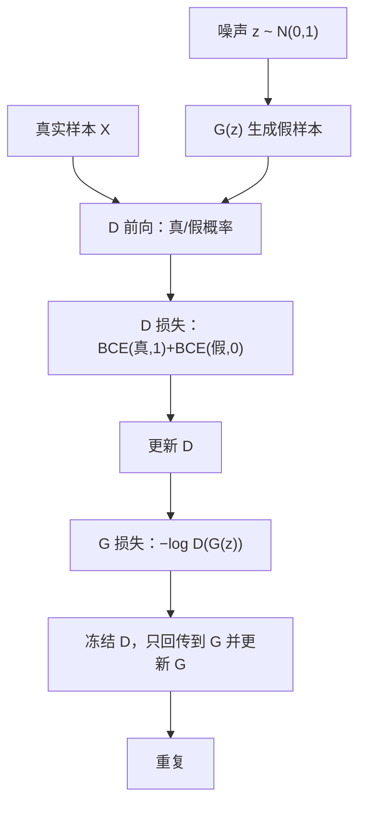
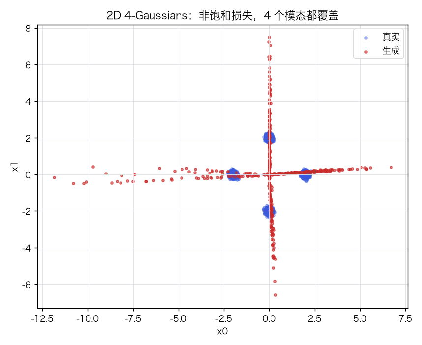
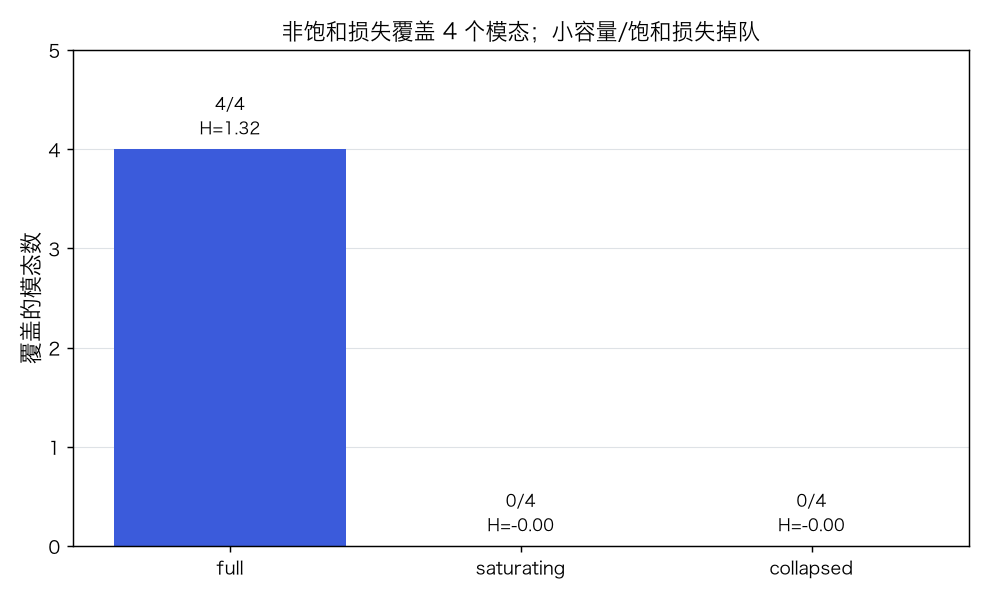
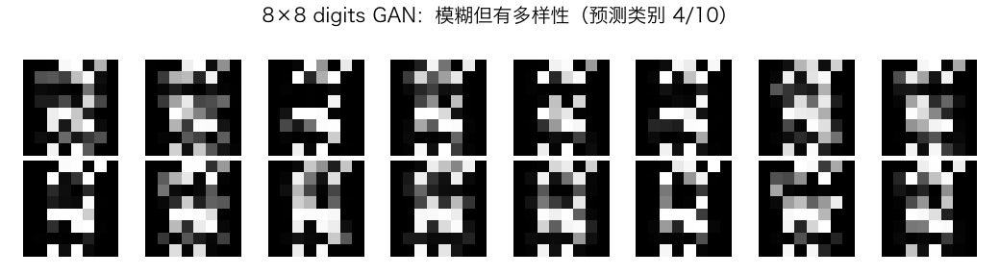
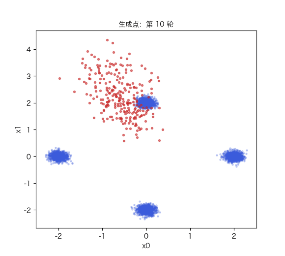

# GAN：对抗训练、非饱和损失与模式崩塌

> 状态：✅ 已完成（2026-10-22）
> 对应文档章节：`../../docs/人工智能代表算法演进路线.md` 第 4.6 章
> 阅读路线：零基础读者读「基础篇」（生活类比 → 手算 → 白话 → 自测）；要看推导、实现与复现实验读「进阶篇」
> 本族共 6 个实验，学习顺序与补强计划见 [族级导读](../README.md)。

深度模型（生成式）：入口 `GAN(data_dim, latent_dim, ...).train(X)` / `sample(n)`，实现在 [impl.py](impl.py)；对照是 [framework.py](framework.py) 的 PyTorch 双 MLP。

## 读之前：GAN 与生成模型

- **GAN**：生成器 G 与判别器 D 交替对抗；G 学“骗过 D”，D 学“分清真假”；
- **非饱和损失**：G 用 `−log D(G(z))`，而不是原始 `log(1−D(G(z)))`；
- **模式崩塌**：G 只生成少数几种样本，覆盖率/熵下降；
- **与 VAE/Diffusion 的区别**：GAN 没有显式似然，训练是博弈；VAE/Diffusion 在 p05。

| 概念 | 是什么 | 本实验 |
|---|---|---|
| GAN | 对抗式生成模型 | 手写 + torch |
| 非饱和损失 | G 的实用损失 | `loss_type="non_saturating"` |
| 模式覆盖 | 生成样本覆盖多少个真实模态 | `covered/4` |
| 多样性 | 生成样本的熵/最近邻距离 | `entropy` / `nn_distance` |

# 基础篇 · 先搞懂它

## 1. 生活类比：造假者与鉴定师

造假者（G）想造出以假乱真的画；鉴定师（D）想分辨真画和假画。
两人互相较劲：D 越强，G 越要改进；G 越像，D 越难分。

GAN 就是这样两个网络：

- **G**：噪声 `z → 假样本 G(z)`；
- **D**：样本 `x → 真概率 D(x)`；
- 训练：D 学“真=1、假=0”，G 学“让 D 把假判成真”。

没有标签、没有显式似然；训练信号来自 D 的判决。

## 2. 核心量：minimax、非饱和损失、模式崩塌

**原始 minimax**：

$$\min_G\max_D\ \mathbb E_{x\sim p_{data}}\log D(x)+\mathbb E_{z}\log(1-D(G(z)))$$

**非饱和 G 损失**（实践常用）：

$$\min_G\ -\mathbb E_z\log D(G(z))$$

**模式崩塌**：G 发现“只造一种最像的样本”就能骗过 D，于是覆盖的模态变少。
**指标**：覆盖模态数、类别熵、最近邻距离（NN 距离越大越分散）。

## 3. 主循环：先更新 D，再更新 G（冻结 D）

## 4. 手算示例：非饱和 vs 饱和的梯度

设 D 对某个假样本输出 `d`：

- 非饱和 G 损失 `−log d`，对 `d` 的导数 `−1/d`；
- 饱和 G 损失 `log(1−d)`，对 `d` 的导数 `−1/(1−d)`。

当 `d` 很小（假样本很容易被识破）时：

| d | 非饱和梯度大小 | 饱和梯度大小 |
|---|---|---|
| 0.01 | 100 | 1.01 |
| 0.1 | 10 | 1.11 |
| 0.5 | 2 | 2 |

非饱和损失在“假样本很差”时给出更大的梯度，G 更容易改进；饱和损失此时梯度接近 1，学得慢。
这就是实践里用非饱和损失的原因。

## 5. 白话版：为什么 GAN 难训、模式崩塌怎么发现

**难训**：两个网络目标相反，D 太强 → G 梯度消失；G 太强 → D 学不到东西。
需要调 lr、更新次数、网络容量。

**模式崩塌**：G 只生成少数几种样本，D 难以区分；损失看起来正常，但多样性没了。
**发现方法**：看覆盖的模态数/类别熵/最近邻距离，而不是只看 loss。

**本实验**：2D 4-Gaussians 上，非饱和 + 足够容量覆盖 4/4；小容量/饱和损失掉队；
8×8 digits 上，MLP GAN 只生成 4/10 类“模糊数字”——这就是 DCGAN/条件 GAN 的动机。

## 6. 常见误区

- **❌ "GAN 有唯一损失，越小越好"** —— 是博弈；G/D loss 要一起看，loss 低不代表样本好。
- **❌ "非饱和损失一定比饱和好"** —— 通常更稳，但仍可能崩塌；本实验饱和版在同样预算下更差。
- **❌ "生成样本逼真 = 多样性好"** —— 模式崩塌时也能生成少数逼真样本；要看覆盖/熵。
- **❌ "D 越强越好"** —— D 太强会让 G 梯度消失；要平衡。
- **❌ "GAN 能直接算概率"** —— 没有显式似然；评估要靠样本/指标/下游任务。
- **❌ "8×8 上 GAN 能生成清晰数字"** —— MLP GAN 只能到“模糊块”；清晰图要 DCGAN/条件 GAN。

## 7. 看图：真假、覆盖、8×8 与训练过程

2D 4-Gaussians：生成点覆盖 4 个模态，但也有少量低密度“辐条”——GAN 不完美。

full 4/4（H=1.32）；saturating 0/4；collapsed latent=1 0/4。

8×8 digits：生成的是“像数字的模糊块”，预测类别只覆盖 4/10。

训练中生成点从一团噪声逐渐铺到 4 个模态。

## 8. 掌握清单：五级能力与自测

| 级别 | 能力 | 本实验的检验方式 | 在哪做 |
|---|---|---|---|
| 1 说清 | 用自己的话讲规则 | 说出 G/D 目标、非饱和损失、模式崩塌 | 基础篇「核心量」「白话版」 |
| 2 走通 | 纸上手算 | `−log d` 与 `log(1−d)` 的梯度对比 | 基础篇「手算示例」节 |
| 3 判断 | 说清正确性条件 | 解释 D 太强/太弱、模式崩塌、指标 | 基础篇「白话版」+ 实验一 |
| 4 实现 | 手写并与对照比对 | 跑通 `demo.py`，损失有限、样本形状正确 | 进阶篇「实验结果」 |
| 5 迁移 | 用到新问题 | 不同 latent 容量的覆盖/熵对照 | [project/](project/README.md) |

**自测关卡（先预测，再跑代码验证）**：

1. D 对假样本输出 0.01，非饱和 G 的梯度大约多大？
2. 模式崩塌时，D loss 会明显变差吗？
3. latent 从 16 降到 1，覆盖模态数会怎样？
4. 8×8 digits 上 MLP GAN 能覆盖 10 类吗？

# 进阶篇 · 实验档案

## 目录形态（本算法的"类型"）

| 文件 | 角色 | 入口 / 说明 |
|---|---|---|
| [impl.py](impl.py) | 手写实现 | `GAN`：G/D MLP、Adam、非饱和/饱和损失、`mode_coverage` |
| [framework.py](framework.py) | PyTorch 对照 | `TorchGAN` |
| [demo.py](demo.py) | 同数据双跑 | 2D 4-Gaussians / 8×8 digits / torch |
| [test_impl.py](test_impl.py) | 性质测试 | LeakyReLU、覆盖指标、训练 smoke、输出域、契约 |
| [make_teaching_assets.py](make_teaching_assets.py) | 素材生成 + 对账 | 真假 / 覆盖 / 8×8 / GIF |
| [exercises/](exercises/README.md) | 练习（5 题，题解分离） | 概念、手算、诊断、实现、迁移 |
| [project/](project/README.md) | 迁移项目 | latent 容量的覆盖/熵扫描 |

## 1. 设计原理

GAN 用两个网络做博弈：D 提供“真假”信号，G 用这个信号改进。
它不定义显式似然，所以训练不稳定、评估困难；但能生成高质量样本。
本实验用 2D 混合高斯把“覆盖/崩塌”变成可计算的指标，再用 8×8 digits 看真实像素上的困难。

## 2. 数学推导

**最优 D**：固定 G 时，逐点最大化

$$D^*(x)=\frac{p_{data}(x)}{p_{data}(x)+p_g(x)}$$

**原始 G 损失**：`log(1−D(G(z)))`；在 D 很自信时梯度消失。
**非饱和**：`−log D(G(z))`，在 D 把假判假时仍有大梯度。

**覆盖/熵**：把生成样本分给最近的真实中心，`counts` 的熵 `H=−Σp log p`；
`H` 越接近 `log K` 越均匀；NN 距离衡量局部多样性。

## 3. 手写实现要点

1. **D/G 交替**：先更新 D，再冻结 D 更新 G；G 的反向要穿过 D。
2. **非饱和损失**：`dL/dD = −1/(D·m)`；饱和是 `−1/((1−D)·m)`。
3. **Adam 的 beta**：GAN 常用 `beta1=0.5`；本实现用 0.9/0.999 也能跑，但更抖。
4. **D 太强**：降低 `lr_d` 或增加 `g_steps`；本实验用 `lr_d=5e-5`。
5. **模式指标**：覆盖数/熵/NN 距离；不要只看 loss。
6. **输出层**：2D 用线性；8×8 像素用 sigmoid。

## 4. 框架对照

torch 的 `nn.Sequential` + `BCELoss` + Adam 与手写版同结构：

| 2D 4-Gaussians（1000 轮） | 覆盖 | 熵 | 耗时 |
|---|---|---|---|
| 手写 | **4/4** | 1.34 | ≈5s |
| torch | 1/4 | 0.00 | ≈41s |

torch 版在同样轮数下崩塌；说明 **GAN 对初始化/优化细节极敏感**，不能指望“换框架就稳”。
（torch 版调 lr/轮数后也能覆盖，但本实验保留这个负面结果。）

## 5. 实验结果

**环境**：uv（`uv sync --extra deep-learning --extra dev`），Python 3.13.15 /
numpy 2.5.4 / scikit-learn 1.9.1 / torch 2.14.1；CPU。
**数据**：2D 4-Gaussians（4000 点，σ=0.1）；8×8 digits（1200 训练）。
**复现**：本目录内 `uv run python demo.py`、`uv run pytest test_impl.py -q`、
`uv run python make_teaching_assets.py`。

**实验一：2D 4-Gaussians（500 轮）**

| 配置 | 覆盖 | 熵 | NN 距 | D acc |
|---|---|---|---|---|
| 非饱和, latent=16 | **4/4** | **1.32** | 0.06 | 0.47 |
| 饱和, latent=16 | 0/4 | 0.00 | 0.35 | 0.50 |
| 小容量, latent=1 | 0/4 | 0.00 | 0.31 | 0.50 |

**实验二：8×8 digits（150 轮）**

生成 256 张：预测类别 **4/10**，类别熵 **0.98**，D acc 0.43，耗时 ≈1.8s。

**实验三：手写 vs torch（2D，1000 轮）**

手写 4/4、熵 1.34；torch 1/4、熵 0.00，耗时 ≈41s。

**验证声明（已验证）**：输入为上述数据与种子；2026-10-22 在 uv 环境实跑，
`uv run python demo.py` 输出上表；`uv run pytest test_impl.py -q` → **7 passed**；
`uv run python make_teaching_assets.py` 对账通过（2D 覆盖 ≥3、样本有限）。

**可视化结论**：

- `images/00-2D真假.png`：生成点覆盖 4 个模态，但有低密度辐条；
- `images/01-模式覆盖.png`：full 4/4，saturating/collapsed 0/4；
- `images/02-8x8生成.png`：模糊数字块，类别只覆盖 4/10；
- `images/03-生成生长.gif`：训练中生成点逐渐铺开。

## 6. 局限与延伸

- **2D 仍有辐条**：覆盖指标过，但视觉不完美；GAN 不是“训了就完美”。
- **8×8 digits 很弱**：MLP GAN 只生成模糊块；清晰图要 DCGAN/条件 GAN/WGAN-GP。
- **饱和损失在同样预算下崩塌**：不能据此说“饱和永远差”，但说明调参敏感。
- **torch 版未调好**：同轮数 1/4；保留负面结果，提醒框架不自动解决 GAN 稳定性。
- **评估不完整**：只有覆盖/熵/NN；没有 FID/IS/人工评估。
- **下游**：DCGAN → WGAN-GP → StyleGAN → Diffusion（p05）。

**已记录、不阻塞**：

- **2D 样本仍有“辐条”**：覆盖指标只统计“离中心足够近”的样本，4/4 不等于视觉完美；
  低密度辐条正是这个简单 GAN 的失败模式。
- **单种子/未调参的负面结果**：饱和损失 0/4、latent=1 0/4、torch 1/4 都只说明“这个配置/预算下失败”，
  不能推出“饱和/小容量/torch 永远差”。
- **8×8 digits 只覆盖 4/10 类**：MLP GAN 生成模糊块；没有 DCGAN/条件 GAN/WGAN-GP。
- **评估不完整**：只有覆盖数/熵/NN 距离；没有 FID/IS/人工评估。
- **测试只做 smoke**：没有 G/D 的有限差分梯度检查，也没有模式崩塌的硬断言。
- **`sample()` 重复调用返回同一批样本**：每次都用 `random_state` 新建 RNG；
  连续采样应先推进 RNG。`train()` 每次调用会**重新初始化参数**，不是“继续训练”。
