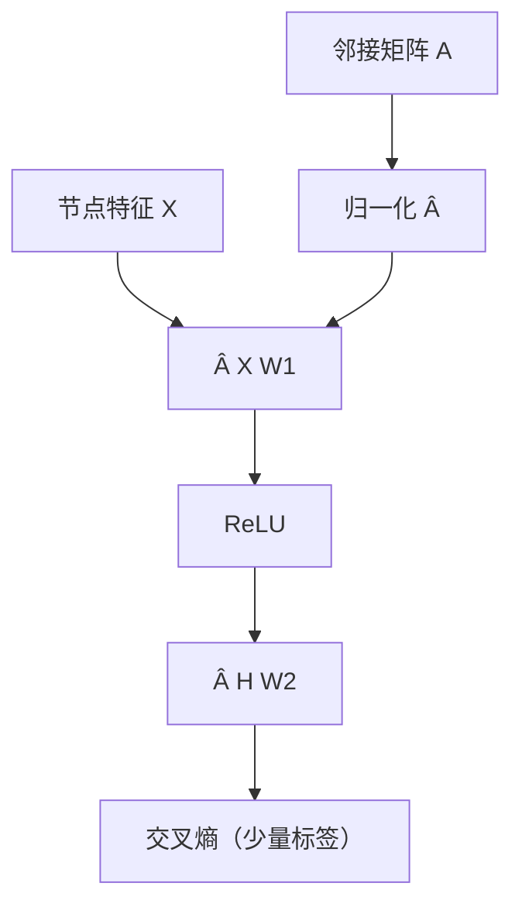
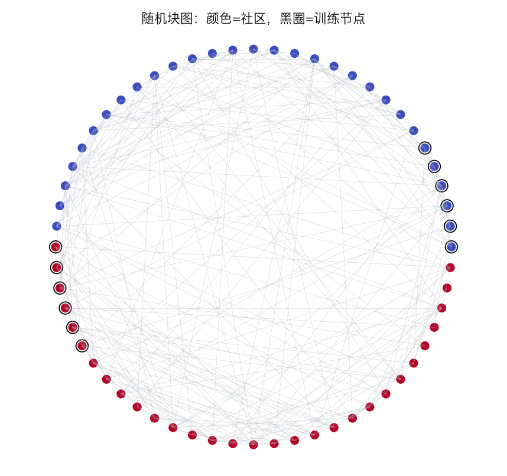
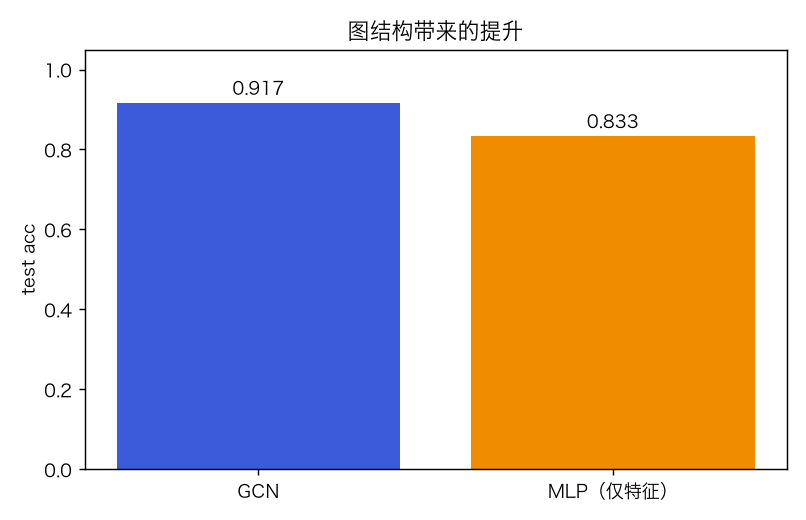
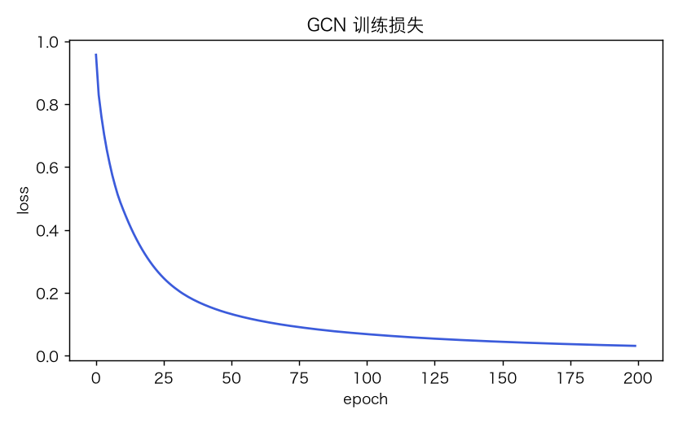
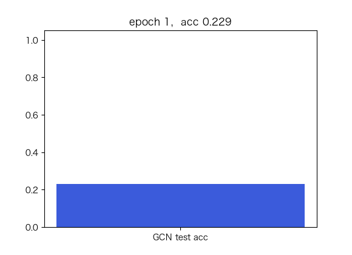

# 图神经网络 GCN：消息传递与半监督节点分类

> 状态：✅ 已完成（2026-10-23）
> 对应文档章节：`../../docs/人工智能代表算法演进路线.md` 第 4.7 章
> 阅读路线：基础篇 → 进阶篇
> 本族共 8 个实验，见 [族级导读](../README.md)。

深度模型（判别式）：入口是 `GCN(hidden).fit(A, X, y, train_mask)` / `predict()`，实现在 [impl.py](impl.py)；对照是无图 MLP（`demo.py`）。

# 基础篇

## 1. 生活类比：听邻居的意见

每个节点不只是看自己的特征，还聚合邻居的特征；一层 GCN 看 1 跳邻居，两层看 2 跳。

## 2. 核心量：邻接矩阵、归一化、消息传递

- `A_hat = D^{-1/2}(A+I)D^{-1/2}`：加自环并对称归一化；
- 一层：`H = ReLU(A_hat X W1 + b1)`；
- 二层：`logits = A_hat H W2 + b2`；
- 半监督：只对少量训练节点算交叉熵。

## 3. 主循环

## 4. 手算示例

`A=[[0,1],[1,0]]`，加自环后 `[[1,1],[1,1]]`，`D=2`，`A_hat=0.5*ones`。
节点特征 `[1,0]`、`[0,1]` 聚合后都变成 `[0.5,0.5]`——两层后容易过平滑。

## 5. 白话版：GCN 为什么需要图

- 标签少时，邻居特征提供额外信息；
- MLP 只看单节点特征，无法利用连接；
- 但层数太深会过平滑，所有节点变得相似；
- 本实验 GCN 0.917 vs MLP 0.833，图结构带来提升。

## 6. 常见误区

- **❌ "GCN 层数越多越好"** —— 过平滑。
- **❌ "GCN 不需要特征"** —— 纯结构也可以，但特征是主力。
- **❌ "GCN=GraphSAGE=GAT"** —— 聚合/注意力不同。
- **❌ "半监督=不用标签"** —— 仍需少量标签。
- **❌ "节点分类=图分类"** —— 任务不同。
- **❌ "合成图能代表 Cora"** —— 不能。

## 7. 看图

## 8. 掌握清单

| 级别 | 能力 | 检验 |
|---|---|---|
| 1 说清 | 复述消息传递 | 本文 |
| 2 走通 | 手算归一化/聚合 | 手算示例 |
| 3 判断 | 过平滑/层数 | 白话版 |
| 4 实现 | 跑 demo | 实验结果 |
| 5 迁移 | 新图节点分类 | project |

# 进阶篇

## 目录形态

| 文件 | 角色 |
|---|---|
| [impl.py](impl.py) | 归一化、GCN 前向/反向、SBM 数据 |
| [demo.py](demo.py) | GCN vs MLP |
| [test_impl.py](test_impl.py) | 8 个测试 |
| [make_teaching_assets.py](make_teaching_assets.py) | 素材 |
| [exercises/](exercises/README.md) | 5 题 |
| [project/](project/README.md) | 新图节点分类 |

## 1. 设计原理

GCN 是“归一化邻接矩阵 + 两层 MLP”的消息传递；半监督只对训练节点回传。

## 2. 数学推导

`Â=D^{-1/2}(A+I)D^{-1/2}`；`H=ReLU(ÂXW1+b1)`；`Z=ÂHW2+b2`；
损失 `-Σ_{train} log softmax(Z)_y`。

## 3. 手写实现要点

1. 加自环；2. 对称归一化；3. 只对训练节点算 loss；4. 两层，避免过平滑；5. 固定 seed。

## 4. 框架对照

对照是**无图 MLP**，不是 PyG；本实验不依赖 PyTorch Geometric。

## 5. 实验结果

60 节点 / 240 边 / 12 训练 / 48 测试：

| 模型 | 测试 acc |
|---|---|
| GCN | **0.917** |
| MLP（仅特征） | 0.833 |

GCN loss 0.957 → 0.031；训练 8ms。**8 passed**；素材对账通过。

## 6. 局限与延伸

- 合成随机块图，不是 Cora/CiteSeer；
- 只有 2 层 GCN，没有 GraphSAGE/GAT；
- 没有 mini-batch/大图采样；
- 没有过平滑定量实验；
- 下游：GraphSAGE/GAT → 图分类/链接预测。

**已记录、不阻塞**：合成图、无 PyG、无大图采样。
