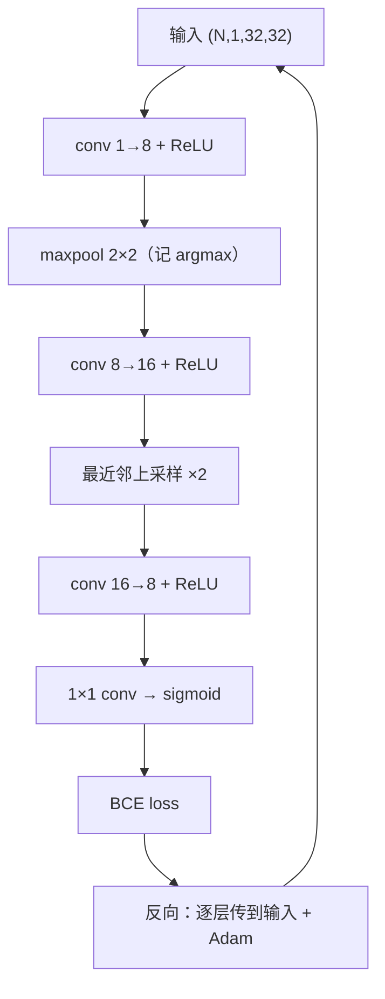
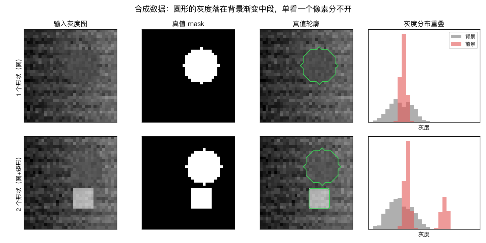
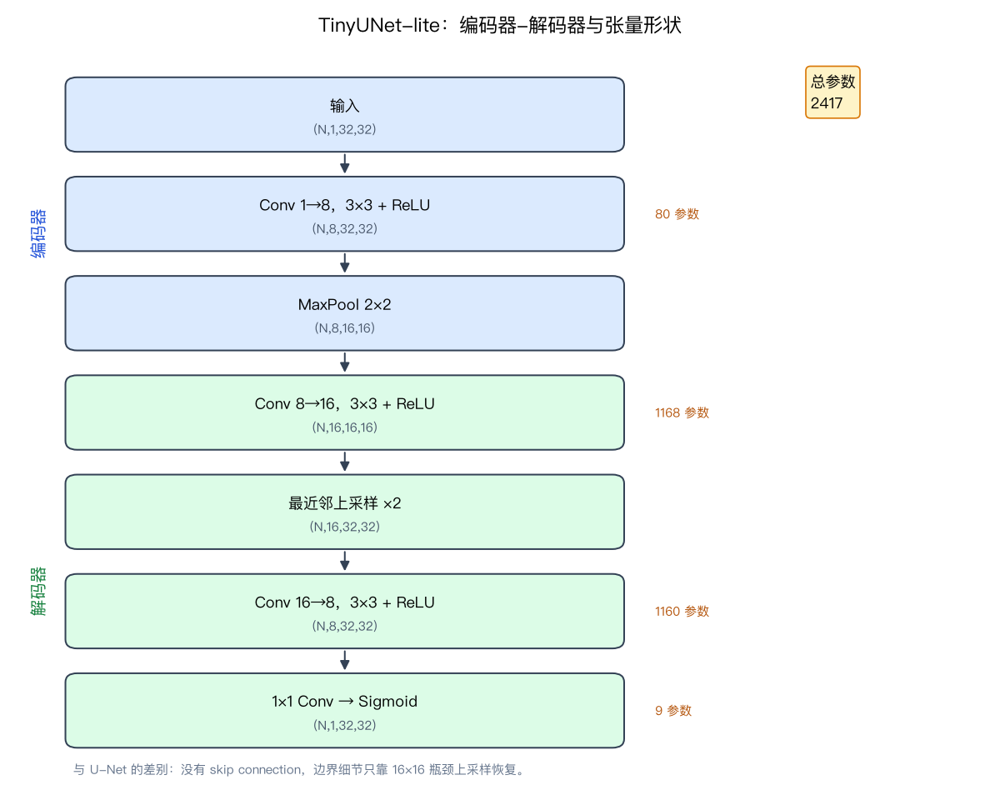
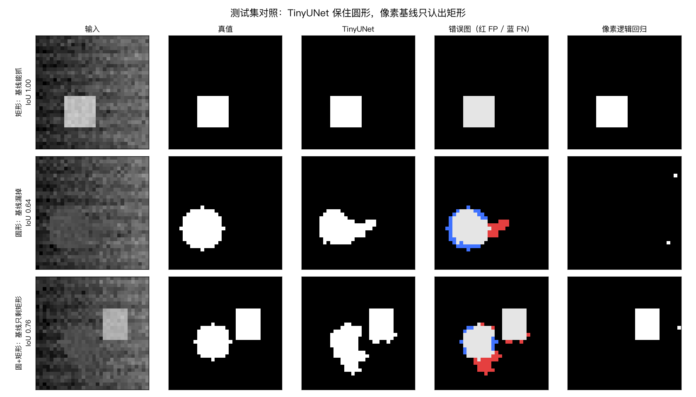
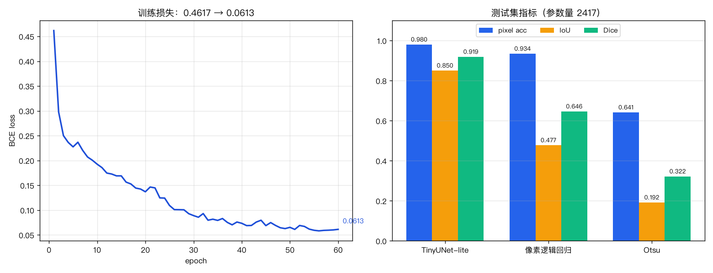
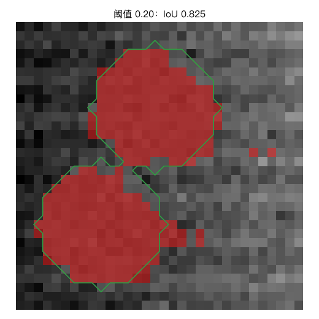

# 图像分割：编码器-解码器与 IoU

> 状态：✅ 已完成（2026-10-26）
> 对应文档章节：`../../docs/人工智能代表算法演进路线.md` 第 4.3.4 章
> 阅读路线：零基础读「基础篇」，复现读「进阶篇」；深度模型（判别式）入口 `TinyUNet().fit(X,y)` / `predict(X)`，对照在 [baseline.py](baseline.py)

# 基础篇 · 先搞懂它

## 1. 生活类比：给 1024 个像素各发一张工牌

分类给整图贴标签；分割给每个像素判"是不是目标"。TinyUNet-lite 像"压缩—还原"流程：
编码器把 32×32 压到 16×16 记"哪里有"，解码器放回原尺寸画边界。只看单像素亮度的阈值
等于让像素孤立投票，遇到"圆的灰度与背景重叠"必然投错。

## 2. 核心量：mask、卷积、池化、上采样、IoU/Dice

- **mask**：每像素 0/1；输出 `(N,1,32,32)` 概率图，阈值 0.5 得 mask。
- **卷积**：3×3 滑窗学局部模式。
- **最大池化**：2×2 取最大、尺寸减半；前向记 argmax，反向只回传最大值位置。
- **最近邻上采样**：每像素复制成 2×2；反向把 2×2 梯度**求和**回原像素。
- **sigmoid + BCE**：每像素独立二分类，`p=σ(z)`。
- **IoU** = `|P∩T|/|P∪T|`；**Dice** = `2|P∩T|/(|P|+|T|)`；两者都空时约定为 1。

## 3. 主循环



一个 batch：前向得每像素前景概率 → BCE → 反向 → Adam；重复多轮，每轮打乱训练集。

## 4. 手算示例：4×4 的 IoU/Dice 与 2×2 上采样

```text
target = [[1,1,0,0],      pred = [[1,1,0,0],
          [1,1,0,0],               [1,0,0,0],
          [0,0,0,0],               [1,0,0,0],
          [0,0,1,1]]               [0,0,1,0]]
```

逐行数：`|T|=6`、`|P|=5`、`|P∩T|=4`，故 `|P∪T|=7`：
**IoU = 4/7 ≈ 0.571，Dice = 8/11 ≈ 0.727**。

上采样 `[[1,2],[3,4]]` → 每个数复制 2×2：

```text
1 1 2 2
1 1 2 2
3 3 4 4
3 3 4 4
```

若输出收到全 1 梯度，反传后每输入位置是 4（被复制 4 次，梯度累加 4 次）。

## 5. 白话版：为什么压缩再还原能分割

- 卷积 + 池化扩大感受野：16×16 上一点对应原图更大区域，能判断"这一带像不像形状"。
- 上采样把"哪里有"放回"在哪里"；无 skip 时边界只能靠瓶颈特征猜，边界带更难。
- IoU/Dice 比 pixel accuracy 严格：前景远少于背景时，"全预测背景"也有高 acc，但 IoU/Dice 为 0。
- BCE + sigmoid 是逐像素独立假设；不直接优化 IoU，但梯度稳定、实现简单。

## 6. 常见误区

- **❌ "pixel accuracy 高=分割好"** —— 前景少时全背景也高，必须看 IoU/Dice。
- **❌ "IoU 和 Dice 一样"** —— `Dice=2IoU/(1+IoU)`，同一预测的 Dice 更大。
- **❌ "上采样反向也是复制"** —— 前向复制，反向是**求和**（转置）。
- **❌ "TinyUNet-lite=U-Net"** —— 没有 skip，边界保真差一截。
- **❌ "深度模型自动鲁棒"** —— 不增广时加噪可能被阈值反超。
- **❌ "阈值一定差"** —— 它们只是没有上下文；数据可分时也能很强。

## 7. 看图








阈值从 0.2 扫到 0.8：同一张概率图，mask 逐步收缩，IoU 先升后降——阈值要在验证集上选。

## 8. 掌握清单

| 级别 | 能力 | 检验 |
|---|---|---|
| 1 说清 | 复述 mask/卷积/池化/上采样/IoU/Dice | 复述，做第 1 题 |
| 2 走通 | 手算 4×4 的 IoU/Dice 与上采样反向 | 重走「手算示例」，与 `impl.py` 对拍 |
| 3 判断 | 说出 pixel acc 失效条件、反向为什么求和 | 举"高 acc 低 IoU"例，做第 3 题 |
| 4 实现 | 跑通 `demo.py`，解释与基线差距 | 复现「实验结果」，做第 4/5 题 |
| 5 迁移 | 用到多形状/面积/噪声场景 | `project/` 验收 + 第 6 题 |

**自测**（先预测再验证）：

1. 上采样反向只取左上，伴随误差变大吗？
2. 测试图加噪，CNN 和阈值谁更稳？
3. maxpool 反向均分梯度，训练会怎样？

# 进阶篇 · 实验档案

## 目录形态

手写 `impl.py`、数据 `data.py`、对照 `baseline.py`、入口 `demo.py`；测试 `test_impl.py`、
素材 `make_teaching_assets.py`（4 图 + 1 GIF）；练习 [exercises/](exercises/README.md)、项目 [project/](project/README.md)。

## 1. 设计原理

分割把分类从"整图"推到"逐像素"。路线图 4.3.4 的 FCN/U-Net 用编码器-解码器合起语义与位置；
本实验取最小骨架（卷积-池化-上采样-卷积），用合成数据走通 IoU/Dice 闭环。

数据让圆形灰度落在背景渐变中段：任何**逐像素**阈值都顾此失彼，必须利用局部上下文。

## 2. 数学推导

**卷积**（3×3、pad=1、stride=1）：`Y_{i,j,c}=Σ_{u,v,k}X_{i+u-1,j+v-1,k}W_{c,k,u,v}+b_c`；
`im2col` 把它变成 `cols @ Wᵀ`，反传用 `col2im` 把重叠窗口梯度累加。

**最大池化**：`y=max(x_1..x_4)`；`∂L/∂x_m=∂L/∂y` 仅当 `m=argmax`，其余为 0。

**最近邻上采样**：`up(X)[2i+a,2j+b]=X[i,j]`；转置 `upᵀ(G)[i,j]=Σ_{a,b}G[2i+a,2j+b]`；
伴随 `<up(X),G>=<X,upᵀ(G)>` 是测试反向的根据。

**sigmoid + BCE**：`p=σ(z)`，`L=mean(max(z,0)-zy+log(1+e^{-|z|}))`，`∂L/∂z=(p-y)/N`。

**IoU/Dice**：`IoU=I/U`，`Dice=2I/(|P|+|T|)`；由 `U=|P|+|T|-I` 得 `Dice=2IoU/(1+IoU)`。

## 3. 手写实现要点

1. `col2im` 对重叠窗口**累加**，不能赋值。
2. maxpool 前向存 argmax，反向用 `put_along_axis` 路由；均分梯度会破坏伴随。
3. 上采样反向 `reshape(N,C,H,2,W,2).sum(axis=(3,5))`；最容易写错的一步。
4. BCE 从 logits 算；`sigmoid` 正负分支分开，避免 `exp` 溢出；单张与整批预测应一致。
5. 数据固定 seed、形状互不重叠。

## 4. 基线对照

选择两个**只看单像素灰度**的基线：

- **逐像素逻辑回归**：1024 像素当独立样本、同样标签，训练"学出来的阈值"；
  与 CNN 同数据同指标，差距归因于无空间上下文。
- **Otsu**：无监督最大化类间方差选全局阈值，作为经典图像处理参照。

不用 sklearn 分割模型：没有同名接口；对照的是"上下文有无"，同 train/test、同指标。差异：
逻辑回归对灰度单调，无法同时表达"圆在中灰、矩形在高灰、背景两端都有"；
Otsu 被大面积背景渐变主导。CNN 的 3×3 卷积看到边缘/平滑度，池化扩大感受野，两类形状都能找回。

## 5. 实验结果

环境：uv（Python 3.13.15 / numpy 2.5.4 / scikit-learn 1.9.1）。
数据：32×32 合成图，训练 320 / 验证 64 / 测试 64，seed=11/12/13，每图 1–2 个互不重叠形状。
模型：60 轮、Adam、lr=0.008、batch=16、seed=0。

| 方法 | pixel acc | IoU | Dice | 耗时(s)（随环境） |
|---|---|---|---|---|
| TinyUNet-lite | **0.9803** | **0.8503** | **0.9191** | 训练 16.1 |
| 逐像素逻辑回归 | 0.9344 | 0.4774 | 0.6463 | 0.05 |
| Otsu（阈值 0.326） | 0.6414 | 0.1917 | 0.3217 | 0.00 |

模型：参数量 **2417**；loss **0.4617 → 0.0613**。

阈值/边界：验证集最佳阈值 0.48，IoU 0.8658（0.50 处 0.8650，几乎平坦）；
边界带（8.2% 区域）TinyUNet acc 0.8168，像素逻辑回归 0.6841。

复现：

```bash
cd algorithms/p03-deep-learning/image-segmentation
uv run python demo.py
uv run pytest test_impl.py -q
uv run python make_teaching_assets.py
uv run python project/segment_area.py
```

**验证**：2026-10-26 在本机实跑上述命令；`pytest` → **12 passed**；
素材脚本对账通过（4 图 + 1 GIF）；project 5 条验收断言通过。

## 6. 局限与延伸

- **无 skip**：边界靠 16×16 瓶颈恢复，边界带更差；完整 U-Net 应补 skip。
- **数据太小**：32×32、1–2 形状、无真实纹理，结论不能直接外推到工业图。
- **不自动鲁棒**：不做噪声增广，测试加噪会让 IoU 腰斩，甚至被像素基线反超
  （见 [第 6 题](exercises/sol-06-噪声鲁棒性.md)）。
- **单类分割**：只分前景/背景；多类要 softmax，实例分割还要拆粘连目标。
- **阈值未校准**：0.5 只是默认值；面积测量偏小，需按标定样本校准。

延伸：补 skip/完整 U-Net → Dice loss（第 4 题）→ 双线性上采样（第 5 题）→
多形状面积测量（[project](project/README.md)）→ 真实数据与噪声增广；Mask R-CNN、SAM
见路线图 4.3.4 后续。
