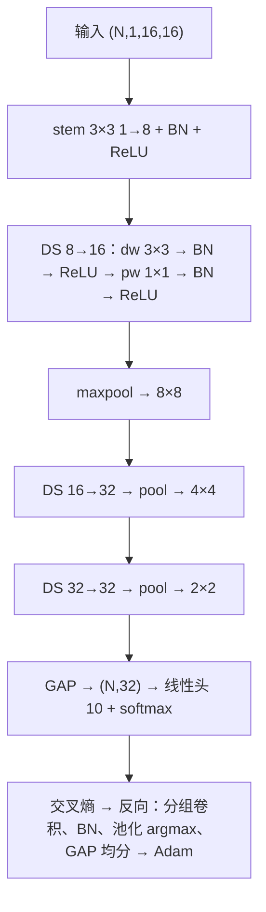
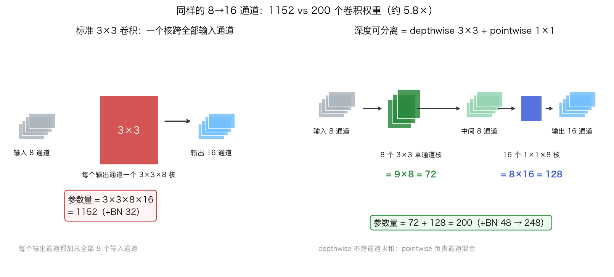
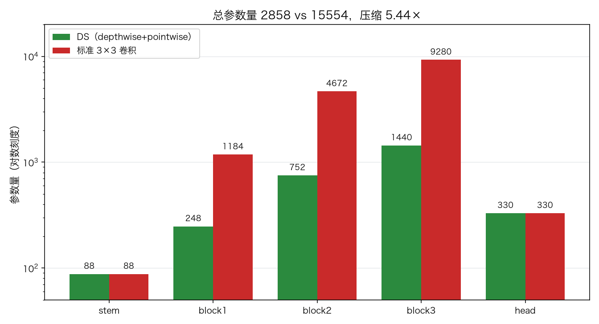
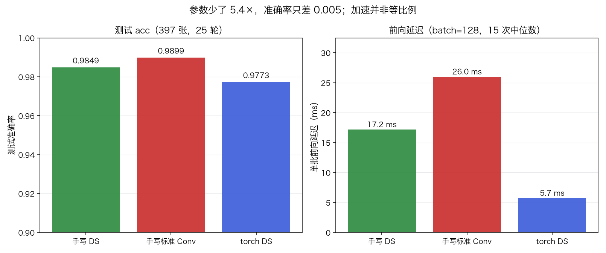
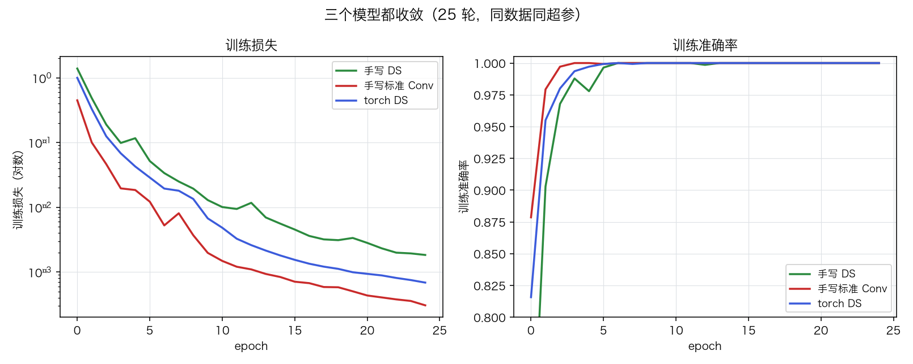
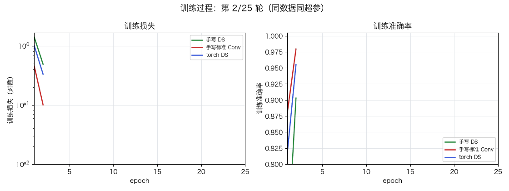

# 轻量级 CNN：深度可分离卷积

> 状态：✅ 已完成（2026-10-26）
> 对应文档章节：`../../docs/人工智能代表算法演进路线.md` 第 4.3.2 章
> 阅读路线：基础篇（类比 → 手算 → 白话）→ 进阶篇（推导 → 实现 → 复现）

深度模型：入口 `MobileNetLite(widths=(8,16,32,32)).fit(X, y)` / `predict(X)`，输入 `(N,1,16,16)`；手写在 [impl.py](impl.py)，torch 对照在 [framework.py](framework.py)。

# 基础篇

## 1. 生活类比：先各看各的，再开会汇总

标准 3×3 卷积像所有人一起表决：每个输出通道同时加权 8 个输入通道。
深度可分离拆成两步：**depthwise** 每个通道用自己的 3×3 找纹理（不跨通道），
**pointwise** 用 1×1 把 8 个通道汇总成 16 个输出——"各看各的"比"两两组合"便宜。

## 2. 核心量：depthwise、pointwise、压缩比、GAP

- **depthwise 3×3**：`groups=in_channels`，每个输出只卷自己的输入，参数 `9C`。
- **pointwise 1×1**：`Cin→Cout`，参数 `Cin·Cout`，只混合通道。
- **DS 块**：`dw→BN→ReLU→pw→BN→ReLU`，参数 `9Cin+CinCout+2Cin+2Cout`。
- **标准块**：`9CinCout+2Cout`；单块压缩比 `9Cout/(9+Cout)<9`。
- **GAP**：空间取均值到 `(N,C)`，无参数，替代大 FC 头。

## 3. 主循环：三次 DS 下采样，GAP 后接线性头



## 4. 手算示例：4×4 depthwise + pointwise

输入 `X` 为 1..16 的 4×4，核取十字 `K=[[0,1,0],[1,0,1],[0,1,0]]`，pad=1：

| 位置 | 窗口（补零后） | 计算 | 结果 |
|---|---|---|---|
| (0,0) 角 | `[[0,0,0],[0,1,2],[0,5,6]]` | `2 + 5` | **7** |
| (1,1) 中心 | `[[1,2,3],[5,6,7],[9,10,11]]` | `2 + (5+7) + 10` | **24** |

pointwise 取权重 `[0.5, -1.0]`：中心 `24 → [12, -24]`。这里跳过 BN/ReLU，
BN 的 β 才是可学习偏移。复算 depthwise：

```python
import numpy as np
from impl import Conv2D
X = np.arange(1, 17, dtype=float).reshape(1, 1, 4, 4)
dw = Conv2D(1, 1, 3, pad=1); dw.W[0, 0] = [[0, 1, 0], [1, 0, 1], [0, 1, 0]]
print(dw.forward(X)[0, 0, 0, 0], dw.forward(X)[0, 0, 1, 1])   # 7.0 24.0
```

## 5. 白话版：省在哪、精度为何没崩、延迟为何不按比例降

**省在哪**：标准 3×3 同时做空间与通道；DS 拆开，depthwise 只做空间（`9Cin`），
pointwise 只做通道（`CinCout`），省掉 `9CinCout` 的大头。

**精度为何没崩**：拆开降低单层容量，但 16×16 digits 笔画简单，瓶颈不在参数。

**延迟为何不按比例降**：depthwise 是多次小矩阵乘，算术强度低、访存占比高；
延迟还看算子融合、线程与硬件，参数量只决定内存。

## 6. 常见误区

- **❌ "depthwise 只是参数少的普通卷积"** —— 它不跨通道求和，表达力不同。
- **❌ "DS 一定更准、更快"** —— 本实验精度略低，速度要看实现。
- **❌ "压缩比是 9×"** —— 单块 `<9×`，stem/head 不压缩，实测总压缩 5.44×。
- **❌ "参数量少 = 推理快"** —— 还要看 FLOPs、访存、算子支持与 batch。
- **❌ "上采样到 16×16 信息变多"** —— 最近邻不增信息，只为池化留空间。

## 7. 看图



标准卷积一个核跨 8 通道；DS 拆成逐通道 3×3 + 1×1。



压缩全部来自三个 DS 块。



准确率接近，延迟差距远小于参数差距。



三个模型都收敛。



训练过程：损失与准确率随 epoch 逐步展开（时间维度）。

## 8. 掌握清单

| 级别 | 检验方式 |
|---|---|
| 1 说清 | 复述两个卷积与参数公式 |
| 2 走通 | 手算 4×4 角/中心 + pointwise |
| 3 判断 | groups 等价、BN train/eval |
| 4 实现 | `demo.py` 数字 + 梯度检查 |
| 5 迁移 | [project/](project/README.md) 预算选宽 |

**自测**：① 8→16 的 3×3 换 DS，参数约变几分之一？
② 参数降到 1/5，延迟也降到 1/5 吗？

# 进阶篇

## 目录形态

| 文件 | 角色 |
|---|---|
| [impl.py](impl.py) | 分组 Conv2D、BN、池化、GAP、两个网络 |
| [framework.py](framework.py) | PyTorch 对照（`groups=in_channels`） |
| [demo.py](demo.py) | 三路对照 + 参数 + 延迟 |
| [test_impl.py](test_impl.py) / [make_teaching_assets.py](make_teaching_assets.py) | 12 个测试 / 4 图 + 1 GIF 对账 |
| [exercises/](exercises/README.md) / [project/](project/README.md) | 6 题 / 预算项目 |

## 1. 设计原理

depthwise 做空间、pointwise 做通道，参数与 FLOPs 降一个量级；逐级池化，GAP 替代
大 FC。规模压到 16×16，使 numpy 手写全套反向可在 CPU 秒级复现。

## 2. 数学推导

**depthwise**：`D[n,c,i,j]=Σ_{u,v} X[n,c,i+u-1,j+v-1]·K[c,u,v]`。
**pointwise**：`Y[n,o,i,j]=Σ_c D[n,c,i,j]·Wp[o,c]`。

**参数量**：DS 块 `9Cin + CinCout + 2Cin + 2Cout`；标准块 `9CinCout + 2Cout`；压缩比
$$\frac{9C_{in}C_{out}}{9C_{in}+C_{in}C_{out}}=\frac{9C_{out}}{9+C_{out}}<9.$$

**反向**：depthwise 逐通道独立，`dK[c]=Σ_{n,i,j} X[n,c,i+u-1,j+v-1]·dD`；
pointwise `dWp=DᵀdY`、`dD=dY·Wpᵀ`。分组维塞进 einsum 的 `g` 轴一次算完。
BN 反传用标准公式，GAP 反向为 `df[c]/(H·W)`。

## 3. 手写实现要点

1. **分组卷积**：`cols` reshape 成 `(M,groups,·)`，`einsum("ngi,goi->ngo")`；`groups=Cin` 即 depthwise。
2. **卷积不带 bias**：conv 后都有 BN，β 承担偏移，参数与 torch 才能逐位相等。
3. **BN 反传别漏均值/方差项**，否则通不过有限差分；池化缓存 argmax；GAP 均分 `H·W`。
4. **参数引用要稳定**：反向用 `dW[...] = ...` 原地写，否则 Adam 可能持有旧数组。

## 4. 框架对照

torch 版逐层等价：`Conv2d(...,groups=C,bias=False)` + `BatchNorm2d` + `ReLU`、
`Conv2d(...,1,bias=False)`、`MaxPool2d`、`AdaptiveAvgPool2d(1)`、`Linear`，
参数量相同。对照版固定 `torch.set_num_threads(1)`，避免小张量的多线程开销。

| 维度 | 手写 | torch |
|---|---|---|
| 卷积 | im2col + einsum 分组 | 融合算子 |
| 数值/优化 | float64 / 手写 Adam | float32 / `Adam` |

参数量一致说明结构等价；精度/延迟差异来自数值精度、初始化与算子融合。

## 5. 实验结果

**环境/数据**：`algorithms/.venv`（uv），Python 3.13.15 / numpy 2.5.4 / scikit-learn 1.9.1 /
torch 2.14.1，CPU；sklearn `digits` 1797 张，8×8 像素 /16 后**最近邻上采样**到
16×16，训练 1400 / 测试 397，`random_state=0`。
**训练**：25 轮，batch 64，Adam，lr 0.01，seed 0，三模型同数据同超参。
**复现**：

```bash
cd algorithms/p03-deep-learning/lightweight-cnn
uv run python demo.py                  # 约 60 秒
uv run pytest test_impl.py -q          # 12 passed
uv run python make_teaching_assets.py  # 生成并核对 4 图 + 1 GIF
```

**实验一：三路对照**

| 方法 | 参数量 | 测试 acc | 训练(s) | 单批前向(ms) |
|---|---|---|---|---|
| 手写 DS | 2858 | **0.9849** | 19.63 | 17.43 |
| 手写标准 Conv | 15554 | 0.9899 | 27.59 | 28.26 |
| torch DS | 2858 | 0.9773 | 8.98 | **6.21** |

**实验二：参数拆解**

| 阶段 | DS | 标准 Conv | 压缩比 |
|---|---|---|---|
| stem | 88 | 88 | 1.00× |
| block1（8→16） | 248 | 1184 | 4.77× |
| block2（16→32） | 752 | 4672 | 6.21× |
| block3（32→32） | 1440 | 9280 | 6.44× |
| 线性头 | 330 | 330 | 1.00× |
| **合计** | **2858** | **15554** | **5.44×** |

延迟列即实验三（batch=128，15 次中位数）：手写 DS 参数只有 1/5.44，延迟只快 1.62×；
torch 融合算子再快 2.81×。

**验证声明（已验证）**：2026-10-26 本机 CPU 用 uv 环境实跑，`demo.py` 输出上表（约 60 秒）；
`pytest test_impl.py -q` → **12 passed**；素材对账通过。延迟随负载波动，图 02 的延迟
来自另一次实跑（参数/acc 一致），比较时看相对关系。

## 6. 局限与延伸

- **小数据小图**：16×16 digits 不是 ImageNet，结论不能外推到真实移动端视觉。
- **无 inverted residual / SE**：本实验只是 MobileNet v1 的单层 DS 块。
- **stride 固定 1、无部署验证**：下采样全靠池化；CPU 上的 numpy/torch，未做量化、
  ONNX/TFLite 与端侧测速。
- **下游**：MobileNet v2/v3、ShuffleNet、GhostNet；量化剪枝；轻量检测/分割。

**已记录**：上采样不增信息；手写 DS 延迟优势小于参数优势；torch 与手写差 0.0076。
