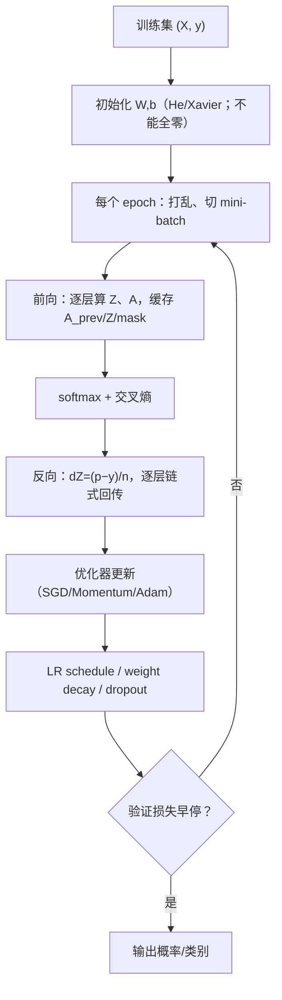
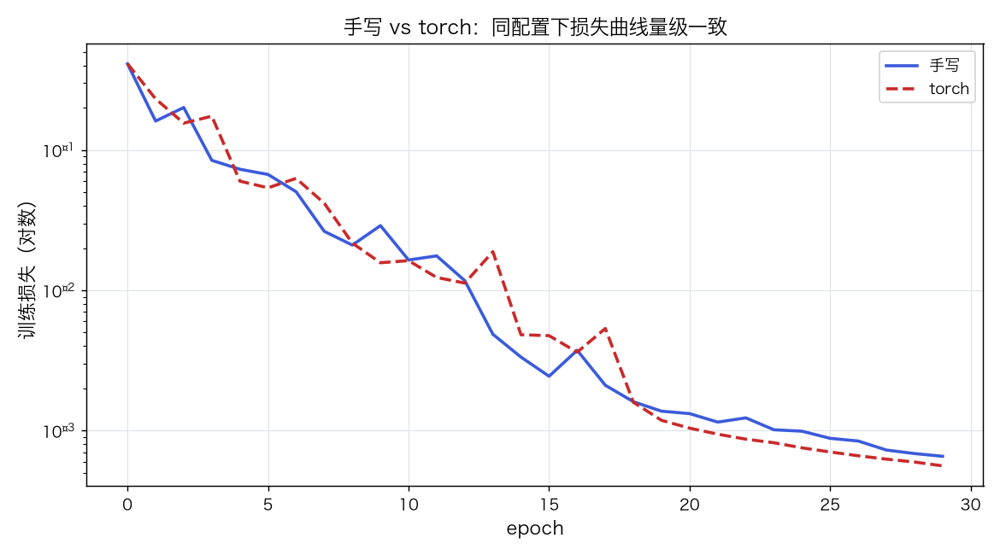
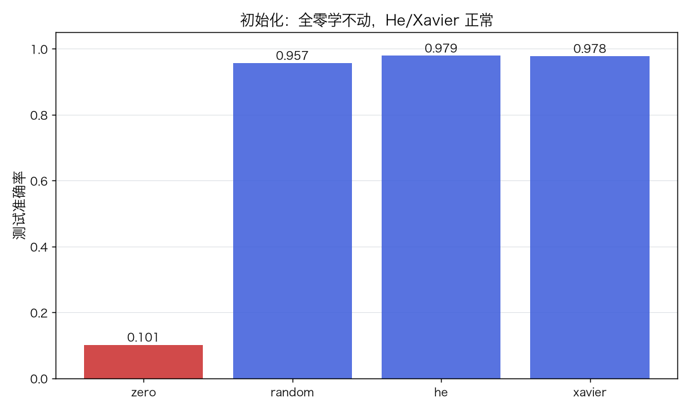
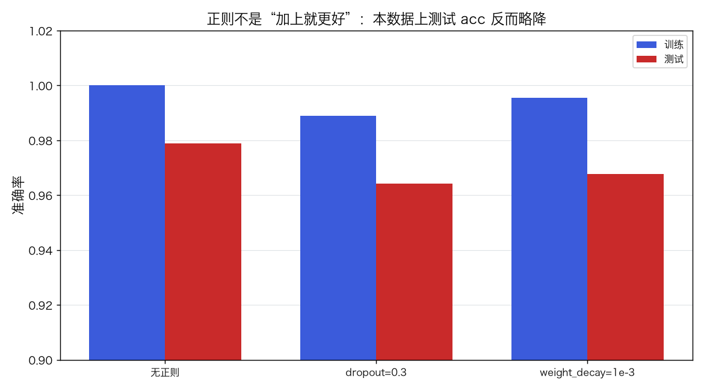
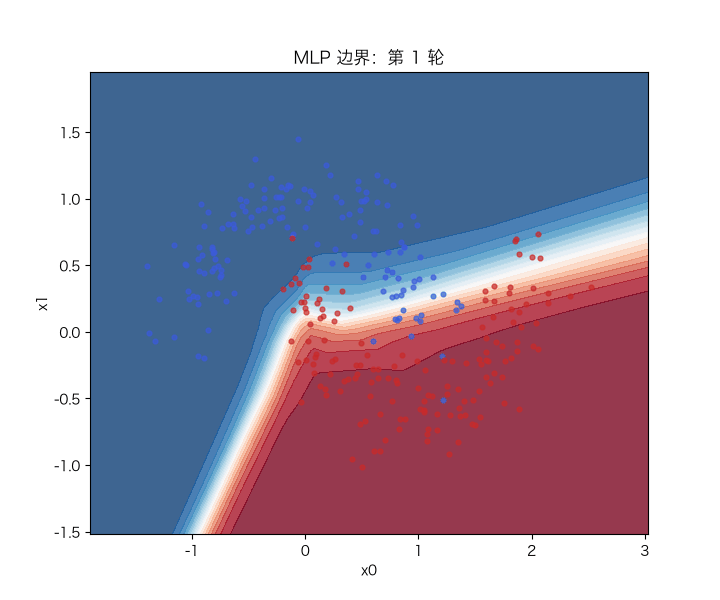

# MLP 与手写反向传播：链式法则、优化器与训练技巧

> 状态：✅ 已完成（2026-10-22）
> 对应文档章节：`../../docs/人工智能代表算法演进路线.md` 第 4.2 章
> 阅读路线：零基础读者读「基础篇」（生活类比 → 手算 → 白话 → 自测）；要看推导、实现与复现实验读「进阶篇」
> 本族共 6 个实验，学习顺序与补强计划见 [族级导读](../README.md)。

深度模型（判别式）：入口 `MLP(hidden_sizes, lr, epochs, ...).fit(X, y)` / `predict_proba(X)`，实现在 [impl.py](impl.py)；对照是 [framework.py](framework.py) 的 PyTorch `nn.Linear + ReLU + CrossEntropyLoss`。

# 基础篇 · 先搞懂它

## 1. 生活类比：一条会自我修正的流水线

单层感知机像"一道闸门"：只能力一刀切。MLP 像一条**多层流水线**：
第一层把原始像素组合成边缘/笔画，第二层再把边缘组合成数字部件，最后一层做分类。
每一层都输出一组"新特征"，而不是直接给答案。

关键是**每层都要知道自己对最终错误负多少责任**——这就是反向传播：
从输出层的错误出发，把责任一层层往回分，按责任大小改参数。

## 2. 核心量：仿射、ReLU、softmax、交叉熵、梯度

**一层前向**：

$$Z=A_{\text{prev}}W+b,\qquad A=\operatorname{ReLU}(Z)=\max(0,Z)$$

**输出层**：`logits = A W + b`，`p = softmax(logits)`：

$$p_k=\frac{e^{z_k}}{\sum_j e^{z_j}}$$

**损失**：交叉熵 `L = −Σ_k y_k log p_k`。

**反向（核心）**：

$$dZ_{\text{out}}=\frac{p-y}{n},\qquad dW=A_{\text{prev}}^\top dZ,\qquad db=\sum dZ$$

隐层：`dA = dZ @ W.T`，再乘激活导数 `dZ = dA * relu_grad(Z)`。

**优化器**：SGD / Momentum / Adam；**初始化**：He/Xavier；**正则**：weight decay / dropout；
**调度**：step/cosine；**早停**：验证损失不再降就停。

## 3. 主循环：前向缓存 → 反向 → 更新

## 4. 手算示例：一个隐单元的一次前向 + 反向

`x=(1,0)`，两类，`y=1`；隐层 1 个 ReLU 单元：

- `W1=[[1],[0]], b1=0`；`W2=[1,−1], b2=0`；`η=1`。

**前向**：

- `z1=1`，`a1=1`；
- `logits=[1,−1]`；
- `p=[0.881,0.119]`。

**反向**（`y=[1,0]`）：

| 量 | 计算 | 结果 |
|---|---|---|
| `dZ2` | `p−y` | `[−0.119, 0.119]` |
| `dW2` | `a1·dZ2` | `[−0.119, 0.119]` |
| `dA1` | `dZ2 @ W2.T` | `−0.238` |
| `dZ1` | `dA1·relu_grad(1)` | `−0.238` |
| `dW1` | `x·dZ1` | `[−0.238, 0]` |

一次 SGD 后：`W1≈[[0.762],[0]]`，`W2≈[1.119,−1.119]`。

## 5. 白话版：为什么必须非线性、反向到底在传什么

**为什么必须非线性**：没有 ReLU，多层线性叠起来还是线性，和逻辑回归没区别。
ReLU 给网络"折线"能力，层数越多能拼出的形状越复杂。

**反向在传什么**：输出层知道"每个类错了多少"（`p−y`）；这个错误乘上权重，
变成"上一层每个单元该负多少责任"（`dA`）；再乘激活导数，才是"该单元在激活前该改多少"（`dZ`）。
漏乘激活导数 = 把网络当线性模型。

**为什么不能全零初始化**：所有隐单元前向相同、梯度相同，更新后仍然相同；
网络退化成一个线性模型。He/Xavier 用随机性打破对称，并让方差随层数稳定。

**正则不是越多越好**：dropout/weight decay 会降低训练集拟合；本实验 digits 上
测试 acc 反而略降——小数据/小模型时，先看 gap 和验证集，不要盲加。

## 6. 常见误区

- **❌ "层数越多越好"** —— 深了会梯度消失/退化；残差、BN、初始化才是前提。
- **❌ "全零初始化也能学"** —— 对称性破不了，隐层学成同一个单元。
- **❌ "softmax 直接 exp 就行"** —— 大 logits 会溢出；必须先减最大值。
- **❌ "反向就是照着前向倒着写"** —— 必须乘激活导数、处理 dropout mask、对 batch 取平均。
- **❌ "dropout/weight decay 一定提升测试"** —— 本数据上反而略降；要按验证集判断。
- **❌ "torch 和手写必须逐位相同"** —— 初始化、算子顺序、float32 都会造成差异；看量级/精度。

## 7. 看图：损失、初始化、正则与边界

同配置下两条损失曲线量级一致；差异来自初始化/算子顺序，不是算法错。

全零初始化测试 acc 只有 0.101（10 类随机水平）；He/Xavier 正常。

dropout/weight decay 在本数据上测试 acc 略降、gap 没缩小——正则不是“加上就更好”。

二维 moons 上，MLP 的边界从近乎线性逐渐弯成非线性；60 轮内收敛。

## 8. 掌握清单：五级能力与自测

| 级别 | 能力 | 本实验的检验方式 | 在哪做 |
|---|---|---|---|
| 1 说清 | 用自己的话讲规则 | 说出前向/反向、softmax+CE 梯度、为什么非线性 | 基础篇「核心量」「白话版」 |
| 2 走通 | 纸上手算 | 一个隐单元的前向/反向/SGD | 基础篇「手算示例」节 |
| 3 判断 | 说清正确性条件 | 解释零初始化、softmax 溢出、漏乘激活导数的后果 | 练习 3 + 实验三 |
| 4 实现 | 手写并与对照比对 | 跑通 `demo.py`，与 torch 精度对齐 | 进阶篇「实验结果」 |
| 5 迁移 | 用到新问题 | digits 10 分类，与逻辑回归/torch 比较 | [project/](project/README.md) |

**自测关卡（先预测，再跑代码验证）**：

1. 把 ReLU 换成恒等映射，MLP 和逻辑回归还有区别吗？
2. 全零初始化 + Adam，训练 20 轮后准确率大约多少？
3. softmax 不减最大值，logits 到 1000 时会发生什么？
4. dropout 对训练 acc 和测试 acc 的影响一定同向吗？

# 进阶篇 · 实验档案

## 目录形态（本算法的"类型"）

| 文件 | 角色 | 入口 / 说明 |
|---|---|---|
| [impl.py](impl.py) | 手写实现 | `MLP`：前向缓存、反向、SGD/Momentum/Adam、dropout、weight decay、schedule、早停 |
| [framework.py](framework.py) | PyTorch 对照 | `TorchMLP` / `run_framework` |
| [demo.py](demo.py) | 同数据双跑 | 基线 / 优化器 / 初始化 / 正则 / schedule+batch |
| [test_impl.py](test_impl.py) | 性质测试 | 梯度检查、精度、零初始化、优化器、dropout、早停、torch |
| [make_teaching_assets.py](make_teaching_assets.py) | 素材生成 + 对账 | 损失 / 初始化 / 正则 / 边界 GIF |
| [exercises/](exercises/README.md) | 练习（5 题，题解分离） | 概念、手算、诊断、梯度检查、调参 |
| [project/](project/README.md) | 迁移项目 | digits 10 分类：手写 vs torch vs 逻辑回归 |

## 1. 设计原理

MLP 用"仿射 + 非线性"的堆叠逼近任意连续函数；训练用反向传播算梯度，
再用优化器更新。它的参数量、层数、初始化、正则、学习率共同决定能否训练好——
所以本实验不只写反向，还把现代训练的五个旋钮都跑一遍。

## 2. 数学推导

**前向**：`Z_l=A_{l-1}W_l+b_l`，`A_l=ReLU(Z_l)`；输出 `p=softmax(Z_L)`。

**交叉熵 + softmax 的梯度**：

$$\frac{\partial L}{\partial Z_L}=\frac{p-y}{n}$$

**反向递推**：

$$dW_l=A_{l-1}^\top dZ_l+\lambda W_l,\qquad db_l=\sum dZ_l$$
$$dA_{l-1}=dZ_lW_l^\top,\qquad dZ_{l-1}=dA_{l-1}\odot \operatorname{ReLU}'(Z_{l-1})\odot m_{l-1}$$

`m` 是 dropout 的缩放 mask（训练时）。

**优化器**：

- Momentum：`v=μv−ηg`，`θ+=v`；
- Adam：`m=β1m+(1−β1)g`，`v=β2v+(1−β2)g²`，偏差修正后 `θ−=η m̂/(√v̂+ε)`。

**初始化方差**：He `Var(W)=2/fan_in`；Xavier `6/(fan_in+fan_out)` 的均匀分布。
**Dropout**：训练时以 `p` 置零并除以 `1−p`（inverted dropout），测试时不动。
**Weight decay**：梯度加 `λW`（本实现是 coupled L2）。
**LR schedule**：step 每 `step_size` 轮乘 `decay`；cosine 从 `η` 降到 0。

## 3. 手写实现要点

1. **缓存前向的 `A_prev/Z/mask`**：反向要用；只存输出没法算梯度。
2. **softmax 数值稳定**：先减每行最大值，否则 `exp(1000)` 溢出。
3. **dropout 的 mask 要缩放**：`mask/(1−p)`；反向乘同一个 mask。
4. **Adam 偏差修正**：`m/(1−β1^t)`、`v/(1−β2^t)`；漏了前期更新会偏小。
5. **梯度检查**：小网络中心差分，误差 <1e-5；这是背传的"单元测试"。
6. **零初始化会死**：对称性破不了；默认 He。
7. **早停要恢复最优参数**：只看验证损失，不偷看测试集。

## 4. 框架对照

torch 的 `nn.Linear + ReLU + Dropout + CrossEntropyLoss` 与手写版同配置：
测试 acc 0.9788 vs 0.9777，末轮 loss 0.0007 vs 0.0006，量级一致。

| 维度 | 手写 | torch |
|---|---|---|
| 反向 | 手写链式法则 | autograd |
| 优化器 | 手写 SGD/Momentum/Adam | `torch.optim` |
| 初始化 | 手写 He/Xavier | `nn.init` |
| 速度 | ≈85 ms | ≈350 ms（逐 batch 调用开销） |
| 数值 | float64 | 默认 float32 |

不能逐位对齐的原因：初始化随机数、算子顺序、float32/64；比较指标/损失量级即可。

## 5. 实验结果

**环境**：uv 环境（`uv sync --extra deep-learning --extra dev`），Python 3.13.15 /
numpy 2.5.4 / scikit-learn 1.9.1 / torch 2.14.1；CPU。
**数据**：sklearn `digits`（1797×8×8，10 类），像素 /16；训练 900 / 测试 897。
**复现**：本目录内 `uv run python demo.py`、`uv run pytest test_impl.py -q`、
`uv run python make_teaching_assets.py`。

**实验一：手写 vs torch（Adam, He, 30 轮）**

| 方法 | 训练 acc | 测试 acc | 末轮 loss | 耗时（ms） |
|---|---|---|---|---|
| 手写 | 1.0000 | 0.9788 | 0.0007 | ≈85 |
| torch | 1.0000 | 0.9777 | 0.0006 | ≈350 |

**实验二：优化器（30 轮）**

| optimizer | lr | 测试 acc | 末轮 loss |
|---|---|---|---|
| SGD | 0.05 | 0.8863 | 0.2559 |
| Momentum | 0.01 | 0.9599 | 0.0359 |
| Adam | 0.01 | **0.9788** | **0.0007** |

**实验三：初始化（Adam, 20 轮）**

| init | 测试 acc | 末轮 loss |
|---|---|---|
| zero | 0.1014 | 2.3031 |
| random | 0.9565 | 0.0255 |
| He | **0.9788** | 0.0014 |
| Xavier | 0.9777 | 0.0012 |

**实验四：正则（Adam, 30 轮）**

| 配置 | 训练 acc | 测试 acc | gap |
|---|---|---|---|
| 无正则 | 1.0000 | **0.9788** | **0.0212** |
| dropout=0.3 | 0.9889 | 0.9643 | 0.0246 |
| weight_decay=1e-3 | 0.9956 | 0.9677 | 0.0279 |

**实验五：LR schedule / batch size（Adam, 30 轮）**

| schedule | batch | 测试 acc | 末轮 lr |
|---|---|---|---|
| none | 32 | 0.9788 | 0.0100 |
| step | 32 | 0.9788 | 0.0025 |
| cosine | 32 | 0.9766 | 0.0000 |
| none | 16 | **0.9855** | 0.0100 |
| none | 64 | 0.9766 | 0.0100 |
| none | 256 | 0.9688 | 0.0100 |

**验证声明（已验证）**：输入为上述数据与种子；2026-10-22 在 uv 环境实跑，
`uv run python demo.py` 输出上表；`uv run pytest test_impl.py -q` → **10 passed**；
`uv run python make_teaching_assets.py` 对账通过（手写 0.979 / torch 0.978；zero-init 0.101）。

**可视化结论**：

- `images/00-手写vs-torch.png`：损失曲线量级一致；
- `images/01-初始化.png`：zero 0.101，He/Xavier 0.98；
- `images/02-正则化.png`：本数据上正则反而略降测试；
- `images/03-边界生长.gif`：moons 上边界由线性弯成非线性。

## 6. 局限与延伸

- **小数据**：digits 只有 1797 张；更大的 CNN 收益在 p03 的 LeNet 里看。
- **全连接不利用空间结构**：图像要 CNN；序列要 RNN。
- **训练技巧不是万能**：本数据上 dropout/weight decay 反而略降；要按验证集选。
- **没有 BatchNorm/残差**：LeNet 实验补；深层网络还需要它们。
- **概率校准未做**：softmax 概率可能过度自信；需要温度缩放/可靠性曲线。
- **下游**：CNN（空间）→ RNN（时间）→ AutoEncoder/GAN（表示/生成）→ Transformer（注意力）。

**已记录、不阻塞**：

- **dropout / L2 的反向没有有限差分测试**：整网梯度检查只覆盖“无 dropout、无 weight decay”的路径；
  带 mask/正则的梯度目前靠训练结果间接验证。
- **torch 早停不恢复最优权重**：手写版会恢复 `best_params`；`TorchMLP` 只停不恢复，
  做早停对照时不要直接比较两边末轮精度。
- **输入校验不完整**：手写版查 `X` 的 NaN，但没查 `y` 的 NaN；`TorchMLP` 校验更少。
- **只验证 8×8 digits**：没有 MNIST/更大图像；全连接也不利用空间结构，CNN 在 LeNet 补。
