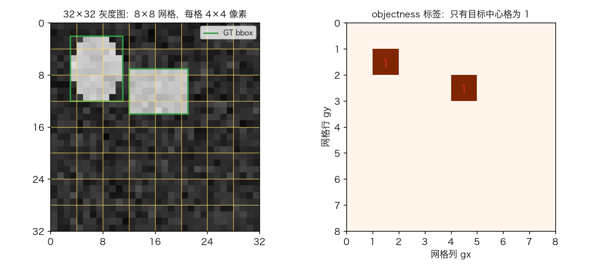
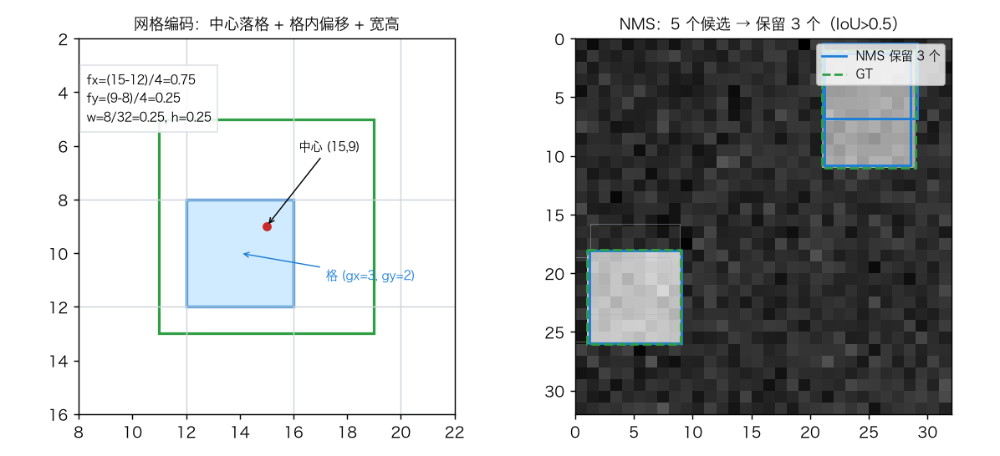
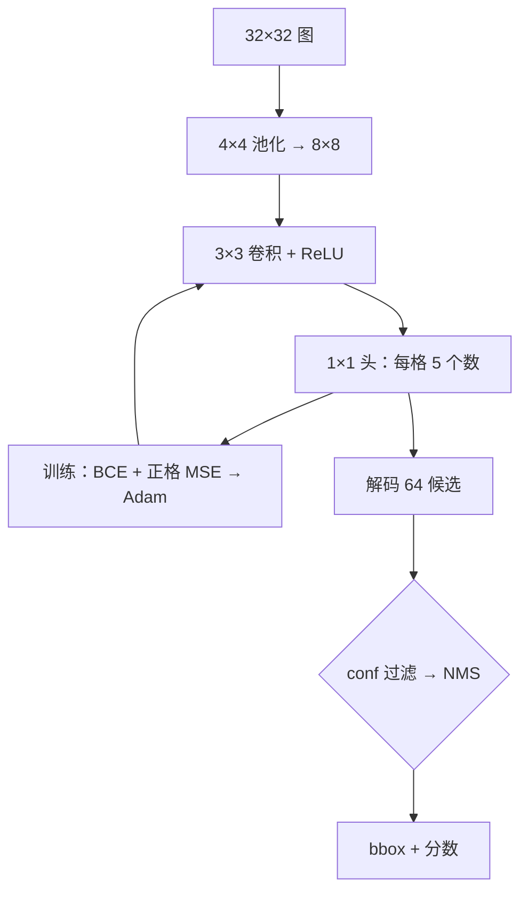
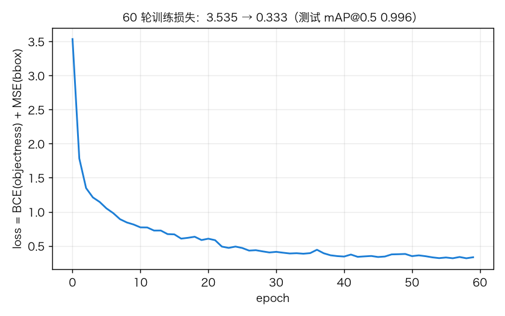
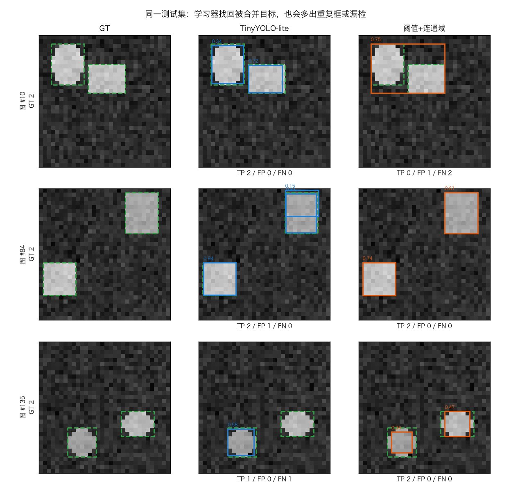
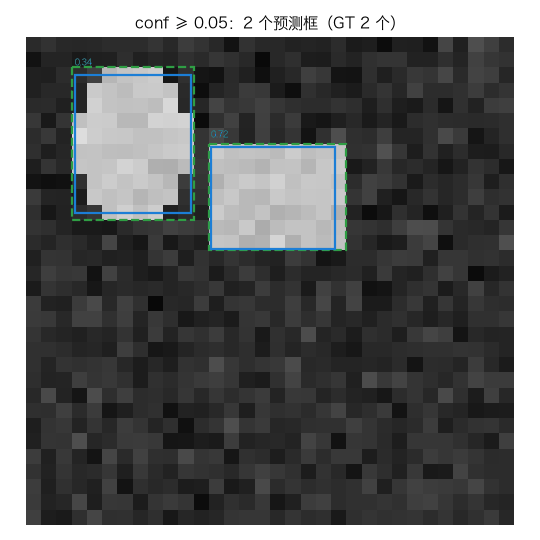

# 目标检测：网格预测与 NMS（TinyYOLO-lite）

> 状态：✅ 已完成（2026-10-26）
> 对应文档章节：`../../docs/人工智能代表算法演进路线.md` 第 4.3.3 章
> 阅读路线：零基础读者读「基础篇」（生活类比 → 手算 → 白话证明 → 自测）；要看推导与复现实验读「进阶篇」

深度模型（判别式）：入口 `TinyYOLO(...).fit(X, boxes)` / `predict(...)`；对照在 [baseline.py](baseline.py)，练习/项目见 [exercises/](exercises/README.md)、[project/](project/README.md)。

# 基础篇 · 先搞懂它

## 1. 生活类比：在图上盖一张 8×8 的格子纸

给 32×32 图盖一张 8×8 格子纸（每格 4×4 像素）：不问整图是什么，只让每格回答
**"有目标中心吗？框多大？"** 图里是 1–2 个亮目标 + 噪声背景。



## 2. 核心量：objectness + 4 个偏移 + IoU + NMS

- **网格**：8×8 格、4×4 像素/格；目标中心落哪格，哪格负责；
- **objectness**：该格有目标中心的概率 `σ(o)`，单类；
- **偏移**：`cx=(gx+σ(tx))·4`、`cy=(gy+σ(ty))·4`、`w=σ(tw)·32`、`h=σ(th)·32`；
- **IoU / NMS**：交并比 ≥0.5 算命中；NMS 分数降序保留，抑制 IoU 超阈值的重复框。

规则：**中心落格预测，邻格多框交给 NMS 删。**



## 3. 主循环



训练跑满 60 轮；推理一次前向 + NMS。

## 4. 手算示例：一个框从像素到格子再回来

bbox `(11,5,19,13)`，中心 `(15,9)`，格边长 4：

- 格：`(gx,gy)=(3,2)`；偏移：`fx=(15−12)/4=.75`、`fy=(9−8)/4=.25`；
- 宽高：`w=h=8/32=.25`；回归目标：`log3, log⅓, log⅓, log⅓`。

预测框 `(12,6,20,14)`：交集 `7×7=49`，并集 `79`，**IoU=49/79≈0.620**。
NMS：A 分 .9、B 分 .8（与 A 的 IoU≈.681）、C 分 .4；B 被抑制，保留 **{A,C}**。
这些数可用 `impl.py` 复算。

## 5. 白话版：为什么这样能工作

- **池化 + 卷积**：4×4 池化后每格看 12×12 像素；只看 3×3 像素分不清"中心格"和"内部邻格"。
- **一格一目标**：只有中心格是正样本，bbox 相对本格编码，sigmoid 保证中心不出格。
- **NMS**：邻格会重复报框，按分数保留最高、压掉重复即可。
- **条件**：中心不撞格、目标大于一格、objectness 可分、NMS 阈值能分开重复框与相邻真目标；四类失效都会掉点。

## 6. 常见误区

- **❌ 网格越细越好**：正样本更稀疏、回归更难；8×8 是折中。
- **❌ objectness 是类别概率**：单类只表示有没有目标。
- **❌ NMS 阈值越高越好**：越高越不抑制重复框，P 掉；越低越易误删相邻目标。
- **❌ 有学习器就不需要基线**：合成图上阈值法几乎最优，不跑基线看不清学习器买到了什么。
- **❌ conf 可以在 test 上调**：等于把测试集当验证集，指标偏乐观。

## 7. 看图：损失与检测对比





对比图：图 #10 基线把相邻目标并成一个连通域；图 #84 模型多一个重复框；图 #135 模型漏椭圆、基线找到。



阈值从 0.05 扫到 0.95：同一模型同一张图，框逐步出现再消失——conf 决定 P/R 的取舍。

## 8. 掌握清单：五级能力与自测

| 级别 | 能力 | 检验方式 |
|---|---|---|
| 1 说清 | objectness、偏移、IoU、NMS | 复述「核心量」并默写 decode 公式 |
| 2 走通 | 纸上编码、IoU、NMS | 重走「手算示例」，答案对 49/79 与 {A,C} |
| 3 判断 | 失效条件与阈值作用 | 构造撞格/重叠反例，解释指标怎么坏 |
| 4 实现 | 跑通 demo 并解释差异 | 复现结果表，指出 P/R 差异来源 |
| 5 迁移 | 多目标重叠场景 | `project/` 验收：mAP > 0.80 且明显超基线 |

**自测**：① 去掉池化，中心格还分得清吗？② NMS 阈值改 0.95，P 会怎样？③ 两目标中心同格，谁丢？

# 进阶篇 · 实验档案

## 目录形态

| 文件 | 角色 |
|---|---|
| [impl.py](impl.py) | 手写 Conv2D 反向、TinyYOLO-lite、IoU/NMS/AP |
| [baseline.py](baseline.py) | 颜色阈值 + 连通域基线（val 调参） |
| [demo.py](demo.py) | 同数据双跑 + mAP/P/R/耗时 |
| [test_impl.py](test_impl.py) / [make_teaching_assets.py](make_teaching_assets.py) | 12 个测试 / 4 图 + 1 GIF 对账 |
| [exercises/](exercises/README.md) / [project/](project/README.md) | 6 题 / 多目标场景检测 |

## 1. 设计原理

检测的演进是"怎么产生候选、怎么分类回归"：R-CNN 用外部候选逐框分类，Faster R-CNN 把候选生成学进网络，
YOLO 把图切成网格、一次前向同时出 objectness 与 bbox，SSD/RetinaNet 补多尺度，DETR 用集合预测去掉 NMS。
本实验保留 YOLO 最小骨架：单类、8×8、一个 3×3 卷积、中心格负责；它取代滑动窗口，也受限于单尺度。

## 2. 数学推导

池化 `p_{ij}=(1/16)ΣX_{4i+u,4j+v}`；3×3 卷积 + ReLU 后由 1×1 头输出 `o,t∈R⁴`。

编解码：`cx=(gx+σ(tx))·4`、`cy=(gy+σ(ty))·4`、`w=σ(tw)·32`、`h=σ(th)·32`；
编码 `tx=logit(clip(cx/4−gx,.02,.98))`，其余同理。clip 防 logit 发散，边界误差 ≤0.08 像素。

损失（`y∈{0,1}`，`P={y=1}`，`N_pos=|P|`）：`L_obj=−(1/64)Σ[y logσ(o)+(1−y)log(1−σ(o))]`，
`L_box=(1/N_pos)Σ_P||t−t*||²`，`L=L_obj+L_box`。

反向：`∂L_obj/∂o=(σ(o)−y)/64`；`∂L_box/∂t=2(t−t*)/N_pos`（只对正格）；经 1×1 头、ReLU、
3×3 卷积与 im2col/col2im 回传，Adam 更新。

评估：`IoU=(A∩B)/(A∪B)`；NMS 分数降序保留最高、删 IoU>τ 的框。AP 全局排序、逐图贪心匹配 IoU≥0.5 的 GT，
`P=TP/(TP+FP)`、`R=TP/N_gt`，全点插值 `AP=Σ(R_k−R_{k−1})·max_{k'≥k}P(k')`。条件：中心唯一落格、`N_pos>0`、阈值在 val 选。

## 3. 手写实现要点

1. **池化决定感受野**：直接 3×3 卷积只有 3×3 视野，中心格与内部邻格同分布；先池化再卷积，视野变 12×12。
2. **im2col/col2im**：前向把窗口摊成矩阵乘，反向按位置累加梯度；与 [cnn-lenet](../cnn-lenet/) 同源。
3. **logit 目标**：sigmoid 解码保证中心在格内、宽高为正；目标先 clip 再 logit。
4. **损失掩码**：bbox MSE 只取正格并按 `N_pos` 归一；负格只贡献 BCE。
5. **NMS 顺序**：`raw_predict` 做 NMS，`predict` 再按 conf 过滤；阈值只在 val 上定。

## 4. 基线对照

选颜色阈值 + 连通域，不选滑动窗口 + 逻辑回归：① 合成图的判别信息就是"亮"，阈值法零训练、可解释；
② 滑窗要枚举尺度/步长，窗口粒度决定上限，还会把对照变成"另一个学习器"；③ 连通域在目标重叠时会并框，能暴露经典流水线的缺陷。

基线：3×3 均值滤波 → 阈值 → 4 邻域 BFS → 面积过滤 → bbox + 平均亮度分 → NMS。
差异：目标不重叠、亮度可分时，阈值法 precision 略高、延迟低一个量级；学习器靠局部对比度与形状上下文赢 recall/mAP。
代价是 245 参数与约 5 倍延迟；项目放大差距。

## 5. 实验结果

**环境/数据**：macOS arm64，Python 3.13 + numpy 2.5.4 + matplotlib 3.11.2；`impl.py` 无 sklearn/torch。
32×32 灰度图，1–2 个 6–10 像素目标 + 噪声；train/val/test=480/160/160，seed 0/1/2，测试 244 目标。
**模型/阈值**：4×4 池化 → conv 1→16（3×3）→ ReLU → 8×8 头；245 参数，60 轮、batch 32、lr 0.02；
模型 conf 0.10、NMS 0.5；基线 thr 0.50、min_area 10、conf 0.05（均在 val 上选）。

| 方法 | mAP@0.5 | P | R | ms/图 |
|---|---|---|---|---|
| TinyYOLO-lite | **0.996** | 0.984 | 0.996 | 0.53 |
| 颜色阈值 + 连通域 | 0.977 | 0.996 | 0.980 | 0.11 |

loss 3.535→0.333，0.6 s。**项目（2–3 目标、允许重叠）**：640/160/200，100 轮，1.2 s；
模型 mAP **0.931**/P 0.879/R 0.953，基线 0.535/0.838/0.628——差距来自重叠目标被连通域合并。

**复现**（在 `algorithms/` 下）：

```bash
uv run python p03-deep-learning/object-detection/demo.py
uv run pytest p03-deep-learning/object-detection/test_impl.py -q
uv run python p03-deep-learning/object-detection/make_teaching_assets.py
uv run python p03-deep-learning/object-detection/project/detect_scene.py
```

**验证**：2026-10-26 实跑（Python 3.13）；`pytest` 12 passed；素材对账通过；project 验收通过。耗时随机器变化。

## 6. 局限与延伸

- **单类、单尺度、一格一目标**：中心撞格就有一个学不到；密集小目标会掉点。延伸：16×16 网格 / 多 anchor。
- **仅一个 3×3 卷积**：245 参数只适合 32×32 合成图；真实图需 backbone 与 FPN（见 [cnn-lenet](../cnn-lenet/)）。
- **NMS/评测**：手写 NMS 是 O(K²)，可用向量化/soft-NMS；AP@0.5 对定位宽容，应补 AP@0.75。
- **演进**：YOLOv8 多尺度、DETR 去 NMS；上游见 [ViT](../../p04-transformer/vit/)。

