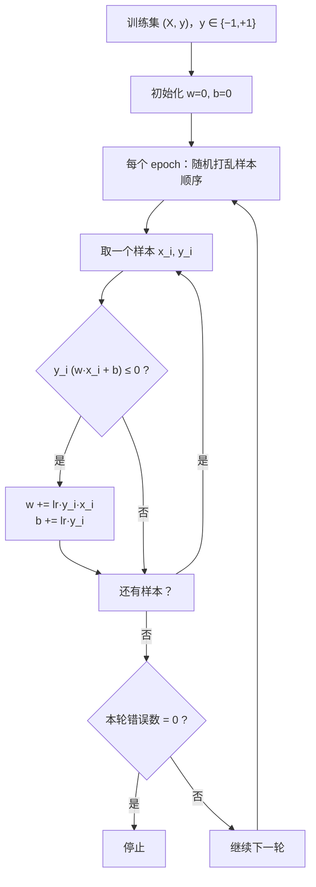
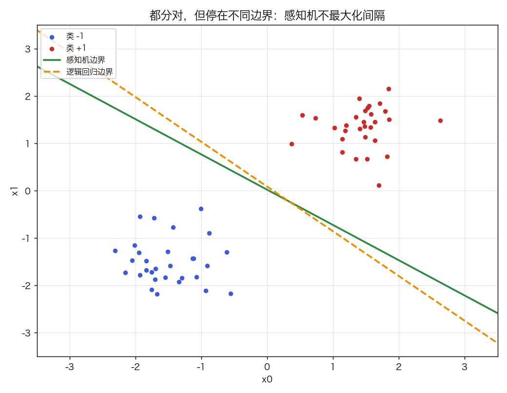
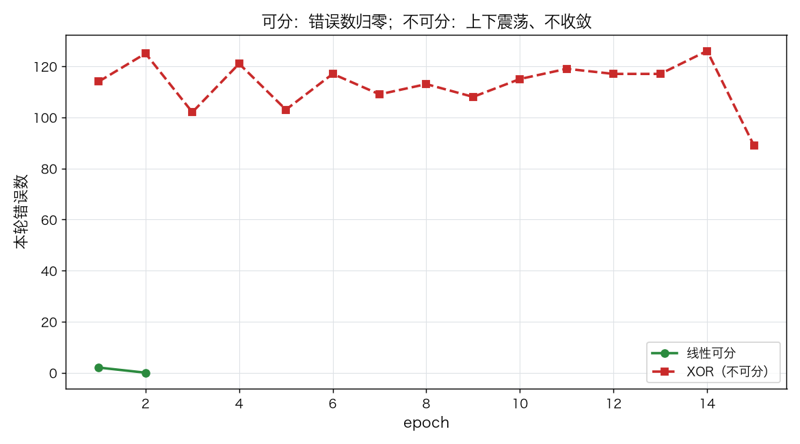
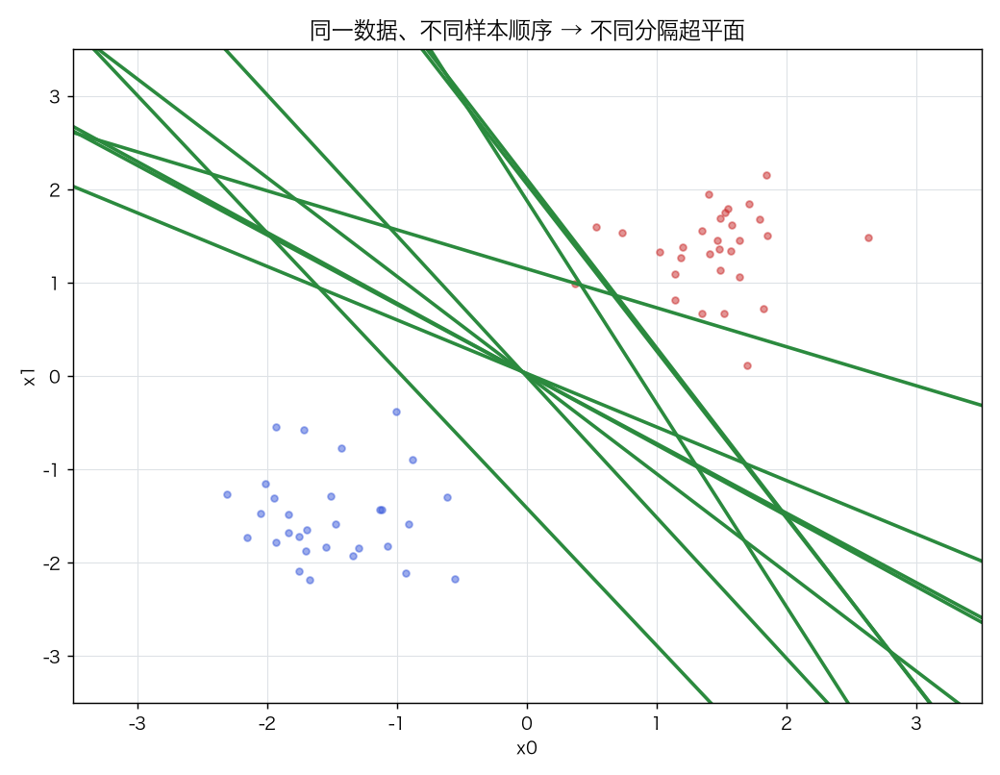
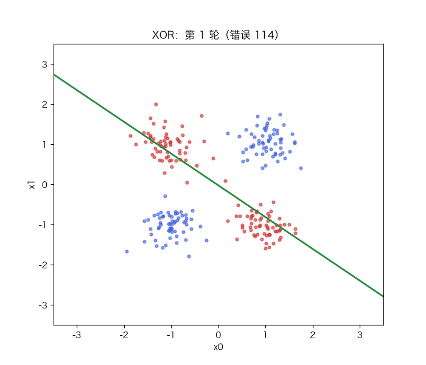

# 感知机：错误驱动更新、收敛定理与逻辑回归的边界

> 状态：✅ 已完成（2026-10-22）
> 对应文档章节：`../../docs/人工智能代表算法演进路线.md` 第 4.2 章
> 阅读路线：零基础读者读「基础篇」（生活类比 → 手算 → 白话 → 自测）；要看推导、实现与复现实验读「进阶篇」
> 本族共 8 个实验，学习顺序与补强计划见 [族级导读](../README.md)。

深度模型（判别式）：入口 `Perceptron(lr, epochs).fit(X, y)` / `predict(X)`，实现在 [impl.py](impl.py)；对照是 [framework.py](framework.py) 的 sklearn `Perceptron` 与逻辑回归。

# 基础篇 · 先搞懂它

## 1. 生活类比：做错一道题就改一点

想象你在学判卷：看到一道题，先按当前规则判"对/错"；判错了，就把规则往正确答案方向掰一点；
判对了，不动。**没有总损失，没有"错得多惨"的度量**——只关心这一道题有没有判错。

感知机就是这样：`y_hat = sign(w·x + b)`，分错就 `w += lr·y·x`、`b += lr·y`。
它是神经网络的第一块砖，也是"没有损失函数也能学习"的最小例子。

## 2. 核心量：符号、权重、偏置、更新、间隔

**判决**：

$$\hat y=\operatorname{sign}(w\cdot x+b),\qquad \operatorname{sign}(0)=+1$$

**错分条件**：`y_i (w·x_i + b) ≤ 0`（含恰好在边界上）。

**更新**：

$$w\leftarrow w+\eta\,y_i x_i,\qquad b\leftarrow b+\eta\,y_i$$

**几何间隔**：`2/‖w‖`（原始特征空间）。注意：感知机**不最大化间隔**，它只是停在某个能分开的超平面上。

**收敛定理**（线性可分时）：若样本半径 `R`、间隔 `γ`，则更新次数 ≤ `(R/γ)²`；
数据线性不可分时，误差不会归零，会在 epoch 间来回摆。

## 3. 主循环：打乱 → 逐样本判 → 错就改

## 4. 手算示例：两个点、两轮更新

数据：`x1=(1,0), y1=+1`；`x2=(0,1), y2=−1`；`lr=1`，初始 `w=(0,0), b=0`，按 x1 → x2 顺序。

| 步骤 | 样本 | 当前 `w·x+b` | `y·score` | 是否更新 | 更新后 `w` | `b` |
|---|---|---|---|---|---|---|
| 1 | x1 (+1) | 0 | 0 | 是（≤0） | (1,0) | 1 |
| 2 | x2 (−1) | 0+0+1=1 | −1 | 是 | (1,−1) | 0 |
| 3 | x1 (+1) | 1 | +1 | 否 | (1,−1) | 0 |
| 4 | x2 (−1) | −1 | +1 | 否 | (1,−1) | 0 |

最终 `w=(1,−1), b=0`，边界 `x0=x1`。第二轮零错误 → 停止。

**如果数据不可分**：比如 XOR 的四个角，任何直线都会切错至少一个点；错分样本永远存在，
更新会让边界来回翻，`errors_per_epoch` 不归零。

## 5. 白话版：为什么"没有损失"也能学、它和逻辑回归差在哪

**为什么能学**：每次更新都把边界往"把这个点分对"的方向推。线性可分时，这个方向累计起来
一定能把你带到某个分隔超平面（Novikoff 定理）；所以它不需要损失函数。

**不可分时为什么不收敛**：没有"错得多惨"的度量，更新只保证"当前点分对"，
可能把之前分对的点又弄错；错误数在 epoch 间震荡。

**和逻辑回归的差别**：

| 维度 | 感知机 | 逻辑回归 |
|---|---|---|
| 目标 | 只要分对 | 最小化交叉熵，输出概率 |
| 解 | 任意一个分隔面（不唯一） | 唯一最优解（凸） |
| 间隔 | 不最大化 | 受正则/数据影响，通常更合理 |
| 概率 | 没有 | 有 |
| 重叠数据 | 只给硬判决 | 能给风险分数 |

**顺序敏感**：打乱顺序不同，停下来的分隔面不同；demo 的 10 个种子间隔 14.9–20.6 就是证据。

## 6. 常见误区

- **❌ "感知机有损失函数"** —— 它是在线错误驱动；可以把它看成感知机损失 `max(0, −y·score)` 的 SGD，但教材定义不依赖损失。
- **❌ "感知机一定收敛"** —— 只在**线性可分**时；不可分时误差震荡。
- **❌ "感知机找到最大间隔"** —— 不；它只是找到某个分隔面，SVM 才最大化间隔。
- **❌ "sign(0) 随便取"** —— 本实现约定 `+1`，并写进测试；换约定会改变边界上的判决。
- **❌ "结果和样本顺序无关"** —— 有关；不同 shuffle 得到不同解。
- **❌ "感知机可以替代逻辑回归"** —— 需要概率/风险分数时不能；重叠数据上逻辑回归通常更好。

## 7. 看图：边界、收敛与顺序

两者都 100% 分对，但感知机停在一个较"贴"的边界；它不最大化间隔。

线性可分：错误数归零；XOR：错误数上下震荡、不收敛。

同一数据、10 个随机种子，得到 10 条不同的分隔线。

XOR 上训练 20 轮：边界反复移动，错误数不归零——线性边界永远切不开。

## 8. 掌握清单：五级能力与自测

| 级别 | 能力 | 本实验的检验方式 | 在哪做 |
|---|---|---|---|
| 1 说清 | 用自己的话讲规则 | 说出判决、错分条件、更新式、收敛条件 | 基础篇「核心量」「白话版」 |
| 2 走通 | 纸上手算 | 两个点、两轮更新，算出 `w=(1,−1), b=0` | 基础篇「手算示例」节 |
| 3 判断 | 说清正确性条件 | 解释为什么不可分会震荡、为什么解不唯一 | 基础篇「白话版」+ 实验二/三 |
| 4 实现 | 手写并与对照比对 | 跑通 `demo.py`，准确率与 sklearn 对齐 | 进阶篇「实验结果」 |
| 5 迁移 | 用到新问题 | 乳腺癌数据上与逻辑回归比较 | [project/](project/README.md) |

**自测关卡（先预测，再跑代码验证）**：

1. 线性可分时，`epochs=50` 一定会跑满 50 轮吗？
2. 把学习率从 0.1 改成 0.01，收敛轮数会变多还是变少？
3. XOR 上把 `epochs` 加到 300，错误数会归零吗？
4. 同一数据换一个随机种子，测试准确率会变吗？间隔呢？

# 进阶篇 · 实验档案

## 目录形态（本算法的"类型"）

| 文件 | 角色 | 入口 / 说明 |
|---|---|---|
| [impl.py](impl.py) | 手写实现 | `Perceptron`：fit / decision_function / predict / margin |
| [framework.py](framework.py) | 框架对照 | sklearn `Perceptron`、`LogisticRegression` |
| [demo.py](demo.py) | 同数据双跑 | 四组实验：可分 / XOR / 顺序 / 重叠 |
| [test_impl.py](test_impl.py) | 性质测试 | 收敛、震荡、更新规则、sign(0)、确定性、契约 |
| [make_teaching_assets.py](make_teaching_assets.py) | 素材生成 + 对账 | 边界 / 错误曲线 / 多种子 / GIF |
| [exercises/](exercises/README.md) | 练习（5 题，题解分离） | 概念、手算、诊断、实现、迁移 |
| [project/](project/README.md) | 迁移项目 | 乳腺癌数据：感知机 vs 逻辑回归 |

## 1. 设计原理

感知机是最小的线性分类器：用超平面把两类分开，错误驱动地调整超平面。
它不估计概率、不优化间隔，因此解不唯一、对顺序敏感；但它是理解"在线学习"和
"神经网络第一层"的起点。逻辑回归把"分对"换成"最大化似然"，才得到唯一解与概率。

## 2. 数学推导

**判决与错分**：`ŷ=sign(w·x+b)`；错分当且仅当 `y(w·x+b)≤0`。

**更新**：若错分，`w←w+ηy x`，`b←b+ηy`。更新后该点的 `y(w·x+b)` 增加
`η‖x‖² + η`（若 `b` 也更新），所以"当前点更容易分对"。

**收敛定理（Novikoff）**：设 `‖x_i‖≤R`，存在 `‖w*‖=1` 使 `y_i(w*·x_i+b*)≥γ`，
则更新次数 `≤(R/γ)²`。证明大意：每次更新 `w·w*` 至少增加 `ηγ`，
而 `‖w‖²` 最多增加 `η²R²`；两者夹逼得到上界。

**与逻辑回归**：逻辑回归最小化

$$L(w,b)=-\sum_i\log\sigma\big(y_i(w\cdot x_i+b)\big)$$

目标严格凸（加正则后），解唯一；感知机没有这样的目标，只要求 `y(w·x+b)>0`。

**间隔**：`2/‖w‖`。感知机的 `w` 依赖更新历史，所以间隔不是最优的。

## 3. 手写实现要点

1. **标签必须是 ±1**：更新式依赖 `y_i` 的符号；0/1 标签会写错。
2. **每个 epoch 打乱**：顺序影响解；固定 `random_state` 保证可复现。
3. **错分条件含等号**：`y·score ≤ 0` 都更新；`sign(0)=+1` 是判决约定，两者不矛盾。
4. **零错误提前停**：手写在 `errors==0` 时停；sklearn 不按"零错误"停，所以轮数不可直接比。
5. **标准化**：`standardize=True` 时在缩放空间训练，`raw_coef`/`margin` 换回原始空间。
6. **记录 `param_history`**：动画和"边界怎么动"靠它。

## 4. 框架对照

sklearn 的 `Perceptron(eta0, max_iter, shuffle, tol)` 与手写版同数据准确率一致（都 1.0000）；torch 版也一致。
差异：

| 维度 | 手写 | sklearn |
|---|---|---|
| 提前停 | 本轮零错误就停 | `tol=None` 时跑满 `max_iter`；按 loss 变化停 |
| 向量化 | Python 逐样本循环 | C 级实现，单轮更快 |
| 随机数 | `default_rng` | 自己的 shuffle 实现 |
| 多分类 | 未实现 | 一对多 |
| 概率 | 无 | 无（`decision_function` 只有分数） |

**耗时**：手写 ≈0.2 ms、sklearn ≈0.4 ms、torch ≈5.4 ms（本数据/本机，仅同机对比；每次运行有抖动）；
sklearn 跑满 50 轮，手写/torch 2 轮就停；torch 慢在逐样本 Python→张量调用，不是算法复杂。

**为什么主对照仍是 sklearn**：感知机只有一个线性层 + `sign`，sklearn 已有同算法实现；
torch 版也补了（`TorchPerceptron`），用来验证"同一更新规则在框架里怎么写"，
结果与手写逐位一致，但逐样本调用更慢。p03 从 MLP 起统一用 PyTorch 作主对照，
感知机是族内唯一以 sklearn 为主、torch 为辅的例外（见族级导读「框架对照」）。
逻辑回归在这里只作概率/间隔的经典基线。

## 5. 实验结果

**环境**：uv 环境（`uv sync --extra dev`），Python 3.13.15 / numpy 2.5.4 / scikit-learn 1.9.1。
**数据**：二维合成数据，`seed=0`；可分数据 200 点（训练 140 / 测试 60），
XOR 240 点，重叠数据 300 点（训练 210 / 测试 90）。
**复现**：本目录内 `uv run python demo.py`、`uv run pytest test_impl.py -q`、
`uv run python make_teaching_assets.py`。

**实验一：线性可分（手写 / sklearn / torch / 逻辑回归）**

| 方法 | 训练 acc | 测试 acc | 轮数 | 耗时（ms） |
|---|---|---|---|---|
| 手写感知机 | 1.0000 | 1.0000 | 2 | ≈0.2 |
| sklearn 感知机 | 1.0000 | 1.0000 | 50 | ≈0.4 |
| 逻辑回归 | 1.0000 | 1.0000 | — | ≈1.0 |
| torch 感知机 | 1.0000 | 1.0000 | 2 | ≈5.4 |

手写感知机间隔 16.22（原始空间）；它只是「停在哪」，不是最大间隔。torch 版与手写逐位一致（w、每轮错误数都相同）。

**实验二：线性不可分（XOR）**

手写前 10 轮错误数：`114, 125, 102, 121, 103, 117, 109, 113, 108, 115`；
最后一轮 125，训练准确率 0.463；sklearn 0.617。两者都在随机水平附近，误差不归零。

**实验三：样本顺序敏感性（10 个种子）**

间隔：`16.22、14.88、15.96、20.58、14.88、15.83、20.60、20.23、15.38、17.57`；
均值 17.214，标准差 2.252，最小 14.878，最大 20.596。

**实验四：重叠数据**

| 方法 | acc | AUC | 间隔 |
|---|---|---|---|
| 感知机 | 0.689 | 0.752 | 13.931 |
| 逻辑回归 | **0.800** | **0.872** | 0.817 |

**验证声明（已验证）**：输入为上述数据与种子；2026-10-22 在 uv 环境实跑，
`uv run python demo.py` 输出上表；`uv run pytest test_impl.py -q` → **11 passed**；
`uv run python make_teaching_assets.py` 对账通过（可分 100%、XOR 不归零）。

**可视化结论**：

- `images/00-边界对比.png`：都分对，但边界不同；
- `images/01-收敛与震荡.png`：可分归零、不可分震荡；
- `images/02-顺序敏感.png`：10 个种子 10 条边界；
- `images/03-边界生长.gif`：XOR 上 20 轮边界反复移动，不收敛。

## 6. 局限与延伸

- **线性边界**：XOR/同心圆学不了；核 SVM 或 MLP 才能解决。
- **解不唯一/顺序敏感**：没有最大间隔；SVM 补上"最大化间隔"。
- **无概率**：重叠数据只给硬判决；逻辑回归给概率与风险分数。
- **不可分不收敛**：需要 Pocket 算法/损失函数/学习率衰减等工程手段。
- **多分类未实现**：sklearn 用一对多；后续 MLP 用 softmax 统一处理。
- **下游**：逻辑回归（概率）→ SVM（间隔）→ MLP（多层非线性 + 反向传播）。

**已记录、不阻塞**：

- **torch 对照范围**：目前只在“线性可分”上做了逐位一致性测试；XOR/重叠数据与乳腺癌项目仍以
  sklearn 为基线，torch 未覆盖。
- **间隔比较**：`margin` 是**原始特征空间**的几何间隔；不同缩放/不同模型不能直接比大小。
  实验四的 13.931 vs 0.817 只说明“感知机停得很贴”，不是优劣结论。
- **sklearn 轮数**：`tol=None` 时跑满 `max_iter`，所以 50 轮不是“收敛慢”；不要用手写 2 轮
  vs sklearn 50 轮比较效率。
- **TorchPerceptron 校验**：只校验形状/标签，未查 NaN/空样本（手写版有）；异常输入行为未定义。
