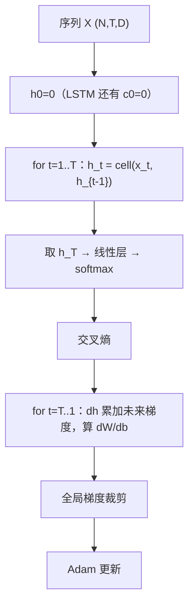
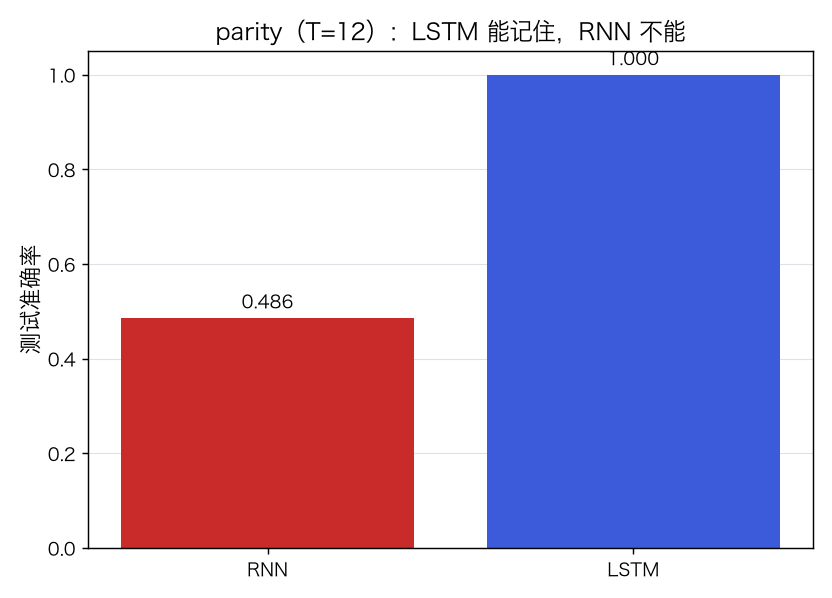
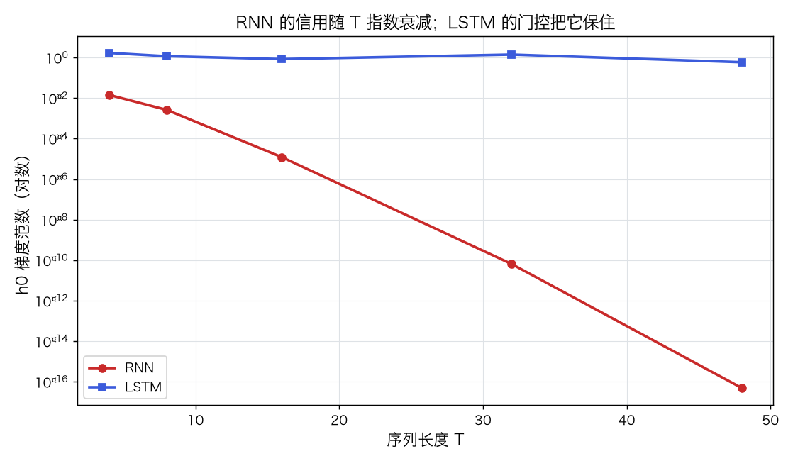
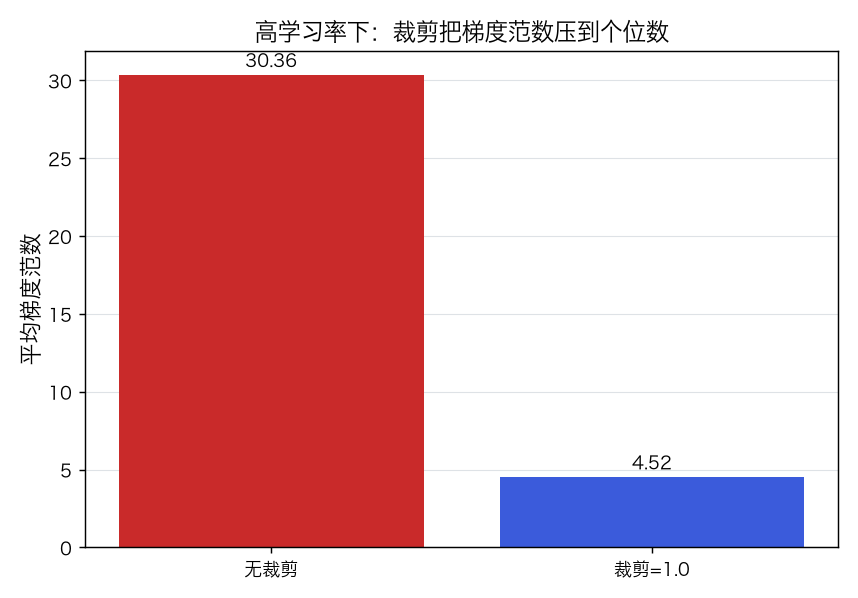
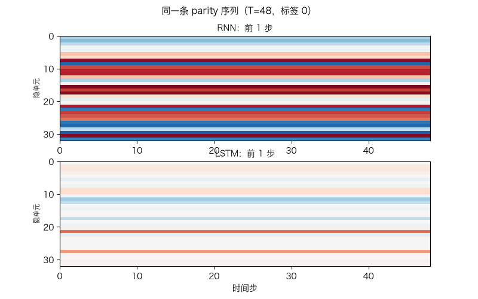

# RNN 与 LSTM：BPTT、梯度裁剪与门控

> 状态：✅ 已完成（2026-10-22）
> 对应文档章节：`../../docs/人工智能代表算法演进路线.md` 第 4.4 章
> 阅读路线：零基础读者读「基础篇」（生活类比 → 手算 → 白话 → 自测）；要看推导、实现与复现实验读「进阶篇」
> 本族共 6 个实验，学习顺序与补强计划见 [族级导读](../README.md)。

深度模型（判别式，序列）：入口 `RNN / LSTM(input_size, hidden_size, n_classes).fit(X, y)`，`X` 为 `(N,T,input_size)`；实现在 [impl.py](impl.py)，对照是 [framework.py](framework.py) 的 PyTorch `nn.RNN / nn.LSTM`。

## 读之前：RNN、LSTM 与序列模型

- **RNN** 是一类“沿时间共享参数”的网络：同一个单元在每个时间步复用，隐状态携带历史；
- **LSTM** 是 RNN 的一个**门控变体**：用输入/遗忘/输出门 + 细胞状态缓解梯度消失；
- **Transformer** 是另一条序列路线（注意力，无循环），见 p04；本实验只讲循环网络。

| 概念 | 是什么 | 本实验 |
|---|---|---|
| RNN | 最朴素的循环网络 | 手写 + torch |
| LSTM | 带门控的 RNN | 手写 + torch |
| BPTT | 沿时间展开的反向传播 | 手写 |
| 梯度裁剪 | 限制更新步长 | 手写 + torch |

# 基础篇 · 先搞懂它

## 1. 生活类比：读句子时要记住前文

读“小明把苹果给了小红，**她**很高兴”——要知道“她”指谁，必须记住前几个词。
RNN 就是这样：每读一个词，更新一次“记忆”（隐状态 `h_t`），再读下一个。

但普通 RNN 的记忆很短：读到句尾时，开头的信息已经被冲淡。LSTM 加了“门”：
**遗忘门**决定丢什么、**输入门**决定记什么、**输出门**决定现在输出什么；
细胞状态 `c_t` 像一条“传送带”，让早期信息更容易传到最后。

## 2. 核心量：隐状态、门、BPTT、梯度裁剪

**RNN**：

$$h_t=\tanh(x_tW_x+h_{t-1}W_h+b),\qquad \hat y=\operatorname{softmax}(h_TW_y+b_y)$$

**LSTM**：

$$i_t=\sigma(\cdot),\ f_t=\sigma(\cdot),\ o_t=\sigma(\cdot),\ g_t=\tanh(\cdot)$$
$$c_t=f_t\odot c_{t-1}+i_t\odot g_t,\qquad h_t=o_t\odot\tanh(c_t)$$

**BPTT**：把网络沿时间展开，梯度从 `T` 倒着传到 `1`；每步的 `dh` 要**累加**“来自未来”的梯度。

**梯度裁剪**：若全局梯度范数 `‖g‖>clip`，按 `clip/‖g‖` 缩放；防爆炸，不改变方向。

## 3. 主循环：沿时间前向，沿时间反向

## 4. 手算示例：两步标量 RNN 的梯度衰减

标量 RNN：`h_t = tanh(0.5·h_{t-1} + x_t)`，`h_0=0`，输入 `x=[1,0]`，输出 `h_2`。

前向：

- `h_1 = tanh(1) ≈ 0.7616`
- `h_2 = tanh(0.5×0.7616 + 0) ≈ tanh(0.3808) ≈ 0.3630`

对 `h_0` 的梯度（链式）：

$$\frac{\partial h_2}{\partial h_0}
=0.5(1-h_1^2)\cdot 0.5(1-h_2^2)
\approx 0.5×0.420×0.5×0.868\approx 0.091$$

每一步乘一个 `<1` 的因子，`T` 越长越小——这就是普通 RNN 的梯度消失。
LSTM 的 `c_t = f_t c_{t-1}+…` 给了一条近似“加法”的通道，`f_t≈1` 时梯度可以传得更远。

## 5. 白话版：为什么梯度会消失、LSTM 的门在修什么

**梯度消失**：`tanh` 导数 ≤1，`W_h` 的谱范数通常 <1；BPTT 连乘 `T` 次，
`0.9^50≈0.005`，早期信息对loss的影响几乎没了。

**LSTM 的修法**：细胞状态 `c_t` 的更新是“遗忘门 × 旧状态 + 输入门 × 新候选”；
反向时 `dc_{t-1}` 主要乘 `f_t`，而不是一整串矩阵/激活导数。`f_t` 学到接近 1 时，
梯度可以沿“传送带”传很远。

**梯度裁剪**：爆炸时把步长压住；它不解决消失，只防“一步飞出去”。

**为什么 parity 难**：要记住“到目前为止 1 的个数是奇还是偶”，必须把信息从第 1 步带到第 T 步；
普通 RNN 在 T=12 就基本学不动，LSTM 可以。

## 6. 常见误区

- **❌ "RNN 能记住任意长的历史"** —— 普通 RNN 的梯度/记忆随 T 衰减；长依赖要靠 LSTM/GRU/注意力。
- **❌ "LSTM 一定比 RNN 好"** —— 短序列/小数据上 RNN 可能够用；LSTM 参数更多、更慢。
- **❌ "梯度裁剪能解决梯度消失"** —— 裁剪只防爆炸；消失要靠门控/残差/更好初始化。
- **❌ "BPTT 只从最后一步回传"** —— 每个时间步的输出/状态都可能贡献梯度，要逐时间累加。
- **❌ "序列分类必须用最后一个 h_T"** —— 也可以用 mean pooling/attention；本实验用 `h_T`。
- **❌ "RNN 只能做 NLP"** —— 时序、传感器、音频、视频帧序列都能用。

## 7. 看图：parity、梯度范数与裁剪

T=12 的 parity：LSTM 1.000，RNN 0.486（接近随机）。

对 `h0` 的梯度范数：RNN 从 0.02 衰减到 1e-16；LSTM 保持在 1 附近。

高学习率下，裁剪把平均梯度范数从 30.4 压到 4.5；准确率没有因此变好。

同一条 T=48 序列的隐状态热图：RNN 的状态很快饱和，LSTM 的门控让状态持续变化。

## 8. 掌握清单：五级能力与自测

| 级别 | 能力 | 本实验的检验方式 | 在哪做 |
|---|---|---|---|
| 1 说清 | 用自己的话讲规则 | 说出 RNN 递推、LSTM 三门、BPTT、裁剪 | 基础篇「核心量」「白话版」 |
| 2 走通 | 纸上手算 | 两步标量 RNN 的前向与 `dh0` | 基础篇「手算示例」节 |
| 3 判断 | 说清正确性条件 | 解释梯度消失、裁剪的作用与边界 | 基础篇「白话版」+ 实验二/三 |
| 4 实现 | 手写并与对照比对 | 跑通 `demo.py`，BPTT 梯度检查通过 | 进阶篇「实验结果」 |
| 5 迁移 | 用到新问题 | digits 行序列分类，比较 RNN/LSTM | [project/](project/README.md) |

**自测关卡（先预测，再跑代码验证）**：

1. `tanh` 的导数最大是多少？为什么连乘会衰减？
2. LSTM 的遗忘门接近 1 时，`dc` 会怎样传？
3. 梯度裁剪后，梯度方向会变吗？
4. T 从 12 加到 48，普通 RNN 的 `h0` 梯度会怎样？

# 进阶篇 · 实验档案

## 目录形态（本算法的"类型"）

| 文件 | 角色 | 入口 / 说明 |
|---|---|---|
| [impl.py](impl.py) | 手写实现 | `RNN` / `LSTM`：BPTT、Adam、裁剪、`grad_norm_h0_for_T` |
| [framework.py](framework.py) | PyTorch 对照 | `TorchSequence`（`nn.RNN`/`nn.LSTM`） |
| [demo.py](demo.py) | 同数据双跑 | parity / 梯度范数 / 裁剪 / torch |
| [test_impl.py](test_impl.py) | 性质测试 | BPTT 梯度检查、parity、梯度衰减、裁剪、契约 |
| [make_teaching_assets.py](make_teaching_assets.py) | 素材生成 + 对账 | 准确率 / 梯度范数 / 裁剪 / 隐状态 GIF |
| [exercises/](exercises/README.md) | 练习（5 题，题解分离） | 概念、手算、诊断、实现、迁移 |
| [project/](project/README.md) | 迁移项目 | digits 行序列分类：RNN vs LSTM |

## 1. 设计原理

RNN 用“同一组权重 + 隐状态”处理任意长度序列；BPTT 把时间展开成深层网络。
普通 RNN 的雅可比连乘导致梯度消失/爆炸；LSTM 用门控 + 细胞状态提供近似恒等的梯度通道。
本实验用 parity 任务把“记不记得住”变成可测的准确率，用 `h0` 梯度范数把“梯度消失”变成可看的曲线。

## 2. 数学推导

**RNN 前向**：`h_t=tanh(x_tW_x+h_{t-1}W_h+b)`。

**BPTT**：设 `dh_t` 为 loss 对 `h_t` 的梯度，

$$dh_t = \frac{\partial L}{\partial h_T}\prod_{k=t+1}^{T}\frac{\partial h_k}{\partial h_{k-1}}
+\text{(每步输出的贡献)}$$

其中 `∂h_k/∂h_{k-1}=diag(1-h_k²)W_h`；连乘导致指数衰减/爆炸。

**LSTM**：

$$i,f,o=\sigma(\cdot),\quad g=\tanh(\cdot),\quad c_t=f\odot c_{t-1}+i\odot g,\quad h_t=o\odot\tanh(c_t)$$

`dc_{t-1}` 主要乘 `f`，而不是 `W_h` 的连乘；`f≈1` 时形成“梯度高速公路”。

**裁剪**：`g←g·min(1, clip/‖g‖)`；方向不变，范数被压到 `clip` 以内。

## 3. 手写实现要点

1. **缓存每个时间步的 `h_t`（LSTM 还有 `c_t`/门）**：BPTT 全都要用。
2. **`dh` 必须累加**：当前步的梯度 = 来自未来 + 来自本步输出；漏加就断链。
3. **LSTM 的 `dc` 也要跨步传**：`dc_prev = dc * f`；漏了细胞状态梯度就错。
4. **裁剪在更新前做**：按全局范数缩放所有参数梯度。
5. **`h0` 梯度诊断**：`grad_norm_h0_for_T` 直接量化“T 步后还能传回多少信用”。
6. **数值稳定**：sigmoid 分正负分支，softmax 减最大值。

## 4. 框架对照

torch 的 `nn.RNN` / `nn.LSTM` 与手写版同数据、同 T=12、40 轮：

| 模型 | 手写测试 acc | torch 测试 acc |
|---|---|---|
| RNN | 0.484 | 0.514 |
| LSTM | **1.000** | 0.934 |

差异原因：初始化、优化器细节、浮点精度；LSTM 的 torch 版 40 轮略欠训练（80 轮可到 1.0）。
框架把 BPTT 封装进 `autograd`，手写版则显式缓存/回传——这是本实验要展示的差别。

## 5. 实验结果

**环境**：uv（`uv sync --extra deep-learning --extra dev`），Python 3.13.15 /
numpy 2.5.4 / torch 2.14.1；CPU。
**数据**：合成 parity 序列，`T=12`，4000 训练 / 1000 测试；`seed=0`。
**复现**：本目录内 `uv run python demo.py`、`uv run pytest test_impl.py -q`、
`uv run python make_teaching_assets.py`。

**实验一：parity（T=12，40 轮）**

| 模型 | 训练 acc | 测试 acc | 末轮 loss | 耗时（s） |
|---|---|---|---|---|
| RNN | 0.5102 | 0.4840 | 0.6931 | ≈1.4 |
| LSTM | 1.0000 | **1.0000** | 0.0000 | ≈8.2 |

**实验二：`h0` 梯度范数随 T（5 批平均）**

| T | RNN | LSTM |
|---|---|---|
| 4 | 0.020097 | 1.930064 |
| 8 | 0.009399 | 1.284476 |
| 16 | 0.000646 | 1.014209 |
| 32 | 0.000004 | 1.892623 |
| 48 | 0.000000 | 0.925780 |

**实验三：高学习率（0.5）与裁剪（T=20）**

| clip | 测试 acc | 末轮 loss | 平均梯度范数 |
|---|---|---|---|
| None | 0.5125 | 0.7619 | 30.358 |
| 1.0 | 0.5000 | 1.4705 | 4.517 |

**验证声明（已验证）**：输入为上述数据与种子；2026-10-22 在 uv 环境实跑，
`uv run python demo.py` 输出上表；`uv run pytest test_impl.py -q` → **8 passed**；
`uv run python make_teaching_assets.py` 对账通过（LSTM >0.9、RNN <0.7）。

**可视化结论**：

- `images/00-parity准确率.png`：LSTM 1.000 vs RNN 0.486；
- `images/01-梯度范数.png`：RNN 指数衰减到 1e-16，LSTM 保持 ~1；
- `images/02-梯度裁剪.png`：平均梯度范数 30.4 → 4.5；
- `images/03-隐状态.gif`：同一条序列的隐状态热图，LSTM 状态持续变化。

## 6. 局限与延伸

- **合成任务**：parity 是受控诊断，不代表真实语言/时序任务；真实任务要词嵌入、更大数据。
- **单层**：本实验只有一层 RNN/LSTM；深层/双向/GRU 未覆盖。
- **`h_T` 分类**：长序列可用 mean pooling/attention；本实验用最后隐状态。
- **梯度范数诊断依赖训练后的权重**：曲线有噪声；它展示趋势，不是严格定理。
- **无 Transformer**：注意力/并行训练在 p04；RNN 的“逐步”限制了长序列效率。
- **下游**：GRU/双向 RNN → seq2seq/注意力 → Transformer。

**已记录、不阻塞**：

- **只做序列分类，未实现骨架里的 `generate`**：自回归生成/语言模型留给 p04 的 mini-GPT；
  本实验的 `RNN`/`LSTM` 只输出 `h_T → 分类`。
- **合成任务 + digits 行序列**：没有真实文本/传感器时序语料；parity 是受控诊断，不代表真实任务。
- **单层、单向**：GRU、双向、堆叠、embedding、seq2seq 都未覆盖；`input_size` 需手工给。
- **`h0` 梯度曲线依赖训练后的权重/批次**：5 批平均仍有噪声，只展示趋势，不是严格定理。
- **输入校验不完整**：`fit` 没显式检查 `X.shape[2]==input_size`，形状不匹配会抛 numpy 错误；
  `predict`/`grad_norm_*` 也没有统一的形状/NaN 检查。
- **torch 对照轮数要对齐**：40 轮 torch LSTM 0.934，80 轮才到 1.0；不能拿 40 轮 torch 对 40 轮手写直接下结论。
