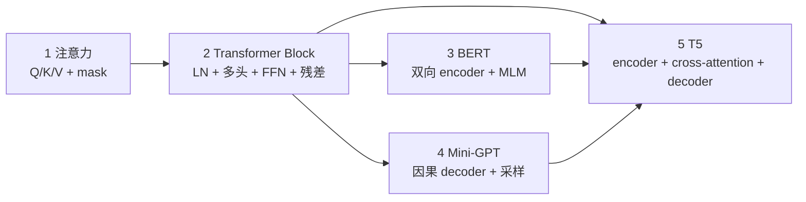

# p04-transformer · Transformer 与预训练时代

> 状态：**7/7 完成（p04 全族 ✅）**
> 对应路线：`../docs/人工智能代表算法演进路线.md` 第五章（5.1–5.3.4）
> 族内顺序：注意力 → 迷你 Transformer Block → BERT → 迷你 GPT → T5/编码器-解码器
> 本族 7 个实验；逐实验入口见 [`algorithms/README.md`](../README.md)。

## 1. 这个族在讲什么

p03 的 RNN 沿时间递推，长序列只能串行、长依赖会衰减。Transformer 换成**注意力**：

- 每个位置直接看所有位置（全局依赖）；
- 同一层内可并行（训练更快）；
- 用 Q/K/V、多头、位置编码、LayerNorm、残差堆成 Block；
- 同一套 Block 换 mask/目标，就得到 **BERT（双向 encoder）**、**GPT（因果 decoder）**、
  **T5（encoder-decoder + cross-attention）** 三条路线。

这个族按“**组件 → Block → 三种预训练范式**”推进，不是一上来就写 GPT。

## 2. 五个实验一览

| # | 实验 | 章节 | 默认数据 | 核心 | 接口形态 | 状态 |
|---|---|---|---|---|---|---|
| 1 | [注意力机制](attention/) | 5.2 | 合成 Q/K/V / 小序列 | scaled dot-product、mask、softmax 反传、多头 | **组件**：`forward/backward` | ✅ 2026-10-22 |
| 2 | [迷你 Transformer Block](mini-transformer/) | 5.2 | 小字符序列 | LayerNorm、FFN、残差、pre-LN、多头 | **Block**：`forward/backward` + `train` | ✅ 2026-10-22 |
| 3 | [BERT / 掩码语言模型](bert/) | 5.3.2 | 离线小文本 | 双向注意力、MLM、`[CLS]` 分类探针 | **模型**：`train(tokens)` / `encode` | ✅ 2026-10-22 |
| 4 | [迷你 GPT](mini-gpt/) | 5.3.4 | 离线小文本（Zen/合成 grammar） | tokenizer、embedding、N 个 Block、采样 | **模型**：`train(text)` / `generate` | ✅ 2026-10-22 |
| 5 | [T5 / 编码器-解码器](t5/) | 5.3.3 | 合成 seq2seq 对 | encoder-decoder、cross-attention、生成 | **模型**：`train(pairs)` / `generate(src)` | ✅ 2026-10-22 |
| 6 | [ViT-lite](vit/) | 5.4 | digits 8×8 | patch + 自注意力 | **模型**：`fit(X,y)` / `predict` | ✅ 2026-10-23 |
| 7 | [多模态 CLIP 式](multimodal/) | 5.5 | 合成图文对 | 双塔、对比学习、检索 | **模型**：`fit(Xi,Xt)` / `similarity` | ✅ 2026-10-23 |

> 章节说明：5.1 是“Transformer 的意义”背景；Block 属于 5.2 的组件装配，因此
> `mini-transformer` 锚 **5.2**，不再使用原来的 5.1。

## 3. 依赖链



- **1 → 2**：Block 只是把注意力、LN、FFN、残差装起来；
- **2 → 3/4/5**：同一套 Block，换 mask 与训练目标：
  - BERT：无 causal mask + 挖空预测（MLM）；
  - GPT：causal mask + next-token；
  - T5：encoder 双向、decoder 因果，再加 cross-attention。

## 4. 接口边界（必须先分清）

| 实验 | 有 fit(X,y)？ | 有 train？ | 有 generate？ | 为什么 |
|---|---|---|---|---|
| attention | ❌ | ❌ | ❌ | 是**组件**，输入 Q/K/V，输出加权和 + 权重 |
| mini-transformer | ❌ | ✅（tokens） | ❌ | 是**Block**，可在语言建模目标上训练 |
| BERT | ❌ | ✅（tokens） | ❌ | 是**encoder 模型**，学 MLM/表示；生成不是它的目标 |
| mini-gpt | ❌ | ✅（text） | ✅ | 是**decoder 生成模型**，目标 next-token |
| T5 | ❌ | ✅（pairs） | ✅ | 是**encoder-decoder**，输入源序列，生成目标序列 |

> 这是 p04 最容易被误解的地方：attention 不是“一个小模型”，它没有标签、没有 fit。

### 4.1 还必须补的 4 个契约

| 契约 | 放在哪 | 必须写清什么 |
|---|---|---|
| **位置编码** | Block / 所有模型 | attention 对位置是置换不变的；可学习位置嵌入 vs 正弦编码，shape `(T,d_model)`，加在 embedding 后 |
| **tokenizer / 错位目标** | BERT / GPT / T5 | 字符表、`<unk>`、context 截断、`input=text[:-1]`、`target=text[1:]`、忽略越界 |
| **训练/评估** | 全部模型 | train/val 切分、交叉熵/MLM 准确率、perplexity、采样参数 |
| **共享组件** | 全族 | LayerNorm / FFN / MultiHeadAttention 放一个共享模块还是各实验复制；**必须只选一种** |

**建议的共享策略**：在 `p04-transformer/` 下放 `components.py`（LayerNorm、FFN、MultiHeadAttention），
三个模型实验复用它；这样 attention 实验验证组件、Block/BERT/GPT/T5 不再复制一份。
如果坚持“每个实验完全自包含”，就要接受多份重复实现，并在 README 说明。

### 4.2 单头 vs 多头

- `ScaledDotProductAttention`：**无参数**，只做 `softmax(QKᵀ/√d_k)V`；适合讲公式与反传；
- `MultiHeadAttention`：有 `Wq/Wk/Wv/Wo`，负责拆头/拼头；Block 用的是它。

## 5. 数据与环境（离线优先）

| 实验 | 默认数据 | 说明 |
|---|---|---|
| attention | 合成 Q/K/V + 小序列 | 可构造 padding/causal mask |
| mini-transformer | 合成字符序列 / Zen of Python | next-token |
| BERT | Zen/合成句子 | 15% mask，`[CLS]/[SEP]/[MASK]` |
| mini-gpt | Zen of Python 或合成 grammar（1–5KB） | 字符级；可选 Tiny Shakespeare |
| T5 | 合成 copy/reverse/翻译对 | 不下载语料 |

**不默认下载语料**；真实语料只作为可选扩展，且要标注来源/许可证。

### 环境

```bash
cd algorithms
uv sync --extra deep-learning --extra dev
uv run python p04-transformer/attention/demo.py
```

- 手写实现用 **numpy**；`torch` 只用于 `framework.py` 对照；
- 默认 CPU；每个 demo 控制在 **2–3 分钟**；
- 默认模型：`d_model=32/64`、`n_heads=2/4`、`context=16/32`、`n_layers=1/2`。

## 6. Phase 0–5 计划（本文件是 Phase 0 的产物）

| 阶段 | 内容 | 交付 | 状态 |
|---|---|---|---|
| **Phase 0** | 族级导读、章节修正、接口/数据/范围约定 | 本文件 + 五个实验骨架 | ✅ 本版完成 |
| Phase 1 | attention：scaled dot-product、mask、softmax 反传、多头 | 实现 + 测试 + 热图 + 练习/项目 | ✅ 2026-10-22 |
| Phase 2 | Block：LayerNorm、FFN、残差、pre-LN、多头 | 实现 + 梯度检查 + 小语料训练 + torch 对照 | ✅ 2026-10-22 |
| Phase 3 | BERT：双向 encoder、MLM、`[CLS]` 分类探针 | 实现 + 测试 + 表示/分类项目 | ✅ 2026-10-22 |
| Phase 4 | mini-GPT：tokenizer、embedding、N 个 Block、采样 | 训练/生成 + 温度/top-k + 项目 | ✅ 2026-10-22 |
| Phase 5 | T5：encoder-decoder、cross-attention、toy seq2seq + 阶段质量轮 | 实现 + 生成 + 对照 + 质量项 | ✅ 2026-10-22 |

## 7. 每个实验的交付标准

- README：基础篇 8 节 + 进阶篇六段 + 五级清单；
- 测试：形状、mask/causal、有限差分梯度、确定性、契约；
- 素材：3 张 PNG + 1 个 GIF（注意力热图、loss、生成样本/权重动画）；
- 练习 5 题（题解分离）；
- 1 个迁移项目；
- 验证声明：环境、数据、种子、命令、结果。

## 8. 本族的范围边界

**做**：单头/多头注意力、padding/causal mask、LayerNorm、FFN、残差、pre-LN；
字符级 BERT/MLM、GPT、T5 toy（copy/reverse）与 cross-attention。

**不做**（只作延伸，避免把 p04 变成大模型工程课）：

- BERT 全量预训练/多任务微调、T5 全量预训练/翻译刷榜；
- BPE/SentencePiece 分词、Word2Vec/GloVe 词向量训练（5.3.1）；
- RLHF、KV cache、长上下文、分布式训练、量化部署；
- 现代大模型工程（FlashAttention、张量并行、MoE）。

## 9. 状态与后续

- 当前 **7/7**，p04 全族完成；
- 下一步：p05 生成式 AI（VAE/GAN/Diffusion）或 p04 阶段质量轮；
- 每个实验完成后同步：本表状态、[`algorithms/README.md`](../README.md) 索引、根 README 计数；
- 遗留项统一记在本文件"范围边界"和 `.dsh/memory/`。

## 10. 阶段横向对照（架构级）

**口径**：这不是“同一任务排名”。BERT/GPT/T5 的训练目标不同，硬把 accuracy/exact 放一张表会误导；
这一节在同一 `d_model=32 / heads=4 / context=16` 下比较**参数量、前向延迟、结构位置**。
复现：`uv run python p04-transformer/stage_benchmark.py`。

| 模型 | 参数量 | 前向 ms | 任务位置 |
|---|---|---|---|
| attention(MHA) | 4096 | 0.06 | 位置混合组件 |
| Block(1 层) | 11008 | 0.10 | 可堆叠层 |
| BERT(1 层) | 10683 | 0.11 | 双向 encoder |
| Mini-GPT(2 层) | 19099 | 0.21 | causal decoder |
| T5(enc+dec) | 22027 | 0.22 | encoder-decoder |

attention 前向随 T：16→0.05ms、32→0.07ms、64→0.12ms、128→0.31ms（O(T²) 趋势）。

**四条结论**：

1. **参数量不是“模型越新越大”**：T5 最高（enc+dec + cross-attn），BERT/Block 相近，GPT 2 层居中。
2. **T5 成本最高**：两栈 + cross-attn；换来的能力是 seq2seq（copy/reverse exact 0.980）。
3. **BERT/GPT 是同一套 Block 的两种 mask/目标**：双向理解 vs 因果生成，不能只看参数量选型。
4. **attention 是组件**：4096 参数只是 4 个投影；真正的容量在堆叠与 embedding/LM head。

## 11. p04 完成度与质量项

| 项 | 数量 / 状态 |
|---|---|
| 实验 | **7/7 ✅** |
| 测试 | **45 个**（10+9+8+9+9） |
| 素材 | **20 个**（每实验 3 PNG + 1 GIF） |
| 练习 | **25 题**（每实验 5 题，题解分离） |
| 项目 | **5 个**，验收全过 |
| 质量轮 | 架构级对照 + 各实验遗留汇总 |

**已记录的 p04 遗留（不阻塞）**：

| 实验 | 问题 |
|---|---|
| attention | mask 只支持共享 `(Tq,Tk)`；无 bias/dropout；无 per-sample mask |
| Block | 单层；无 post-LN 对照；残差消融在这个小配置下出现负面结果 |
| BERT | 单层；torch 指标偏低；无 BPE/WordPiece；无留出 MLM 验证集 |
| GPT | 字符级/2 层；无 KV cache；greedy/T/top-k 只做样例；无 BPE |
| T5 | toy copy/reverse；单层；固定长度；greedy only；无 beam search |
| 全族 | 无全量预训练/微调/RLHF；无真实大语料；不是 SOTA 复现 |

> 结论：**p04 可以作为“Transformer 原理族”收口**；BERT/T5 只到 toy 规模，真实预训练/大模型工程不在本族硬塞。
