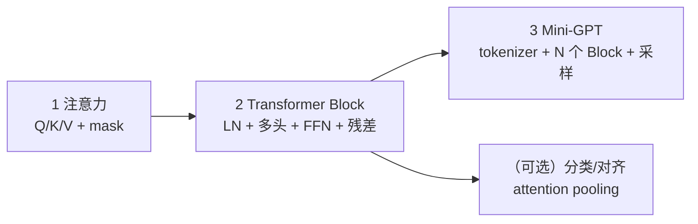

# p04-transformer · Transformer 与预训练时代

> 状态：**0/3 完成（Phase 0 骨架已就绪，三个实验仍为 ⬜）**
> 对应路线：`../docs/人工智能代表算法演进路线.md` 第五章（5.1–5.3.4）
> 族内顺序：注意力机制 → 迷你 Transformer Block → 迷你 GPT
> 本族 3 个实验，占全仓库 29 个实验中的 3 个；逐实验入口见 [`algorithms/README.md`](../README.md)。

## 1. 这个族在讲什么

p03 的 RNN 沿时间递推，长序列只能串行、长依赖会衰减。Transformer 换成**注意力**：

- 每个位置直接看所有位置（全局依赖）；
- 同一层内可并行（训练更快）；
- 用 Q/K/V、多头、位置编码、LayerNorm、残差堆成 Block；
- 堆很多 Block + 自回归训练，就是 GPT。

这个族按“**组件 → 组装 → 生成模型**”三层推进，不是一上来就写 GPT。

## 2. 三个实验一览

| # | 实验 | 章节 | 默认数据 | 核心 | 接口形态 | 状态 |
|---|---|---|---|---|---|---|
| 1 | [注意力机制](attention/) | 5.2 | 合成 Q/K/V / 小序列 | scaled dot-product、mask、softmax 反传、多头 | **组件**：`forward/backward` | ⬜ |
| 2 | [迷你 Transformer Block](mini-transformer/) | 5.2 | 小字符序列 | LayerNorm、FFN、残差、pre-LN、多头 | **Block**：`forward/backward` + `train` | ⬜ |
| 3 | [迷你 GPT](mini-gpt/) | 5.3.4 | 离线小文本（Zen/合成 grammar） | tokenizer、embedding、N 个 Block、采样 | **模型**：`train(text)` / `generate` | ⬜ |

> 章节说明：5.1 是“Transformer 的意义”背景；Block 属于 5.2 的组件装配，因此
> `mini-transformer` 锚 **5.2**，不再使用原来的 5.1。

## 3. 依赖链



- **1 → 2**：Block 只是把注意力、LN、FFN、残差装起来；
- **2 → 3**：GPT 是 N 个 Block + embedding + 语言模型头；
- 不先写 attention 就直接写 GPT，等于把最难的反传藏在黑盒里。

## 4. 接口边界（必须先分清）

| 实验 | 有 fit(X,y)？ | 有 train？ | 有 generate？ | 为什么 |
|---|---|---|---|---|
| attention | ❌ | ❌ | ❌ | 是**组件**，输入 Q/K/V，输出加权和 + 权重 |
| mini-transformer | ❌ | ✅（tokens） | ❌ | 是**Block**，可在语言建模目标上训练 |
| mini-gpt | ❌ | ✅（text） | ✅ | 是**生成模型**，目标是 next-token |

> 这是 p04 最容易被误解的地方：attention 不是“一个小模型”，它没有标签、没有 fit。

### 4.1 还必须补的 4 个契约

| 契约 | 放在哪 | 必须写清什么 |
|---|---|---|
| **位置编码** | Block / GPT | attention 对位置是置换不变的；可学习位置嵌入 vs 正弦编码，shape `(T,d_model)`，加在 embedding 后 |
| **tokenizer / 错位目标** | GPT | 字符表、`<unk>`、context 截断、`input=text[:-1]`、`target=text[1:]`、忽略越界 |
| **训练/评估** | Block / GPT | train/val 切分、交叉熵、perplexity、采样参数（temperature/top-k/seed） |
| **共享组件** | 全族 | LayerNorm / FFN / MultiHeadAttention 放一个共享模块还是各实验复制；**必须只选一种** |

**建议的共享策略**：在 `p04-transformer/` 下放 `components.py`（LayerNorm、FFN、MultiHeadAttention），
三个实验的 `impl.py` 复用它；这样 attention 实验验证组件、Block/GPT 不再复制一份。
如果坚持“每个实验完全自包含”，就要接受 2 份重复实现，并在 README 说明。

### 4.2 单头 vs 多头

- `ScaledDotProductAttention`：**无参数**，只做 `softmax(QKᵀ/√d_k)V`；适合讲公式与反传；
- `MultiHeadAttention`：有 `Wq/Wk/Wv/Wo`，负责拆头/拼头；Block 用的是它。

## 5. 数据与环境（离线优先）

### 默认数据

| 实验 | 默认数据 | 说明 |
|---|---|---|
| attention | 合成 Q/K/V + 小序列 | 可构造 padding/causal mask，验证权重 |
| mini-transformer | 合成字符序列 / Zen of Python | 学 next-token，不依赖下载 |
| mini-gpt | Zen of Python 或合成 grammar（1–5KB） | 字符级；可选 Tiny Shakespeare |

**不默认下载语料**；真实语料只作为可选扩展，且要在 README 标注来源/许可证。

### 环境

```bash
cd algorithms
uv sync --extra deep-learning --extra dev
uv run python p04-transformer/attention/demo.py
```

- 手写实现用 **numpy**；`torch` 只用于 `framework.py` 对照；
- 默认 CPU；每个 demo 控制在 **2–3 分钟**；
- 默认模型：`d_model=32/64`、`n_heads=2/4`、`context=16/32`、`n_layers=1/2`。

## 6. Phase 0–4 计划（本文件是 Phase 0 的产物）

| 阶段 | 内容 | 交付 | 状态 |
|---|---|---|---|
| **Phase 0** | 族级导读、章节修正、接口/数据/范围约定 | 本文件 + 三个实验骨架 | ✅ 本版完成 |
| Phase 1 | attention：scaled dot-product、mask、softmax 反传、多头 | 实现 + 测试 + 热图 + 练习/项目 | ⬜ |
| Phase 2 | Block：LayerNorm、FFN、残差、pre-LN、多头 | 实现 + 梯度检查 + 小语料训练 + torch 对照 | ⬜ |
| Phase 3 | mini-GPT：tokenizer、embedding、N 个 Block、采样 | 训练/生成 + 温度/top-k + 项目 | ⬜ |
| Phase 4 | p04 阶段质量轮 | 同结构对照、完成度、遗留项 | ⬜ |

## 7. 每个实验的交付标准

- README：基础篇 8 节 + 进阶篇六段 + 五级清单；
- 测试：形状、mask/causal、有限差分梯度、确定性、契约；
- 素材：3 张 PNG + 1 个 GIF（注意力热图、loss、生成样本/权重动画）；
- 练习 5 题（题解分离）；
- 1 个迁移项目；
- 验证声明：环境、数据、种子、命令、结果。

## 8. 本族的范围边界

**做**：单头/多头注意力、padding/causal mask、LayerNorm、FFN、残差、pre-LN、字符级 GPT、greedy/temperature/top-k。

**不做**（只作延伸，避免把 p04 变成大模型工程课）：

- BERT/ELMo/T5 等预训练/编码器-解码器模型（5.3.2/5.3.3）；
- BPE/SentencePiece 分词、词向量训练（5.3.1）；
- 预训练 + 微调、RLHF、KV cache、长上下文、分布式训练；
- 现代大模型工程（FlashAttention、张量并行、量化部署）。

## 9. 状态与后续

- 当前 **0/3**，三个实验仍是骨架；本版只完成 Phase 0；
- 下一步：Phase 1 注意力（先做组件，再做 Block，最后 GPT）；
- 每个实验完成后同步：本表状态、[`algorithms/README.md`](../README.md) 索引、根 README 计数；
- 遗留项统一记在本文件"范围边界"和 `.dsh/memory/`。
