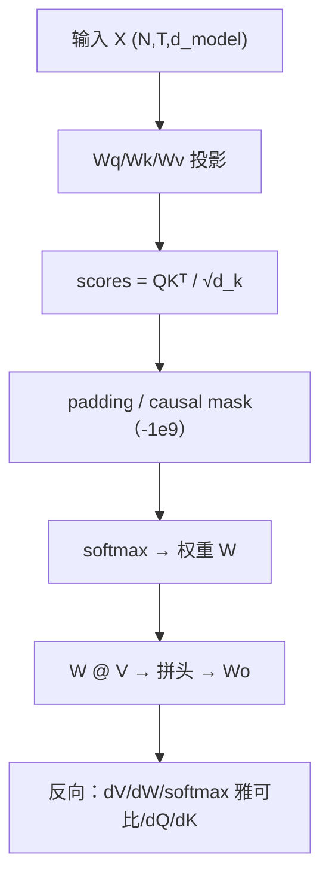
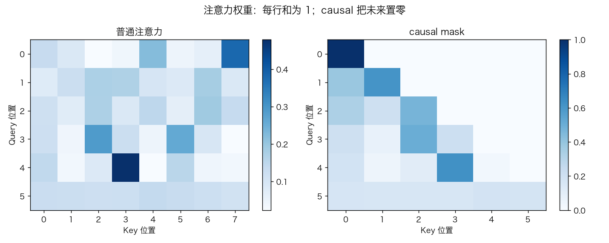
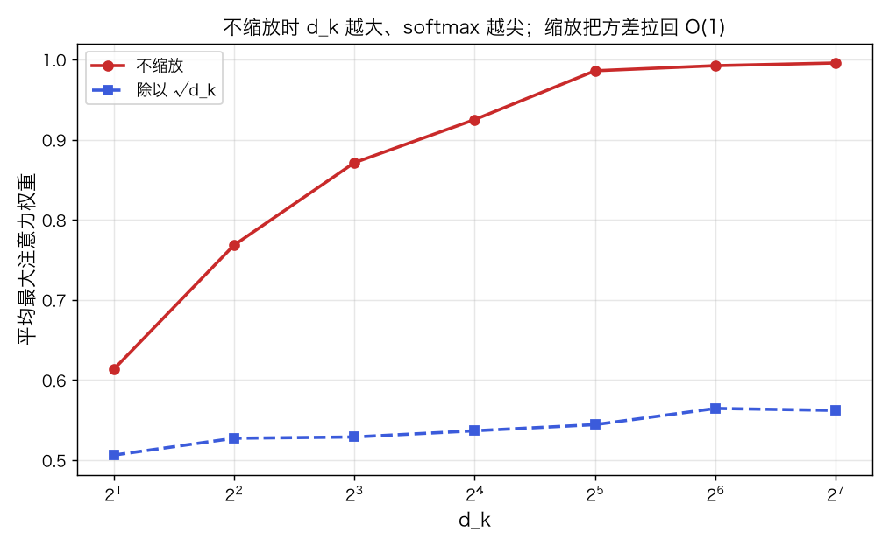
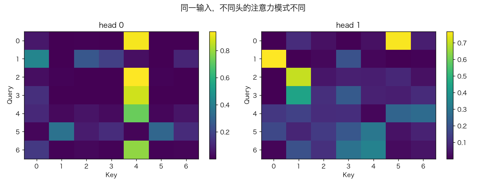
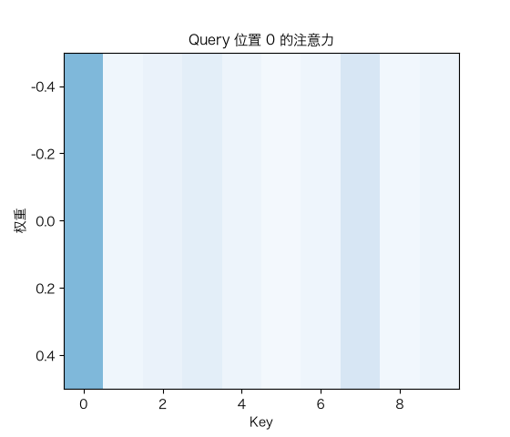

# 注意力机制：Q/K/V、mask 与多头

> 状态：✅ 已完成（2026-10-22）
> 对应文档章节：`../../docs/人工智能代表算法演进路线.md` 第 5.2 章
> 阅读路线：零基础读者读「基础篇」（生活类比 → 手算 → 白话 → 自测）；要看推导、实现与复现实验读「进阶篇」
> 本族共 7 个实验，学习顺序与计划见 [族级导读](../README.md)。

注意力组件（深度模型 · 组件）：入口 `ScaledDotProductAttention().forward(Q,K,V,mask)` / `backward(d_out)`，以及 `MultiHeadAttention().forward(X)` / `backward`；实现在 [impl.py](impl.py)，对照是 [framework.py](framework.py) 的 torch 实现。**没有 `fit` / `train`**：它不是独立模型，而是 Block/BERT/GPT/T5 的零件。

## 读之前：attention 是什么、不是什么

- 是一个组件，不是模型：有 `forward/backward`，没有 `fit/train`。
- 有 Q/K/V 和 mask，不是“又一层全连接”。
- 它不分类、不生成；分类/生成由后面的 Block/BERT/GPT/T5 负责。

# 基础篇 · 先搞懂它

## 1. 生活类比：在一句话里“划重点”

你读“小明把苹果给了小红，**她**很高兴”时，会回头看“小红”这个词。
注意力就是给每个词一个“查询”（Query），拿它去和所有词的“索引”（Key）匹配，
算出该看谁、看多少（权重），再把对应的“内容”（Value）加权加起来。

- **Q**：我现在要找什么；
- **K**：每个位置“能被怎么找到”；
- **V**：每个位置真正提供的信息。

## 2. 核心量：Q/K/V、缩放、softmax、mask、多头

$$\text{Attention}(Q,K,V)=\text{softmax}\left(\frac{QK^\top}{\sqrt{d_k}}\right)V$$

- `QKᵀ/√d_k`：相似度分数；除以 `√d_k` 防止点积方差随维度爆炸；
- `softmax`：每行变成概率，权重和为 1；
- **padding mask**：屏蔽填充位；
- **causal mask**：自回归时屏蔽未来（上三角置 `-1e9`，不用 `-inf`）；
- **多头**：把 `d_model` 拆成 `H` 份，每头独立算注意力，再拼回 + `Wo`。

## 3. 主循环：投影 → 打分 → mask → softmax → 加权

## 4. 手算示例：两个 token、d_k=2

`Q=K=[[1,0],[0,1]]`，`V=[[1,0],[0,1]]`，`d_k=2`。

**分数**：

$$QK^\top/\sqrt2=\begin{bmatrix}0.707&0\\0&0.707\end{bmatrix}$$

**softmax**：每行 `[0.669, 0.331]` 与 `[0.331, 0.669]`。

**输出**：`W @ V = W`，即第一行 `[0.669,0.331]`，第二行 `[0.331,0.669]`。

**causal**：第二行只能看自己 → 权重 `[0,1]`，输出 `[0,1]`。

## 5. 白话版：为什么缩放、为什么要 mask、为什么需要位置编码

**为什么缩放**：随机初始化时 `QKᵀ` 的方差约 `d_k`；不除 `√d_k`，`d_k=128` 时分数很大，
softmax 接近 one-hot，梯度几乎为 0。缩放把方差拉回 O(1)。

**mask 两种**：

- padding：batch 里短句补的 0 不参与注意力；
- causal：第 `t` 个位置不能看 `>t`，否则训练时“偷看答案”。

**为什么需要位置编码**：attention 对 token 排列是**等变**的——把词打乱，输出也跟着打乱，
模型不知道谁在前。所以 Block/GPT 必须加位置编码。

## 6. 常见误区

- **❌ "attention 是一个可训练模型"** —— 它是组件；`ScaledDotProductAttention` 无参数。
- **❌ "不除 √d_k 也能跑"** —— 能跑，但高维时 softmax 饱和、梯度消失。
- **❌ "mask 用 -inf 更好"** —— 全被 mask 的行会出现 `-inf - -inf = nan`；用 `-1e9`。
- **❌ "causal 只是把未来权重置 0"** —— 还要保证反向时未来位置不接收梯度。
- **❌ "多头只是多算几遍"** —— 每个头有独立投影，能关注不同关系。
- **❌ "attention 天然知道顺序"** —— 不知道；必须加位置编码。

## 7. 看图：权重、缩放与多头

每行权重和为 1；causal 把上三角置零。

不缩放时 `d_k` 越大最大权重越接近 1；除以 `√d_k` 后平缓得多。

同一输入，两个头的注意力模式不同。

查询位置变化时，注意力权重跟着移动。

## 8. 掌握清单：五级能力与自测

| 级别 | 能力 | 本实验的检验方式 | 在哪做 |
|---|---|---|---|
| 1 说清 | 用自己的话讲规则 | 说出 Q/K/V、缩放、mask、多头 | 基础篇「核心量」「白话版」 |
| 2 走通 | 纸上手算 | 两个 token 的 softmax 权重与输出 | 基础篇「手算示例」节 |
| 3 判断 | 说清正确性条件 | 解释缩放、causal、位置编码、O(T²) | 基础篇「白话版」+ 实验二/五 |
| 4 实现 | 手写并与对照比对 | 跑通 `demo.py`，梯度检查通过 | 进阶篇「实验结果」 |
| 5 迁移 | 用到新问题 | 内容检索：attention vs mean pooling | [project/](project/README.md) |

**自测关卡（先预测，再跑代码验证）**：

1. 不除 `√d_k`，`d_k=128` 时 softmax 会怎样？
2. causal mask 下，改未来 token 会影响过去输出吗？
3. 打乱 token 顺序，attention 输出会怎样？
4. 为什么 attention 的时间复杂度是 O(T²)？

# 进阶篇 · 实验档案

## 目录形态（本算法的"类型"）

| 文件 | 角色 | 入口 / 说明 |
|---|---|---|
| [impl.py](impl.py) | 手写实现 | `ScaledDotProductAttention`、`MultiHeadAttention`、softmax |
| [framework.py](framework.py) | torch 对照 | `torch_attention`（逐位对账）、`torch_mha`（工程对照） |
| [demo.py](demo.py) | 组件实验 | mask / 缩放 / 多头 / 检索 / 复杂度 / torch |
| [test_impl.py](test_impl.py) | 性质测试 | 归一化、mask、缩放、单头/多头梯度、排列、torch、契约 |
| [make_teaching_assets.py](make_teaching_assets.py) | 素材生成 + 对账 | 热图 / 缩放 / 多头 / GIF |
| [exercises/](exercises/README.md) | 练习（5 题，题解分离） | 概念、手算、诊断、实现、迁移 |
| [project/](project/README.md) | 迁移项目 | 内容检索：attention vs mean pooling |

## 1. 设计原理

Attention 用“Query 与 Key 的相似度”决定每个 Value 的权重；它是**内容寻址**的聚合，
不是固定卷积核。多头让模型在不同子空间学不同关系。它是 Transformer 的核心组件，
但本身没有任务目标、没有参数（单头版）。

## 2. 数学推导

**前向**：`S=QKᵀ/√d_k`，`W=softmax(S)`，`O=WV`。

**softmax 雅可比**：对一行 `w`，

$$\frac{\partial L}{\partial s}=w\odot\left(\frac{\partial L}{\partial w}
-\left(\frac{\partial L}{\partial w}\cdot w\right)\mathbf 1^\top\right)$$

**反向**：

$$dV=W^\top dO,\qquad dW=dO\,V^\top,\qquad dQ=dS\,K/\sqrt{d_k},\qquad dK=dS^\top Q/\sqrt{d_k}$$

**缩放方差**：若 `Q,K` 各维独立、方差 1，则 `q·k` 方差为 `d_k`；除 `√d_k` 后方差为 1。

**多头**：`head_i=Attention(QWq_i,KWk_i,VWv_i)`，`O=Concat(heads)W_o`。

## 3. 手写实现要点

1. **mask 用 `-1e9`**：避免全 mask 行 softmax 出 nan。
2. **反向对 mask 位置清零**：否则未来/填充位仍收梯度。
3. **softmax 雅可比**：`W*(dW - sum(dW*W))`，漏 `sum` 项是常见错。
4. **多头拆/拼**：`(N,T,H,dh) ↔ (N,H,T,dh)`，顺序要一致。
5. **缓存 weights/Q/K/V**：反向要用。
6. **d_model 必须被 n_heads 整除**。

## 4. 框架对照

torch 手写版与 `ScaledDotProductAttention` 输出最大差 **1.4e-7**、权重差 **9.2e-8**；
`nn.MultiheadAttention` 作为工程对照（权重不保证逐位一致）。

| 维度 | 手写 | torch |
|---|---|---|
| 反向 | 手写 softmax 雅可比 | autograd |
| 多头 | 手动拆/拼 | `nn.MultiheadAttention` |
| 速度 | Python 循环 | 融合算子 |
| 用途 | 讲原理/梯度检查 | 工程实现 |

## 5. 实验结果

**环境**：uv（`uv sync --extra deep-learning --extra dev`），Python 3.13.15 /
numpy 2.5.4 / torch 2.14.1；CPU。
**数据**：合成 Q/K/V 与小序列；无训练集/标签。
**复现**：本目录内 `uv run python demo.py`、`uv run pytest test_impl.py -q`、
`uv run python make_teaching_assets.py`。

**实验一：mask**

权重行和=1；causal 上三角最大 0；改未来 V 后前面输出不变。

**实验二：d_k 与 softmax 锐度**

| d_k | 不缩放 max weight | 缩放后 max weight |
|---|---|---|
| 2 | 0.613 | 0.506 |
| 8 | 0.871 | 0.529 |
| 32 | 0.986 | 0.544 |
| 128 | 0.996 | 0.562 |

**实验三：多头**

head 0：max 0.687，熵 1.395；head 1：max 0.995，熵 0.839——同一输入，不同模式。

**实验四：内容检索**

T=32，query=K[17]：attention 选中 **17**；mean pooling 选中 0。
attention 能按内容选择，mean pooling 丢失选择能力。

**实验五：成本与排列**

T=32/64/128/256 的耗时随 T 增长（O(T²) 趋势）；打乱 token 后输出跟着打乱（排列等变）。

**验证声明（已验证）**：输入为上述数据与种子；2026-10-22 在 uv 环境实跑，
`uv run python demo.py` 输出上表；`uv run pytest test_impl.py -q` → **10 passed**；
`uv run python make_teaching_assets.py` 对账通过（手写 vs torch <1e-6）。

**可视化结论**：

- `images/00-注意力与causal.png`：权重归一化 + causal 上三角为 0；
- `images/01-缩放.png`：不缩放时 d_k 越大越尖；
- `images/02-多头.png`：不同头不同模式；
- `images/03-权重生长.gif`：查询位置变化时权重移动。

## 6. 局限与延伸

- **O(T²)**：长序列成本高；KV cache/FlashAttention 是工程优化，不在本实验。
- **位置无感知**：必须加位置编码；本实验没有实现位置编码（交给 Block/GPT）。
- **没有任务目标**：单头 attention 无参数；多头才有投影，但仍需 Block 才能训练。
- **只做 self-attention**：cross-attention（T5）在后续实验。
- **没有多头可解释性训练**：多头权重由随机投影决定，不是“学出来的分工”。
- **下游**：Block（组装）→ BERT/GPT/T5（三种范式）。

**已记录、不阻塞**：

- **mask 只支持共享 `(Tq,Tk)`**：一个 batch 内不同样本的 padding 长度不同时，不能逐样本 mask；
  需要调用方先 padding 到同一长度，或后续扩展 `(N,Tq,Tk)`。
- **多头反向每头重跑 forward**：教学实现优先可读性，不是高性能实现；生产实现会缓存 K/V。
- **没有 bias/dropout**：`MultiHeadAttention` 只有四个投影矩阵，省略了 bias 与 dropout。
- **`nn.MultiheadAttention` 只做工程对照**：未与手写逐位对账（权重布局/初始化不同），
  逐位对账使用的是 `torch_attention` 手写版。
- **复杂度计时是单次 CPU**：只用于说明 O(T²) 趋势，不是严格 benchmark。
- **没有 cross-attention/位置编码**：前者留给 T5，后者留给 Block/GPT。
