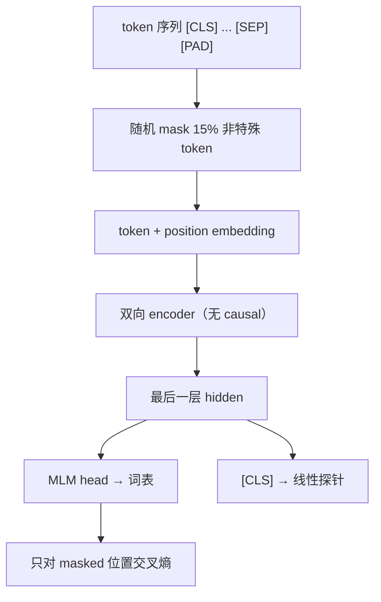
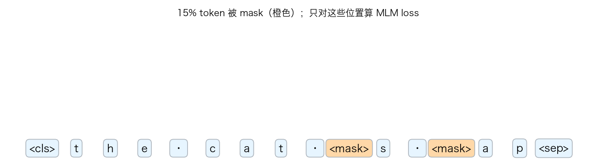
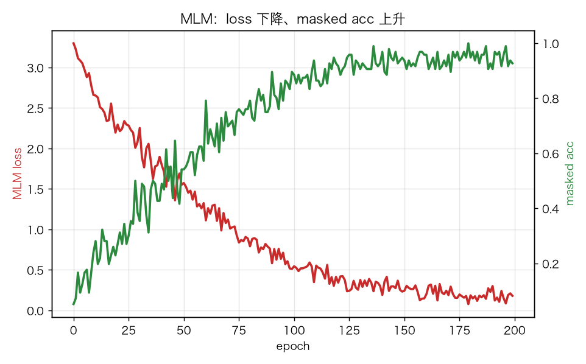
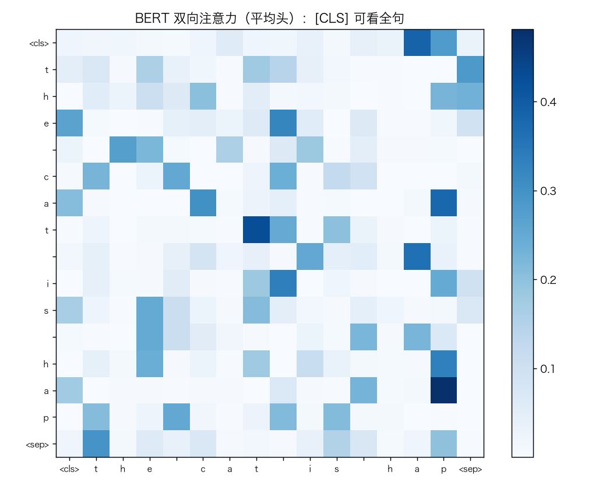
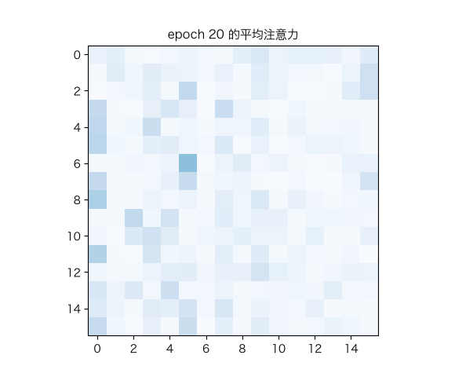

# BERT：双向 encoder、MLM 与 [CLS] 探针

> 状态：✅ 已完成（2026-10-22）
> 对应文档章节：`../../docs/人工智能代表算法演进路线.md` 第 5.3.2 章
> 阅读路线：零基础读者读「基础篇」（生活类比 → 手算 → 白话 → 自测）；要看推导、实现与复现实验读「进阶篇」
> 本族共 7 个实验，学习顺序与计划见 [族级导读](../README.md)。

Encoder-only 模型（深度模型 · 预训练/表示）：入口 `BertMLM(vocab_size, context).train(tokens)` / `encode(tokens)` / `predict_masked(tokens)`，实现在 [impl.py](impl.py)，对照是 [framework.py](framework.py) 的 PyTorch encoder + MLM。**没有 `fit(X,y)`，也没有 `generate`**：目标是恢复被 mask 的 token，不是自回归生成。

## 读之前：BERT 是什么、不是什么

- 是 encoder-only 模型：双向看整句，不生成下一个 token。
- 训练目标是 MLM：遮住 15% token，只对被遮位置算交叉熵。
- `[CLS]` 不是“分类器本身”，它的表示要再接一个探针/微调头才能分类。

# 基础篇 · 先搞懂它

## 1. 生活类比：完形填空

“今天天气真 `[MASK]`，我们去公园吧。”  
人要填“好”，必须同时看**左边和右边**。BERT 就是这样练出来的：

- 随机遮住 15% 的词；
- 让模型从上下文恢复；
- 因为能看两边，它学的是“理解型”表示。

GPT 则是“接龙”：只能看左边，预测下一个词。

## 2. 核心量：双向注意力、MLM、15% mask、[CLS]

**双向注意力**：没有 causal mask，每个位置可以看所有非 pad 位置。

**MLM**：随机选 15% 的非特殊 token：

- 80% 替换成 `[MASK]`；
- 10% 替换成随机 token；
- 10% 保持不变；
- **只对被选中的位置算 loss**，其他位置不计。

**`[CLS]`**：句首特殊 token；它的最后一层表示作为整句表示，接线性分类器做探针。

**`[SEP]` / `[PAD]` / `[UNK]`**：分隔、填充、未知。

## 3. 主循环：mask → 双向 encoder → 只算 masked loss

## 4. 手算示例：15% mask 与 MLM loss

一句 20 个非特殊 token，15% ≈ 3 个被选中。

若某个 masked 位置的正确 token 是 `h`，模型给 `h` 的概率 `p_h=0.8`，则该位置 loss：

$$-\log 0.8 \approx 0.223$$

三个位置取平均，就是这一句的 MLM loss。
**非 masked 位置即使预测错，也不进 loss。**

`[CLS]` 探针：把 `[CLS]` 向量 `z` 接 `softmax(Wz+b)`，用带标签句子训练 `W,b`。

## 5. 白话版：为什么双向、为什么只算 masked、为什么还要探针

- **双向**：理解任务需要左右上下文；“完形填空”逼模型用全句。
- **只算 masked**：如果所有位置都算 loss，模型会学“抄输入”，MLM 就退化成自编码。
- **80/10/10**：避免训练时永远看到 `[MASK]`，而推理时没有 `[MASK]` 的分布错位。
- **探针**：MLM 只保证“能恢复词”，不保证“表示适合分类”；要用下游任务检验。

## 6. 常见误区

- **❌ "BERT 能生成"** —— 它是 encoder，没有自回归解码；生成看 GPT/T5。
- **❌ "mask 越多越好"** —— 15% 是经验值；太多上下文不够，太少学得慢。
- **❌ "所有位置都算 loss"** —— 只算被 mask 的位置。
- **❌ "[CLS] 天然是句向量"** —— 要训练/微调；本实验用线性探针检验。
- **❌ "MLM loss 低 = 分类好"** —— 表示质量和下游任务要分开看。
- **❌ "BERT 和 GPT 只是 mask 不同"** —— 结构（encoder vs decoder）、目标、用途都不同。

## 7. 看图：mask、训练与注意力

橙色是 15% 被 mask 的位置；只对这些位置算 loss。

MLM loss 下降、masked acc 上升。

BERT 的双向注意力：`[CLS]` 可以看全句，没有 causal 上三角限制。

训练中注意力逐渐结构化。

## 8. 掌握清单：五级能力与自测

| 级别 | 能力 | 本实验的检验方式 | 在哪做 |
|---|---|---|---|
| 1 说清 | 用自己的话讲规则 | 说出双向、MLM、15%、只算 masked、[CLS] | 基础篇「核心量」「白话版」 |
| 2 走通 | 纸上手算 | 20 token 选 3 个；`-log 0.8` | 基础篇「手算示例」节 |
| 3 判断 | 说清正确性条件 | 解释为什么双向、为什么只算 masked、探针 | 基础篇「白话版」 |
| 4 实现 | 手写并与对照比对 | 跑通 `demo.py`，MLM acc/探针 | 进阶篇「实验结果」 |
| 5 迁移 | 用到新问题 | MLM + `[CLS]` 情感分类 | [project/](project/README.md) |

**自测关卡（先预测，再跑代码验证）**：

1. 20 个非特殊 token，15% mask 大约几个？
2. 非 masked 位置的预测会进 loss 吗？
3. BERT 的注意力有没有 causal 上三角限制？
4. MLM loss 低，`[CLS]` 分类一定好吗？

# 进阶篇 · 实验档案

## 目录形态（本算法的"类型"）

| 文件 | 角色 | 入口 / 说明 |
|---|---|---|
| [impl.py](impl.py) | 手写实现 | `BertMLM`：双向 MHA、LN、FFN、MLM head、Adam |
| [framework.py](framework.py) | PyTorch 对照 | `TorchBERT`（`nn.TransformerEncoderLayer`） |
| [demo.py](demo.py) | 同数据双跑 | MLM / 固定 mask 评测 / `[CLS]` 探针 / torch |
| [test_impl.py](test_impl.py) | 性质测试 | mask、loss、CLS、双向、梯度、torch、契约 |
| [make_teaching_assets.py](make_teaching_assets.py) | 素材生成 + 对账 | mask / 曲线 / 注意力 / GIF |
| [exercises/](exercises/README.md) | 练习（5 题，题解分离） | 概念、手算、诊断、实现、迁移 |
| [project/](project/README.md) | 迁移项目 | MLM + `[CLS]` 情感分类 |

## 1. 设计原理

BERT 用 **encoder-only + 双向注意力 + MLM** 学上下文表示。  
没有 causal mask，所以每个位置能看全句；MLM 只监督被遮位置，逼模型用上下文恢复。
`[CLS]` 的表示再接下有监督探针，评估表示质量。

## 2. 数学推导

**MLM loss**：

$$L=-\frac{1}{|\mathcal M|}\sum_{i\in\mathcal M}\log p_\theta(x_i\mid \tilde x)$$

`M` 是 masked 位置集合，`\tilde x` 是损坏后的输入。

**双向注意力**：`S=QKᵀ/√d_k`，只 mask pad，不做 causal；`W=softmax(S)`。

**mask 策略**：15% 选中；其中 80% `[MASK]`、10% 随机、10% 原样。
**只对 M 算 loss**；其他位置梯度为 0。

**探针**：`z=[CLS]`，`p=softmax(Wz+b)`，用交叉熵训练 `W,b`。

## 3. 手写实现要点

1. **pad mask**：key 侧屏蔽 `[PAD]`，否则注意力会聚合填充位。
2. **只算 masked loss**：`probs[mask, target]`；不是 `probs[mask]` 的所有类别。
3. **特殊 token 不 mask**：`[PAD]/[CLS]/[SEP]/[MASK]` 排除。
4. **双向**：不加 causal mask。
5. **`[CLS]` 表示**：最后一层位置 0；不要用 MLM logits 代替。
6. **embedding 梯度**：`np.add.at`，同一 token 多次出现要累加。

## 4. 框架对照

torch 用 `nn.TransformerEncoderLayer(norm_first=True)` + `src_key_padding_mask`；两边的 MLM loss 都只算 masked 位置。
手写版自己实现双向 MHA/LN/FFN/MLM。

| 维度 | 手写 | torch |
|---|---|---|
| 注意力 | 手写双向 MHA | `nn.MultiheadAttention` |
| mask | pad key mask | `src_key_padding_mask` |
| 反向 | 手写链式 | autograd |
| 速度 | 教学优先 | 融合算子 |

两边不要求逐位一致；本实验固定 mask 的 MLM acc 接近，`[CLS]` 探针有差异（见局限）。

## 5. 实验结果

**环境**：uv（`uv sync --extra deep-learning --extra dev`），Python 3.13.15 /
numpy 2.5.4 / scikit-learn 1.9.1 / torch 2.14.1；CPU。
**数据**：48 句合成情感句（12 正/12 负 ×4），词表 27，context 16；200 轮。
**复现**：本目录内 `uv run python demo.py`、`uv run pytest test_impl.py -q`、
`uv run python make_teaching_assets.py`。

**MLM（200 轮，lr=1e-3）**

| 实现 | MLM loss | masked acc | `[CLS]` 探针 | 耗时 |
|---|---|---|---|---|
| 手写 BERT | 0.180 | 0.958 | **0.933** | ≈0.5s |
| torch BERT | 1.549 | 0.542 | 0.533 | ≈0.6s |

**mask 示例**：`the cat is happy .` 中 `p`、`h` 被 mask；模型可恢复。

**验证声明（已验证）**：输入为上述语料与种子；2026-10-22 在 uv 环境实跑，
`uv run python demo.py` 输出上表；`uv run pytest test_impl.py -q` → **8 passed**；
`uv run python make_teaching_assets.py` 对账通过（MLM acc >0.8、探针 >0.8）。

**可视化结论**：

- `images/00-MLM掩码.png`：15% token 被遮；
- `images/01-MLM训练.png`：loss 下降、masked acc 上升；
- `images/02-注意力.png`：双向注意力无 causal 上三角；
- `images/03-注意力生长.gif`：训练中注意力变化。

## 6. 局限与延伸

- **合成小语料**：48 句、词表 27；不能代表真实语料/全量 BERT。
- **单层 encoder**：`BertMLM` 只实现一层，没有 `n_layers` 堆叠；深层表示未验证。
- **`[CLS]` 探针/MLM 差异**：torch masked acc 0.542、探针 0.533；手写 0.958 / 0.933。
  两者已统一为“只算 masked loss + lr=1e-3 + 干净 tokens 探针”，但 toy 单层/初始化/优化仍会分叉；保留负面结果，不强行对齐。
- **没有 BERT 全量预训练/微调**：只做小规模 MLM + 线性探针。
- **没有 BPE/WordPiece**：字符级；真实 BERT 用 WordPiece。
- **没有下游多任务**：只做情感分类探针。
- **下游**：RoBERTa/ALBERT/DistilBERT（5.3.2 延伸）→ GPT/T5（生成/seq2seq）。

**已记录、不阻塞**：

- **torch 探针偏低**：`[CLS]` 表示质量受初始化/训练细节影响；不据此断言框架更差。
- **单层 + 字符级**：没有多层堆叠、没有 WordPiece。
- **mask 比例固定 15%**：没有做比例扫描。
- **`encode` 会重跑一次 forward**：为了取 hidden，效率不高；教学优先。
- **MLM loss 与探针是两件事**：MLM 好不代表 `[CLS]` 分类好。

- **`forward(mask=...)` 参数未使用**：接口保留了 mask 槽位，但实际只根据 token 的 pad 位构造 key mask；
  传自定义 mask 不会生效。
- **`encode` 会重跑一次 forward**：为了取 hidden 又算一遍，效率不高；教学优先。
- **MLM 没有留出验证集**：训练/评测用同一批句子（固定 mask），只能说明“能恢复”，不是泛化指标。
- **tokenizer 用全量句子建表**：字符表包含测试句字符；本语料字符几乎全在训练集，影响小，
  但严格做法应只用训练文本建表。
- **全 batch 训练**：没有 mini-batch/梯度累积；48 句可跑，放大语料需要改。
- **测试只覆盖 MLM head 梯度**：没有对完整 encoder 输入做有限差分；单层 + 小模型降低了风险。
