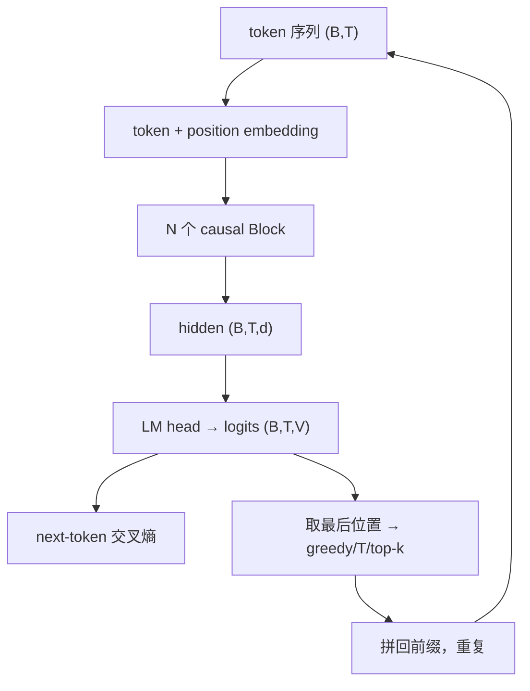
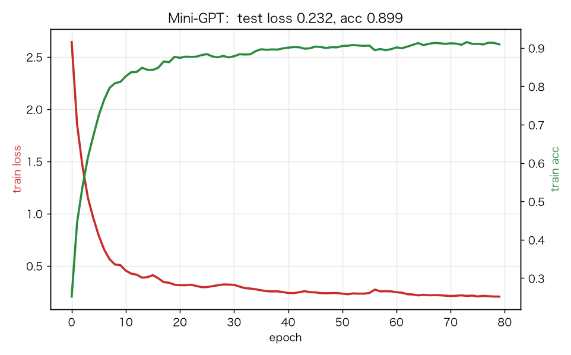
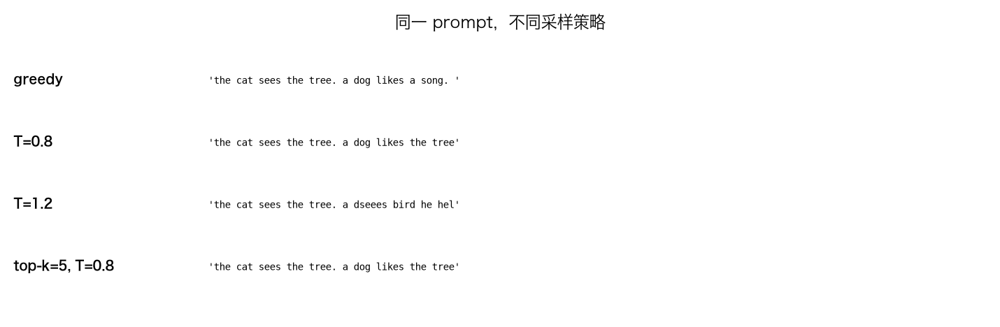
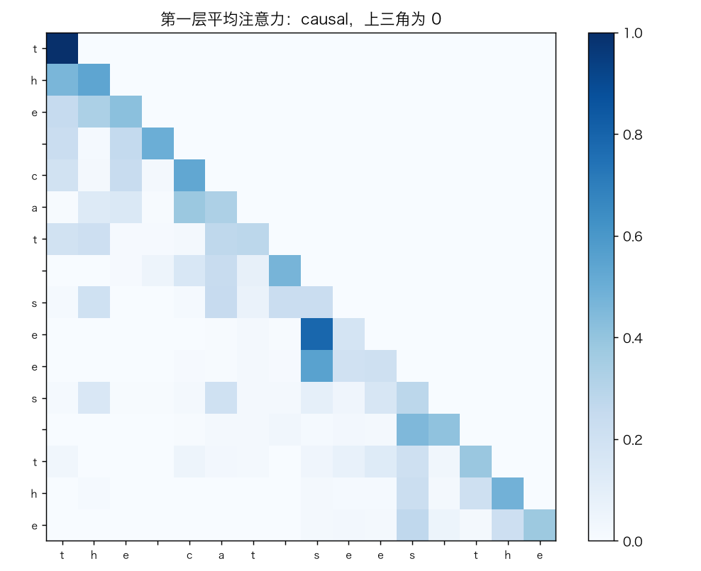
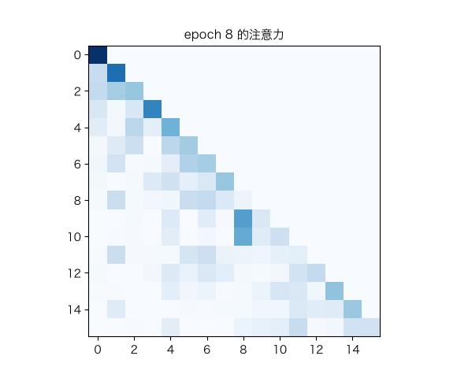

# Mini-GPT：字符级自回归语言模型

> 状态：✅ 已完成（2026-10-22）
> 对应文档章节：`../../docs/人工智能代表算法演进路线.md` 第 5.3.4 章
> 阅读路线：零基础读者读「基础篇」（生活类比 → 手算 → 白话 → 自测）；要看推导、实现与复现实验读「进阶篇」
> 本族共 7 个实验，学习顺序与计划见 [族级导读](../README.md)。

生成模型（深度模型 · 生成式）：入口 `MiniGPT(vocab_size, context, n_layers).train(tokens)` / `generate(prompt, tokenizer, temperature, top_k)`，实现在 [impl.py](impl.py)，对照是 [framework.py](framework.py) 的 PyTorch causal GPT。**没有 `fit(X,y)`**：输入/目标是同一段文本的错位切分。

## 读之前：GPT 是什么、不是什么

- 是 decoder-only 自回归模型：只能看左边，预测下一个 token。
- 由 tokenizer + token/位置 embedding + N 个 Block + LM head 组成，不是单个 Block。
- 生成是“反复调用自己”：每次取最后一个位置的 logits，采样一个 token，再拼回前缀。

# 基础篇 · 先搞懂它

## 1. 生活类比：接龙

给“今天天气”，接“真”，再给“今天天气真”，接“好”。
GPT 就是训练一个“看前文、猜下一个字”的模型；生成时把自己的输出再喂回去。

## 2. 核心量：tokenizer、embedding、causal Block、LM head、采样

- **tokenizer**：字符 ↔ id；本实验字符级，含 `<unk>`。
- **token embedding**：`E[id]`；
- **position embedding**：`P[pos]`，否则模型不知道顺序；
- **N 个 causal Block**：每个位置只能看 `≤t`；
- **LM head**：`hidden @ Wlm + b` → 词表 logits；
- **采样**：
  - greedy：`argmax`；
  - temperature：`logits / T` 再 softmax；
  - top-k：只保留概率最高的 k 个再采样。

## 3. 主循环：embedding → N 个 Block → 最后一个位置 → 采样

## 4. 手算示例：softmax、temperature、top-k

某位置 logits `[2.0, 1.0, 0.0]`：

**softmax**：`[0.665, 0.245, 0.090]`。

**temperature=0.5**：`logits/0.5=[4,2,0]`，softmax 更尖，约 `[0.867,0.117,0.016]`。

**top-k=2**：只保留前两个，重新归一化 `[0.731,0.269]`，第三个为 0。

**loss**：正确 token 概率 0.665 → `-log 0.665≈0.408`。

## 5. 白话版：为什么 causal、为什么要位置、temperature/top-k 在调什么

- **causal**：第 t 个位置不能看未来，否则训练时偷答案，生成时没有未来可看。
- **位置**：attention 对顺序无感知；没有位置嵌入，模型把句子当词袋。
- **temperature**：T<1 更保守/重复，T>1 更随机/容易跑偏。
- **top-k**：砍掉长尾低概率 token，减少胡言乱语；k 太小会单调。
- **N 层**：每层做“混合位置 + 逐位置加工”，堆叠提升表达能力。

## 6. 常见误区

- **❌ "GPT 就是 Block"** —— Block 是层；GPT 还要 tokenizer/embedding/N 层/LM head/采样。
- **❌ "训练和生成是一回事"** —— 训练并行算所有位置；生成串行逐 token。
- **❌ "temperature 越高越好"** —— 高温度更随机，但更容易不连贯。
- **❌ "top-k 能提高准确率"** —— 它只改变采样分布，不改变模型概率。
- **❌ "字符级能理解语义"** —— 本实验只学局部字符转移，不是语义理解。
- **❌ "生成文本通顺 = 模型理解"** —— 可能只是背了训练模板。

## 7. 看图：训练、采样与注意力

80 轮后 test loss 0.232 / acc 0.899。

greedy 最稳；T=1.2 开始跑偏；top-k 把分布收窄。

causal 注意力上三角为 0，只能看左边。

训练中注意力逐渐结构化。

## 8. 掌握清单：五级能力与自测

| 级别 | 能力 | 本实验的检验方式 | 在哪做 |
|---|---|---|---|
| 1 说清 | 用自己的话讲规则 | 说出 tokenizer/embedding/N Block/LM head/采样 | 基础篇「核心量」「白话版」 |
| 2 走通 | 纸上手算 | softmax、temperature、top-k、CE | 基础篇「手算示例」节 |
| 3 判断 | 说清正确性条件 | 解释 causal、位置、温度/top-k | 基础篇「白话版」 |
| 4 实现 | 手写并与对照比对 | 跑通 `demo.py`，生成非空 | 进阶篇「实验结果」 |
| 5 迁移 | 用到新问题 | 多 prompt/多策略生成 | [project/](project/README.md) |

**自测关卡（先预测，再跑代码验证）**：

1. 没有 causal mask，next-token 训练会怎样？
2. 没有位置嵌入，模型能区分“猫追狗”和“狗追猫”吗？
3. temperature=0.5 与 1.5，生成风格差在哪？
4. top-k=1 等价于哪种采样？

# 进阶篇 · 实验档案

## 目录形态（本算法的"类型"）

| 文件 | 角色 | 入口 / 说明 |
|---|---|---|
| [impl.py](impl.py) | 手写实现 | `CharTokenizer`、`MiniGPT`、N 个 Block、采样 |
| [framework.py](framework.py) | PyTorch 对照 | `TorchGPT`（causal `nn.TransformerEncoder`） |
| [demo.py](demo.py) | 同语料双跑 | 训练 / 采样策略 / torch |
| [test_impl.py](test_impl.py) | 性质测试 | tokenizer、causal、梯度、训练、生成、torch |
| [make_teaching_assets.py](make_teaching_assets.py) | 素材生成 + 对账 | 曲线 / 采样 / 注意力 / GIF |
| [exercises/](exercises/README.md) | 练习（5 题，题解分离） | 概念、手算、诊断、实现、迁移 |
| [project/](project/README.md) | 迁移项目 | 多 prompt/采样策略生成 |

## 1. 设计原理

GPT 是“自回归语言模型”：用前文预测下一个 token；训练时并行计算所有位置的 next-token loss，
生成时串行采样。causal mask 保证每个位置只看左边；位置嵌入提供顺序；N 层 Block 提升容量。

## 2. 数学推导

**next-token loss**：

$$L=-\frac{1}{BT}\sum_{b,t}\log p_\theta(x_{t+1}\mid x_{\le t})$$

**causal mask**：`scores[t,s]=-1e9` 当 `s>t`；softmax 后未来权重为 0。

**temperature**：`p=softmax(logits/T)`；T→0 趋近 argmax，T→∞ 趋近均匀。

**top-k**：保留 logits 最大的 k 个，其余置 `-1e9`，再 softmax。

**位置嵌入**：`X=E[token]+P[pos]`；没有它，attention 对排列等变。

## 3. 手写实现要点

1. **causal mask**：Block 内固定下三角，反向也要把未来梯度清零。
2. **错位目标**：`input=tokens[:-1]`，`target=tokens[1:]`。
3. **embedding 梯度**：`np.add.at(dE, tokens, dX)`；同一 token 多次出现要累加。
4. **位置梯度**：`dP[:T] += dX.sum(0)`。
5. **N 层反传**：逆序遍历 Block。
6. **采样**：temperature/top-k 只作用于最后一个位置的 logits。

## 4. 框架对照

torch 用 `nn.TransformerEncoder` + causal mask + LM head；手写版自己实现 N 个 Block/反传/采样。

| 维度 | 手写 | torch |
|---|---|---|
| Block | 手写 LN/MHA/FFN | `nn.TransformerEncoderLayer` |
| mask | 手写下三角 | `src_mask` |
| 反向 | 手写链式 | autograd |
| 采样 | 手写温度/top-k | 手写采样逻辑（对照版） |

## 5. 实验结果

**环境**：uv（`uv sync --extra deep-learning --extra dev`），Python 3.13.15 /
numpy 2.5.4 / torch 2.14.1；CPU。
**数据**：离线合成主谓宾语料，3600 字符、词表 25；训练/测试 token 2880/720；context=16。
**复现**：本目录内 `uv run python demo.py`、`uv run pytest test_impl.py -q`、
`uv run python make_teaching_assets.py`。

**next-token（80 轮，2 层）**

| 实现 | train loss | train acc | test loss | test acc | 耗时 |
|---|---|---|---|---|---|
| 手写 Mini-GPT | 0.196 | 0.917 | 0.232 | **0.899** | ≈2.4s |
| torch GPT | 0.199 | — | 0.238 | 0.900 | ≈3.1s |

**采样（prompt=`the cat`，40 字符）**

- greedy：`the cat sees the tree. a dog likes a song. ...`
- T=0.8：`the cat sees the tree. a dog likes the tree. ...`
- T=1.2：开始出现 `dseees` 之类拼写错误；
- top-k=5, T=0.8：更接近 greedy，但仍有变化。

**验证声明（已验证）**：输入为上述语料与种子；2026-10-22 在 uv 环境实跑，
`uv run python demo.py` 输出上表；`uv run pytest test_impl.py -q` → **9 passed**；
`uv run python make_teaching_assets.py` 对账通过（test acc >0.8、生成非空）。

**可视化结论**：

- `images/00-训练曲线.png`：loss 下降、acc 上升；
- `images/01-采样策略.png`：温度/top-k 的差异；
- `images/02-注意力.png`：causal 上三角为 0；
- `images/03-注意力生长.gif`：注意力结构化。

## 6. 局限与延伸

- **字符级 + 合成语料**：只学局部字符转移，不是语义理解。
- **2 层小模型**：容量有限；不是 GPT-2/3。
- **没有 BPE/WordPiece**：字符级 tokenizer。
- **没有 KV cache**：生成每步重算全前缀，O(T²)/步。
- **没有预训练/微调/RLHF**：只做小语料 next-token。
- **没有 FID/人工评估**：生成质量只看样例/准确率。
- **下游**：BPE → 更大语料 → GPT-2/3 → 指令微调/RLHF。

**已记录、不阻塞**：

- **生成质量有限**：合成语料 + 2 层，输出会重复/跑偏。
- **`generate` 每步重算全前缀**：没有 KV cache；教学优先。
- **temperature/top-k 没有系统扫描**：只展示 4 组样例。
- **test acc 0.899 不代表语言能力**：只是字符级 next-token 准确率。
- **tokenizer 只用训练文本建表**：`<unk>` 处理未知字符；没有 BPE。
- **`generate` 每步重算全前缀**：没有 KV cache，时间复杂度随生成长度增长；教学优先。
- **`top_k` 必须是整数**：传浮点会在切片处报错；接口只做了 `<1` 的校验。
- **`forward` 每次重置 `dE/dP`**：生成时也分配梯度数组，带来不必要的开销。
- **没有梯度裁剪/早停**：训练配置固定，未做稳定性扫描。
