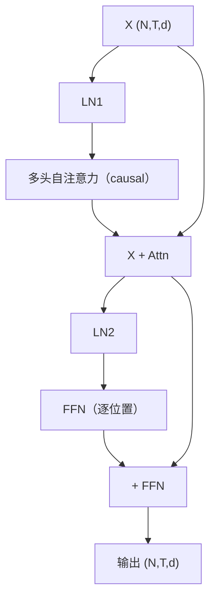
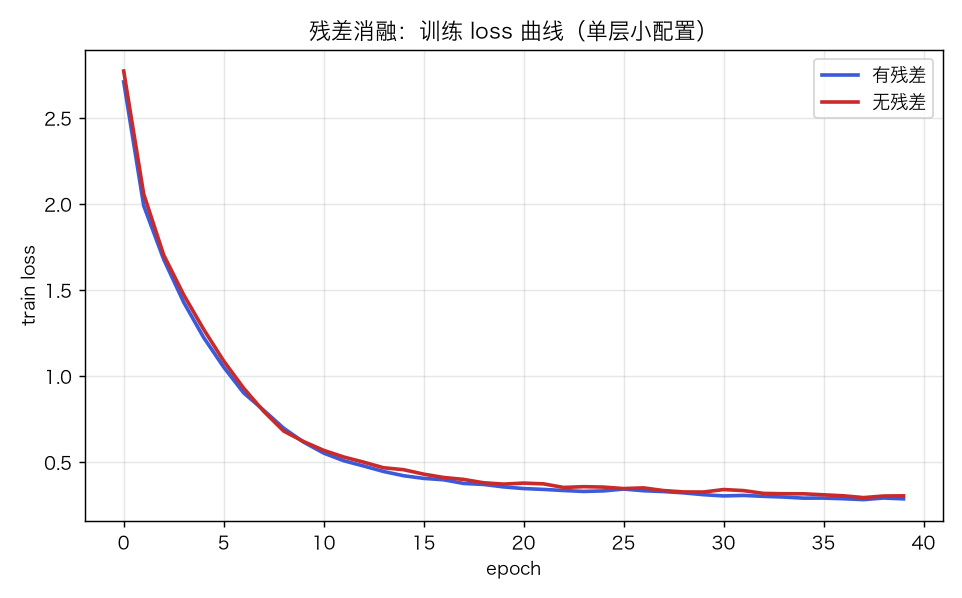
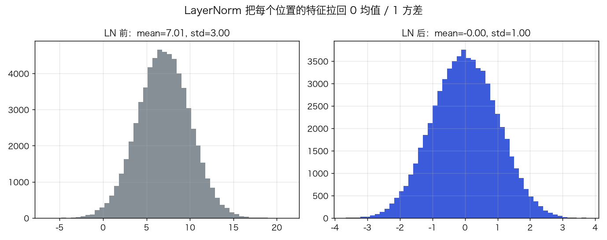
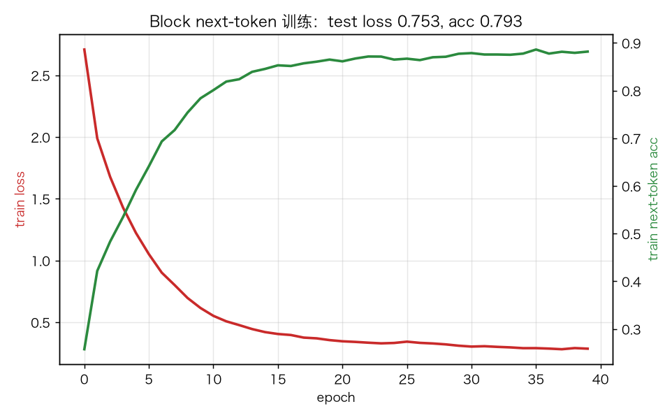
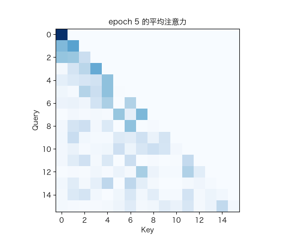

# 迷你 Transformer Block：LayerNorm、FFN、残差与 pre-LN

> 状态：✅ 已完成（2026-10-22）
> 对应文档章节：`../../docs/人工智能代表算法演进路线.md` 第 5.2 章
> 阅读路线：零基础读者读「基础篇」（生活类比 → 手算 → 白话 → 自测）；要看推导、实现与复现实验读「进阶篇」
> 本族共 7 个实验，学习顺序与计划见 [族级导读](../README.md)。

Transformer Block（深度模型 · 组件/可训练块）：入口 `TransformerBlock(...).forward(X)` / `backward(d_out)`，并可在字符序列上 `train(tokens)` / `evaluate(tokens)` / `predict_next(tokens)`；实现在 [impl.py](impl.py)，对照是 [framework.py](framework.py) 的 PyTorch pre-LN Block。**没有 `fit(X,y)`**：next-token 的输入/目标来自同一段文本的错位切分。

## 读之前：Block 是什么、不是什么

- 是一层可堆叠的 Block，不是完整语言模型：输入 `(N,T,d_model)`，输出同形状。
- 内部是 LN → 多头注意力 → 残差 → LN → FFN → 残差，不是一层全连接。
- 它可以用 next-token 目标训练，但词表/采样属于 GPT 实验。

# 基础篇 · 先搞懂它

## 1. 生活类比：一层“先整理、再开会、再记笔记”的流水线

一句话经过 Block 时：

1. **LayerNorm** 先把每个人的发言整理到同一音量；
2. **多头注意力** 让大家互相听、各自关注不同的人；
3. **残差** 保留原始发言，不被改写丢；
4. **FFN** 每个人自己再消化一遍；
5. 再 **残差** 汇总。

堆很多层，就是 Transformer。

## 2. 核心量：LN、MHA、FFN、残差、pre-LN

**LayerNorm**（对最后一维）：

$$\text{LN}(x)=\gamma\odot\frac{x-\mu}{\sqrt{\sigma^2+\epsilon}}+\beta$$

**pre-LN Block**：

```text
x = x + MultiHeadAttention(LN1(x))
x = x + FFN(LN2(x))
```

- **FFN**：`W2·ReLU(W1·x+b1)+b2`，逐位置独立；
- **残差**：`y=x+f(x)`，反向时 `dL/dx = dL/dy + dL/dy·f'(x)`；
- **pre-LN**：LN 在子层之前；post-LN 是 `LN(x+f(x))`。pre-LN 梯度更稳，深层常用。

## 3. 主循环：LN → 注意力 → 加回 → LN → FFN → 加回



## 4. 手算示例：LayerNorm + 残差

**LN**：`x=[1,2,3]`，`μ=2`，`σ²=2/3`，`σ≈0.816`。

`xhat=[-1.225,0,1.225]`；若 `γ=1,β=0`，输出就是 `xhat`。

**残差**：`y=x+f(x)`，`x=1`，`f(x)=0.1` → `y=1.1`。
反向若 `dL/dy=1`、`f'(x)=0.5`，则 `dL/dx=1+0.5=1.5`：
**直连的 1 是梯度高速公路，子层的 0.5 是额外路径。**

## 5. 白话版：为什么 pre-LN、残差、FFN 都要有

- **pre-LN**：LN 放在残差分支里，主路保持恒等；深层梯度不必穿过 LN，训练更稳。
- **残差**：每层只学“增量”，最坏情况可以学 0，不会把原表示破坏。
- **FFN**：注意力负责“混合位置”，FFN 负责“每个位置自己加工”；没有 FFN，Block 只是加权平均。
- **causal mask**：第 `t` 个位置不能看未来，否则 next-token 训练会偷答案。

## 6. 常见误区

- **❌ "pre-LN 和 post-LN 只是顺序不同"** —— 梯度路径不同；pre-LN 主路无 LN，深层更稳。
- **❌ "残差只是加一下"** —— 它给梯度提供直连路径；去掉后深层/长序列更难训。
- **❌ "FFN 是可有可无的"** —— 它提供逐位置非线性，参数量通常占 Block 的大头。
- **❌ "LN 和 BatchNorm 一样"** —— LN 对每个样本/位置自己归一化，不依赖 batch。
- **❌ "Block 就是 GPT"** —— Block 是层；GPT 还要 tokenizer、embedding、N 层、采样。

## 7. 看图：残差、LN 与训练



残差消融：在这个单层小配置上，无残差的 test 反而略好；残差优势要在深层/大模型验证。



LN 前均值 7.01、标准差 3.00；LN 后均值 0、标准差 1。



40 轮后 train loss 2.709 → 0.286，test loss 0.753 / acc 0.793。



训练中注意力从均匀逐渐变得有结构。

## 8. 掌握清单：五级能力与自测

| 级别 | 能力 | 本实验的检验方式 | 在哪做 |
|---|---|---|---|
| 1 说清 | 用自己的话讲规则 | 说出 LN/MHA/FFN/残差/pre-LN 的作用 | 基础篇「核心量」「白话版」 |
| 2 走通 | 纸上手算 | `[1,2,3]` 的 LN；残差梯度 1.5 | 基础篇「手算示例」节 |
| 3 判断 | 说清正确性条件 | 解释 pre-LN、残差、causal、FFN | 基础篇「白话版」+ 实验二 |
| 4 实现 | 手写并与对照比对 | 跑通 `demo.py`，梯度检查通过 | 进阶篇「实验结果」 |
| 5 迁移 | 用到新问题 | 训练后做 next-token 预测 | [project/](project/README.md) |

**自测关卡（先预测，再跑代码验证）**：

1. `[1,2,3]` 经过 `γ=1,β=0` 的 LN 后是什么？
2. 残差反向为什么是“两条路径相加”？
3. pre-LN 与 post-LN 的梯度路径差在哪？
4. 去掉残差，训练 loss 会怎样？

# 进阶篇 · 实验档案

## 目录形态（本算法的"类型"）

| 文件 | 角色 | 入口 / 说明 |
|---|---|---|
| [impl.py](impl.py) | 手写实现 | `LayerNorm`、`_MHA`、`_FFN`、`TransformerBlock`、Adam |
| [framework.py](framework.py) | PyTorch 对照 | `TorchBlock`（`norm_first=True`） |
| [demo.py](demo.py) | 同语料双跑 | next-token / 残差消融 / torch |
| [test_impl.py](test_impl.py) | 性质测试 | LN 归一化/梯度、Block 梯度、causal、训练、torch、契约 |
| [make_teaching_assets.py](make_teaching_assets.py) | 素材生成 + 对账 | 残差 / LN / 曲线 / 注意力 GIF |
| [exercises/](exercises/README.md) | 练习（5 题，题解分离） | 概念、手算、诊断、实现、迁移 |
| [project/](project/README.md) | 迁移项目 | 训练后做 next-token 续写 |

## 1. 设计原理

Block 把“位置混合”（注意力）和“逐位置加工”（FFN）交替堆叠；每个子层用残差保留原表示，
用 LN 稳定数值。pre-LN 把 LN 放在子层前，主路恒等，深层梯度更顺。

## 2. 数学推导

**LN 前向**：`μ=mean(x)`，`σ²=var(x)`，`xhat=(x-μ)/√(σ²+ε)`，`y=γxhat+β`。

**LN 反向**：

$$dx=\frac{1}{\sigma}\left(d\hat x-\overline{d\hat x}
-\hat x\,\overline{d\hat x\odot\hat x}\right),\quad
d\gamma=\sum d y\odot\hat x,\quad d\beta=\sum dy$$

**残差**：`y=x+f(x)`，`dy/dx=1+f'(x)`；反向 `dx = dy + f'(x)^T dy`。

**pre-LN**：`x1=x+Attn(LN(x))`，`x2=x1+FFN(LN(x1))`；主路梯度不经过 LN。
**post-LN**：`x1=LN(x+Attn(x))`，梯度必须穿过 LN。

**FFN**：`h=ReLU(xW1+b1)`，`y=hW2+b2`，逐位置独立。

## 3. 手写实现要点

1. **LN 反向三项**：`dxhat`、均值项、方差项，缺一不可。
2. **残差两路**：`d_x1 = d_out + LN2.backward(FFN.backward(d_out))`。
3. **pre-LN 顺序**：先 LN 再子层，残差加在最外层；写反会改变梯度路径。
4. **causal mask**：Block 内固定下三角，防止 next-token 偷看。
5. **embedding 梯度**：`np.add.at(dE, tokens, d_emb)`，同一 token 多次出现要累加。
6. **Adam 状态**：所有参数（含 E/P/Wlm）共享一个 step 计数。

## 4. 框架对照

torch 用 `nn.TransformerEncoderLayer(norm_first=True)`，同样 pre-LN；手写版逐层实现 LN/MHA/FFN。

| 维度 | 手写 | torch |
|---|---|---|
| LN | 手写前向/反向 | `nn.LayerNorm` |
| 注意力 | 手写多头 | `nn.MultiheadAttention` |
| 反向 | 手写链式 | autograd |
| 速度 | 教学优先 | 融合算子 |

两边不要求逐位一致（初始化/优化器细节不同），只比较 loss/acc 量级。

## 5. 实验结果

**环境**：uv（`uv sync --extra deep-learning --extra dev`），Python 3.13.15 /
numpy 2.5.4 / torch 2.14.1；CPU。
**数据**：离线合成主谓宾语料，3599 字符、词表 25；训练/测试 token 2879/720；context=16。
**复现**：本目录内 `uv run python demo.py`、`uv run pytest test_impl.py -q`、
`uv run python make_teaching_assets.py`。

**实验一：next-token（40 轮）**

| 实现 | train loss | train acc | test loss | test acc | 耗时 |
|---|---|---|---|---|---|
| 手写 Block | 0.271 | 0.890 | 0.753 | 0.793 | ≈0.7s |
| torch Block | 0.310 | — | 0.496 | 0.810 | ≈0.9s |

手写 loss 曲线：2.709 → 0.286。

**实验二：残差消融（40 轮）**

| 配置 | test loss | test acc |
|---|---|---|
| 有残差 | 0.753 | 0.793 |
| 无残差 | **0.670** | **0.806** |

**验证声明（已验证）**：输入为上述语料与种子；2026-10-22 在 uv 环境实跑，
`uv run python demo.py` 输出上表；`uv run pytest test_impl.py -q` → **9 passed**；
`uv run python make_teaching_assets.py` 对账通过（test acc >0.5）。

**可视化结论**：

- `images/00-残差消融.png`：有/无残差的训练曲线接近；单层小配置下无残差 test 略好。
- `images/01-LayerNorm.png`：LN 前后均值/方差；
- `images/02-训练曲线.png`：loss 下降、acc 上升；
- `images/03-注意力生长.gif`：注意力逐渐结构化。

## 6. 局限与延伸

- **单层 Block**：只验证一层；多层堆叠/深层稳定性未做。
- **合成语料**：语法简单，test acc 0.793 不代表真实语言能力。
- **没有位置编码消融**：Block 使用可学习位置嵌入，正弦版未比较。
- **没有 post-LN 对照**：只实现 pre-LN；post-LN 作为延伸。
- **没有 dropout/权重初始化扫描**：训练稳定性只覆盖一个配置。
- **下游**：BERT（双向）、GPT（生成）、T5（cross-attention）。

**已记录、不阻塞**：

- **单层 + 小语料**：结论只说明“能训”，不外推到深层/真实文本。
- **无 post-LN 实现**：README 只解释差异，没有实验对照。
- **无 dropout/初始化扫描**：训练配置单一。
- **`train` 每次会重置 loss history，但不重置参数/Adam**：连续调用是“继续训练”，
  不是重新初始化；项目里依赖这一点。

- **残差消融是负面结果**：这个单层/小语料上，无残差 test 0.670/0.806，反而略好于有残差 0.753/0.793；
  不能据此否定残差，残差的价值要在深层/大模型验证。
- **`forward` 不校验 `T <= context`**：超过位置嵌入长度会抛 numpy 广播错误，没有友好提示。
- **只支持 causal mask**：没有 padding mask，batch 内不同长度需调用方自己截断/补齐。
- **`train` 每次重置 loss history，但不重置参数/Adam**：连续调用是继续训练，不是重新初始化。
