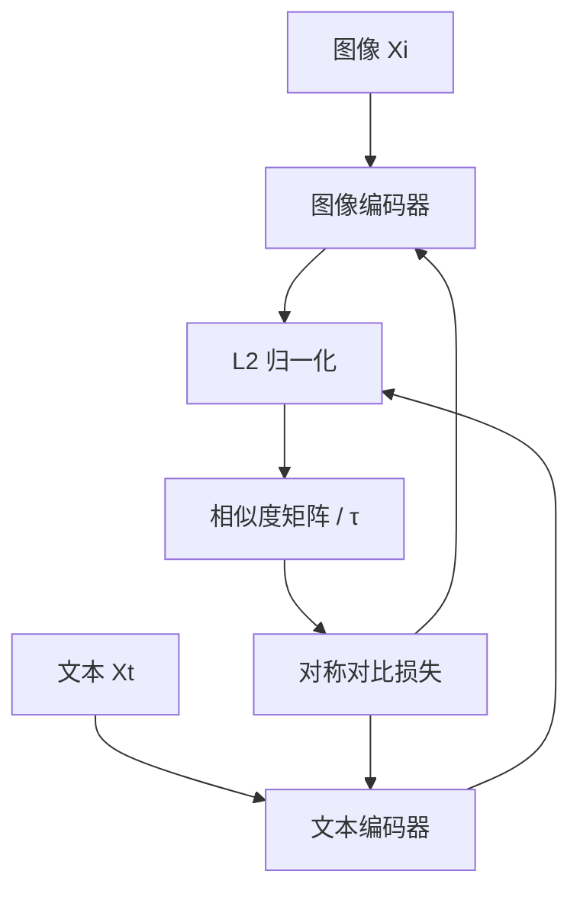
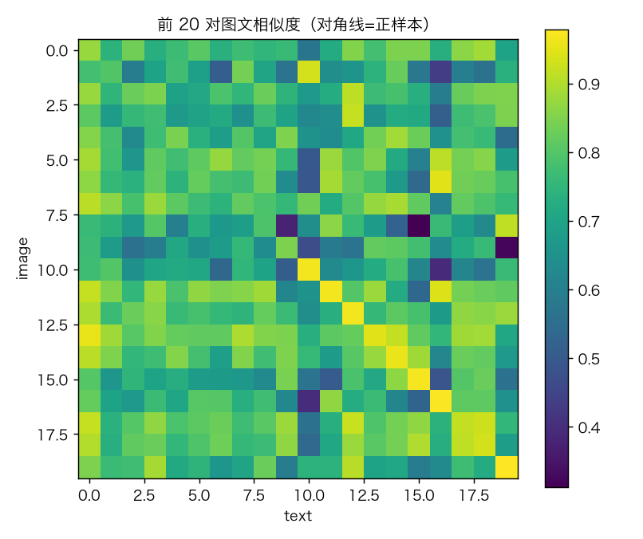
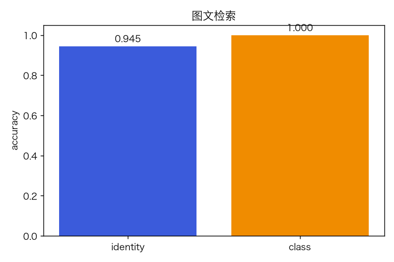
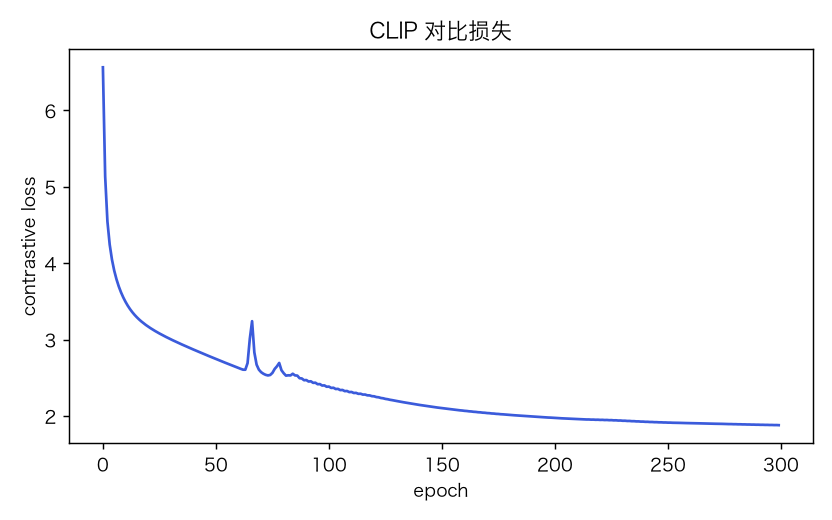
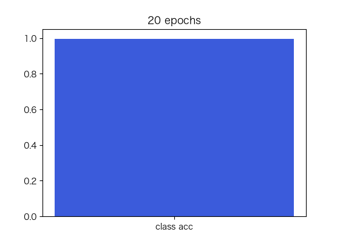

# 多模态 CLIP 式：图文对比学习与检索

> 状态：✅ 已完成（2026-10-23）
> 对应文档章节：`../../docs/人工智能代表算法演进路线.md` 第 5.5 章
> 阅读路线：基础篇 → 进阶篇
> 本族共 6 个实验，见 [族级导读](../README.md)。

深度模型（多模态）：入口是 `CLIP().fit(Xi, Xt)` / `retrieval_accuracy(Xi, Xt, y)` / `similarity`，实现在 [impl.py](impl.py)；对照是无对齐的随机基线。

# 基础篇

## 1. 生活类比：给图片和文字找共同语言

同一张图与它的描述，在向量空间里应该更近；不同图的描述应该更远。CLIP 用对比学习把两个编码器拉到同一空间。

## 2. 核心量：双塔、温度、对称对比损失

- 图像编码器 `I=X_i W_i`，文本编码器 `T=X_t W_t`；
- L2 归一化后，`logits=I Tᵀ/τ`；
- 对称交叉熵：行（图→文）和列（文→图）；
- 检索：`argmax` 相似度的文本/图像。

## 3. 主循环

## 4. 手算示例

`I=[1,0]`，`T1=[1,0]`，`T2=[0,1]`，`τ=.2`：
`logits=[5,0]`，softmax 后正样本概率≈.993；loss≈.007。

## 5. 白话版：为什么温度/负样本重要

- 温度 τ 小 → 分布更尖，正样本拉得更紧，但训练更不稳；
- 负样本（batch 内其他对）提供对比信号；
- 双塔共享空间，才能做跨模态检索；
- 本实验的文本是 200 维 one-hot，图像是 12 维连续特征；合成数据。

## 6. 常见误区

- **❌ "CLIP 能理解任意文字"** —— 只学配对分布。
- **❌ "温度无所谓"** —— τ 影响梯度/难度。
- **❌ "图文检索=图像分类"** —— 开放集合检索。
- **❌ "合成数据能代表真实 CLIP"** —— 不能。
- **❌ "双塔一定对称"** —— 编码器容量/模态难度不同。
- **❌ "对比学习不需要负样本"** —— 会塌缩。

## 7. 看图

## 8. 掌握清单

| 级别 | 能力 | 检验 |
|---|---|---|
| 1 说清 | 复述双塔/τ/对比损失 | 本文 |
| 2 走通 | 手算 softmax/相似度 | 手算示例 |
| 3 判断 | 温度/负样本/塌缩 | 白话版 |
| 4 实现 | 跑 demo | 实验结果 |
| 5 迁移 | 新图文检索 | project |

# 进阶篇

## 目录形态

| 文件 | 角色 |
|---|---|
| [impl.py](impl.py) | 双塔、对比损失、检索 |
| [demo.py](demo.py) | 训练 + identity/class 检索 |
| [test_impl.py](test_impl.py) | 8 个测试 |
| [make_teaching_assets.py](make_teaching_assets.py) | 素材 |
| [exercises/](exercises/README.md) | 5 题 |
| [project/](project/README.md) | 图文检索脚本 |

## 1. 设计原理

两个线性编码器把图像/文本映射到 8–16 维空间；对称 InfoNCE 拉近正对、推远负对。

## 2. 数学推导

`L = -1/N Σ log softmax(I Tᵀ/τ)[i,i]`（对称版再加转置）。
梯度经 L2 归一化反传；`dI=(P-Y)/N/τ @ T`，再减径向分量。

## 3. 手写实现要点

1. L2 归一化 + 反传；
2. 对称/单边损失说明；
3. 温度 τ；
4. one-hot 文本唯一性；
5. 检索指标 identity/class 分开。

## 4. 框架对照

本实验不接 CLIP 模型；对照是随机编码器/无对齐基线。

## 5. 实验结果

200 对，图像 12 维、文本 200 维、嵌入 16：

| 指标 | 值 |
|---|---|
| loss | 6.564 → **1.879** |
| identity 检索 | **0.945** |
| 类别检索 | **1.000** |
| 训练 | 0.07s |

**验证**：2026-10-23 实跑；`pytest` → **8 passed**；素材对账通过。

## 6. 局限与延伸

- 合成特征，不是真实图像/文本；
- 线性双塔，无 CNN/Transformer 编码器；
- 只有检索，无 zero-shot 分类；
- 单温度/单 seed；
- 下游：CLIP 真模型 → 图文生成/多模态 LLM。

**已记录、不阻塞**：合成数据、线性编码器、无 zero-shot。
