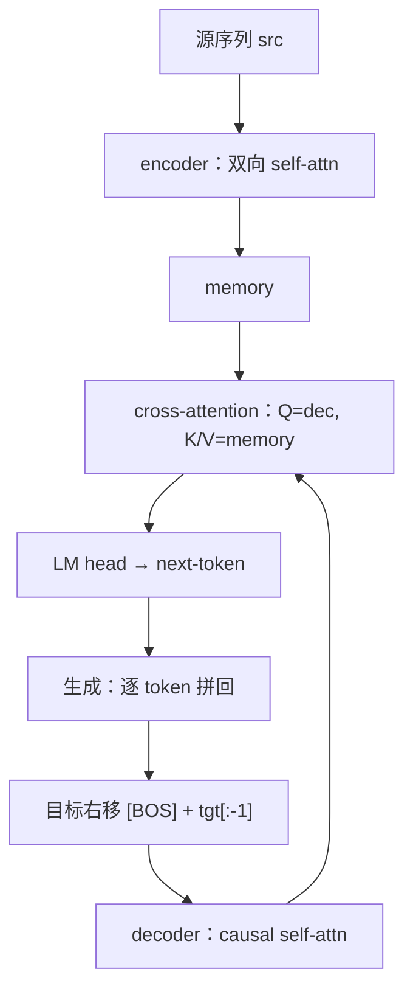
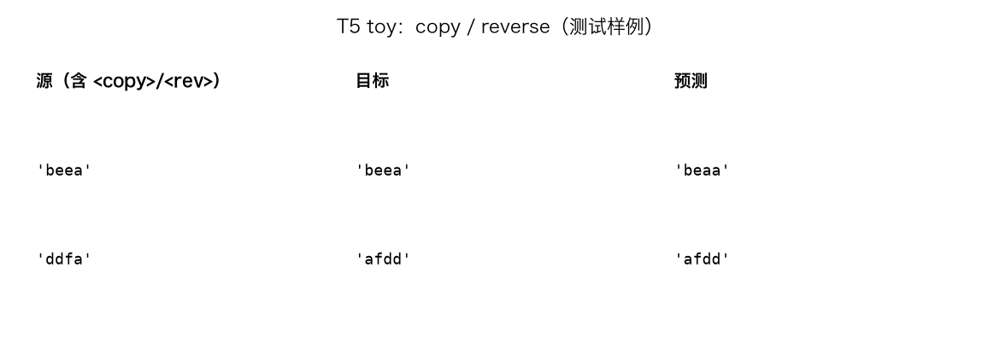
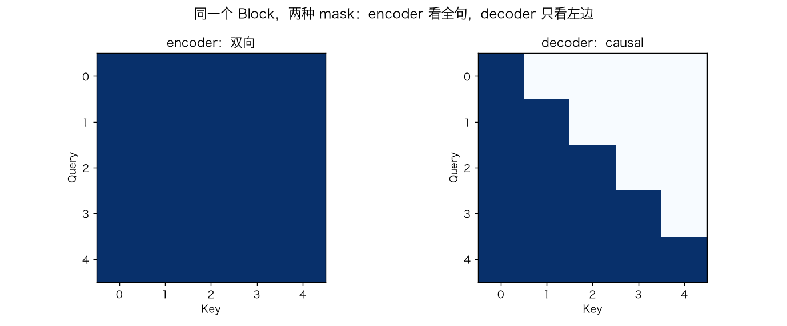
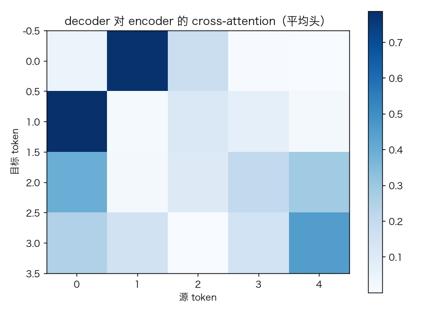
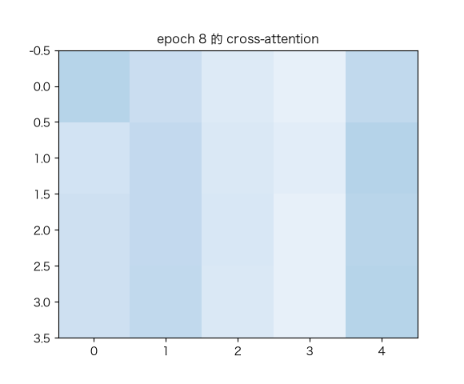

# T5 / 编码器-解码器：双向 encoder + causal decoder + cross-attention

> 状态：✅ 已完成（2026-10-22）
> 对应文档章节：`../../docs/人工智能代表算法演进路线.md` 第 5.3.3 章
> 阅读路线：零基础读者读「基础篇」（生活类比 → 手算 → 白话 → 自测）；要看推导、实现与复现实验读「进阶篇」
> 本族共 5 个实验，学习顺序与计划见 [族级导读](../README.md)。

Encoder-decoder 模型（深度模型 · 生成式）：入口 `T5Toy(vocab_size, src_len, tgt_len).train(pairs)` / `generate(src_ids)`，实现在 [impl.py](impl.py)，对照是 [framework.py](framework.py) 的 PyTorch encoder-decoder。**没有 `fit(X,y)`**：`pairs=(src, decoder_input, target)`，训练目标是 decoder 的 next-token。

## 读之前：T5 是什么、不是什么

- 是 encoder-decoder：encoder 双向读源序列，decoder 因果生成目标序列。
- decoder 比 GPT 多一个 **cross-attention**：Q 来自 decoder，K/V 来自 encoder。
- 本实验只做 toy copy/reverse；不是完整 T5，也不做翻译刷榜。

# 基础篇 · 先搞懂它

## 1. 生活类比：听写 + 复述

老师读一句源序列（encoder 听完、双向理解），学生再逐字写目标序列（decoder 只能看已写部分 + 源序列）。
“看源序列”就是 **cross-attention**：decoder 每写一个字，都去源序列里找相关信息。

## 2. 核心量：encoder、decoder、cross-attention、teacher forcing

- **encoder**：双向 self-attention，输出 `memory`；
- **decoder**：causal self-attention + **cross-attention** + FFN；
- **cross-attention**：`Q=decoder hidden`，`K/V=encoder memory`；
- **teacher forcing**：训练时 decoder 输入用真实目标右移一位，而不是模型自己的预测；
- **生成**：从 `<bos>` 开始，逐步 argmax/采样，直到 `<eos>`。

## 3. 主循环：编码源序列 → 右移目标 → 解码 → 交叉注意力

## 4. 手算示例：两种 mask 与 cross-attention

源长度 4，目标长度 5。

**encoder mask**：全 1（双向），每个源位置看所有源位置。

**decoder self-attn mask**：下三角，第 3 个目标位置只能看 0/1/2/3。

**cross-attention**：decoder 位置 `t` 对 4 个源位置打分，softmax 后加权 `memory`；形状 `(Tgt, Src)`。

若目标 token 正确概率 0.8，单点 CE `-log0.8≈0.223`；5 个位置取平均。

## 5. 白话版：为什么需要 encoder-decoder、cross-attention 怎么工作

- **encoder 双向**：源序列已经完整给出，可以看全句；
- **decoder causal**：生成时不能看未来目标 token；
- **cross-attention**：decoder 每步“回看”源序列，决定当前该抄/该翻哪个词；
- **teacher forcing**：训练并行、稳定；推理只能自回归；
- **copy/reverse**：copy 考“对齐”，reverse 考“重排”；两者共享 encoder，靠任务 token 区分。

## 6. 常见误区

- **❌ "T5 就是 GPT 加 encoder"** —— decoder 多了 cross-attention，训练目标/生成方式也不同。
- **❌ "encoder 也用 causal mask"** —— encoder 双向，causal 只在 decoder self-attn。
- **❌ "cross-attention 的 K/V 来自 decoder"** —— Q 来自 decoder，K/V 来自 encoder memory。
- **❌ "训练和推理一样"** —— 训练 teacher forcing 并行；推理逐 token。
- **❌ "copy 会了就会 reverse"** —— 两个任务需要不同重排能力；本实验用任务 token 区分。
- **❌ "exact 高 = 理解语言"** —— toy 任务只验证结构，不代表翻译能力。

## 7. 看图：样例、mask 与 cross-attention

copy/reverse 测试样例；reverse 需要重排。

encoder 全 1；decoder 下三角。

decoder 的每个位置对源序列的注意力。

训练中 cross-attention 逐渐对齐。

## 8. 掌握清单：五级能力与自测

| 级别 | 能力 | 本实验的检验方式 | 在哪做 |
|---|---|---|---|
| 1 说清 | 用自己的话讲规则 | 说出 encoder/decoder/cross-attn/teacher forcing | 基础篇「核心量」「白话版」 |
| 2 走通 | 纸上手算 | 两种 mask、cross-attn 形状、CE | 基础篇「手算示例」节 |
| 3 判断 | 说清正确性条件 | 解释为什么 encoder 双向、decoder causal | 基础篇「白话版」 |
| 4 实现 | 手写并与对照比对 | 跑通 `demo.py`，copy/reverse exact | 进阶篇「实验结果」 |
| 5 迁移 | 用到新问题 | 训练后做 copy/reverse 生成 | [project/](project/README.md) |

**自测关卡（先预测，再跑代码验证）**：

1. encoder 的 attention mask 是全 1 还是下三角？
2. cross-attention 的 Q/K/V 分别来自哪？
3. 训练时 decoder 输入是什么？
4. reverse 比 copy 难在哪？

# 进阶篇 · 实验档案

## 目录形态（本算法的"类型"）

| 文件 | 角色 | 入口 / 说明 |
|---|---|---|
| [impl.py](impl.py) | 手写实现 | `Vocab`、encoder/decoder、cross-attn、`T5Toy` |
| [framework.py](framework.py) | PyTorch 对照 | `TorchT5`（encoder-decoder） |
| [demo.py](demo.py) | 同数据双跑 | copy/reverse、exact、torch |
| [test_impl.py](test_impl.py) | 性质测试 | 双向/causal/cross、梯度、训练、生成、torch |
| [make_teaching_assets.py](make_teaching_assets.py) | 素材生成 + 对账 | 样例 / mask / cross-attn / GIF |
| [exercises/](exercises/README.md) | 练习（5 题，题解分离） | 概念、手算、诊断、实现、迁移 |
| [project/](project/README.md) | 迁移项目 | copy/reverse 生成 |

## 1. 设计原理

Encoder 双向编码源序列；decoder 用 causal self-attn 生成目标，并用 cross-attn 每步查询 encoder memory。
teacher forcing 让训练可并行；推理逐 token 自回归。copy 考对齐，reverse 考重排。

## 2. 数学推导

**encoder**：`S=QKᵀ/√d_k`，无 causal；`O=softmax(S)V`。

**decoder self-attn**：`scores[t,s]=-1e9` 当 `s>t`。

**cross-attn**：`Q=Y Wq`，`K=MWk`，`V=MWv`；`scores=QKᵀ/√d_k`，无 causal，mask 源 pad。

**loss**：`L=-1/(BT)Σ log p(target_t | target_<t, src)`。

## 3. 手写实现要点

1. **两套 mask**：encoder 全 1，decoder 下三角；不要混。
2. **cross-attn 的 K/V** 来自 encoder memory，不是 decoder。
3. **teacher forcing**：decoder 输入 `[BOS]+target[:-1]`，目标 `target+[EOS]`。
4. **反向**：decoder 反传到 cross-attn 的 K/V，再反传到 encoder。
5. **生成**：从 BOS 开始，逐步 argmax，遇到 EOS 停。
6. **任务 token**：copy/reverse 用 `<copy>/<rev>` 区分，否则同一源有两个目标。

## 4. 框架对照

torch 用 `nn.TransformerEncoderLayer` + `nn.TransformerDecoderLayer`（pre-LN），
手写版自己实现双向/因果 attention、cross-attention 和反传。

| 维度 | 手写 | torch |
|---|---|---|
| encoder | 手写双向 MHA | `TransformerEncoderLayer` |
| decoder | 手写 causal + cross | `TransformerDecoderLayer` |
| 反向 | 手写链式 | autograd |
| 生成 | 手写 greedy | 手写 greedy（对照版） |

torch 300 轮才到 exact 0.935；手写 80 轮 0.980。两者训练预算不同，只比较量级。

## 5. 实验结果

**环境**：uv（`uv sync --extra deep-learning --extra dev`），Python 3.13.15 /
numpy 2.5.4 / torch 2.14.1；CPU。
**数据**：字母表 6、长度 4 的全部序列；700 训练 / 200 测试；copy/reverse 各半；词表 11。
**复现**：本目录内 `uv run python demo.py`、`uv run pytest test_impl.py -q`、
`uv run python make_teaching_assets.py`。

**copy/reverse（手写 80 轮）**

| 指标 | 值 |
|---|---|
| train loss | 2.364 → 0.0016 |
| train token acc | 1.000 |
| test exact | **0.980** |
| copy exact | 0.970 |
| reverse exact | 0.990 |
| 耗时 | ≈2.1s |

**torch 对照（300 轮）**

| 实现 | loss | token acc | exact | 耗时 |
|---|---|---|---|---|
| torch T5 | 0.0004 | 1.000 | 0.935 | ≈3.1s |

**验证声明（已验证）**：输入为上述数据与种子；2026-10-22 在 uv 环境实跑，
`uv run python demo.py` 输出上表；`uv run pytest test_impl.py -q` → **9 passed**；
`uv run python make_teaching_assets.py` 对账通过（test exact >0.9）。

**可视化结论**：

- `images/00-copy-reverse.png`：copy/reverse 样例；
- `images/01-两种mask.png`：encoder 全 1、decoder 下三角；
- `images/02-cross-attention.png`：decoder 对源序列的注意力；
- `images/03-cross生长.gif`：cross-attention 随训练变化。

## 6. 局限与延伸

- **toy copy/reverse**：只验证结构，不代表翻译/摘要能力。
- **单层 encoder/decoder**：没有堆叠；深层未验证。
- **字符级**：没有 BPE/SentencePiece。
- **训练/测试序列来自同一分布**：6^4 全枚举；不是自然语言泛化。
- **torch 对照预算不同**：手写 80 轮 vs torch 300 轮；只比较量级。
- **没有 beam search/长度惩罚**：只用 greedy。
- **没有 T5 全量预训练/多任务**：与真实 T5 差距很大。

**已记录、不阻塞**：

- **copy/reverse exact 0.980**：仍有 2% 失败，主要是 reverse 边界样例。
- **单层 + toy 数据**：不能外推到真实 seq2seq。
- **greedy only**：没有 beam search/采样。
- **训练/测试同分布**：全枚举序列，泛化要求低。
- **torch exact 0.935**：训练预算/初始化不同，保留负面结果。

**本次修复的阻塞问题**：

- `generate` 源序列长度不对、`max_steps<1`、`src` token 越界：现在都显式报错，不再走到 broadcast/IndexError。
- `forward` 的 `tgt_in` 为空、`src` 长度不对、token 越界：现在都显式校验。
- `src_len/tgt_len=0`、空 `pairs`：构造/训练时拒绝。

**补充的非阻塞边界**：

- **`generate` 只有 greedy**：没有 beam search、长度惩罚、重复惩罚。
- **`generate` 的 `vocab` 参数未使用**：只是为了接口兼容；解码由调用方自己做。
- **固定源/目标长度**：没有变长 padding、target mask。
- **单层 encoder/decoder**：没有堆叠。
- **全 batch 训练**：没有 mini-batch/梯度累积。
- **torch 对照 300 轮 vs 手写 80 轮**：预算不同，exact 0.935 只是量级参考。
- **exact 0.980 仍有 2% 失败**：边界样例（如 copy 的 `beea→beaa`）。
