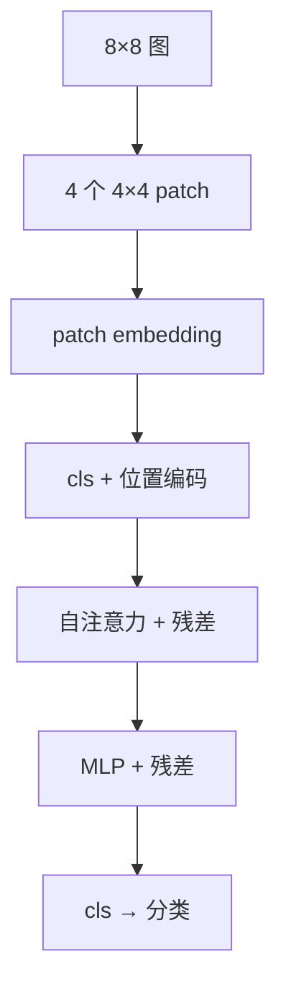
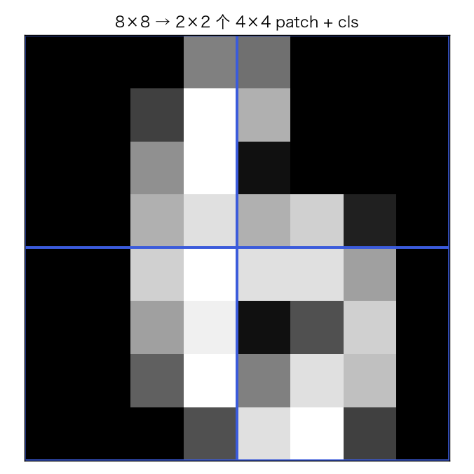
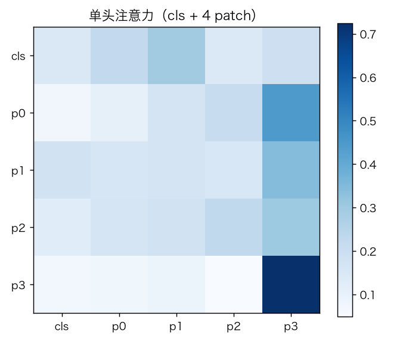
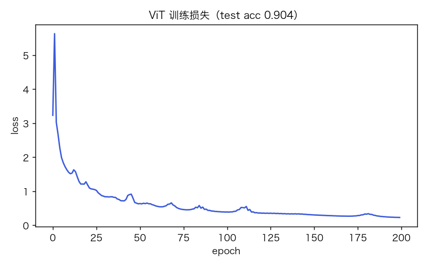
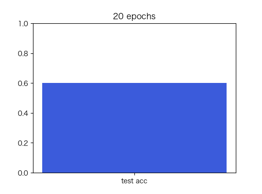

# ViT-lite：patch embedding + 自注意力图像分类

> 状态：✅ 已完成（2026-10-23）
> 对应文档章节：`../../docs/人工智能代表算法演进路线.md` 第 5.4 章
> 阅读路线：基础篇 → 进阶篇
> 本族共 7 个实验，见 [族级导读](../README.md)。

深度模型（判别式）：入口是 `ViT(d).fit(X, y)` / `predict(X)`，实现在 [impl.py](impl.py)；对照是展平像素 + 逻辑回归（`baseline.py`）。

# 基础篇

## 1. 生活类比：把图切成拼图，再看哪块和哪块有关

8×8 图切成 4 个 4×4 patch，每个 patch 变成一个 token；cls token 汇总全局信息做分类。

## 2. 核心量：patch、token、Q/K/V、注意力

- patch：4 个 4×4 块，每块 16 维；
- token：`patch @ E` + 位置编码，再加 cls；
- `Q=Z Wq, K=Z Wk, V=Z Wv`；
- `Attention=softmax(QKᵀ/√d)V`；
- 分类：cls token 过线性层。

## 3. 主循环

## 4. 手算示例

`Q=[[1,0]]`，`K=[[1,0],[0,1]]`，`d=2`：scores=`[0.707,0]`；softmax≈`[.67,.33]`；
输出≈`.67 V1 + .33 V2`。

## 5. 白话版：ViT 与 CNN 的区别

- CNN 局部卷积、平移等变；ViT 全局注意力、patch 间直接交互。
- 小数据上 ViT 通常不如 CNN；本实验 8×8 digits 只有 1257 训练样本。
- 本实现是 **ViT-lite**：单头、1 block、无 LayerNorm；不是标准 ViT。
- 没有预训练/大规模数据，不能代表 ViT 的真实能力。

## 6. 常见误区

- **❌ "ViT 一定比 CNN 好"** —— 小数据常相反。
- **❌ "patch 越大越好"** —— 粒度/序列长度权衡。
- **❌ "注意力可解释"** —— 注意力权重≠因果解释。
- **❌ "ViT-lite=标准 ViT"** —— 单头/无 LN/1 block。
- **❌ "没有位置编码也行"** —— 丢失空间顺序。
- **❌ "8×8 能代表 ImageNet"** —— 不能。

## 7. 看图

## 8. 掌握清单

| 级别 | 能力 | 检验 |
|---|---|---|
| 1 说清 | 复述 patch/attention | 本文 |
| 2 走通 | 手算注意力 | 手算示例 |
| 3 判断 | ViT vs CNN/小数据 | 白话版 |
| 4 实现 | 跑 demo | 实验结果 |
| 5 迁移 | 新图分类 | project |

# 进阶篇

## 目录形态

| 文件 | 角色 |
|---|---|
| [impl.py](impl.py) | patch embedding、单头注意力、反向 |
| [demo.py](demo.py) | digits 训练/评估 |
| [test_impl.py](test_impl.py) | 8 个测试 |
| [make_teaching_assets.py](make_teaching_assets.py) | 素材 |
| [exercises/](exercises/README.md) | 5 题 |
| [project/](project/README.md) | 小图分类 |

## 1. 设计原理

图像 → patch token → 自注意力 → cls 分类；本实现手写全部矩阵梯度。

## 2. 数学推导

`Z0=[cls; patches]E+pos`；`S=QKᵀ/√d`；`P=softmax(S)`；`Z1=Z0+P V Wo`；
`Z2=Z1+ReLU(Z1W1)W2`；`logits=Z2[:,0]Wc`。
反向：softmax `dS=P(dP-ΣdP·P)`，再回传 Q/K/V。

## 3. 手写实现要点

1. patch 切分无重叠；
2. cls + 位置编码；
3. 单头注意力；
4. 手写 softmax 反向；
5. 无 LN，训练更敏感（lr 大易 NaN）。

## 4. 框架对照

本实验未接 `nn.Transformer`；CNN 对照见 p03 `cnn-lenet`。

## 5. 实验结果

8×8 digits，1257 训练 / 540 测试，d=64，200 轮：

| 项 | 值 |
|---|---|
| loss | 3.233 → **0.231** |
| 测试 acc | **0.904**（逻辑回归基线 0.970） |
| 训练 | 3.6s |

**验证**：2026-10-23 实跑；`pytest` → **8 passed**；素材对账通过。

## 6. 局限与延伸

- ViT-lite：单头、1 block、无 LayerNorm；
- 小数据，CNN 可能更强；
- 无预训练/数据增广；
- 训练对 lr 敏感（0.2 会 NaN）；
- 下游：标准 ViT/DeiT/Swin → 检测/分割。

**已记录、不阻塞**：toy ViT、小数据、无 LN/预训练。
