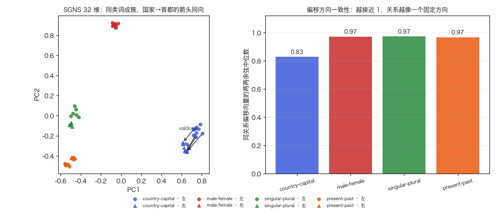
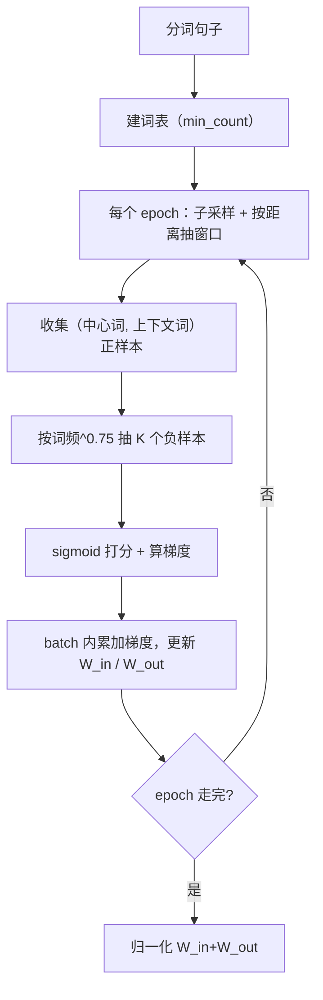
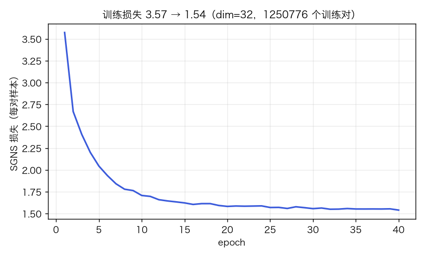
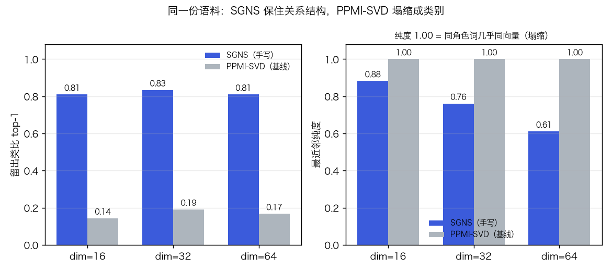
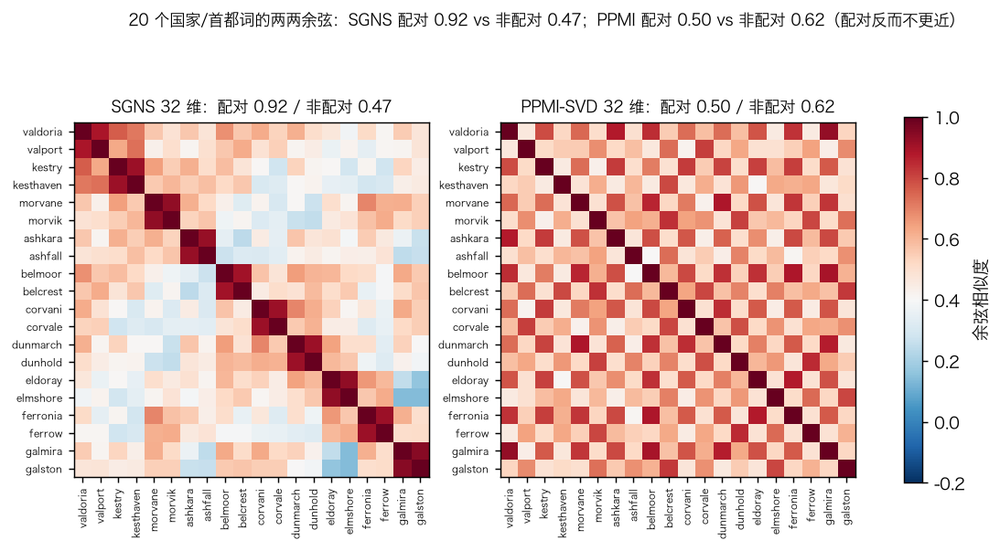
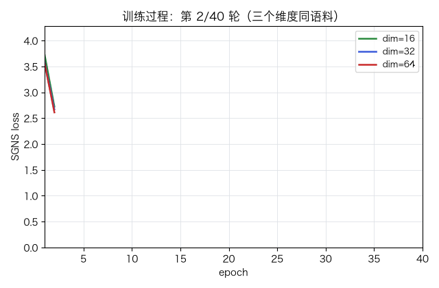

# 词向量：skip-gram 与负采样（word2vec）

> 状态：✅ 已完成（2026-10-26）
> 对应文档章节：`../../docs/人工智能代表算法演进路线.md` 第 5.3.1 章
> 阅读路线：基础篇 → 进阶篇

无监督估计器（词嵌入）：入口 `SkipGramNS().fit(sentences)`（别名 `.train`，**没有 y**）/ `.vectors` / `.analogy`，见 [impl.py](impl.py)；对照是 PPMI + 截断 SVD（[baseline.py](baseline.py)）。

# 基础篇

## 1. 生活类比：谁常和谁一起出现，谁就是一类

只看句子、不看标签，把词压成向量，让常在同一上下文出现的词靠近。语料是**合成语料
（非真实语料）**：模板生成国家-首都、男-女、单-复数、现在-过去四组关系加填充句，
词的"含义"由模板决定，不是真实语义。

## 2. 核心量：中心词、上下文、负样本、两张矩阵

- 中心词 c / 上下文 o：窗口内的一对词，如「capital…valport」；
- `W_in` (V×d) 是中心词向量 `v_c`，`W_out` (V×d) 是上下文向量 `u_o`（V=94）；
- 负样本 k：随机抽的 K 个「不该是上下文」的词。

目标：正样本 `σ(u_o·v_c)` 接近 1、负样本接近 0；词向量取 `l2_normalize(W_in+W_out)`。



## 3. 主循环



## 4. 手算示例

dim=2，`v_a=[1,0]`、`u_b=[0,1]`、`u_c=[1,0]`、`u_d=[0.5,0.5]`；正样本 (a,b)，负样本 c、d，
学习率 0.1，更新一次：

| 项 | 内积 | σ | 梯度 |
|---|---|---|---|
| (a,b) | 0 | 0.500 | −0.500 |
| (a,c) | 1 | 0.731 | +0.731 |
| (a,d) | 0.5 | 0.622 | +0.622 |

`v_a ← [1,0] − 0.1·(−0.5·u_b + 0.731·u_c + 0.622·u_d) = [0.8958, 0.0189]`；
`u_b ← [0.05,1]`、`u_c ← [0.9269,0]`、`u_d ← [0.4378,0.5]`。正样本拉近、负样本推远。

## 5. 白话版：为什么它是对的

**能预测相同上下文的词，意思相近。** 点积当预测分数，梯度把「上下文相似」的词推近；
负采样提供对比压力——没有它，把词拉成一团就能刷高正样本得分，向量失去区分度。
边界：一词只有一个向量，表达不了「同词不同义」，这正是 5.3.2 的 ELMo/BERT 要解决的
问题（见 [bert](../bert/)）。

## 6. 常见误区

- **❌「词向量 = 词义」「类比 = 推理」** —— 前者是共现统计的低秩压缩，后者只是向量加减
  恰好落在目标附近。
- **❌「负采样越多越好」** —— K 从 5 加到 15，留出类比反而下降。
- **❌「最近邻纯度 100% 就是好表示」** —— 基线纯度满分，但同角色词几乎同向量（塌缩）、
  类比接近随机；**纯度可以靠塌缩刷出来**。
- **❌「只用 `W_in` 就行」** —— 只取一半矩阵，关系方向基本消失。

## 7. 看图









训练过程：dim=16/32/64 的 SGNS loss 同步下降（时间维度）。

左图相邻两词（一对国家/首都）形成亮块；右图**配对词的余弦反而不比非配对高**——
PPMI-SVD 丢掉的正是「谁配谁」。

## 8. 掌握清单

| 级别 | 能力 | 检验方式 |
|---|---|---|
| 1 说清 | 说出核心量与目标函数 | 复述并解释负采样省了什么 |
| 2 走通 | 手算一步 SGD | 「手算示例」四项新值独立重算 |
| 3 判断 | 说出失效边界 | 举「纯度满分但类比随机」的例子 |
| 4 实现 | 跑通 demo 并解释基线差异 | 复现「实验结果」的数字 |
| 5 迁移 | 把向量接成检索服务 | [project/](project/README.md) 的验收 |

# 进阶篇

## 目录形态

| 文件 | 角色 |
|---|---|
| [impl.py](impl.py) | 手写 SGNS（skip-gram + 负采样） |
| [baseline.py](baseline.py) | PPMI + 截断 SVD 基线 |
| [demo.py](demo.py) | 三个维度双跑 + 类比/纯度/耗时 |
| [test_impl.py](test_impl.py) / [make_teaching_assets.py](make_teaching_assets.py) | 12 个测试 / 4 图 + 1 GIF 对账 |
| [exercises/](exercises/README.md) / [project/](project/README.md) | 6 题 / 关系检索服务 |

## 1. 设计原理

5.3.1 要解决 one-hot 稀疏与「词间没有距离」：Word2Vec 用「预测上下文」把 V 维稀疏
向量压成 d 维稠密向量，关键是把「V 分类 softmax」换成「1 正 + K 负的二分类」。
本实验只做 SGNS，对照是同窗口的 PPMI-SVD。

## 2. 数学推导

```text
J = -log σ(u_o·v_c) - Σ_{k=1..K} log σ(-u_k·v_c)
∂J/∂v_c = (σ(u_o·v_c) - 1)·u_o + Σ_k σ(u_k·v_c)·u_k
∂J/∂u_o = (σ(u_o·v_c) - 1)·v_c,   ∂J/∂u_k = σ(u_k·v_c)·v_c
```

正样本梯度为负（拉近），负样本为正（推远）。V=94、K=5 时每对 6 次内积；
40 个 epoch 共 **1,250,776** 个训练对 ≈ 7.5×10⁶ 次打分，全词表 softmax 是 94 倍。
SGNS 隐式分解「平移后的 PMI 矩阵」（Levy & Goldberg 2014），所以同窗口的 PPMI-SVD
是有意义的对照。

## 3. 手写实现要点

1. **句边界**：语料拼一维数组 + `sent_id`，只有同句位置才成对，否则窗口跨句「读串」；
2. **动态窗口 + 子采样**：每位置独立抽 1..window；高频词按 `(√(t/f)+1)·t/f` 丢弃
   （小语料取 `t=1e-2`，默认 1e-3 会丢掉大部分 token）；
3. **负采样表**：`count^0.75` 累积分布 + `searchsorted`，比 `rng.choice(p=…)` 快；
4. **批均值梯度**：每批 512 对基于同一份参数快照算梯度、`np.add.at` 累加后更新，
   等价于逐对学习率 `lr/batch`，比逐对 SGD 快一个量级；
5. **向量取 `W_in+W_out`**：单个矩阵留出类比大幅下降，相加最好（见「实验结果」）；
6. `sigmoid` 输入裁剪到 ±30，避免 `exp` 溢出。

## 4. 基线对照

PPMI-SVD 与 SGNS 吃同一份语料、同一窗口（距离加权 1/d），上下文分布 α=0.75 平滑，
再用 `TruncatedSVD` 取前 d 个奇异向量。差异原因：

- **塌缩**：所有国家共享同一套模板，PPMI 行几乎相同；截断后同侧词余弦接近 1，
  配对信息被抹平——纯度满分、类比接近随机；
- **训练方式**：SVD 一次得到低秩全局最优，但对「类比」没有偏好；SGNS 的逐批 SGD
  把配对词拉到最近邻，反而保住了关系；
- **速度**：SVD 0.0s 级、SGNS 2.2s，手写版慢在 Python 循环与 `np.add.at`。

## 5. 实验结果

环境：Python 3.13 / numpy 2.5.4 / sklearn 1.9.1，`seed=0`；语料 3916 句 / 33262 token /
词表 94；40 epoch；138 开发 + 42 留出类比题（3CosAdd top-1）。

| dim | 方法 | 留出类比 | 开发类比 | 最近邻纯度 | 同侧余弦 | 耗时 |
|---|---|---|---|---|---|---|
| 16 | SGNS | **0.810** | 0.812 | 0.882 | 0.876 | 1.3s |
| 16 | PPMI-SVD | 0.143 | 0.145 | 1.000 | 1.000 | 0.0s |
| 32 | SGNS | **0.833** | 0.870 | 0.761 | 0.721 | 2.2s |
| 32 | PPMI-SVD | 0.190 | 0.174 | 1.000 | 0.869 | 0.0s |
| 64 | SGNS | **0.810** | 0.884 | 0.611 | 0.647 | 3.7s |
| 64 | PPMI-SVD | 0.167 | 0.152 | 1.000 | 0.742 | 0.0s |

SGNS 损失 3.57 → 1.54；消融：`negative` 0/1/5/15 → 0.619/0.762/0.833/0.786，
均匀负采样 0.810，3CosMul 0.714（3CosAdd 0.833）。维度升高类比不升、纯度反降——
高维把「配对身份」写得更细，类别邻域被配对词挤占。

**复现**（在 `algorithms/` 下用 `.venv/bin/python`）：

```bash
cd p04-transformer/word-vectors
../../.venv/bin/python demo.py                    # 上表
../../.venv/bin/python -m pytest test_impl.py -q   # 12 passed
../../.venv/bin/python make_teaching_assets.py     # 4 图 + 1 GIF + 数字对账
../../.venv/bin/python project/search.py           # A/B/C 三项验收
```

**验证声明**：2026-10-26 本机实跑以上四条命令；pytest 12 passed；素材脚本对账通过；
`project/search.py` 退出码 0。耗时随机器浮动，指标是确定性数字。

## 6. 局限与延伸

- **一词一向量**：无法处理多义词，这是 5.3.1 的固有边界，走向 [bert](../bert/)；
- **合成语料**：词表 94、模板决定语义，任何数字都不能外推到真实语料；
- **留出的是题不是词**：OOV 无法参与点积，类比只能按「关系对组合」切分测试题（3:1）；
- **批 SGD 的取舍**：`batch=512` 快但噪声小，细粒度关系最弱（`project` 里时态补全 0/6）；
- **纯度与类比的矛盾**：塌缩能刷高纯度却毁掉类比，评估必须两个一起看；
- **延伸**：GloVe、FastText（子词缓解 OOV）、句向量/对比学习。
