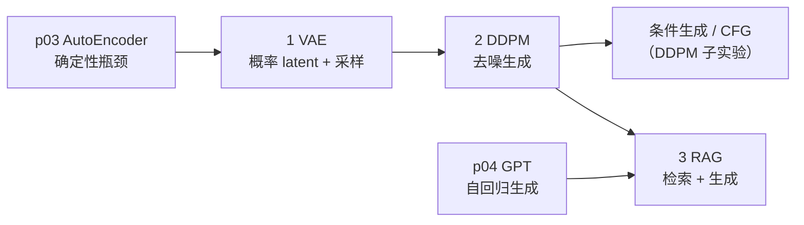

# p05-generative · 生成式 AI

> 状态：**0/3 完成（骨架）**
> 对应路线：`../docs/人工智能代表算法演进路线.md`（4.5 / 6.3 / 8.1）
> 族内顺序：VAE → DDPM（含条件生成/CFG 子实验）→ RAG
> 本族 3 个实验，占全仓库 31 个实验中的 3 个；逐实验入口见 [`algorithms/README.md`](../README.md)。

## 1. 这个族在讲什么

p03 的 AutoEncoder 能“压缩 + 重构”，p04 的 GPT 能“自回归生成”。
p05 补三条不同的生成路线：

- **VAE**：显式概率 latent，能采样、能插值；
- **DDPM**：从噪声逐步去噪，现代图像生成的主线；
- **RAG**：不改模型权重，把外部知识检索进上下文再生成。

三者不是同一算法的三个变体，而是**三种生成/增强范式**。

## 2. 三个实验一览

| # | 实验 | 章节 | 默认数据 | 核心 | 接口形态 | 状态 |
|---|---|---|---|---|---|---|
| 1 | [VAE](vae/) | 4.5 | digits 8×8 / 2D latent | 重参数化、ELBO、KL、采样/插值 | **模型**：`train(X)` / `sample` / `reconstruct` | ⬜ |
| 2 | [DDPM](mini-diffusion/) | 6.3 | digits 8×8 | 前向加噪、反向去噪、采样 | **模型**：`train(X)` / `sample` | ⬜ |
| 3 | [RAG](mini-rag/) | 8.1 | 小型文档/问答 | 检索 → 上下文 → 生成 | **流水线**：`index(docs)` / `query(q)` | ⬜ |

### DDPM 内的条件生成子实验（不单开目录）

DDPM 主线是**无条件**去噪；在同一目录内增加一个条件生成子实验：

1. **class-conditional DDPM**：噪声预测网络输入 `(x_t, t, y)`，`y` 为类别；
2. **CFG（classifier-free guidance）**：训练时以一定概率把 `y` 置空，学条件/无条件两套预测；
3. 采样时：

   ```text
   ε = ε_uncond + w · (ε_cond − ε_uncond)
   ```

   `w=0` 退化为无条件，`w=1` 为标准条件，`w>1` 强化条件；
4. **对照**：`w ∈ {0, 1, 3, 7}` 的类别一致性 / 多样性 / 视觉网格。

> 这是 DDPM 的“条件生成”章节，不是第 4 个实验目录；状态跟 DDPM 一起记。

## 3. 依赖链



- **AE → VAE**：从“能重构”到“能按先验采样”；
- **VAE → DDPM**：从显式 latent 到“噪声 → 去噪”的生成；
- **GPT/DDPM → RAG**：生成模型 + 外部知识检索；
- RAG 不是训练新生成模型，而是应用流水线。

## 4. VAE 与 p03 AutoEncoder 的边界

| 维度 | AutoEncoder（p03） | VAE（p05） |
|---|---|---|
| latent | 确定性 `z=f(x)` | 分布 `q(z|x)=N(μ,σ²)` |
| 目标 | 重构 MSE | ELBO = 重构 + KL |
| 采样 | 不能直接采样 | 从先验 `N(0,I)` 采样 |
| 插值 | latent 可能不连续 | 先验约束使插值更平滑 |
| 用途 | 压缩/去噪/表示 | 生成/插值/概率表示 |

> VAE 不是“带噪声的 AE”；关键是**变分下界 + 重参数化 + 先验**。

## 5. 数据与环境（离线优先）

| 实验 | 默认数据 | 说明 |
|---|---|---|
| VAE | digits 8×8（1797 张） | 2D latent 可视化；CPU |
| DDPM | digits 8×8 | 小 UNet/MLP 去噪；CPU；条件子实验用类别标签 |
| RAG | 小型离线文档 + 问题 | TF-IDF/小 embedding 检索；不依赖外部 API |

- 手写实现用 **numpy**；`torch` 只用于 `framework.py` 对照；
- 默认 CPU；每个 demo 控制在 2–3 分钟；
- 默认模型：`d_model=32/64`、latent=2/8、diffusion steps=100–200。

## 6. Phase 0–4 计划

| 阶段 | 内容 | 交付 | 状态 |
|---|---|---|---|
| **Phase 0** | 族级导读、VAE/AE 边界、DDPM 条件子实验、RAG 定位 | 本文件 + 三个骨架 | ✅ 本版完成 |
| Phase 1 | VAE：重参数化、ELBO、KL、2D latent、采样/插值 | 实现 + 测试 + 素材 + 练习/项目 | ⬜ |
| Phase 2 | DDPM：前向/反向、去噪、采样；条件生成/CFG 子实验 | 实现 + 测试 + 条件对照 + 素材 | ⬜ |
| Phase 3 | RAG：索引、检索、上下文、生成、引用 | 流水线 + 测试 + 评估 + 项目 | ⬜ |
| Phase 4 | p05 阶段成熟度评估 | 成本/质量/边界/遗留 | ⬜ |

## 7. 每个实验的交付标准

- README：基础篇 8 节 + 进阶篇六段 + 五级清单；
- 测试：形状、重参数化/梯度、ELBO/KL、采样、契约；
- 素材：3 PNG + 1 GIF（重构/采样/插值/去噪过程）；
- 练习 5 题（题解分离）；
- 1 个迁移项目；
- 验证声明：环境、数据、种子、命令、结果。

## 8. 范围边界

**做**：VAE、DDPM、class-conditional DDPM + CFG、小型 RAG。

**不做**（只作延伸）：

- Stable Diffusion / Latent Diffusion / ControlNet / T2I-Adapter；
- 文本到图像的大规模训练、CLIP/多模态；
- LLM 对齐（SFT/RLHF/DPO）、Agent/工具调用；
- 大规模向量库/分布式推理/生产部署。

## 9. 状态与后续

- 当前 **0/3**，三个实验仍是骨架；本版只完成 Phase 0；
- 下一步：Phase 1 VAE（先做概率 latent，再讲采样/插值）；
- 每完成一个实验，同步本表、[`algorithms/README.md`](../README.md) 索引与根 README 计数。
