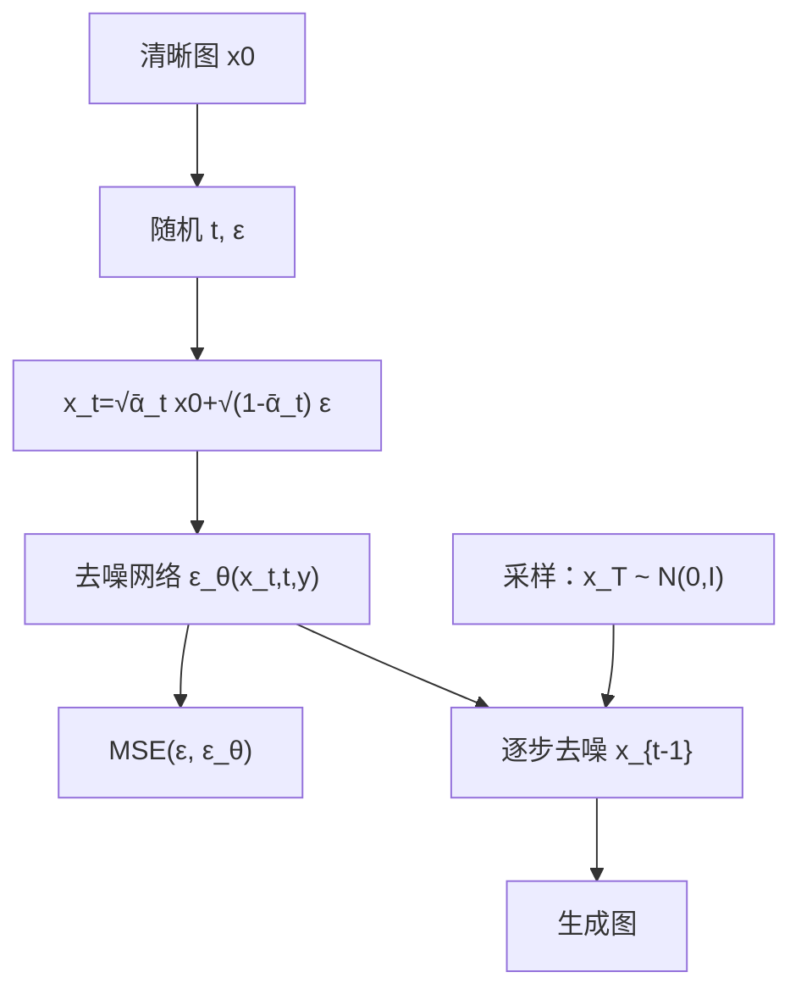
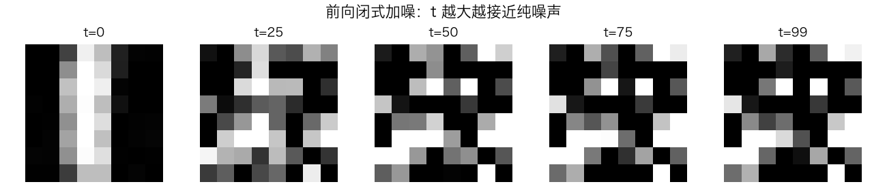
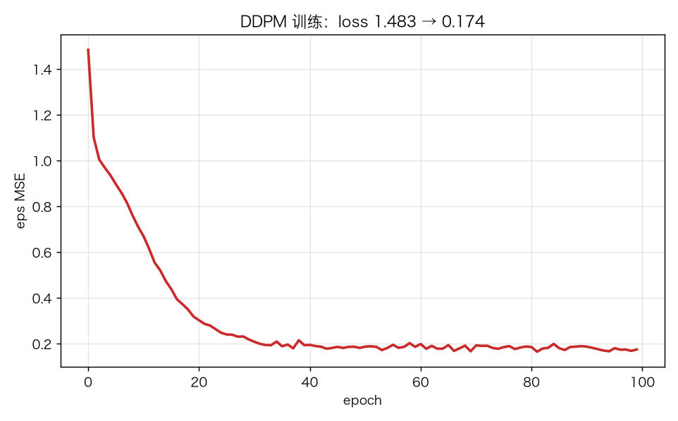
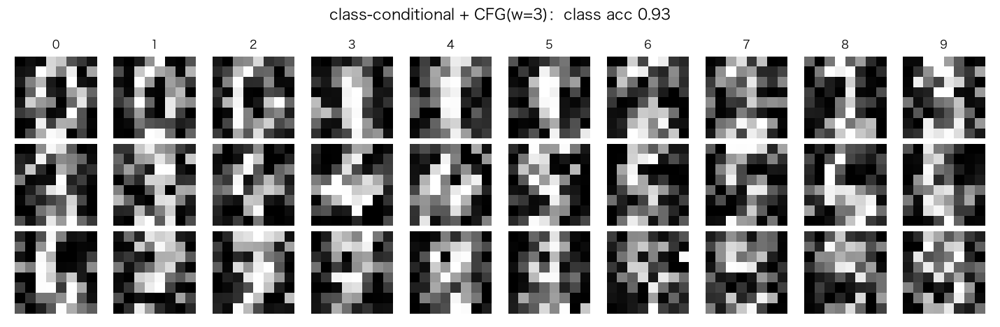
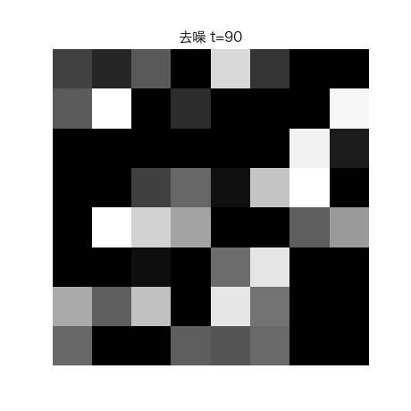

# 迷你扩散模型 DDPM：前向加噪、反向去噪与 CFG

> 状态：✅ 已完成（2026-10-23）
> 对应文档章节：`../../docs/人工智能代表算法演进路线.md` 第 6.3 章
> 阅读路线：零基础读者读「基础篇」（生活类比 → 手算 → 白话 → 自测）；要看推导、实现与复现实验读「进阶篇」
> 本族共 3 个实验，学习顺序与计划见 [族级导读](../README.md)。

生成模型（深度模型 · 生成式）：入口 `DDPM(n_steps, num_classes).train(X, y)` / `q_sample(X0,t,noise)` / `sample(n, labels, guidance)`；实现在 [impl.py](impl.py)，对照是 [framework.py](framework.py) 的 PyTorch DDPM。**没有 `fit(X,y)`**：训练目标是预测自己加进去的噪声。

## 读之前：DDPM 与 VAE/GPT 的边界

- VAE 一步解码；DDPM **多步去噪**，从纯噪声逐步恢复；
- GPT 自回归逐 token；DDPM 在像素空间逐步去噪；
- 条件生成不是另一个模型：在去噪网络里加类别嵌入，再用 **CFG** 调条件强度。

# 基础篇 · 先搞懂它

## 1. 生活类比：从一团雾里“擦”出数字

先给清晰图不断加噪，直到变成一团噪声；再训练一个网络，学会“每一步该擦掉多少噪声”。
生成时从纯噪声开始，反复问网络“这一步的噪声是什么”，擦掉一点，重复 100 次。

## 2. 核心量：beta、alpha_bar、q_sample、eps 预测、CFG

**前向闭式**：

$$x_t=\sqrt{\bar\alpha_t}x_0+\sqrt{1-\bar\alpha_t}\epsilon$$

**训练目标**：随机 `t`、随机 `ε`，让网络预测 `ε`：

$$L=\|\epsilon-\epsilon_\theta(x_t,t)\|^2$$

**反向均值**（由预测的 `x0` 推出）：

$$\mu_t=\frac{\sqrt{\bar\alpha_{t-1}}\beta_t}{1-\bar\alpha_t}x_0+
\frac{\sqrt{\alpha_t}(1-\bar\alpha_{t-1})}{1-\bar\alpha_t}x_t$$

**CFG**：

$$\epsilon=\epsilon_{uncond}+w(\epsilon_{cond}-\epsilon_{uncond})$$

`w=0` 无条件，`w=1` 标准条件，`w>1` 强化条件。

## 3. 主循环：加噪 → 预测 eps → 去噪采样

## 4. 手算示例：一步加噪与后验均值

设 `beta=[0.0001,0.0002]`，`alpha=[0.9999,0.9998]`，`alpha_bar=[0.9999,0.9997]`。

`t=1`、`x0=0.5`、`ε=1`：

`x1=√0.9997·0.5+√0.0003·1≈0.517`。

反向若预测 `ε_hat=0.8`，先算 `x0_hat=(x1-√(1-ᾱ1)·0.8)/√ᾱ1`，再代入后验均值；`t=0` 不加噪声。

## 5. 白话版：为什么能一步加噪、为什么预测 eps、CFG 在调什么

- **闭式加噪**：高斯加噪可组合，`q(x_t|x_0)` 一步到位，训练不必循环 t 次。
- **预测 eps**：从 `x_t` 推 `x0` 需要 `ε`；预测 `ε` 等价于学习去噪方向，数值更稳。
- **CFG**：训练时随机丢条件（10%），让同一个网络同时会条件/无条件；采样时用差值放大条件。
- **w 的代价**：w 太大画面更“像目标类”，但多样性/自然度可能下降；本实验 w=7 已接近饱和。

## 6. 常见误区

- **❌ "DDPM 是一步生成"** —— 采样要跑 `n_steps` 次网络。
- **❌ "训练要循环加噪 t 次"** —— 用闭式 `q_sample` 一步到 `x_t`。
- **❌ "预测 x0 比预测 eps 好"** —— 两种参数化都可，预测 eps 是 DDPM 的常用化简。
- **❌ "CFG 是另一个模型"** —— 同一个网络，训练时条件 dropout，采样时组合。
- **❌ "w 越大越好"** —— 条件更强但多样性/自然度下降；要扫描。
- **❌ "分类器 acc 高 = 生成质量高"** —— 只是类别一致性代理；还要看视觉/FID。

## 7. 看图：加噪、训练、条件生成与去噪

`t` 越大越接近纯噪声。

eps MSE 从 1.483 降到 0.174。

class-conditional + CFG(w=3)；分类器 acc 0.91，但视觉仍是模糊块。

从纯噪声逐步去噪。

## 8. 掌握清单：五级能力与自测

| 级别 | 能力 | 本实验的检验方式 | 在哪做 |
|---|---|---|---|
| 1 说清 | 用自己的话讲规则 | 说出闭式加噪、eps 目标、反向均值、CFG | 基础篇「核心量」「白话版」 |
| 2 走通 | 纸上手算 | 一步 `q_sample`、后验均值 | 基础篇「手算示例」节 |
| 3 判断 | 说清正确性条件 | 解释闭式、eps 参数化、w 权衡 | 基础篇「白话版」+ 实验三 |
| 4 实现 | 手写并与对照比对 | 跑通 `demo.py`，loss 下降/采样有限 | 进阶篇「实验结果」 |
| 5 迁移 | 用到新问题 | 条件生成 + CFG 扫描 | [project/](project/README.md) |

**自测关卡（先预测，再跑代码验证）**：

1. 训练时为什么要随机 `t`？
2. 为什么 `q_sample` 可以一步到位？
3. CFG 的 `w=0` 和 `w=3` 有什么区别？
4. 采样为什么比训练慢？

# 进阶篇 · 实验档案

## 目录形态（本算法的"类型"）

| 文件 | 角色 | 入口 / 说明 |
|---|---|---|
| [impl.py](impl.py) | 手写实现 | `DDPM`、`Denoiser`（时间/类别嵌入）、CFG 采样 |
| [framework.py](framework.py) | PyTorch 对照 | `TorchDenoiser` + 采样 |
| [demo.py](demo.py) | 同数据双跑 | 训练 / 无条件 / CFG / torch |
| [test_impl.py](test_impl.py) | 性质测试 | 调度、q_sample、训练、采样、CFG、契约 |
| [make_teaching_assets.py](make_teaching_assets.py) | 素材生成 + 对账 | 加噪 / 曲线 / 条件生成 / GIF |
| [exercises/](exercises/README.md) | 练习（5 题，题解分离） | 概念、手算、诊断、实现、迁移 |
| [project/](project/README.md) | 迁移项目 | 条件生成 + CFG |

## 1. 设计原理

DDPM 用固定前向马尔可夫链把数据变成噪声，再学反向链从噪声恢复。
训练只学“预测噪声”，采样反复应用反向一步；条件生成用类别嵌入 + CFG。

## 2. 数学推导

**前向**：`q(x_t|x_0)=N(√ᾱ_t x0,(1-ᾱ_t)I)`。

**训练**：`L=||ε-εθ(√ᾱ_t x0+√(1-ᾱ_t)ε,t)||²`。

**反向均值**：见基础篇公式；方差 `β_t(1-ᾱ_{t-1})/(1-ᾱ_t)`。

**CFG**：训练时 `y` 以 10% 置空；采样 `ε=ε_uncond+w(ε_cond-ε_uncond)`。

## 3. 手写实现要点

1. **调度**：`alpha_bar=cumprod(1-beta)`，clip 下界防除零。
2. **时间嵌入**：正弦/余弦；每个 batch 的 `t` 是向量。
3. **类别嵌入**：额外一个 `null` 类，供 CFG 无条件分支。
4. **条件 dropout**：训练时 10% 置空，否则 CFG 学不到无条件。
5. **反向**：`x0_hat` clip 到 `[0,1]`；`t=0` 不加噪声。
6. **CFG 采样**：同一个网络跑条件/无条件两次。

## 4. 框架对照

torch 版同结构 MLP（64+16+8→128→128→64），同训练/采样逻辑。

| 维度 | 手写 | torch |
|---|---|---|
| 时间嵌入 | 手写 sin/cos | 手写 sin/cos |
| 去噪 MLP | 手写矩阵/反传 | `nn.Sequential` |
| 反向 | 手写链式 | autograd |
| 采样 | 手写循环 | 手写循环 |

## 5. 实验结果

**环境**：uv（`uv sync --extra deep-learning --extra dev`），Python 3.13.15 /
numpy 2.5.4 / scikit-learn 1.9.1 / torch 2.14.1；CPU。
**数据**：digits 8×8，1200 训练；100 步线性调度（beta 1e-4→0.1）；100 轮；MLP hidden=128。
**复现**：本目录内 `uv run python demo.py`、`uv run pytest test_impl.py -q`、
`uv run python make_teaching_assets.py`。

**训练/采样**

| 项 | 值 |
|---|---|
| train loss | 1.483 → **0.174** |
| 训练耗时 | ≈0.6s |
| sample(16) | 形状 `(16,64)`，范围 `[0,1]`，<0.01s |

**CFG（200 个样本，每类 20 个）**

| w | class acc | diversity |
|---|---|---|
| 0.0 | 0.085 | 2.69 |
| 1.0 | 0.535 | 2.77 |
| 3.0 | 0.910 | 3.15 |
| 7.0 | **0.950** | 3.72 |

**torch 对照（w=3）**：loss 0.363；class acc 1.000；训练 ≈1.1s，采样 ≈0.03s。

**验证声明（已验证）**：输入为上述数据与种子；2026-10-23 在 uv 环境实跑，
`uv run python demo.py` 输出上表；`uv run pytest test_impl.py -q` → **8 passed**；
`uv run python make_teaching_assets.py` 对账通过（CFG w=3 acc >0.8、样本有限）。

**可视化结论**：

- `images/00-前向加噪.png`：t 越大越接近噪声；
- `images/01-训练曲线.png`：eps MSE 下降；
- `images/02-条件生成.png`：CFG 后类别一致性高，但视觉模糊；
- `images/03-去噪生长.gif`：逐步去噪。

## 6. 局限与延伸

- **MLP 去噪器**：不是 U-Net；8×8 小图，视觉质量有限。
- **100 步线性调度（beta 1e-4→0.1）**：没有 cosine/DDIM；采样慢、步数多。
- **w=7 接近饱和**：class acc 高但多样性/自然度未必最好。
- **classifier acc 是代理指标**：没有 FID/人工评估。
- **只做类别条件**：没有文本条件/ControlNet。
- **没有 latent diffusion**：像素空间直接扩散。

**已记录、不阻塞**：

- **视觉模糊**：MLP + 8×8 + 100 步；不是 U-Net/大模型。
- **CFG 指标是分类器代理**：acc 1.0 不代表视觉完美。
- **w 扫描只到 7**：没有更细的 guidance/多样性曲线。
- **没有 DDIM/少步采样**：采样成本未优化。

**本次修复的阻塞问题**：

- `n_steps<2`、`epochs/hidden<1`：构造时拒绝。
- `X` 不是非空 `(N,64)`：训练时拒绝。
- class label 越界（训练/采样）：显式报错，不再 IndexError。
- `sample(n<1)`、`guidance<0`：显式拒绝。

**补充的非阻塞边界**：

- **视觉模糊**：MLP + 8×8 + 100 步；不是 U-Net/大模型，classifier acc 高不代表视觉好。
- **w=7 接近饱和**：条件强度高，但多样性/自然度未必最佳。
- **CFG 指标是代理**：分类器 acc 只测类别一致性，没有 FID/人工评估。
- **只有 100 步线性调度（beta 1e-4→0.1）**：没有 cosine/DDIM/少步采样。
- **只做类别条件**：没有文本条件/ControlNet；没有 latent diffusion。
