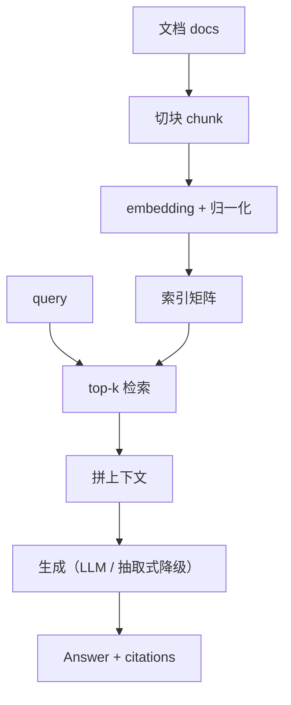
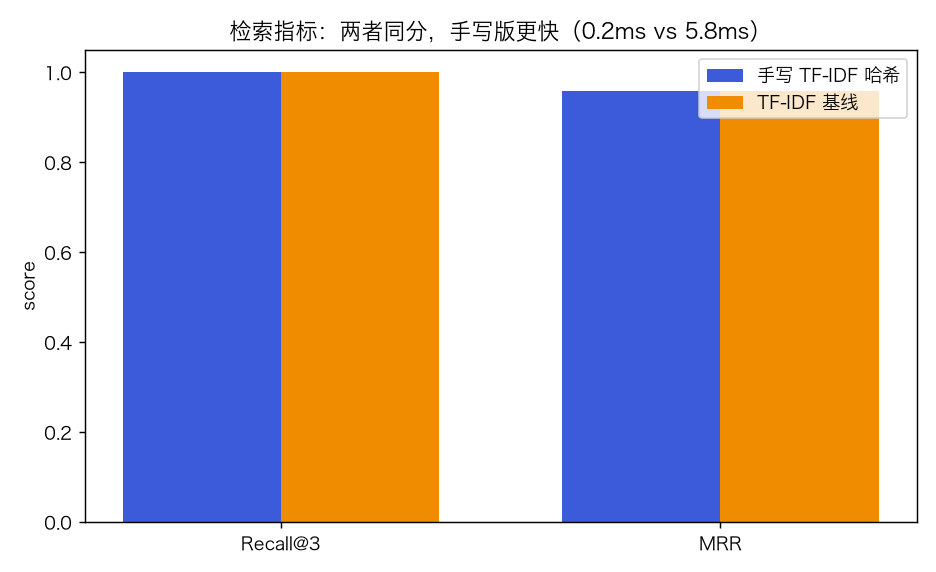
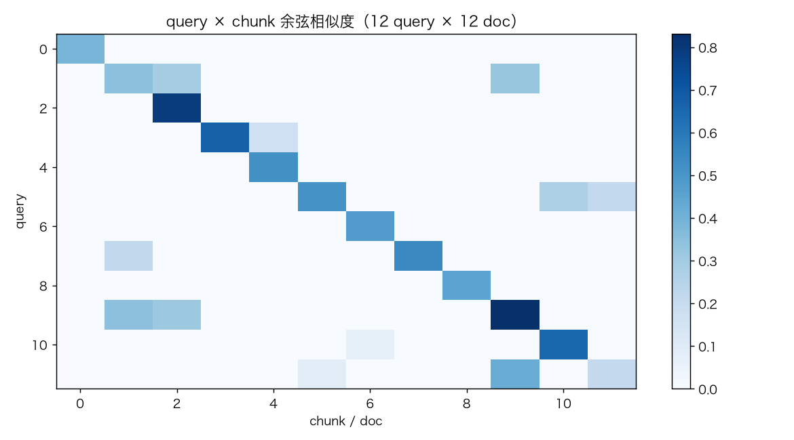
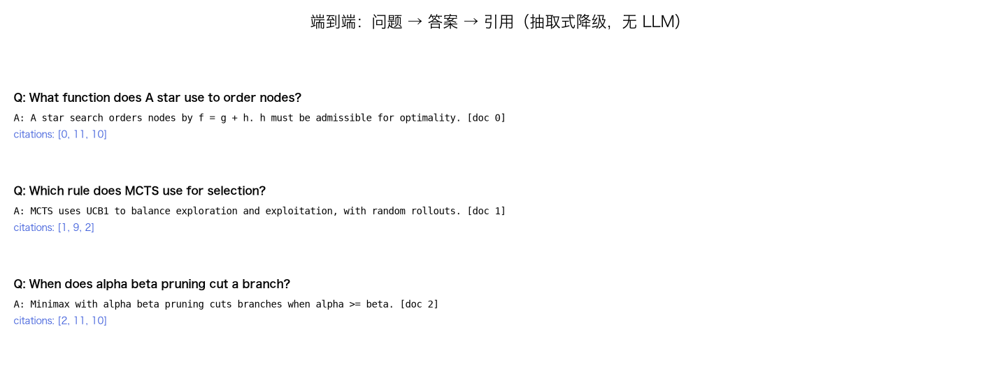
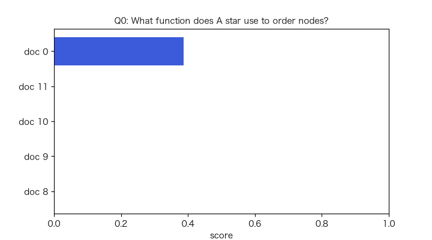

# 迷你 RAG：索引 → 检索 → 上下文 → 生成/引用

> 状态：✅ 已完成（2026-10-23）
> 对应文档章节：`../../docs/人工智能代表算法演进路线.md` 第 8.1 章
> 阅读路线：零基础读者读「基础篇」（生活类比 → 手算 → 白话 → 自测）；要看推导、实现与复现实验读「进阶篇」
> 本族共 3 个实验，学习顺序与计划见 [族级导读](../README.md)。

流水线（深度模型 · 应用）：入口 `Index().build(docs)` / `search(query, top_k)`，`Pipeline(index, Generator()).query(text)` → `Answer(text, citations)`；实现在 [impl.py](impl.py)，对照是 [framework.py](framework.py) 的 TF-IDF 检索基线。**没有单一 `fit(X,y)`**：RAG 是一条链路，三个环节各自可测。

## 读之前：RAG 不是“又一个大模型”

- RAG = **检索**（找相关上下文）+ **生成**（把上下文写进答案）+ **引用**（能溯源）。
- 它不改模型权重；知识更新靠换索引/语料。
- 本实验没有接外部 LLM：生成用**抽取式降级**，保证无 API key 也能跑；LLM 版标注为未验证。

# 基础篇 · 先搞懂它

## 1. 生活类比：开卷考试

先按问题去书里找相关段落（检索），再根据段落写答案（生成），最后标“第几页”（引用）。
RAG 就是给大模型开卷：不会就查，答完给依据。

## 2. 核心量：chunk、embedding、top-k、上下文、citation

- **chunk**：长文档切块；块太大噪声多，太小丢上下文；
- **embedding**：把 query/chunk 变成向量；
- **相似度**：归一化后内积 = 余弦相似度；
- **top-k**：取最相似的 k 个块；
- **context**：把 hits 拼成提示词；
- **citation**：答案引用到的 `doc_id` / 片段。

## 3. 主循环：建索引 → 检索 → 拼上下文 → 生成 + 引用

## 4. 手算示例：余弦相似度与 top-k

`q=[1,0]`，`d1=[1,0]`，`d2=[0,1]`：

- `cos(q,d1)=1`；`cos(q,d2)=0`；
- top-1 选 `d1`。

若 `q=[1,1]`，`d1=[1,0]`，`d2=[0,1]`：两者都是 `0.707`，平局。

**Recall@k**：gold doc 是否在前 k；**MRR**：gold doc 排名倒数。

## 5. 白话版：为什么切块、为什么要引用、为什么还要词法基线

- **切块**：embedding 有长度限制；块太大主题混杂，检索分数被稀释。
- **引用**：没有引用就无法验证答案；RAG 的价值一半在“可溯源”。
- **词法基线**：TF-IDF/BM25 在关键词明确时很强；向量检索在改写/近义时更好。
- **抽取式降级**：没有 LLM 时直接返回最相关片段；能跑通链路，但不是“生成”。

## 6. 常见误区

- **❌ "RAG 能保证答案正确"** —— 检索错/上下文冲突，生成仍会错。
- **❌ "top-k 越大越好"** —— 噪声变多，上下文超长，成本上升。
- **❌ "有引用就等于有依据"** —— 引用可能不支撑结论；要评估 citation 是否真对应。
- **❌ "向量检索一定赢关键词"** —— 关键词明确时 TF-IDF/BM25 常更强。
- **❌ "RAG 训练了新模型"** —— 本实验不改权重；知识在索引里。
- **❌ "抽取式降级 = LLM 生成"** —— 它只是无 API 时的可复现替代。

## 7. 看图：指标、相似度与端到端

手写 TF-IDF 哈希与 sklearn TF-IDF 同分；手写版更快（0.2ms vs 5.8ms）。

query × chunk 余弦相似度。

问题 → 抽取式答案 → citations。

逐 query 的 top-5 分数。

## 8. 掌握清单：五级能力与自测

| 级别 | 能力 | 本实验的检验方式 | 在哪做 |
|---|---|---|---|
| 1 说清 | 用自己的话讲规则 | 说出 chunk/embedding/top-k/引用 | 基础篇「核心量」「白话版」 |
| 2 走通 | 纸上手算 | 余弦相似度、Recall@k/MRR | 基础篇「手算示例」节 |
| 3 判断 | 说清正确性条件 | 解释切块、top-k、引用、词法基线 | 基础篇「白话版」+ 实验一 |
| 4 实现 | 手写并与对照比对 | 跑通 `demo.py`，检索/引用指标 | 进阶篇「实验结果」 |
| 5 迁移 | 用到新问题 | 自定义语料 + 查询 + 引用 | [project/](project/README.md) |

**自测关卡（先预测，再跑代码验证）**：

1. 文档比 chunk 短时，切块后几个块？
2. 归一化后内积等于什么？
3. Recall@3 与 MRR 的区别？
4. 为什么本实验还要跑 TF-IDF 基线？

# 进阶篇 · 实验档案

## 目录形态（本算法的"类型"）

| 文件 | 角色 | 入口 / 说明 |
|---|---|---|
| [impl.py](impl.py) | 手写实现 | `HashingEmbedder`、`Index`、`Generator`、`Pipeline` |
| [framework.py](framework.py) | 检索基线 | sklearn TF-IDF + 余弦；生成基线未验证 |
| [demo.py](demo.py) | 端到端 | 12 文档/12 query、检索/答案/引用、基线 |
| [test_impl.py](test_impl.py) | 性质测试 | 切块、检索、引用、生成、基线、契约 |
| [make_teaching_assets.py](make_teaching_assets.py) | 素材生成 + 对账 | 指标 / 热图 / 案例 / GIF |
| [exercises/](exercises/README.md) | 练习（5 题，题解分离） | 概念、手算、诊断、实现、迁移 |
| [project/](project/README.md) | 迁移项目 | 自定义语料 QA + 引用 |

## 1. 设计原理

RAG 把“知识”放在外部索引：检索负责召回，生成负责组织语言，引用负责可验证。
本实验用 TF-IDF 哈希做手写 embedding，用余弦相似度检索；生成用抽取式降级，避免外部 API。

## 2. 数学推导

**TF-IDF**：`w(t,d)=tf(t,d)·idf(t)`，`idf=log((N+1)/(df+1))+1`。

**余弦**：`cos(q,d)=q·d/(||q||·||d||)`；归一化后内积即余弦。

**Recall@k**：`1[gold ∈ top-k]`；**MRR**：`1/rank(gold)`。

**BM25**（基线对照，本实验用 TF-IDF 近似）：`score=Σ idf·tf·(k1+1)/(tf+k1(1-b+b|d|/avgdl))`。

## 3. 手写实现要点

1. **切块重叠**：`start += chunk_size - overlap`，保证不漏边界。
2. **归一化**：存单位向量，检索用内积。
3. **doc_id 保留**：每个 chunk 记录来源文档，引用才能回填。
4. **生成降级**：无 LLM 时返回最相关片段 + `[doc id]`。
5. **引用**：`Answer.citations` 保存 hits，不只返回字符串。
6. **基线**：同一批 query 上比 Recall/MRR，不能只报手写。

## 4. 框架对照

| 维度 | 手写 | 基线 |
|---|---|---|
| embedding | TF-IDF + 稳定哈希 | sklearn `TfidfVectorizer` |
| 检索 | 余弦 top-k | 余弦 top-k |
| 生成 | 抽取式降级 | LLM 基线未验证（无 API key） |
| 速度 | 0.2ms | 5.8ms |

**生成基线未在本环境验证**：缺 LLM 服务/API key；读者可接任意 OpenAI 兼容服务复现。

## 5. 实验结果

**环境**：uv（`uv sync --extra deep-learning --extra dev`），Python 3.13.15 /
numpy 2.5.4 / scikit-learn 1.9.1；CPU。
**数据**：12 个 AI 算法事实文档、12 个 query；chunk_size=200、overlap=40；哈希维度 512。
**复现**：本目录内 `uv run python demo.py`、`uv run pytest test_impl.py -q`、
`uv run python make_teaching_assets.py`。

**检索（top-3）**

| 方法 | Recall@3 | MRR | 耗时 |
|---|---|---|---|
| 手写 TF-IDF 哈希 | **1.000** | **0.958** | 0.2ms |
| sklearn TF-IDF | 1.000 | 0.958 | 5.8ms |

**端到端（抽取式降级）**

| 指标 | 值 |
|---|---|
| answer match | 0.917 |
| citation hit | 1.000 |
| 平均延迟 | 0.02ms |

**验证声明（已验证）**：输入为上述 12 文档/12 query；2026-10-23 在 uv 环境实跑，
`uv run python demo.py` 输出上表；`uv run pytest test_impl.py -q` → **8 passed**；
`uv run python make_teaching_assets.py` 对账通过（Recall@3 ≥0.9、citations 非空）。

**可视化结论**：

- `images/00-检索指标.png`：手写与基线同分，手写更快；
- `images/01-相似度热图.png`：query 与 doc 的对齐；
- `images/02-端到端案例.png`：答案 + 引用；
- `images/03-检索扫描.gif`：逐 query top-5。

## 6. 局限与延伸

- **12 个合成文档**：不是真实语料；指标不能外推。
- **TF-IDF 哈希**：有碰撞；没有语义 embedding/rerank。
- **生成是抽取式降级**：不是 LLM；LLM 端到端未验证。
- **answer match 是子串匹配**：不是语义评估。
- **citation hit 只检查 gold doc 是否在 citations**：不检查引用是否真的支撑句子。
- **没有多跳/对话/权限**：RAG 的工程问题未覆盖。
- **下游**：真实语料 + embedding + rerank + LLM + 引用校验 + 评测集。

**已记录、不阻塞**：

- **合成语料**：12 文档，指标偏乐观。
- **无 LLM**：生成用抽取式；LLM 基线标“未在本环境验证”。
- **无 rerank/混合检索**：只有 TF-IDF 哈希 + 余弦。
- **无引用支撑判断**：citation hit 只测 doc id。

**本次修复的阻塞问题**：

- **空/空白 query**：`Index.search` 现在抛 `ValueError`，不再返回任意 top-k。
- **`top_k<1`**：手写检索与基线都显式拒绝。
- **空 docs**：`Index.build` 拒绝；空文档被跳过而不是产生空 chunk。
- **非法 chunk 参数**：`chunk_size<1` 或 `overlap>=chunk_size` 构造时拒绝。
- **未 build 就 search**：显式 `RuntimeError`。

**补充的非阻塞边界**：

- **citation 是 top-k 全部 hits**：不是“答案实际用了哪几条”；citation hit 只测 doc id。
- **answer match 是子串匹配**：同义改写可能判错。
- **TF-IDF 哈希有碰撞**：没有语义 embedding/rerank；关键词明确时词法基线已很强。
- **只有 12 个合成文档**：没有真实语料/长文档/多跳问题。
- **生成是抽取式降级**：没有 LLM；LLM 端到端链路仍未在本环境验证。
- **没有权限/租户/敏感信息过滤**：RAG 的生产工程问题未覆盖。
