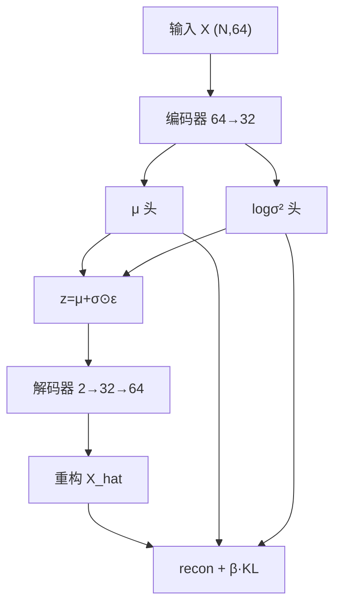
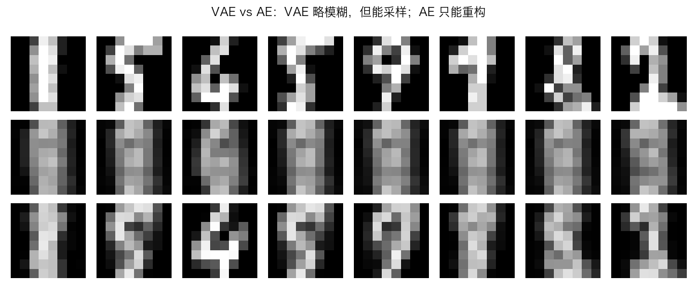
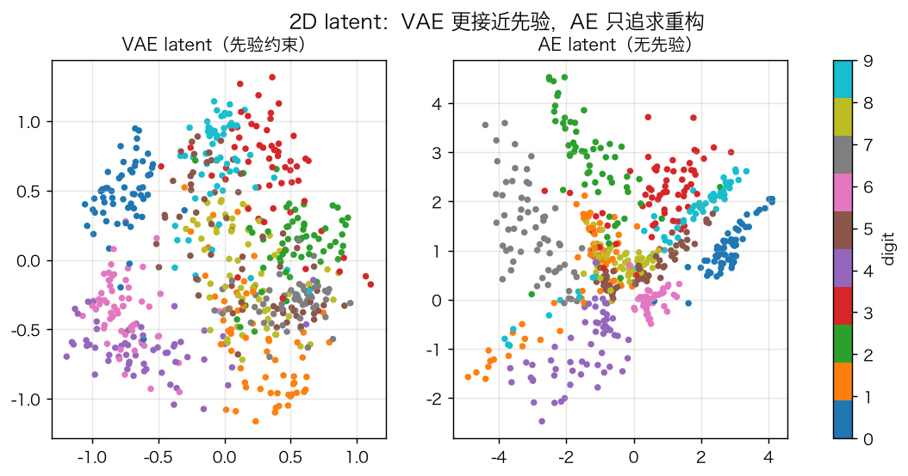
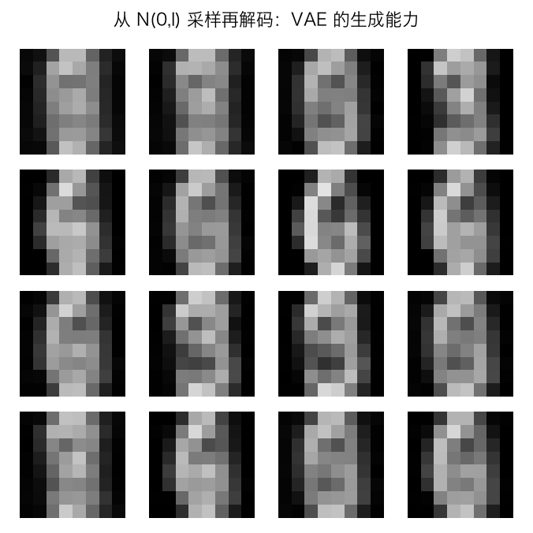
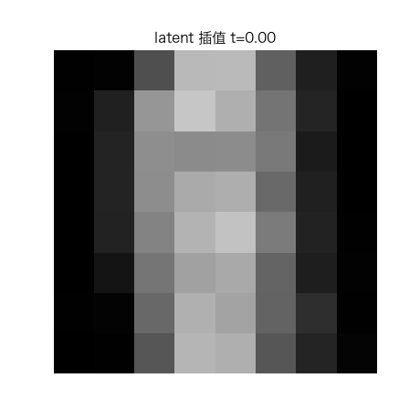

# 变分自编码器 VAE：ELBO、重参数化与 2D latent

> 状态：✅ 已完成（2026-10-23）
> 对应文档章节：`../../docs/人工智能代表算法演进路线.md` 第 4.5 章
> 阅读路线：零基础读者读「基础篇」（生活类比 → 手算 → 白话 → 自测）；要看推导、实现与复现实验读「进阶篇」
> 本族共 3 个实验，学习顺序与计划见 [族级导读](../README.md)。

生成模型（深度模型 · 生成式）：入口 `VAE(latent_dim, beta).fit(X)` / `encode(X)` / `reconstruct(X)` / `sample(n)` / `interpolate(z1,z2,n)`；实现在 [impl.py](impl.py)，对照是 [framework.py](framework.py) 的 PyTorch VAE。**没有 `fit(X,y)`**：无监督，目标是 `X` 自己 + KL 正则。

## 读之前：VAE 与 AutoEncoder 的边界

- AE 的 latent 是**点** `z=f(x)`；VAE 的 latent 是**分布** `q(z|x)=N(μ,σ²)`。
- AE 只能重构；VAE 从先验 `N(0,I)` 采样后解码，所以能生成。
- VAE 的 loss 不是纯重构：`ELBO = 重构项 − KL`，训练时最小化 `−ELBO`。

# 基础篇 · 先搞懂它

## 1. 生活类比：不是“记一个编码”，而是“记一个范围”

AE 像把一张图压成一个精确坐标；VAE 像记“这张图大概在哪个区域、范围多大”。
生成时在区域里随机取一个点，解码器就能画出一张新图。

## 2. 核心量：μ、logσ²、重参数化、ELBO、KL

**编码器**：`h=ReLU(xW1+b1)`，`μ=hWμ+bμ`，`logσ²=hWσ+bσ`。

**重参数化**：

$$z=\mu+\exp(\tfrac12\log\sigma^2)\odot\varepsilon,\qquad \varepsilon\sim N(0,I)$$

**ELBO**（要最大化）：

$$\mathcal L=\mathbb E_{q(z|x)}[\log p(x|z)]-D_{KL}(q(z|x)\|p(z))$$

**KL 闭式**（`p(z)=N(0,I)`）：

$$D_{KL}=-\frac12\sum_j\left(1+\log\sigma_j^2-\mu_j^2-\exp(\log\sigma_j^2)\right)$$

**损失**：`recon + beta * KL`；`beta>1` 更强正则，`beta<1` 更重重构。

## 3. 主循环：编码 → 重参数化 → 解码 → ELBO

## 4. 手算示例：KL 与重参数化

**KL**：`μ=0, logσ²=0` → `KL=0`；`μ=1, logσ²=0` → `KL=0.5`。

**重参数化**：`μ=0, σ=1, ε=0.5` → `z=0.5`；`ε=-1` → `z=-1`。

**梯度**：`∂z/∂μ=1`，`∂z/∂logσ²=0.5·σ·ε`；没有重参数化，采样不可导。

## 5. 白话版：为什么需要 KL、为什么重参数化、beta 在调什么

- **KL**：把 `q(z|x)` 拉向先验 `N(0,I)`，否则编码器会把每张图塞到互不相连的点，无法采样。
- **重参数化**：把随机性放到 `ε`，`μ/σ` 仍是可导参数；否则“采样”是黑盒。
- **beta**：`beta` 大 → latent 更规整、重构更模糊；`beta` 小 → 重构更好、先验约束弱。
- **2D latent**：便于可视化，但容量小，重构/生成都会模糊；这是教学取舍。

## 6. 常见误区

- **❌ "VAE = AE + 噪声"** —— 关键是分布、KL、重参数化，不是加噪。
- **❌ "KL 越大越好"** —— KL 太大导致 posterior collapse/重构模糊。
- **❌ "直接采样 z 也能反传"** —— 采样不可导；必须重参数化。
- **❌ "VAE 的 loss 是重构 MSE"** —— 是 ELBO；重构只是其中一项。
- **❌ "VAE 生成一定比 AE 清晰"** —— 2D latent 下 VAE 通常更模糊；它换的是可采样性。
- **❌ "latent 维度越高越好"** —— 高维更容易忽略 latent；本实验用 2D 讲故事。

## 7. 看图：重构、latent、采样与插值

VAE 重构比 AE 模糊（2D latent + KL），但 VAE 能采样。

VAE latent 受先验约束；AE latent 只追求重构。

从 `N(0,I)` 采样再解码；2D latent 下是模糊数字块。

latent 线性插值，解码结果连续变化。

## 8. 掌握清单：五级能力与自测

| 级别 | 能力 | 本实验的检验方式 | 在哪做 |
|---|---|---|---|
| 1 说清 | 用自己的话讲规则 | 说出 μ/logσ²、重参数化、ELBO、KL | 基础篇「核心量」「白话版」 |
| 2 走通 | 纸上手算 | `μ=1` 的 KL；`ε=0.5` 的 z | 基础篇「手算示例」节 |
| 3 判断 | 说清正确性条件 | 解释 KL、重参数化、beta、2D 模糊 | 基础篇「白话版」+ 实验二 |
| 4 实现 | 手写并与对照比对 | 跑通 `demo.py`，梯度/ELBO 检查 | 进阶篇「实验结果」 |
| 5 迁移 | 用到新问题 | 采样 + 插值生成 | [project/](project/README.md) |

**自测关卡（先预测，再跑代码验证）**：

1. `μ=0, logσ²=0` 的 KL 是多少？
2. 为什么不能直接 `z~N(μ,σ²)` 后反传？
3. beta 从 0.1 加到 4，重构会变好还是变差？
4. VAE 重构比 AE 差，为什么还值得学？

# 进阶篇 · 实验档案

## 目录形态（本算法的"类型"）

| 文件 | 角色 | 入口 / 说明 |
|---|---|---|
| [impl.py](impl.py) | 手写实现 | `VAE`：双头编码、重参数化、解码、ELBO、Adam |
| [framework.py](framework.py) | PyTorch 对照 | `TorchVAE` |
| [demo.py](demo.py) | 同数据双跑 | VAE vs AE、beta 扫描、采样/插值、torch |
| [test_impl.py](test_impl.py) | 性质测试 | 形状、重参数化、KL、训练、采样、基线、契约 |
| [make_teaching_assets.py](make_teaching_assets.py) | 素材生成 + 对账 | 重构 / latent / 采样 / 插值 |
| [exercises/](exercises/README.md) | 练习（5 题，题解分离） | 概念、手算、诊断、实现、迁移 |
| [project/](project/README.md) | 迁移项目 | 采样 + latent 插值 |

## 1. 设计原理

VAE 用变分分布 `q(z|x)` 近似后验，最大化 ELBO：重构项让解码器能还原，KL 让 latent 接近先验。
重参数化把随机采样变成可导变换，使整条链路能反向传播。KL 有闭式解，不必采样估计。

## 2. 数学推导

**ELBO**：

$$\log p(x)\ge \mathbb E_{q}[\log p(x|z)]-D_{KL}(q(z|x)\|p(z))$$

**KL 闭式**（对角高斯 vs 标准正态）：

$$-D_{KL}=\frac12\sum_j(1+\log\sigma_j^2-\mu_j^2-\sigma_j^2)$$

**重参数化梯度**：`∂z/∂μ=1`，`∂z/∂logσ²=0.5·σ·ε`。

**损失缩放**：重构项按“每个样本对 64 个像素求和、再对 batch 平均”，KL 按样本平均；
否则重构项会被 64 除，KL 直接压垮 latent（本实验实现时踩过这个坑）。

## 3. 手写实现要点

1. **双头输出**：`μ` 与 `logσ²` 分开；不要用 `σ` 直接输出，易负/不稳。
2. **重参数化**：`z=μ+exp(0.5lv)*eps`；`eps` 每个 batch 重新采样。
3. **KL 梯度**：`dμ += beta*μ/N`，`dlv += beta*0.5*(exp(lv)-1)/N`。
4. **重构梯度**：sigmoid + MSE 的 `2(xhat-x)/N`（按样本求和口径）。
5. **推理重构用 μ**：不采样，保证可复现。
6. **采样从先验**：`z~N(0,I)` 再 decode。

## 4. 框架对照

torch 版同结构（64→32→μ/logσ²→2→32→64），同 ELBO 口径。

| 维度 | 手写 | torch |
|---|---|---|
| 双头 | 手写矩阵 | 两个 `nn.Linear` |
| 重参数化 | 手写 | `torch.randn_like` |
| KL | 闭式 | 闭式 |
| 反向 | 手写链式 | autograd |
| 速度 | 教学优先 | 融合算子 |

## 5. 实验结果

**环境**：uv（`uv sync --extra deep-learning --extra dev`），Python 3.13.15 /
numpy 2.5.4 / scikit-learn 1.9.1 / torch 2.14.1；CPU。
**数据**：digits 8×8，像素 /16；训练 1200 / 测试 597；latent=2；100 轮。
**复现**：本目录内 `uv run python demo.py`、`uv run pytest test_impl.py -q`、
`uv run python make_teaching_assets.py`。

**实验一：VAE vs p03 AE（latent=2）**

| 模型 | test MSE | KL | 耗时 | 能采样？ |
|---|---|---|---|---|
| VAE（beta=1） | 0.0608 | 0.342 | ≈0.5s | ✅ |
| AE（p03） | **0.0381** | — | — | ❌ |

**实验二：beta 权衡**

| beta | test MSE | KL |
|---|---|---|
| 0.1 | **0.0424** | 3.737 |
| 1.0 | 0.0608 | 0.342 |
| 4.0 | 0.0742 | 0.000 |

**实验三：采样/插值**

- `sample(8)` 形状 `(8,64)`，范围约 `[0,0.89]`；
- 插值 5 帧，相邻 L2 平均约 `0.076`。

**实验四：手写 vs torch**

手写 test MSE 0.0608 / ≈0.5s；torch 0.0598 / ≈0.7s。

**验证声明（已验证）**：输入为上述数据与种子；2026-10-23 在 uv 环境实跑，
`uv run python demo.py` 输出上表；`uv run pytest test_impl.py -q` → **9 passed**；
`uv run python make_teaching_assets.py` 对账通过（VAE MSE <0.1、采样有限）。

**可视化结论**：

- `images/00-重构对比.png`：VAE 比 AE 模糊，但能采样；
- `images/01-2D隐空间.png`：VAE latent 受先验约束；
- `images/02-先验采样.png`：2D latent 下生成的是模糊数字块；
- `images/03-插值生长.gif`：latent 插值连续变化。

## 6. 局限与延伸

- **2D latent 容量小**：重构/生成模糊；这是可视化取舍，不是 VAE 上限。
- **beta=4 时 posterior collapse**：KL→0、重构退化；需要 warm-up/自由比特。
- **MSE 重构**：二值图像可换 Bernoulli 交叉熵。
- **没有卷积**：8×8 平板 MLP；更大图像要 ConvVAE。
- **没有更丰富先验**：本实验只 `N(0,I)`；层次 VAE/vampPrior 未做。
- **采样质量没有 FID**：只看样例/重构 MSE。
- **下游**：β-VAE/ConvVAE → VQ-VAE → Diffusion（p05 下一个）。

**已记录、不阻塞**：

- **2D latent 生成模糊**：数字块，不是清晰样本；latent 维度/卷积会改善。
- **beta 扫描只到 4**：没有 KL warm-up/自由比特，beta=4 已 collapse。
- **重构口径是 MSE**：没有 Bernoulli/离散解码器对照。
- **没有概率校准/似然评估**：只报 MSE/KL，不是 test log-likelihood。

**本次修复的阻塞问题**：

- `fit/encode/reconstruct` 输入不是 `(N,64)`、空数据：现在显式报错，不再 matmul/广播崩溃。
- `decode` 的 `Z` 维度不对、`sample(n<1)`、`interpolate(n<1)`、`z1/z2` 形状不对：现在显式报错。
- `latent_dim/hidden=0`、`beta<0`、`epochs<1`：构造时拒绝。

**补充的非阻塞边界**：

- **`sample()` 每次用同一 `random_state` 新建 RNG**：重复调用会得到同一批先验样本；
  想要不同样本应传不同 `random_state` 或改持久 RNG。
- **输入固定 64 维**：只适配 8×8 digits；换数据要改 `data_dim`/网络结构。
- **2D latent 生成模糊**：数字块；高维/卷积会改善，但本实验为了可视化选 2D。
- **beta=4 已 posterior collapse**：KL→0、重构退化；没有 KL warm-up/自由比特。
- **MSE 重构**：二值图像可换 Bernoulli 交叉熵，本实验只做 MSE。
- **没有 test log-likelihood/FID**：只报 MSE/KL 和样例。
- **没有 early stopping**：固定 100 轮。
