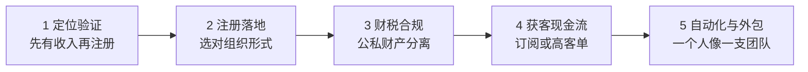
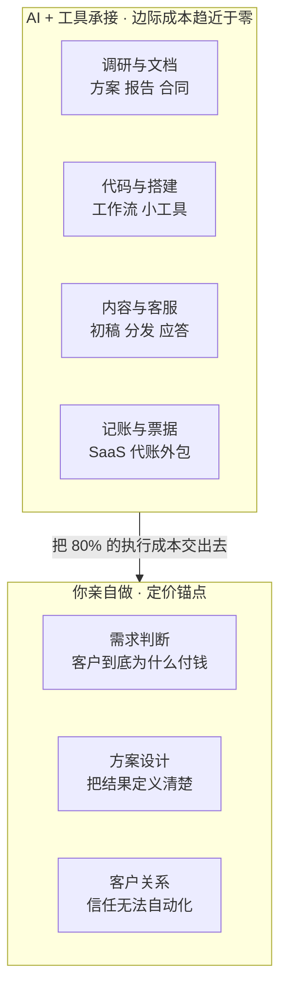

# OPC 一人公司：AI 时代方向

> 一句话结论：**AI 时代的一人公司，不是「一个人干十个人的活」，而是「一个人只做三个决定，其余交给 AI」**。护城河从执行力变成了判断力 + 客户信任。
>
> 整理日期：2026-11-20  
> 适用：想以单人主体独立商业化的人；兼顾「组织形式」「商业模式」「启动路径」「现实可行性」四个层面。

> **信息可信度声明（先读这一段）**：本文的现实案例来自 2026-11-20 的公开检索，分为三档，正文中会逐处标注。
>
> - **A 档（可核查）**：政府网站 / 党媒记者实地采访、以及公开收入面板的独立开发者。
> - **B 档（打折看）**：行业内容站、自媒体流传的 case study，多为当事人自述、无第三方审计，且幸存者偏差极重。只能证明「模式存在」，不能证明「平均水平」。
> - **C 档（框架推演）**：本文给出的收入结构和时间表，是依据 A 档区间做的合理建模，不是承诺。
>
> 「一人公司月入 200 万」「50 天做到月入 4.5 万美元」这类标题属于 B 档，请勿当作常态参照。

---

## 一、OPC 是什么

**OPC（One Person Company，一人公司）**：由一名股东单独出资设立的公司形式。最经典的法定来源是**印度 2013 年《公司法》**，正式确立 OPC 为独立公司类型；国内对应形态是**一人有限责任公司**。

### 核心特点

1. **单一股东**：全部股权由一人持有，个人直接控制公司。
2. **独立法人资格**：公司以出资额为限承担**有限责任**——这是它与个体工商户 / 个人独资企业最本质的区别。
3. **财产分离**：公司财产与个人财产分开，公司债务原则上不牵连个人财产（滥用法人地位时除外，即「刺破公司面纱」）。

### 与相近形式的对比

| 维度   | 一人公司（OPC）    | 个人独资企业 / 个体户  |
| ---- | ------------ | ------------- |
| 法律地位 | 独立法人         | 不具法人资格        |
| 责任   | 有限责任         | 无限责任          |
| 税负   | 企业所得税 + 分红个税 | 一般只交经营所得个税    |
| 设立门槛 | 需章程、规范账目、年报  | 简单灵活          |
| 对外签约 | 适合 B 端合同、品牌化 | 适合小额、本地、低风险业务 |

### 各地形态

- **印度**：OPC 是法定公司类型，要求至少一名董事为印度居民；股本超过规定规模须强制转为至少两名股东的普通公司。
- **中国**：《公司法》允许一人有限责任公司。自然人只能投资设立一个一人有限公司的旧限制，已在 **2023 年新《公司法》**&#x4E2D;取消；另有国有独资公司这一特殊形态。
- **美国**：无专门 OPC 法定形式，但单成员 **LLC** 可达成类似效果。

### 适用与不适用

适合个人创业者、自由职业者、咨询顾问——想要独立法人身份对外签约、隔离经营风险、便于融资或品牌化，但不需要合伙人。代价是合规成本更高（记账、年报、汇算清缴都要按公司标准来）。

---

## 二、跑通框架：五个阶段

### 2.1 定位验证：先有收入，再注册公司

一人公司最大的坑是**没业务就先背上合规成本**。正确顺序：

- 先以个人身份接单验证：你能持续卖出去的东西是什么？
- 找到一个**可重复、客单价够高**的交付物。天花板 = 客单价 × 精力上限，因此要么高客单（咨询 / 项目制），要么可复制（课程 / 订阅 / 软件）。
- 月流水稳定超过几千元、客户开始要求开发票时，再进入 2.2。

### 2.2 注册落地：选对组织形式

| 情况           | 建议                  |
| ------------ | ------------------- |
| 刚起步、利润低      | 个体工商户（税负最低、注销容易）    |
| 要签 B 端合同、做品牌 | 一人有限责任公司            |
| 客户在境外、赚外汇    | 个体户 / 公司 + 跨境收款合规通道 |

国内一人有限公司要点：注册资本**认缴即可但别虚高**（新《公司法》要求 5 年内实缴到位），经营范围写宽一点，注册地址可用园区挂靠；全流程线上办，成本几百到一千元。

### 2.3 财税合规：有限责任的生死线

最致命的风险不是没生意，而是**公私不分导致无限连带责任**：

- **公司账户和个人账户绝对分开**；任何「从公司拿钱」只能走发工资、分红、报销三条路。
- 每年至少做一次规范记账，小规模纳税人代账成本很低，别自己糊账。
- 年度工商年报 + 汇算清缴，逾期列入经营异常。
- 税务筹划空间：小规模纳税人增值税优惠、个体户 / 个独核定征收（政策因地区而异，需核实当地口径）。

### 2.4 获客与现金流

- **内容是最好的销售员**：在垂直领域持续输出，让客户主动找你，替代一对一陌拜。
- **收定金再干活**（30%~50%），尾款不清不交付源文件 / 源码。
- 客户数量控制在 5~10 个长期客户，深度服务 > 广撒网。

### 2.5 自动化与外包

- 重复性工作工具化：AI 写作 / 代码、SaaS 记账、自动化合同与发票流程。
- 非核心环节外包：代账公司、按单外包设计 / 剪辑；自己只保留「获客 + 交付」。
- 跑顺后可考虑「一人公司 + 虚拟团队」，收入翻倍但组织不膨胀。

### 跑通的标志

> 每月稳定收入覆盖个人生活成本 × 2 以上、合规零隐患、90% 的日常事务不占用核心精力。
>
> 前三步解决「合法地活」，后两步解决「持续地赚」。

---

## 三、AI 时代的分工杠杆

AI 时代真正改变的三件事：

1. **交付成本坍塌**：过去要雇 3~5 人的活，现在一人 + AI 可完成，毛利从 30% 升到 80%+。
2. **能力边界消失**：不会写代码也能做工具，不会设计也能出图。
3. **但判断力 / 信任 / 客户关系没有外包出去**——这恰恰是定价锚点。

---

## 四、三个落地案例

### 4.1 案例 A：AI 自动化落地顾问（B 端高客单，最推荐）

- **卖什么**：给中小企业把重复流程用 AI 串起来。例：连锁门店「企业微信自动收订单 → AI 汇总日报 → 生成补货建议」，用 n8n / Coze / Dify 搭。
- **卖给谁**：本地连锁、电商卖家、小型贸易公司——知道 AI 有用、没人会落地、也招不起专职技术。
- **定价三档**：诊断 ¥1,980 / 落地项目 ¥1.5 万~~5 万 / 月度维护 ¥2,000~~5,000。
- **分工**：你只做需求访谈、方案设计、验收、续约；调研、方案文档、脚本代码、演示材料、话术库交给 AI。
- **为什么成立**：客户买的是「省掉 1~2 个人力」，不是「你用了什么模型」，所以他不会自己去问 AI。

**稳定期月度收入结构（C 档建模）**

| 收入项             |          金额 |   占比 |
| --------------- | ----------: | ---: |
| 落地项目 × 2        |     ¥30,000 |  61% |
| 维护订阅 × 5        |     ¥15,000 |  31% |
| 诊断服务 × 2        |      ¥4,000 |   8% |
| **月流水**         | **¥49,000** | 100% |
| AI 订阅 + 代账 + 外包 |    ≈ ¥3,000 |   成本 |

毛利率 90%+。**最值钱的动作是把项目客户转成维护订阅**——项目制收入受时间封顶，订阅收入才让一人公司真正跑通。

### 4.2 案例 B：垂直领域订阅内容 + 数字产品

- **例子**：面向跨境电商卖家的「AI 选品与 Listing 提示词库 + 每周选品简报」，¥199/月。
- **分工**：你负责行业判断和选题；抓取、整理、初稿、翻译、排版、封面、多平台分发由 AI 完成。
- **账**：200 个订阅 × 199 = **约 ¥4 万/月**，边际成本几乎为零，不需要按小时出售时间。
- **前提**：先有受众再收费，用免费内容攒 3 个月信任。

### 4.3 案例 C：AI 辅助的微型 SaaS

- **例子**：给独立开发者做的「多平台用户评论自动汇总 + 回复草稿」小工具，¥49/月。
- **AI 承担**：写代码、测试用例、文档、客服首答。
- **现实提醒**：三者中获客最难，产品好做、卖出去难。适合已有内容受众的人，不适合冷启动。

### 小结

**A 变现存量经验（最快见钱）· B 变现表达与信任（复利但慢）· C 变现产品判断（上限最高、风险最大）。** 三者共同的最硬门槛都不是技术，而是需求判断力。

---

## 五、背景要求与对号入座

### 5.1 背景对比矩阵

**红 = 必需 / 琥珀 = 加分 / 灰 = 不必需**（此处以文字标注：● 必需 / ◐ 加分 / ○ 不必需）

| 背景维度        | A 落地顾问 | B 订阅内容 | C 微型 SaaS |
| ----------- | :----: | :----: | :-------: |
| 行业 know-how |  ● 必需  |  ● 必需  |    ◐ 加分   |
| 技术手感        |  ◐ 加分  |  ○ 不必需 |    ● 必需   |
| 表达 / 写作     |  ◐ 加分  |  ● 必需  |   ○ 不必需   |
| B 端销售谈判     |  ● 必需  |  ○ 不必需 |    ◐ 加分   |
| 已有受众        |  ○ 不必需 |  ● 必需  |    ◐ 加分   |
| 见到首笔钱       |  2~6 周 | 2~3 个月 |   3~6 个月  |

### 5.2 各自详解

**A 落地顾问：卖的是行业履历**

- 核心背景：在某一个行业干过 2~3 年，能一眼看出「哪个环节在白烧人力」。做过电商运营、门店管理、外贸跟单、财务、HR 都算——**这个不是学 AI 能补的**，也是唯一硬门槛。
- 流程抽象能力：把「想用 AI 提效」拆成「输入 → 处理 → 输出」。做过需求分析、SOP、项目管理的人天然会。
- 技术只需手感：不必会写代码，但看得懂 API、能判断需求可行性、能验收 AI 写的脚本。两周学会 n8n / Coze 足够。
- 最易被低估：B 端销售——敢跟老板谈 1 万以上的单、写报价单、定义验收标准。
- **不需要**：算法、模型训练、大厂履历、全职开发能力。

**B 订阅内容：卖的是表达 + 信任**

- 核心背景：在极窄领域里比读者**早半步**，且能持续输出判断，不是搬运资讯。
- 写作仍是硬门槛：AI 能写初稿，但选题、观点、取舍、语气靠你。没有表达力，AI 只给平庸的平均值，而平均值卖不出 ¥199/月。
- 速成不了的资源：受众，通常需 2~3 个月无偿输出。
- **不需要**：技术、销售话术、公司实体、启动资金。
- 自测：过去 3 个月有没有公开写过任何带观点的东西？

**C 微型 SaaS：卖的是产品判断**

- 核心背景：最好自己就是用户——「给自己做工具」是最稳起点，痛点是真的。
- 技术不能全甩给 AI：架构边界、异常处理、上线部署、支付回调、后续运维还得兜底，至少要**读懂**代码并独立部署。
- 最难一环仍是获客：要么已有受众，要么懂 SEO / 社区 / 投放。
- 需要耐心：3~6 个月没收入是常态，得有别的现金流撑着。
- **不需要**：团队、融资、复杂算法。

### 5.3 对号入座

| 你现在有的           | 建议起点                        |
| --------------- | --------------------------- |
| 某行业 2 年以上履历     | **A**，2~6 周能收到第一笔钱          |
| 有内容受众 / 爱写      | **B**，或 B 攒够受众后转 C          |
| 技术底子 + 被某个问题折磨过 | **C**，但建议先用 A 养活自己          |
| 三样都缺            | 先做 A 的**免费诊断**，用真实客户反推自己缺什么 |

**五问自测**：能说清某行业最耗人力的环节吗？近 3 个月公开输出过观点吗？能独立上线一个能收钱的工具吗？敢当面跟陌生老板谈 1 万以上的单吗？有 100 个以上愿意看你内容的人吗？**答「是」最多的一列，就是起点。**

---

## 六、现实验证：真的有人在做吗

### 6.1 国内已形成政策与生态（A 档）

- **上海**：2026 全球开发者先锋大会上「SE 超级创业个体」「OPC 一人公司」成为热议高频词。
- **杭州上城区**：2026 年 3 月推出全省首个区级 OPC 专项政策，**每年 1 亿元专项资金 + 总规模 10 亿元 OPC 专项基金**；未来数智港社区收到 **1600+ 份入驻申请、63 个 OPC 正式入驻**；计划建设 10 个 OPC 社区、培育 100 家 AI 企业、集聚 1000 名 OPC 创业者。
- **生态成熟信号**：出现「OPC 服务 OPC」的平台（如观猹，做工具评测、种子用户、资源对接），以及区级政策明确强调「包容十年不鸣」。连政策文件都在强调**获客与资源对接**是最大痛点，而不是技术。

### 6.2 真人案例（A 档，记者实地采访）

| 人       | 背景                  | 做什么                                        | 收入                     |
| ------- | ------------------- | ------------------------------------------ | ---------------------- |
| 徐爽      | 原设计师                | 独立搭出海网站 + 商品视频自动生成                         | 月 ¥1~~5 万，多数稳定 ¥2~~3 万 |
| 黄江华     | 非计算机科班，4 个月 IT 培训跨界 | 贵阳灵蛛科技，自建 4 个 AI 平台（AI 技能库、制造业定制、一句话生成网页等） | 四平台合计月营收约 ¥3 万         |
| 彭青云     | 原品牌设计，被 AI 冲击后失业    | 杭州星境引擎：出海 AI 短剧承制 + AI 培训 + 智能体定制          | 月入数万元                  |
| 杨默      | 毕业不久                | 手搓图文生成网站，积分付费                              | 超 1 万用户，营收覆盖日常开支       |
| 陆阿吉     | —                   | AI 漫剧制作                                    | 月 ¥1 万到几万              |
| 95 后开发者 | —                   | 10 款极细分小 App                               | 约 ¥7 万/月               |

这些正好对应第四章三个案例：A ≈ 徐爽 / 黄江华，B ≈ 彭青云 / 陆阿吉的内容承制变体，C ≈ 杨默 / 95 后开发者。

### 6.3 海外公开可查标杆（A 档，公开收入面板）

| 人             | 代表产品                              | 说明                                          |
| ------------- | --------------------------------- | ------------------------------------------- |
| Pieter Levels | Nomad List / RemoteOK             | levels.io 公开收入面板，$200K+/月，单人 PHP + SQLite 栈 |
| Justin Welsh  | 新闻简报 + 课程 + 赞助                    | 围绕个人站点做到数百万美元一人公司                           |
| Marc Lou      | ShipFast / ByeDispute / IndiePage | 公开 dashboard，六位数月流水                         |
| Tony Dinh     | TypingMind / Black Magic          | 「做给自己人用的工具」路线                               |

### 6.4 可信度分层：必须打折的部分

- **B 档**：大量英文 case study 站给出「4 个月 $15K MRR」「单人 $85K/月内容代理」「50 天月入 $4.5 万」「70 个 Agent 带动客户 $125 万年营收」等数字；中文自媒体「一人公司月入 200 万」同理。多为自述、无第三方审计、幸存者偏差极重。
- **C 档**：本文第四章的收入结构表、第八章的 90 天时间表，是依据 A 档区间做的建模，不是承诺。

### 6.5 更接近现实的参照

> 国内记者实地采访的案例普遍落在 **月入 ¥1~5 万**。这是常态区间，也和案例 A 建模的 ¥4.9 万量级吻合。
>
> 另有大量案例提到「**死亡谷**」：3~6 个月收入低于 ¥500/月，多数人在此放弃。把这段算进现金流规划，比看头部数字重要得多。

---

## 七、模式全景：还有哪些做法

用两个维度定位：**横轴 = 见钱速度（左快右慢）**，**纵轴 = 可复制 / 被动程度（下低上高）**。

| # | 模式              | 怎么赚钱                                 | 现实对标                                                       | 定位           |
| - | --------------- | ------------------------------------ | ---------------------------------------------------------- | ------------ |
| 1 | 落地顾问 / 定制项目     | 诊断费 + 项目费 + 维护订阅                     | 第四章案例 A                                                    | 左下：快见钱、受时间限制 |
| 2 | AI 内容代运营        | 单客户 $1,500~5,000/月，包 SEO 文章、社媒帖、视频脚本 | 单人服务 15~25 个品牌，人只改 20 分钟/篇                                 | 左下           |
| 3 | Agent / 工作流模板   | n8n 工作流、AI Skill 包、提示词库，$49 一份或套餐    | 黄江华 SkillsBot 汇聚 3 万+ 技能；Gumroad 上「AI 线索打分 + Slack 提醒」是常青款 | 左上           |
| 4 | 数字模板 / 课程       | Notion 模板、行业报告模板、提示词包，一次做完反复卖        | 毛利率 85~92%，但要有分发渠道                                         | 左上           |
| 5 | 付费简报 Newsletter | 极窄专业领域（AI for 律师 / 电商 / 地产），$9~29/月  | 英文圈有 14,200 订阅 / 月 $28,400 案例；国内更常见免费简报引流 + 后端卖服务          | 中上           |
| 6 | 付费社群 / 会员       | Circle / Discord 年费或月费，围绕特定身份        | 留存高、冷启动最难，几乎必须先有受众                                         | 右下           |
| 7 | 内容站 + 联盟        | 买家意图 SEO 长文 → 广告 / 佣金                | 复利型流量，6~12 个月才起量                                           | 右上           |
| 8 | 微型 SaaS         | 单点痛点工具，$49 左右/月订阅                    | 第四章案例 C                                                    | 右上：最慢、最被动    |

**国内这波特有的两类**：

- **AI 短剧 / 漫剧承制**：按剧结算，出海是主要收入来源（彭青云、陆阿吉）。
- **OPC 服务 OPC**：给其他一人公司卖工具评测、资源对接、种子用户。生态成型后才出现的一层。

**AI 设计资产 / POD**（Etsy + Printful 按需印制）也是常见补充形态：320 个在售 listings ≈ $4,200/月，工具成本约 $58/月，偏被动但单价低。

---

## 八、90 天行动清单（以案例 A 为例）

| 阶段      | 动作                             | 关键指标        |
| ------- | ------------------------------ | ----------- |
| 第 1~2 周 | 挑一个你熟的行业，**免费给 2 家做诊断**，换案例和证言 | 2 个真实案例     |
| 第 3~4 周 | 把交付 SOP 化，打包成三档定价              | 一份可复用的方案模板  |
| 第 2 个月  | 每周 2 篇案例拆解内容 + 老客户转介绍，签下 2 单   | 首笔项目款到账     |
| 第 3 个月  | 重复环节做成模板 / 自动化，把客户转成维护订阅       | 经常性收入 > 30% |
| 之后      | **月流水稳定过 ¥3 万才注册一人有限公司**       | 合规隔离        |

---

## 九、坑与规律

### 通用四坑

1. 没业务先注册公司，白背合规成本。
2. 公私账户混用，有限责任变无限连带。
3. 不收定金就开工，尾款收不回。
4. 客户数量失控，一人公司被低客单客户拖垮。

### AI 时代特有四坑

1. **别做纯 AI 搬运**：门槛为零，客户自己也能问，价格战秒杀。必须叠加行业 know-how 和落地责任。
2. **卖结果，别卖 AI**：报价单写「每月省 60 小时人工」，不要写「接入大模型」。
3. **数据合规**：客户资料喂给第三方模型前要脱敏，B 端尽量用企业版 API 并在合同里写清楚。
4. **平台依赖**：账号、API 政策一变就断供。必须攒自有渠道（邮件列表、社群、老客户名单）。

### 一条被反复验证的规律

> **服务起步（快见钱、攒真实需求）→ 把重复交付产品化成模板 / 订阅 → 内容获客让成本复利下降。**
>
> 几乎所有跑通的案例都走这条路，而不是一上来做 SaaS。毛利率排序：SaaS 95% > 数字产品 90% > 咨询 80% > AI 原生代理 70%，但难度正好相反——先做低难度服务养活自己，再往高毛利迁移。
>
> 另一个共性：**每个业务在 AI 出现之前其实都存在**，AI 只是让一个人就能跑完整条流水线。所以别找「AI 才能做的生意」，要找「本来就有付费需求、只是过去需要团队才能交付」的生意。

---

## 十、下一步

选一条再往下拆，建议顺序：

1. 用第五章的五问自测确定起点（A / B / C）。
2. 若选 A：写一份三档服务报价单 + 第一版获客内容大纲 + 免费诊断访谈提纲。
3. 若选 B 或模式 3 / 5：拆一份 30 天启动清单（选题库、分发渠道、冷启动指标）。
4. 拿到第一笔收入后，回到第二章补组织形式与财税合规，再按第八章转订阅。

---

## 附录：信息来源

**A 档 · 官方 / 党媒**

- 杭州宣传网：被 AI 淘汰后，他靠 AI 在杭州开了一家「一人公司」（彭青云、上城区 OPC 政策、未来数智港）
- 贵州日报数字报刊：贵阳一家 OPC 月入 3 万元（黄江华、SkillsBot / 栅格兽 / 萃智引擎）
- 财经中国：AI 时代，普通人做 OPC 也能月入过万（上海全球开发者先锋大会、徐爽、杨默、陆阿吉、观猹平台）

**A 档 · 公开收入面板**

- levels.io（Pieter Levels）、justinwelsh.me（Justin Welsh）、Marc Lou / Tony Dinh 的公开 revenue dashboard 与 X 帖

**B 档 · 行业内容站（仅作模式参考，数字需打折）**

- onepersoncompany.com（一人公司指南 / $500K 案例拆解）、fluxio.dev（2026 solo company 趋势）、monolit.sh、businessplanvault.com、waytoclawearn.com、roareye.ca、money-forge.org、aicofounderstack.com、bestaitoolcompare.com、happierfit.com

**检索日期**：2026-11-20。政策条款、税率、平台规则会变动，落地前请以当地最新口径核实。
